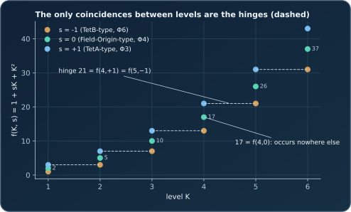
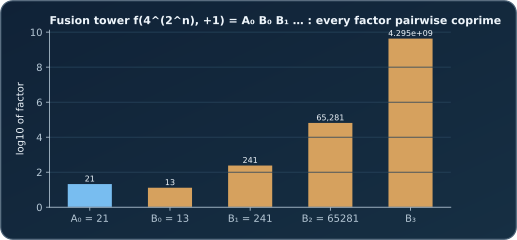
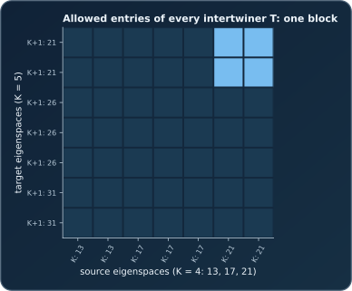

# GP-3 · The Coupling Signatures Are Forced, and the Hinge Is the Only Coincidence Between Levels

*Why 13, 17 and 21 are the only quadratic norm forms of roots of unity, why they never share a factor, how they fuse, and why "21 at the K=4 upper band equals 21 at the K=5 lower band" is the one and only link between levels · Great Pyramid core framework · Gravity Field Dynamics (GFD), exploratory*

`coupling-polynomial` `cyclotomic` `Niven` `finite-geometry` `PG(2,4)` `ovoid` `proof`

[](https://github.com/fielddynamics/research/actions/workflows/lean-great-pyramid-gp3.yml) [](verify_output.txt) [](LEAN_AUDIT.md) [](figures/) [](../../CORE_FRAMEWORK.md)

**Status.** Theorems 1–6 are **[T]**: proved below, with every step checked by [`verify_gp3_signatures_hinge.py`](verify_gp3_signatures_hinge.py) (47 checks, [output](verify_output.txt)). They are statements about integers, polynomials and finite fields. That these numbers *carry* physical couplings is the framework's reading (llms.txt, Rules 5–6), not something proved here.

---

## The question

The pyramid programme leans on three facts about $f(K,s) = 1 + sK + K^2$ (README §§3–5; notes [`01.1`](../../pyramid_portal_research/01_framework_foundations/01.1_cyclotomic_algebra.md), [`01.4`](../../pyramid_portal_research/01_framework_foundations/01.4_shift_identity_proof.md) and [Active Work 05](../../pyramid_portal_research/active_work/05_niven_and_mu_partition.md)):

- the values at $s = -1, 0, +1$ are the cyclotomic polynomials $\Phi_6, \Phi_4, \Phi_3$;
- $f(K,+1) = f(K+1,-1)$ (the "hinge");
- $\Phi_3(K)\Phi_6(K) = \Phi_3(K^2)$ (the "scale fusion").

The notes prove each identity. They do not prove the matching **converse** statements: that nothing else could play these roles, and that no other link between levels exists. This proof supplies the converses.

## Theorem 1 (the signatures are forced)

For a root of unity $\zeta$ of order $n$, and with $s = 2\cos\theta$,

$$|K + e^{i\theta}|^2 = K^2 + 2\cos\theta\,K + 1 = f(K, s).$$

The following are equivalent:

1. $f(K,s)$ has integer coefficients and is irreducible over $\mathbb Q$, with $e^{i\theta}$ a root of unity;
2. $s \in \{-1, 0, +1\}$;
3. the order is $n \in \{6, 4, 3\}$ (for $-e^{i\theta}$), i.e. $\varphi(n) = 2$;
4. $f(K,s) \in \{\Phi_6(K), \Phi_4(K), \Phi_3(K)\}$.

*Proof.*

- **$2\cos(2\pi k/n)$ must be an integer.** For $\gcd(k,n) = 1$ it is an algebraic integer of degree $\varphi(n)/2$ when $n \ge 3$, so it is rational only when $\varphi(n) \le 2$. This is Niven's theorem.
- **$\varphi(n) = 2$ forces $n \in \{3,4,6\}$.** The classical bound $\varphi(n) \ge \sqrt{n/2}$ gives $n \le 8$. The script checks the bound to $10^5$ and the cases $n \le 8$ exhaustively.
- **The endpoints are excluded.** $s = \pm2$ gives $(K\pm1)^2$, which is reducible.

So the three structural states are the only three non-degenerate choices. $\square$

**Theorem 1b (a shorter proof).** $s = \zeta + \bar\zeta$ is an algebraic integer. If it is rational it is an integer, and $|s| \le 2$. The endpoints $s = \pm 2$ give the reducible squares $(K \pm 1)^2$. For $s = -1, 0, +1$ the discriminants $s^2 - 4$ are $-3, -4, -3$, all negative, so the quadratics are irreducible over $\mathbb Q$. No totient search is needed. The hypothesis (an irreducible monic integer quadratic norm form of a root of unity) is still essential, and nothing here selects $K = 4$.

## Theorem 2 (the hinge is the only coincidence between levels)

For integers $K, K' \ge 1$ and $s, s' \in \{-1,0,+1\}$ with $(K,s) \ne (K',s')$:

$$f(K,s) = f(K',s') \iff \{(K,s),(K',s')\} = \{(k,+1),\ (k+1,-1)\}\ \text{for some } k \ge 1 .$$

*Proof.*

- **Same $s$:** $f(K+1,s) - f(K,s) = 2K + 1 + s > 0$.
- **$s = 0$ against $s' = \pm1$:** this needs $K^2 = K'(K' \pm 1)$. But $n(n+1)$ lies strictly between $n^2$ and $(n+1)^2$, and $n(n-1)$ strictly between $(n-1)^2$ and $n^2$ for $n \ge 2$. For $n = 1$ the product is 0. So $K^2$ cannot equal either.
- **$s = +1$ against $s' = -1$:** this needs $K(K+1) = (K'-1)K'$, and $n(n+1)$ is strictly increasing, so $K' = K+1$. $\square$

**Consequences at $K = 4$.**

- **17 belongs to $K = 4$ alone.** The neutral value $f(4,0)$ occurs at no other $(K,s)$. No Field Origin value of any level ever equals a charged value of any level.
- **13 and 21 each occur exactly twice.** $13 = f(3,+1) = f(4,-1)$ and $21 = f(4,+1) = f(5,-1)$. These are the hinges below and above $K = 4$.
- **The match at 21 is the only link between levels.** In the README's terms, the $K=4 \to K=5$ match is not one coincidence among many. It is the unique coincidence between the TetA band at $K=4$ and anything at another level. The script checks all coincidences for $K, K' \le 3000$, and finds 2999, every one a hinge.



## Theorem 3 (pairwise coprimality)

For every integer $K$, the three signatures $f(K,-1)$, $f(K,0)$, $f(K,+1)$ are pairwise coprime.

*Proof.*

- $f(K,1) - f(K,-1) = 2K$. Both values are odd, and both are $\equiv 1 \pmod K$, so their gcd is 1.
- $f(K,\pm1) - f(K,0) = \pm K$, and $\gcd(K^2+1, K) = 1$. $\square$

Also $f(K,+1) + f(K,-1) = 2f(K,0)$ (the identity $21 + 13 = 2\times17$). At every level, the three states share no common factor that a projection or attenuation could exploit.

## Theorem 4 (fusion and the tower)

$$f(K,+1)\,f(K,-1) = f(K^2,+1) = 1 + K^2 f(K,0),$$

$$f\!\left(K^{2^n},+1\right) = f(K,+1)\prod_{j=0}^{n-1} f\!\left(K^{2^j},-1\right).$$

These follow from $\Phi_3(X)\Phi_6(X) = \Phi_3(X^2)$ by induction. At $K = 4$:

$$21 \;\to\; 273 = 21\cdot13 \;\to\; 65\,793 = 21\cdot13\cdot241 ,$$

with the tower factors 21, 13, 241, 65281 pairwise coprime. The same 273 is $1 + K^2 + K^4$, the capacity in Proof 26's Theorem 7.

**Theorem 4b (the whole tower is pairwise coprime).** Write $A_n = f(K^{2^n}, +1)$ and $B_n = f(K^{2^n}, -1)$. Then $A_{n+1} = A_nB_n$, and $\gcd(A_n, B_n) = 1$ by Theorem 3. Every earlier factor divides $A_n$, so it is coprime to $B_n$. By induction, $A_0, B_0, B_1, B_2, \ldots$ are pairwise coprime for every $K$, with no enumeration needed. At $K = 4$: 21, 13, 241, 65281, …. Coprimality is arithmetic; it does not forbid physical interaction between sectors.



## Theorem 5 (finite-geometry counts, by exact enumeration)

For a prime power $q$, $|PG(2,q)| = q^2 + q + 1 = f(q,+1)$. Hence $f(K,-1) = f(K-1,+1) = |PG(2,K-1)|$ whenever $K-1$ is a prime power. The script builds $GF(3)$, $GF(4)$ and $GF(16)$ and counts directly:

| Object | Count | Signature |
|---|:-:|---|
| $PG(2,3)$ | 13 | $f(4,-1)$ (TetB) |
| $PG(2,4)$ | 21 | $f(4,+1)$ (TetA); 21 lines of 5 points, any two points on exactly one line |
| ovoid (elliptic quadric $x_0x_1 + x_2^2 + x_2x_3 + \omega x_3^2$) of $PG(3,4)$ | 17 | $f(4,0) = K^2+1$ (Field Origin); a cap: no three collinear |
| $PG(3,4)$ | 85 | $(K+1)\,f(K,0)$ |
| $PG(2,16)$ | 273 | $f(4,+1)\,f(4,-1)$ |

The hinge is visible here as geometry. TetB's 13 at $K = 4$ is the projective plane of order 3, and TetA's 21 is the plane of order 4: the next plane up, which is the TetB value at $K = 5$. The Field Origin's 17 is the ovoid of the order-4 space, the maximal cap. *Which* of these structures, if any, is physical is open. The counts are exact, but they are **cardinality models**: there is no canonical correspondence between these geometries (for instance, $PG(2,3)$ is not a subplane of $PG(2,4)$). A single register that carries all three signatures is the orientation-character construction of the I Ching research (`../../../i-ching/ORIENTATION_CHARACTER_AND_SEED_DUAL.md`). There, the 21 directions are the nonzero threefold orbits of $\mathbb F_4^3$, and a binary orientation involution has positive rank 17 and signed trace 13 on the same space.

## Theorem 6 (graded-trace realisation; inherited, restated)

On $T_K = \mathbf 1 \oplus V \oplus (V\otimes V)$ with $\dim V = K$:

- $\operatorname{Tr}(P_{\rm even} + sP_{\rm odd}) = f(K,s)$;
- an involution $J$ with $\operatorname{Tr}I = 21$ and $\operatorname{Tr}J = 13$ has multiplicities $(17,4)$, and these are forced;
- $\det\alpha^{\mathbb I_s} = \alpha^{17+4s}$.

These identities are in README §3, and in Proof 26 Theorem 7 as grade traces. The script re-checks them with explicit projectors for $K = 2,\ldots,5$.

**Theorem 6b (unitary rigidity).** Let $J$ be a self-adjoint involution on a 21-dimensional complex (or real) Hilbert space with $\operatorname{Tr}J = 13$. Then $J$ is unitarily (orthogonally) equivalent to $I_{17} \oplus (-I_4)$, by the spectral theorem and the multiplicities above. With $P_{\rm FO} = (I+J)/2$ and $P_{\rm odd} = (I-J)/2$, the operators $A_s = P_{\rm FO} + sP_{\rm odd}$ satisfy $A_{+1} = I$, $A_0 = P_{\rm FO}$ and $A_{-1} = J$, with traces 21, 17 and 13. So the "Field Origin" is the parity-even **projection** (rank 17). TetB's 13 is a signed trace, not the dimension of a 13-dimensional space. Unitary equivalence classifies the abstract operator; it does not pick a canonical basis relative to a specific Walsh read, and it does not show that any physical transfer is $\alpha^{A_s}$.

## Theorem 7 (every exact interlevel intertwiner lives on the hinge block)

Let $H_K$ and $H_{K+1}$ be shell operators whose eigenvalues are exactly the signatures $f(K, s)$ and $f(K+1, s')$, with spectral projectors $P_{K,s}$ and $P_{K+1,s'}$. For any linear map $T$ with $H_{K+1}T = TH_K$,

$$\bigl(f(K+1, s') - f(K, s)\bigr)\,P_{K+1,s'}\,T\,P_{K,s} = 0.$$

By Theorem 2, the only equality between the two spectra is $f(K, +1) = f(K+1, -1)$. Hence

$$\boxed{T = P_{K+1,-}\,T\,P_{K,+},}$$

and, conversely, every map supported on that block intertwines. The space of intertwiners is exactly $\operatorname{Hom}(E_{K,+}, E_{K+1,-})$. Its dimension is $\dim E_{K,+} \times \dim E_{K+1,-}$, which the script checks on 12 random multiplicity patterns. Two non-adjacent shells ($K \to K+2$) admit only $T = 0$.

Two cautions. First, $T = 0$ is always an intertwiner: matching bands do not imply a nonzero transition. Second, when the eigenspaces are larger than one-dimensional, choosing a particular $T$ needs a symmetry or dynamical selection rule. This is the complete solution space, not one chosen rank-one map. Reading shell labels as energies is still a premise.



## What this does not show

Nothing here selects $K = 4$. Theorems 1–4 hold at every $K$, and the dimension selection $2(D+1) = 2^D$ lives in [`proofs/hadamard-cube-frame/`](../../../../../proofs/hadamard-cube-frame/). Nothing here gives the hinge a Hamiltonian, an energy scale or a transition rate. Theorem 2 says the hinge is the *only* candidate interface between levels. It does not say the interface is physical.

## Verification

```bash
python verify_gp3_signatures_hinge.py    # 47 checks; ~30 s (finite-field enumeration)
```
