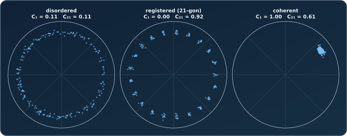
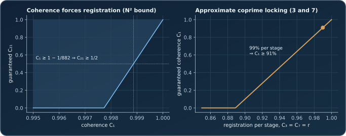
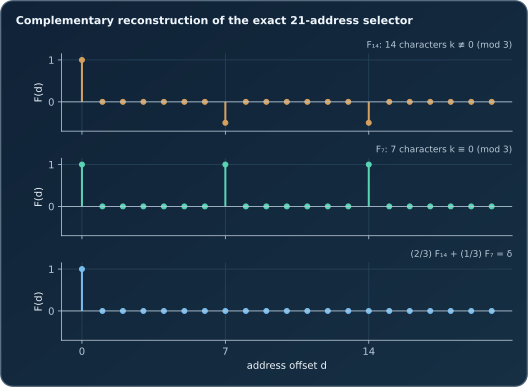

# GP-4 · Registration and Coherence of Phase Ensembles

*A population can be fully registered into 21 phase sectors with no net coherence. Coherence forces registration, with a sharp constant. Registering at 3 and at 7 separately is not the same as registering at 21: it is full coherence. And only the full character sum is an exact address selector · Great Pyramid core framework · Gravity Field Dynamics (GFD), exploratory*

`phase` `order-parameter` `roots-of-unity` `CRT` `Parseval` `selector` `proof`

[](https://github.com/fielddynamics/research/actions/workflows/lean-great-pyramid-gp4.yml)

**Lean.** 9 statements machine-checked in Lean 4 / Mathlib ([`lean/`](lean/), [audit](LEAN_AUDIT.md)).

**Status.** Theorems 1–5 and Proposition 6 are **[T]**: proved below, with every step checked by [`verify_gp4_registration_coherence.py`](verify_gp4_registration_coherence.py) (44 checks, [output](verify_output.txt)). The checks are exact where algebraic and use 50-digit numerics for the 21st roots of unity. Mapping these ensembles onto gravitational or apparatus states is **[E]** (README §8).

**Revision 2 (27 Nov 2026, after the [referee audit](../referee-audit/)).** The rotated-polygon phase convention is made explicit; an **approximate** coprime-locking theorem is added (Theorem 4b); the 14-character statement is corrected and completed by an exact 14 + 7 reconstruction (Theorem 5b); and a coercive amplitude-phase potential replaces the unstable one (Proposition 6b). Point-by-point: [`../REFEREE_RESPONSE.md`](../REFEREE_RESPONSE.md).

---

## Setting

A **phase ensemble** is a probability measure $P$ on the circle. Its harmonics are $m_k = \mathbb E[e^{ik\theta}]$, and

- the order-$N$ **registration** is $C_N = |m_N|$;
- the **coherence** is $C_1 = |m_1|$.

README §8 introduces this pair for $N = 21$ and gives three ideal ensembles. This proof turns that table into theorems and adds the quantitative links between the two order parameters.

## Theorem 1 (what registration means)

$C_N = 1$ if and only if $P$ is supported on a single coset $\theta_0 + \tfrac{2\pi}{N}\mathbb Z$ of the $N$-gon. For the uniform $N$-gon rotated by $\theta_0$, $m_k = e^{ik\theta_0}$ if $N \mid k$ and $m_k = 0$ otherwise. The unrotated polygon has $m_k = 1$ at multiples of $N$. Magnitudes do not see $\theta_0$, but addressing does, so the phase factor matters.

*Proof.* $|\mathbb E\,e^{iN\theta}| = 1$ exactly when $e^{iN\theta}$ is almost surely constant. The uniform-gon harmonics are the geometric sum $\sum_n \zeta^{kn}$. $\square$

## Theorem 2 (registration does not imply coherence)

For every $N \ge 2$ and every $t \in [0,1]$, the ensemble $(1-t)\cdot\text{uniform } N\text{-gon} + t\cdot\delta_0$ has $C_N = 1$ and $C_1 = t$.

So **full registration is compatible with every value of coherence**, including zero. This proves the README's table:

| Ensemble | $C_{21}$ | $C_1$ |
|---|:-:|:-:|
| uniform continuous | 0 | 0 |
| uniform 21-gon | 1 | 0 |
| single phase | 1 | 1 |



## Theorem 3 (coherence implies registration, with a sharp constant)

Let $\varphi = \arg m_1$ be the mean phase. Then

$$\boxed{\;1 - \operatorname{Re}\!\left(e^{-iN\varphi}\,m_N\right) \;\le\; N^2\,(1 - C_1)\;}$$

and so $C_N \ge 1 - N^2(1-C_1)$. The constant $N^2$ is sharp.

*Proof.* $1 - \cos Nx = 2\sin^2(Nx/2) \le 2N^2\sin^2(x/2) = N^2(1-\cos x)$, from $|\sin Nt| \le N|\sin t|$. That inequality holds because $\sin(Nt)/\sin t = U_{N-1}(\cos t)$ has sup norm $N$. Take expectations of $x = \theta - \varphi$. For sharpness, a symmetric pair at $\pm d$ has ratio $\to 1$ as $d \to 0$. $\square$

**Reading for $N = 21$.** Coherence must be within $1/882$ of perfect before registration is guaranteed to exceed $\tfrac12$. Coherence is therefore the much stronger property. The asymmetry runs one way: coherence forces registration (Theorem 3), but registration never forces coherence (Theorem 2).

## Theorem 4 (registration at coprime orders is coherence)

If $C_a = C_b = 1$, then $C_{\gcd(a,b)} = 1$. In particular, $C_3 = C_7 = 1$ implies $C_1 = 1$.

*Proof.* Bezout gives $1 = 7\cdot1 - 3\cdot2$, so $e^{i\theta} = e^{7i\theta}(e^{3i\theta})^{-2}$ is almost surely constant. In general, $\{t : e^{iat} = e^{ibt} = 1\}$ is exactly the $\gcd(a,b)$-gon. $\square$

**Why this matters for the programme.** README §6 builds a "21-sector phase architecture" from the group identity $\mathbb Z_3\times\mathbb Z_7 \cong \mathbb Z_{21}$ (three portcullis grooves × seven corbel courses). The group isomorphism is correct, and the script checks the CRT bijection. But the **registration conditions do not factor**:

- $C_{21} = 1$ means registration into 21 sectors, which can be incoherent;
- $C_3 = C_7 = 1$ (registration by the three-fold and the seven-fold stage separately) means a single phase, which is full coherence.

The uniform 21-gon has $C_{21} = 1$ but $C_3 = C_7 = 0$. A two-stage 3 × 7 filter that demands registration at each stage therefore selects coherent states. It does not select 21-sector registered ones. Any apparatus model must say which of the two it means.

**Theorem 4b (approximate coprime locking, from the referee).** Exact registration is never observed, so the useful statement is quantitative. Let $Z = e^{i\theta}$ and let $a_j$ be the unit phase of $m_j$. Then $\|Z^j - a_j\|_2 = \sqrt{2(1 - C_j)}$. Using $Z = Z^7\,\overline{Z^3}^{\,2}$ and $|z^2 - w^2| \le 2|z - w|$ for unit $z, w$,

$$\boxed{C_1 \ge \max\bigl\{0,\ 1 - [\sqrt{1 - C_7} + 2\sqrt{1 - C_3}]^2\bigr\}.}$$

With equal stages $C_3 = C_7 = r$ this gives $C_1 \ge 1 - 9(1 - r)$, so 99% registration in each stage guarantees at least 91% coherence. The bound is sufficient, not optimal. The script finds no violation in 3,000 random ensembles.



## Theorem 5 (the only exact selector; sidelobes otherwise)

$$\frac1N\sum_{k=0}^{N-1}e^{2\pi ik(a-b)/N} = \delta_{ab}.$$

For any nonempty $S \subsetneq \mathbb Z_N$, the filtered sum $F_S(d) = |S|^{-1}\sum_{k\in S}e^{2\pi ikd/N}$ is **not** $\delta_{d0}$. By Parseval, $\sum_d|F_S(d)|^2 = N/|S|$, so

$$\max_{d\ne0}|F_S(d)| \;\ge\; \sqrt{\frac{N/|S| - 1}{N-1}} > 0 .$$

*Proof.* If $F_S = \delta_0$, its inverse transform is constant, so $\mathbf 1_S$ is constant and $S = \mathbb Z_N$. The bound follows from Parseval with the $d = 0$ term removed. $\square$

**The 14-character case** (README §§8–9; "14 active / 7 suppressed"). Take $S = \{k : 3 \nmid k\}$, with $|S| = 14$. Then exactly

$$F_S(d) = \frac{21\,[21\mid d] - 7\,[7\mid d]}{14} = \begin{cases}1 & d = 0\\ -\tfrac12 & d = 7, 14\\ 0 & \text{otherwise.}\end{cases}$$

Its sidelobes have magnitude ½, well above the Parseval floor $\sqrt{1/40} = 0.158$. The scalar 14-character response therefore **does** separate a match (amplitude 1) from an alias (amplitude −½), by amplitude or phase. What it cannot do is separate the two aliases $d = 7$ and $d = 14$ from each other, so it is not an exact selector. (The earlier sentence, that it cannot tell an address from its translates, was too strong.)

**Theorem 5b (complementary reconstruction, from the referee).** The seven characters $k \equiv 0 \pmod 3$ give $F_7(d) = 1$ if $7 \mid d$ and $0$ otherwise. Recombined **coherently** with weights equal to the character counts,

$$F_{21}(d) = \tfrac23 F_{14}(d) + \tfrac13 F_7(d) = \delta_{d0}\quad\text{exactly},$$

since at each alias $\tfrac23(-\tfrac12) + \tfrac13(1) = 0$. Adding intensities instead cannot cancel the aliases: $\tfrac23|F_{14}|^2 + \tfrac13|F_7|^2 = \tfrac12$ at $d = 7$. For an apparatus the testable question is whether the "suppressed" seven-character sector is truly absent or available to a complementary read. The test is to measure complex transfer coefficients and look for this cancellation.



## Proposition 6 (the 21-fold lock potential)

$V = -\cos 21\theta$ has its minima exactly at $\theta_n = 2\pi n/21$. A population spread evenly over those minima is registered ($C_{21} = 1$) and incoherent ($C_1 = 0$). The README's caveat stands: a positive quartic term cannot stabilise a degree-21 term at large amplitude.

**Proposition 6b (a coercive candidate, from the referee).**

$$V(\Psi) = a|\Psi|^2 + b|\Psi|^4 + c|\Psi|^{22} - h(\Psi^{21} + \bar\Psi^{21}),\qquad c, h > 0.$$

With $\Psi = \rho e^{i\theta}$, $V = a\rho^2 + b\rho^4 + c\rho^{22} - 2h\rho^{21}\cos 21\theta$. The $\rho^{22}$ term makes $V$ bounded below. At any nonzero equilibrium amplitude the phase minima are $\theta_n = 2\pi n/21$, with angular stiffness $\partial_\theta^2 V = 882\,h\rho^{21}$. A nonzero equilibrium amplitude exists for suitable radial parameters (for example $a < 0$). This is a candidate model: dimension 21 does not by itself imply a cyclic $\mathbb Z_{21}$ symmetry, and the coefficient $h$ must come from the dynamics.

## What this does not show

It does not show that any physical system carries these phases, that 21 is the physical sector number, or that registration rather than coherence is what a gravitational or apparatus state needs. It fixes the mathematics those claims must respect.

## Verification

```bash
python verify_gp4_registration_coherence.py    # 44 checks; ~10 s
```
