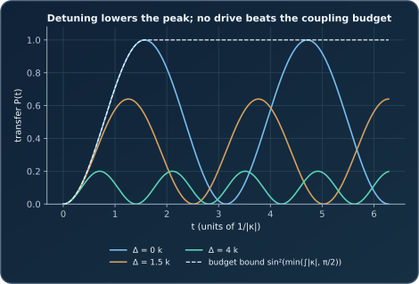
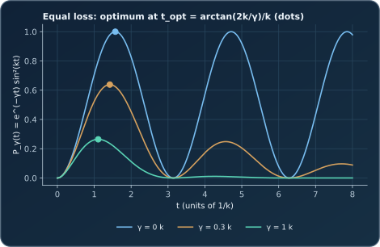
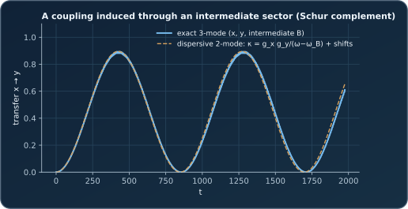
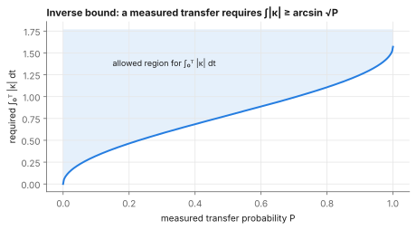

# GP-5 · Two-Site Transfer: Resonance Selects a Channel, It Does Not Create One

*For any two-site system, under any frequency programme, the transferred amplitude is bounded by the integrated coupling. With no coupling there is no transfer, whatever the resonance. The mirror-address mismatch is a genuine pseudometric, and the selector built on it can only slow a transfer · Great Pyramid core framework · Gravity Field Dynamics (GFD), exploratory*

`two-level-system` `Rabi` `quantum-speed-limit` `selector` `pseudometric` `proof`

[](https://github.com/fielddynamics/research/actions/workflows/lean-great-pyramid-gp5.yml) [](verify_output.txt) [](LEAN_AUDIT.md) [](figures/) [](../../CORE_FRAMEWORK.md)

**Status.** Theorems 1, 2, 6, 6b and 7, Corollaries 3 and 9 and Propositions 4, 5 and 8 are **[T]**: proved below, with every step checked by [`verify_gp5_transfer_bound.py`](verify_gp5_transfer_bound.py) (33 checks, [output](verify_output.txt)). The closed forms are checked symbolically; the time-dependent drives use exact matrix exponentials, to tolerance $10^{-12}$. The two-site Hamiltonian is an **illustrative model**, as README §9 says, not a derived GFD action. Every statement about a portal is therefore conditional on that model, and its coupling $\kappa$ is **[E]**.

---

## Setting

Two sites $x, y$ with amplitudes $c = (c_x, c_y)$ evolve as $i\,\dot c = H(t)\,c$, starting from $c(0) = (1, 0)$, with

$$H(t) = \begin{pmatrix}\omega_x(t) & \kappa(t)\\ \bar\kappa(t) & \omega_y(t)\end{pmatrix}.$$

The entries are bounded and measurable. The transfer probability is $P(t) = |c_y(t)|^2$, and the detuning is $\Delta = \omega_x - \omega_y$.

## Theorem 1 (constant coupling: the exact solution)

With $\Omega = \sqrt{\Delta^2 + 4|\kappa|^2}$ and $\bar\omega = (\omega_x+\omega_y)/2$:

$$c_x = e^{-i\bar\omega t}\left(\cos\tfrac{\Omega t}{2} - \tfrac{i\Delta}{\Omega}\sin\tfrac{\Omega t}{2}\right),\qquad c_y = -\,e^{-i\bar\omega t}\,\tfrac{2i\bar\kappa}{\Omega}\sin\tfrac{\Omega t}{2},$$

$$P(t) = \frac{4|\kappa|^2}{\Delta^2+4|\kappa|^2}\,\sin^2\frac{\Omega t}{2}.$$

The script checks symbolically that this solves the equation and conserves the norm. Consequences:

- the peak transfer is $4|\kappa|^2/(\Delta^2+4|\kappa|^2) \le \min(1, 4|\kappa|^2/\Delta^2)$;
- the peak equals 1 if and only if $\Delta = 0$ and $\kappa \neq 0$;
- the first complete transfer is then at $t = \pi/(2|\kappa|)$.

This is README §9's formula, now with a proof.

## Theorem 2 (the coupling budget, for every drive)

For every drive $H(t)$, with any detuning programme, any frequency sweep and any phase modulation of $\kappa$:

$$\boxed{\;|c_y(t)| \;\le\; \sin\!\Big(\min\Big\{\int_0^t|\kappa(s)|\,ds,\ \frac\pi2\Big\}\Big)\;}$$

A resonant constant drive attains the bound **up to the first complete transfer**, $t = \pi/(2|\kappa|)$. After that the constant drive falls back below the bound, which is then 1. Equality beyond that point needs the coupling to be switched off at the first full transfer.

*Proof.*

1. **Interaction picture.** Write $a_j = e^{i\int\omega_j}c_j$. This preserves $|c_j|$ and leaves $i\dot a = K(t)a$ with $K$ off-diagonal, $|K_{xy}| = |\kappa|$.
2. **Speed.** Since $|a| = 1$, $|\dot a| = |Ka| = |\kappa|$, so the curve $a(t)$ on the unit sphere $S^3 \subset \mathbb C^2$ has length $\int_0^t|\kappa|$.
3. **Distance.** The great-circle distance from $(1,0)$ to any unit vector with $|a_y| = \sin\beta$ ($\beta \in [0,\pi/2]$) is $\arccos({\rm Re}\,a_x) \ge \arccos|a_x| = \beta$, since ${\rm Re}\,a_x \le |a_x|$ and $\arccos$ is decreasing.
4. **Conclusion.** Length is at least distance, so $\beta(t) \le \int_0^t|\kappa|$. $\square$

## Corollary 3 (no coupling, no transfer)

- If $\kappa \equiv 0$, then $P \equiv 0$, for every $\omega_x(t)$ and $\omega_y(t)$. No resonance condition and no frequency programme can produce transfer from detuning alone.
- If $\sup|\kappa| \le k$, no drive completes the transfer before $t = \pi/(2k)$.

This is the precise content of README §9's sentence "resonance selects a channel; it does not create the channel". Tuning decides *how much* of an existing coupling is used: at most all of it, at the resonant rate. Within the ideal two-state model, the coupling budget $\int|\kappa|$ is the only resource. A physical apparatus also has power, control, energy and loss requirements, which this bound does not address.



## Proposition 4 (detuning tolerance)

With constant coupling, the peak transfer is at least $\eta$ if and only if

$$|\Delta| \le 2|\kappa|\sqrt{(1-\eta)/\eta}.$$

So 50% transfer needs $|\Delta| \le 2|\kappa|$, and 99% needs $|\Delta| \le 0.201|\kappa|$. This is the preregistration rule for a frequency-sweep test: the predicted peak width is set by the coupling, and it is not a free parameter.

## Proposition 5 (equal loss)

Adding equal loss $-i\gamma/2$ to both sites multiplies the transfer by $e^{-\gamma t}$ exactly. Loss is a second, independent cap on top of Theorem 2.



## Theorem 6 (the mirror-address mismatch and selector)

For triad Gram matrices, define $d_G(G_x, G_y) = \min_{P\in S_3}\|G_x - P^TG_yP\|_F$. Then:

- **$d_G$ is a pseudometric.** It is symmetric, and it satisfies the triangle inequality because the minimum is taken over a group of isometries of the Frobenius norm.
- **$d_G$ vanishes exactly on relabellings:** $d_G(G, P^TGP) = 0$.
- **The selector is bounded.** README §9's

  $$M_{xy} = e^{-d_G^2/2\epsilon^2}\cdot\tfrac{1-\chi_x\chi_y}{2}\cdot\cos^2\tfrac{\Theta_x-\Theta_y}{2}$$

  lies in $[0,1]$. It equals 1 if and only if $d_G = 0$, $\chi_x = -\chi_y$ and $\Theta_x \equiv \Theta_y \pmod{2\pi}$.
- **A mismatch lowers the budget.** With $\kappa = \kappa_0 M_{xy}$, Theorem 2 gives $P(t) \le \sin^2(\min\{\kappa_0M_{xy}t, \pi/2\})$. A mismatch lowers this **bound**, and an exact match only restores the bare rate $\kappa_0$; matching never adds a channel that $\kappa_0$ does not already supply. It does not follow that the instantaneous probability is lower at every late time, because Rabi oscillations can reverse that ordering.

**Theorem 6b (chirality must be tested inside the relabelling).** Minimising over all six permutations while testing handedness separately would be coordinate-dependent. An odd permutation reverses a triad's orientation while leaving its Gram matrix congruent: swapping two columns of an orthonormal triad keeps $G = I_3$ but flips $\det$. In the script, relabelling the receiver changes such a selector's verdict from 1 to 0. The selector must therefore test chirality with the **same** permutation:

$$M_{xy} = \max_{P\in\mathcal P}\Bigl[e^{-d_P^2/2\epsilon^2}\,\tfrac{1 - \chi_x\chi_y\det P}{2}\,L_P\Bigr],\qquad d_P = \|G_x - P^TG_yP\|_F,$$

with $L_P \in [0,1]$ the permutation-consistent phase factor. The script shows it is invariant under relabelling. One caveat remains. With full relabelling freedom, a symmetric Gram matrix (such as $I_3$) has odd automorphisms that undo the handedness test. So genuine chirality discrimination needs an intrinsically labelled, non-coplanar oriented frame, or a restricted relabelling group. Coplanar triads have no chirality sign, and a Gram matrix fixes relative angles, not absolute directions.

## Theorem 7 (a coupling induced by an intermediate sector)

Rather than insert $\kappa$ by hand, let the terminals (sector $A$) talk only through an intermediate sector $B$:

$$\mathcal H = \begin{pmatrix}H_A & V\\ V^\dagger & H_B\end{pmatrix}.$$

From the stationary equations, $b = (E - H_B)^{-1}V^\dagger a$ wherever the resolvent exists, which gives the exact Schur-complement reduction

$$\boxed{H_{\rm eff}(E) = H_A + V(E - H_B)^{-1}V^\dagger,\qquad \hbar\kappa^{\rm induced}_{xy}(E) = \langle v_x,(E - H_B)^{-1}v_y\rangle,}$$

with $v_x = V^\dagger|x\rangle$ and $v_y = V^\dagger|y\rangle$. Any direct term in $H_A$ adds separately, and the diagonal elements shift the resonance (self-energies).

- **Exactness.** Every eigenvalue $E$ of the full system is an eigenvalue of $H_{\rm eff}(E)$; the script checks this on 40 random systems.
- **Dispersive limit.** For one detuned intermediate mode, $\kappa = g_x\bar g_y/(\omega - \omega_B)$, with shifts $|g_{x,y}|^2/(\omega - \omega_B)$. The three-mode dynamics reproduce it. Near $\omega = \omega_B$ the resolvent is singular, so the full system must be solved instead.
- **Zero-channel countermodel.** If the intermediate dynamics are block-local with disjoint supports for $v_x$ and $v_y$, then $\kappa^{\rm induced} = 0$ exactly, however well the signatures match.

This turns "$\kappa_0$ is unknown" into three derivable objects: $H_B$, the local vertices $v_x, v_y$, and a propagator with a nonzero off-diagonal element between separated sites. That is a research route, not a demonstration of an intersite interaction.



## Proposition 8 (optimum transfer under equal loss)

At resonance with equal loss, $P_\gamma(t) = e^{-\gamma t}\sin^2(kt)$, with $k = |\kappa|$. The first maximum is the global one:

$$t_{\rm opt} = \frac1k\arctan\frac{2k}{\gamma},\qquad P_{\rm opt} = \frac{4k^2}{\gamma^2 + 4k^2}\exp\Bigl[-\frac{\gamma}{k}\arctan\frac{2k}{\gamma}\Bigr],$$

which tends to $\pi/(2k)$ and 1 as $\gamma \to 0$. Both the coupling rate and the loss must be measured. A high quality factor helps, but it is no substitute for a nonzero coupling.

## Corollary 9 (inverse bound, for experiments)

Within the two-site model, a measured transfer probability $P$ by time $T$ requires

$$\int_0^T|\kappa(t)|\,dt \ge \arcsin\sqrt P,\qquad \operatorname*{ess\,sup}_{[0,T]}|\kappa| \ge \frac{\arcsin\sqrt P}{T}.$$

This is a lower bound on the coupling that a positive result implies. A null result constrains only specific calibrated models of drive, detuning, loss and observation time.



## What this does not show

It does not supply $\kappa_0$, a mechanism for it, or any claim that it is nonzero between distant sites. Any nonlocal coupling would also need a covariant, causal theory, which the two-site model does not have. What it does show is this: **every positive transfer claim reduces to a measurement of $\int|\kappa|$**, made after conventional channels are excluded. That is the anomaly README §9's control table is built to detect.

## Verification

```bash
python verify_gp5_transfer_bound.py    # 33 checks; ~4 s
```
