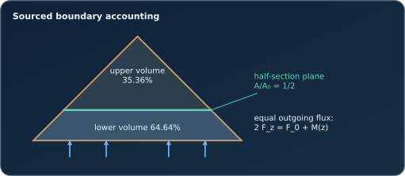
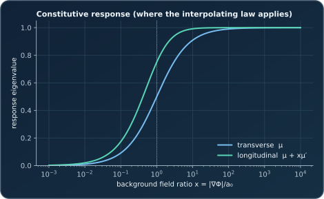
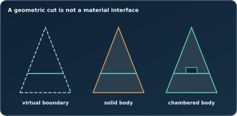

# GP-6 · Structural boundary response and sourced closure

*Whether the half-section plane has any consequence beyond geometry: the sourced flux balance from the action, its exact correction at Giza, the constitutive Hessian, boundary reciprocity, and why a geometric cut is not a material interface · Great Pyramid core framework · Gravity Field Dynamics (GFD), exploratory*

`sourced-flux` `boundary-variation` `Dirichlet-to-Neumann` `reciprocity` `scale-law` `proof`

[](verify_output.txt) [](#verification) [](figures/) [](../../CORE_FRAMEWORK.md)

**[T]** mathematical statements for the inherited quasistatic model; **[D]** idealized calculations; **[E]** physical interpretation. Extends GP-1 and GP-2. The objective is to test whether the structural balance plane has an observable consequence beyond geometry. No new field or parity device is introduced.

## Task and acceptance criteria

Derive the source-aware boundary law from the existing action; bound its correction at Giza; derive the linearized boundary response and reciprocity; distinguish physical material interfaces from imaginary cuts. The remaining numerical task is a fully surveyed 3D geometry with explicit material/source and boundary data. This draft does not pretend such a simulation has been performed.

## 1 · Boundary term and sourced accounting [T]

Use the inherited scalar action (01.7), with potential $\Phi$, $y=|\nabla\Phi|^2/a_0^2$, and $F'(y)=\mu(\sqrt y)$:

$$S=-\int_B [a_0^2 F(y)/(8\pi G)+\rho\Phi]dV.$$

Assume a bounded Lipschitz domain, sufficiently regular potential and integrable source (or the corresponding weak formulation). Variation at fixed density gives

$$\delta S=\int_B (\nabla\cdot\mathbf J-\rho)\delta\Phi\,dV-\int_{\partial B}(\mathbf J\cdot n)\delta\Phi\,dA,\qquad \mathbf J=\mu\nabla\Phi/(4\pi G).$$

Thus the field equation is $\nabla\cdot\mathbf J=\rho$. The kinetic shift symmetry does not imply source-free current in stone. On the frustum below $z$, let $F_0$ be the upward base flux, $F_z$ upward top flux, and $L_z$ outward lateral flux. Then

$$F_z+L_z=F_0+M(z),\qquad M(z)=\int_{V(z)}\rho\,dV.$$

Equal outgoing flux holds **if and only if** $2F_z=F_0+M(z)$. The source-free half-section condition $2F_z=F_0$ is a different condition, except where $M(z)=0$. For the whole volume, air cavities simply carry their own density (approximately zero); for a stone-only volume an additional term for internal cavity-wall flux must be retained. Do not count fictitious flux losses across a material cut.



## 2 · Exact idealized source correction [T/D]

Let $u=z/h$, $A=A_0(1-u)^2$, with uniform density $\rho$. Then $M(u)=\rho A_0h[1-(1-u)^3]/3$. Write $r(u)$ for mean axial current divided by its base mean, and $m=\rho A_0 h/(3F_0)>0$. The equal-outgoing-flux equation becomes

$$2(1-u)^2r(u)=1+m[1-(1-u)^3].$$

Under continuity, $r(0)=1$, and bounded $r$, a root exists between base and apex. If $(1-u)^2r(u)$ is strictly decreasing and $\rho\ge0$, it is unique. Without monotonicity do not assert uniqueness. With $|r-1|\le\epsilon<1$ and $0\le M/F_0\le m$ every root lies in

$$\max(0,1-\sqrt{(1+m)/(2(1-\epsilon))})\le u\le1-1/\sqrt{2(1+\epsilon)}.$$

Proof: rearrange the balance equality to $(1-u)^2=(1+M/F_0)/(2r)$ and apply the two interval bounds. This extends GP-2 to sourced outgoing-flux equality without fitting a parameter.

For a fixed flux profile with a simple half-section root $u_h$, introduce a bookkeeping parameter $t$ multiplying the mass term. By implicit differentiation the outgoing-root derivative is $du/dt=M(u_h)/(2F'_z(u_h))$, with derivative with respect to $u$ and all fluxes held fixed. This compares two root definitions, not the physical operation of turning on mass (which would also change $F_z$). In the nearly uniform approximation $F_z/F_0\simeq(1-u)^2$, $u_h\simeq1-1/\sqrt2$:

$$\delta z\simeq -\frac{hm}{2\sqrt2}(1-2^{-3/2}).$$

Use the inherited Phase 0 constants $h=5776$ in, $a=9068.8$ in, $\rho=2300$ kg/m³, $g=9.7929$ m/s², $G=6.674\times10^{-11}$ SI, and $F_0\simeq gA_0/(4\pi G)$. Then $m\simeq9.633\times10^{-6}$ and the first-order **difference between root definitions** is −0.01272 inches. This is not a new self-field simulation or a correction to the reported 0.82-inch residual. The actual flux profile and survey uncertainties still govern the absolute location.

An exact sourced witness is $\mathbf J=(0,0,j_0+\rho z)$, whose divergence is $\rho$. Its section share is $(1-u)^2(1+3mu)$, so both root definitions can be solved without approximating the profile. This is a mathematical witness, not the pyramid's physical gravity solution.

## 3 · Constitutive Hessian [T]

In a region where the inherited interpolating law applies, set $x=|\nabla\Phi_0|/a_0>0$ and $e=\nabla\Phi_0/|\nabla\Phi_0|$. Differentiating the current gives

$$4\pi G\,\delta\mathbf J=K\nabla\varphi,\qquad K=\mu I+x\mu'ee^T.$$

For $\mu=x/(1+x)$ the transverse eigenvalue is $x/(1+x)$ and the longitudinal one is $1-(1+x)^{-2}$. Their ratio is $2-\mu$. Both are positive for $x>0$. Uniform ellipticity needs a positive lower bound on $x$; the zero-field limit is degenerate. At Giza the inherited net-field rule instead gives $\mu_g=1$, $K=I$ in its stated drainless regime. Do not substitute $\mu_B=1/2$ into this gravitational Hessian. GP-2 T8 explicitly rules that out.



## 4 · Boundary reciprocity, positivity and absence of an automatic neutral mode [T]

On a connected Lipschitz domain with uniformly positive bounded symmetric $K$, fix density and prescribe Dirichlet data $f$ for $\nabla\cdot(K\nabla\varphi)=0$. Let $\Lambda f=n\cdot K\nabla\varphi$ in the weak trace sense. Green's formula gives

$$\langle f,\Lambda g\rangle=\int_B\nabla\varphi_f\cdot K\nabla\varphi_g\,dV=\langle g,\Lambda f\rangle$$

for real data (Hermitian pairing for complex data). Positivity follows on taking $f=g$; zero quadratic form implies $\nabla\varphi_f=0$, hence $f$ constant. Uniqueness and existence of the weak solution follow from coercivity on $H^1_0$ and the trace extension theorem. For a finite port basis with independent nonconstant traces modulo constants the response matrix is positive definite. It cannot have an exact four-dimensional kernel merely because a chosen cut has half the flux. This is a discriminator against equating an arbitrary positive static response with the GP-3 rank-17 projection.

If an actual interface is introduced, continuity of potential and normal flux (absent a surface source) follow from the weak equation with appropriate piecewise coefficients. An imaginary internal cut leaves the solution unchanged: summing the weak integrals from both regions cancels the opposite internal normals. This proves that a geometric half-flux cut is not in itself a physical interface. A material discontinuity, a source, or an independently derived driven field is needed for a physical response difference.



## 5 · Scale law [T]

For a homothetic domain scaled by $s>0$, uniform-current flux scales as $s^2$, mass at fixed density as $s^3$, and the source-to-background ratio $m$ scales as $s$ at fixed background $g$. For constant $K$ and identical boundary potential patterns under pullback, the Dirichlet energy and integrated port response scale as $s$ in 3D; flux density scales as $s^{-1}$. Proof: $\nabla_x=s^{-1}\nabla_\xi$, $dV=s^3d\xi$, $dA=s^2dA_\xi$. These are different experiments (fixed current vs fixed potential). Geometric balance is invariant, dynamical operation is not automatically invariant.

## 6 · Next experiment [E]

Compare virtual cut, solid body and surveyed chambered body. Use GP-2's actual gravitational budget as a control, and the Phase 0 dielectric-model result (~61 m, not 42.97 m) as evidence that the type of imposed field matters. Specify a driven field, source, boundary data, measured material parameters and sensor observables before fitting. The static scalar model alone gives no special rank-17 local channel. A nonzero geometry-to-registration coupling must be separately derived from the native action or measured.

Sources: [GP-1](../gp1-half-section-balance-plane/) / [GP-2](../gp2-balance-plane-robustness/); [01.7](../../pyramid_portal_research/01_framework_foundations/01.7_areal_closure_from_action.md); [Phase 0](../../pyramid_portal_research/phase0/P0.1_field_model_results.md).  No Lean formalization yet.

## Verification

```bash
python verify_gp6_boundary_response.py    # 9 named checks (each loop of random witnesses counts as one)
```

The checks verify the stated mathematical identities and numerical evaluations, not the physical premises or a full-pyramid simulation. No Lean formalisation yet.
