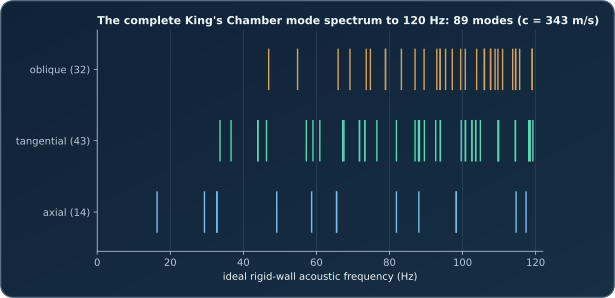
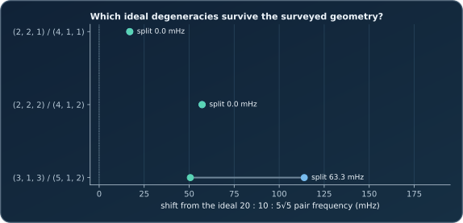
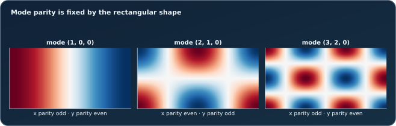

# GP-7 · Chamber spectral selection and symmetry

*What the King's Chamber's measured dimensions alone determine about its acoustic modes: the complete rigid-wall spectrum, exact degeneracy arithmetic, which degeneracies survive the survey, reflection-parity selection, and why the box has no 21-fold symmetry · Great Pyramid core framework · Gravity Field Dynamics (GFD), exploratory*

`Helmholtz` `Neumann-modes` `degeneracy` `parity-selection` `King's-Chamber` `proof`

[](verify_output.txt) [](#verification) [](figures/) [](../../CORE_FRAMEWORK.md)

**[T]** standard wave-equation consequences for the specified rectangular model; **[D]** numerical predictions from surveyed dimensions; **[E]** physical linkage to GFD closure. Builds on GP-3 and GP-4 without assuming the chamber has 21 physical modes.

## Task

Use the measured chamber dimensions to determine naturally occurring acoustic mode degeneracy, parity and sensitivity. Determine what follows from the geometry, and which spectral-selection claims need extra dynamics. Later include the coffer, entrance, shafts, granite elasticity and coupled rooms using surveyed geometry and measured impedances, not arbitrary fit constants.

## 1 · Complete spectrum [T]

For homogeneous air in a rectangular chamber of dimensions $L,W,H$, rigid stationary walls impose Neumann conditions on acoustic pressure. The separated Helmholtz modes are

$$p_n(x,y,z)=N_n\cos(n_x\pi x/L)\cos(n_y\pi y/W)\cos(n_z\pi z/H),$$

$$f_n=\frac{c_s}{2}\sqrt{n_x^2/L^2+n_y^2/W^2+n_z^2/H^2},\quad n_i\in\mathbb N_0,\ n\ne0.$$

Completeness follows from the tensor product of the complete one-dimensional Neumann cosine bases. The zero mode is a static uniform pressure shift, not an oscillatory resonance. One, two and three nonzero indices give axial, tangential and oblique modes. Omitting the first two families gives an incomplete spectrum. Dirichlet walls would instead use sine modes and positive indices; that is a different physical boundary condition.

Petrie's dimensions as reported in 04.2: 412.24 ±0.12, 206.12 ±0.12, 230.09 ±0.15 inches (floor-to-ceiling). The wall-base-to-ceiling height is a different measured quantity. For nominal dimensions and assumed $c_s=343$ m/s, the first three axial fundamentals are approximately 16.38, 32.76 and 29.34 Hz, respectively. Frequency values are predictions of the ideal box, not measured chamber resonances. In a 120 Hz illustrative instrument band the complete model contains 89 modes counted with multiplicity: 14 axial, 43 tangential, 32 oblique. The band is illustrative, not a physical cutoff or a GFD count.



## 2 · Exact degeneracy arithmetic and measured splitting [T/D]

For the ideal ratio $L:W:H=20:10:5\sqrt5$ the normalized squared frequency is

$$Q(n)=(2Lf_n/c_s)^2=n_x^2+4n_y^2+\tfrac{16}{5}n_z^2.$$

Therefore two indices share frequency iff the integers $5n_x^2+20n_y^2+16n_z^2$ agree. Reducing equality modulo 5 yields $n_z'\equiv\pm n_z\pmod5$. Reducing modulo 4 shows equal parity of $n_x$. These necessary tests are not by themselves sufficient; the full integer equality decides. Any degeneracy can be enumerated exactly in a specified bounded frequency band by using nonnegative integers, with no chosen number of modes.

The ideal 2:1 floor ratio gives $(2,2,k)$ and $(4,1,k)$ the same $Q=20+16k^2/5$ for every $k\ge0$. These pairs remain degenerate at the nominal surveyed ratio $412.24/206.12=2$, independently of the surveyed height; measurement tolerances allow a small split. In contrast $(3,1,3)$ and $(5,1,2)$ are degenerate only at the ideal height ratio: $9+4+144/5=25+4+64/5$.

| Pair | Ideal frequency (Hz) | Surveyed nominal frequencies (Hz) | Split |
|---|---:|---:|---:|
| (2,2,1) / (4,1,1) | 78.8904 | 78.9074 / 78.9074 | 0 nominal |
| (2,2,2) / (4,1,2) | 93.8031 | 93.8603 / 93.8603 | 0 nominal |
| (3,1,3) / (5,1,2) | 105.8933 | 106.0072 / 105.9439 | 0.06327 Hz |

The third splitting corresponds to a beat period of about 15.8 s if both modes are coherently excited. Acoustic wall compliance, coupling to passages and temperature gradients can also shift/split these frequencies. Do not mistake these ideal values for measurements.



## 3 · Symmetry selection [T]

A rectangular box with three distinct lengths has the eight isometries generated by independent midplane reflections: $C_2^3$. Each mode transforms with character $((-1)^{n_x},(-1)^{n_y},(-1)^{n_z})$. This follows from $\cos(n\pi(1-t))=(-1)^n\cos(n\pi t)$. If a source $s$ has a definite reflection character, $\int_B s p_n\,dV=0$ whenever any parity differs. The same holds for a symmetric receiver. The equal-frequency pair $(2,2,k)$ / $(4,1,k)$ differs in y parity, so a symmetric/antisymmetric source can separate them even at exact frequency match. The third pair differs in z parity. This is a real selection rule, unlike selecting 21 modes by count.



The box has no spatial isometry of order 3, 7 or 21; all its elements square to identity. Therefore the rectangular geometry alone cannot force the cyclic phase action in GP-4. Nonlinear internal dynamics, additional apparatus symmetry or a non-geometric field representation could in principle have such a group, but must be derived separately. Symmetry-breaking openings generally relax selection rules rather than establishing a new exact 21-fold symmetry of the box.

## 4 · Sensitivity and resolvability [T]

Differentiation gives $d\ln f=d\ln c_s-\sum_i w_i d\ln L_i$, where $w_i=(n_i/L_i)^2/\sum_j(n_j/L_j)^2$ and $\sum w_i=1$. At fixed sound speed, a uniform relative scaling changes every frequency by the inverse factor. At independent bounded dimension uncertainties, calculate rigorous interval bounds by evaluating all lengths at their upper and lower limits (frequency monotone decreasing in each). Splitting intervals can be bounded conservatively by subtracting the individual intervals; correlation in dimensions can sharpen the bounds.

For a narrow isolated lightly damped mode with measured quality factor $Q_c$, its approximate linewidth is $f/Q_c$. Resolving a 0.06327 Hz split around 106 Hz suggests $Q_c$ of order 1675 or greater (linewidth smaller than separation; measurement resolution and overlap also matter). Beat observation additionally requires coherent excitation and observation lasting roughly a beat period. This is a conditional experimental target, not a claim about the actual chamber quality factor.

## 5 · Extension to connected chamber geometry [T/E]

For a connected air domain with rigid outer walls, solve the Neumann Helmholtz problem on the actual cavity geometry. The variational eigenvalues follow the Rayleigh quotient $\int|\nabla p|^2/\int|p|^2$ with appropriate orthogonality constraints. Complex impedance and elastic wall coupling require a larger, generally frequency-dependent model. A sealed granite relieving space cannot be treated as acoustically connected merely because it lies above the chamber; coupling through elastic stone must be included. Compare full complex transfer measurements with the rigid-box baseline. Only a measured or derived character-resolved response can justify applying GP-4's coherent selector.

Sources: [04.2 King's Chamber](../../pyramid_portal_research/04_apparatus_engineering/04.2_kings_chamber_vertex.md); [AW-22](../../pyramid_portal_research/active_work/22_kc_kinematics.md); [AW-21 retraction](../../pyramid_portal_research/active_work/21_retraction_chamber_trio.md); [GP-4](../gp4-registration-and-coherence/).  No 3D acoustic simulation or Lean compilation yet.

## Verification

```bash
python verify_gp7_chamber_spectrum.py    # 9 named checks (each loop of random witnesses counts as one)
```

The checks verify the stated mathematical identities and numerical evaluations, not the physical premises or a full-pyramid simulation. No Lean formalisation yet.
