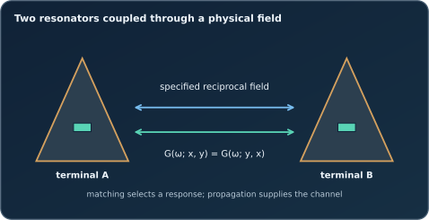
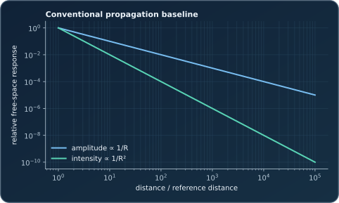
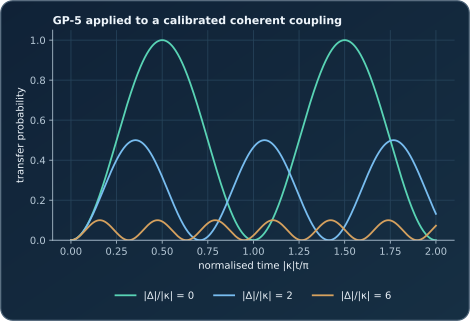

# GP-8 · Reciprocal resonator matching and the propagation baseline

*What two matched resonators can exchange through a named, physical field: reciprocity, a finite-aperture distance bound, matching as necessary but not sufficient, the mediator overlap bound, and causal delay · Great Pyramid core framework · Gravity Field Dynamics (GFD), exploratory*

`Green-function` `reciprocity` `range-bound` `Cauchy-Schwarz` `causality` `proof`

[](verify_output.txt) [](#verification) [](figures/) [](../../CORE_FRAMEWORK.md)

**[T]** mathematical field and spectral results; **[D]** ideal reciprocal scalar-wave baseline; **[E]** Stargate extension remains an unproven hypothesis. Builds on GP-5, GP-6 and GP-7. Matching cannot create a channel.

## Task

Derive what a pair of matching pyramidal resonators could exchange through a specified, known wave field. Separate geometry, detuning, source/receiver overlap, propagation, dissipation and causal delay. A conventional scalar acoustic wave in homogeneous unbounded air is the initial mathematical control; it is not a model of interplanetary vacuum acoustics. No physical TetB mediator or coupling constant is introduced.

## 1 · Reciprocity and coupling through a named field [T]

For a frequency-domain wave with time convention $e^{-i\omega t}$, write $(\nabla^2+k^2)u=-s$, $k=\omega/c_s$, with outgoing radiation in homogeneous free space. The Green function is

$$G_k(x,y)=e^{ik|x-y|}/(4\pi|x-y|).$$

Indeed away from the origin its radial Helmholtz derivative vanishes, while the singular $1/(4\pi r)$ term has distributional Laplacian $-\delta$. The outgoing condition selects the sign of the exponential. $G_k(x,y)=G_k(y,x)$. For real source/receiver test functions $q_i$ define a modal transfer kernel

$$C_{ij}(\omega)=\int\!\int q_i(x)G_k(x,y)q_j(y)\,dy\,dx.$$

The source/receiver roles can be exchanged by swapping integration variables: $C_{ij}=C_{ji}$. In a reciprocal but radiating system this is complex symmetry, not necessarily Hermiticity. A more general reciprocal Green operator follows from the bilinear Green identity with reciprocal boundary conditions. A two-mode lossless Hermitian Hamiltonian as in GP-5 is a separate conservative approximation: to identify $\kappa$ with a multiple of $C_{xy}$ one must specify modal normalization, physical port coupling coefficients, frequency scale and the regime in which radiation loss and retardation may be reduced to local dynamics. The integral alone does not supply a frequency-valued $\kappa$.



## 2 · Finite-aperture distance bound [T]

Let the source and receiver supports lie in balls of radii $a,b$ with centres separated by $R>a+b$. Then $|x-y|\ge R-a-b$. For real $k$ and integrable $q_i$ the triangle inequality gives

$$|C_{xy}|\le \frac{\|q_x\|_1\|q_y\|_1}{4\pi(R-a-b)}.$$

For outgoing waves with $\operatorname{Im}k\ge0$ the bound includes the extra factor $e^{-\operatorname{Im}k(R-a-b)}$. A point monopole yields the exact $1/R$ amplitude law; intensity of a freely propagating spherical wave scales as $1/R^2$. Directional beams and bounded media require their own Green functions, so this is not a universal range law for all possible systems. No scaling can be extrapolated from air to interplanetary vacuum without a physical field that actually propagates there.



## 3 · Spectral matching is necessary for large exchange in GP-5, not sufficient [T]

For a calibrated conservative two-mode reduction, let $\kappa$ be coupling in rad/s and $\Delta=\omega_x-\omega_y$. GP-5 gives $P_{\max}=4|\kappa|^2/(\Delta^2+4|\kappa|^2)$ for nonzero constant coupling. Requiring $P_{\max}\ge\eta\in(0,1]$ is equivalent to

$$|\Delta|\le 2|\kappa|\sqrt{(1-\eta)/\eta}.$$

If matching terminals have the same shape but linear scales $s_x,s_y$ and sound speeds $c_x,c_y$, corresponding ideal eigenfrequencies satisfy $f_y/f_x=(c_y/c_x)(s_x/s_y)$. To match one corresponding mode, the acoustic speeds must scale with dimensions; geometry alone is insufficient. Even exact equality of frequencies does not supply overlap with the propagating field. A source/receiver pair of different parity in a reflection-invariant environment has $C_{xy}=0$ exactly: substitute the reflection in both variables and the integral changes sign. Identical chambers may therefore have a forbidden channel.



## 4 · Mediator overlap bound [T]

For a finite self-adjoint intermediate operator $H_B$ and real energy $E$ below its entire spectrum, define $A=(H_B-E)^{-1}>0$. With GP-5's local vectors $v_i$, induced self-energy is $-v_i^\dagger A v_i$ and cross-coupling is $-v_x^\dagger A v_y$. Cauchy–Schwarz in the $A$ metric gives

$$|v_x^\dagger A v_y|^2\le(v_x^\dagger A v_x)(v_y^\dagger A v_y).$$

Equality occurs iff the two nonzero vectors are proportional, because $A^{1/2}$ is invertible. This is a precise condition for maximally overlapping off-resonant terminals at fixed self-energy magnitudes. It applies below the spectrum (also above, after sign reversal); an indefinite resolvent in a spectral gap does not obey this particular bound. This extends GP-5 T7 without identifying an arbitrary intermediate space with TetB.

## 5 · Causal delay [T]

The retarded Green function for the scalar wave operator $(c_s^{-2}\partial_t^2-\nabla^2)$ in three spatial dimensions is $\delta(t-|x-y|/c_s)/(4\pi|x-y|)$. A source switched on at $t=0$ produces no causal change at the receiving support before $(R-a-b)/c_s$. A stationary shared-frequency description does not remove this delay. The same logic applies to the causal wavefront of conventional electromagnetic propagation with its appropriate speed and vector Green tensor. An effectively instantaneous two-mode approximation must be used only in a regime where the retardation is negligible for the timescale of interest; it cannot be used to infer faster-than-light signaling. A proposed hidden sector must supply its own covariant causal dynamics and conservation laws.

## 6 · Experimental task and pass criteria [E]

Use two calibrated geometrically similar resonators, with a controlled ordinary acoustic or electromagnetic coupling path, not the archaeological monument as a first experiment. Measure each isolated frequency, modal profile and decay rate; measure complex cross-transfer and propagation delay; change separation, orientation, phase and coupling-path attenuation independently; compare with the calibrated model and GP-5 coupling budget. Measure sham/source-off and disconnected cases, environmental noise and leakage. Reciprocal amplitude, matched frequencies or an unusual resonance alone do not establish a hidden channel. A residual needs reproducible statistical evidence and a native-action prediction before attribution. Even verified excitation transfer would not establish matter transport.

Sources: [GP-5](../gp5-two-site-transfer-bound/); [GP-6](../gp6-structural-boundary-response/) and [GP-7](../gp7-chamber-spectral-selection/). Standard Helmholtz/retarded wave Green functions and Cauchy–Schwarz are derived/applied above. No experiment, native TetB propagator or Lean proof completed.

## Verification

```bash
python verify_gp8_reciprocal_matching.py    # 6 named checks (each loop of random witnesses counts as one)
```

The checks verify the stated mathematical identities and numerical evaluations, not the physical premises or a full-pyramid simulation. No Lean formalisation yet.
