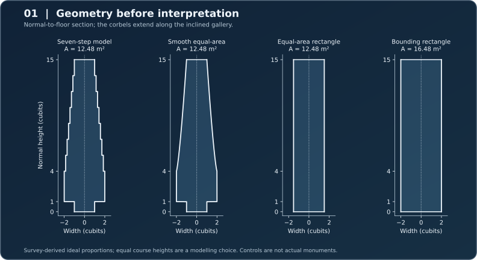
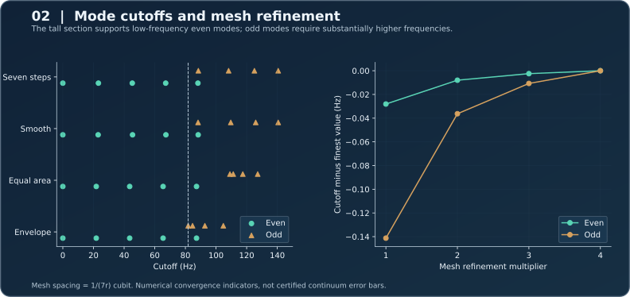
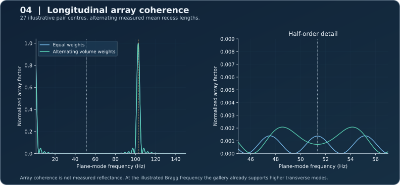
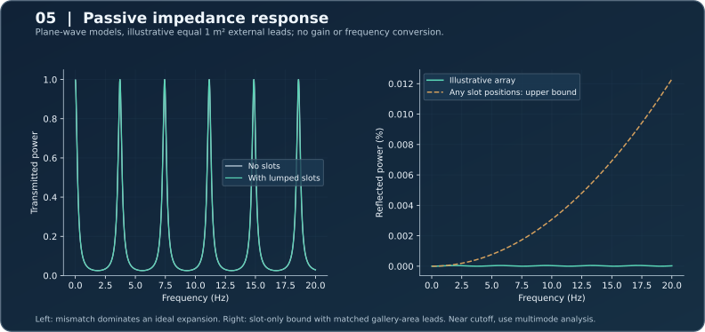
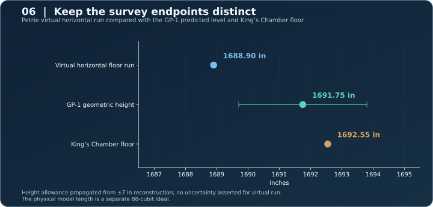
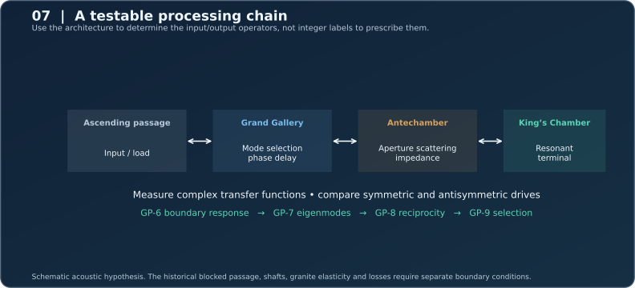

# GP-9 · Grand Gallery spectral selection and passive scattering

*What the gallery's cross-section forces in ordinary rigid-wall acoustics: modal decomposition and reflection parity, an analytic parity-selective band, the finite-array law, a reciprocal lossless network, a position-independent slot bound, similarity scaling and the boundary-to-spectrum link · Great Pyramid core framework · Gravity Field Dynamics (GFD), exploratory*

`Neumann-Laplacian` `parity` `Rayleigh-bounds` `array-factor` `transfer-matrix` `reciprocity` `proof`

[](verify_output.txt) [](results/verify_output.txt) [](#verification) [](figures/) [](../../CORE_FRAMEWORK.md)

The research that precedes this proof is in [RESEARCH.md](RESEARCH.md); the numerical tables are in [RESULTS.md](RESULTS.md); inputs and their provenance are in [SOURCES.md](SOURCES.md). The theorems were written after the 100-case test suite passed. Builds on [GP-6](../gp6-structural-boundary-response/), [GP-7](../gp7-chamber-spectral-selection/) and [GP-8](../gp8-reciprocal-resonator-matching/).

**Scope.** [T] mathematical theorems of a specified rigid-wall linear acoustic model; [N] (numerical; used only in GP-9) finite-volume calculations of a survey-informed idealization; [O] published archaeological dimensions; [E] proposed historical or GFD physical function. The mathematical proof does not identify acoustic parity with the GFD parity operator. No new GFD constant or force law is introduced. GP-1–8 are unchanged. This is not Lean-certified.

## Setting

Let Ω be a bounded connected Lipschitz cross-section symmetric about x=0, with almost every horizontal slice a single interval (−w(y),w(y)), w(y)>0. Let Wmax=2 ess sup w. The guide interior is Ω×(0,ℓ); x,y are transverse coordinates and s is the longitudinal coordinate. Homogeneous air of density ρ and sound speed c>0 obeys linear acoustics with rigid walls. The model excludes mean flow, active gain, time modulation, moving stone and arbitrary unidentified coupling. End conditions are specified separately. For the Great Pyramid application, use the ideal 15-cubit normal-height cross-section in [the research note](RESEARCH.md), not the vertical plumb height. SI lengths follow from the adopted cubit a=0.5240528 m.



## Theorem 1 — Exact modal decomposition and reflection symmetry [T]

The Neumann Laplacian on Ω has an orthonormal eigenbasis φ_j of L²(Ω), with 0=λ₀<λ₁≤… (counting multiplicities). For a pressure amplitude p satisfying (Δ+ω²/c²)p=0 on the uniform guide, write p=Σ a_j(s)φ_j. Then

$$a_j''(s)+k_j^2a_j(s)=0,\qquad k_j^2=\omega^2/c^2-\lambda_j.$$

**Proof.** The Neumann quadratic form ∫Ω∇u·∇v̄ is closed on H¹(Ω), with compact embedding into L² on the bounded Lipschitz domain. The associated self-adjoint operator has compact resolvent and an orthonormal eigenbasis. Connectedness implies that the zero eigenspace consists exactly of constants. Testing the weak Helmholtz equation against transverse eigenfunctions and longitudinal compactly supported test functions gives the scalar ODE. At k_j²>0 the solutions are travelling exponentials, at k_j²=0 affine functions, and at k_j²<0 growing and decaying exponentials. The cutoff in Hz is c√λ_j/(2π). □

Reflection Rφ(x,y)=φ(−x,y) is a unitary self-adjoint involution. It preserves the Neumann form and thus commutes with its operator and spectral projectors. Each eigenspace splits into R=+1 and R=−1 sectors. This remains true at degeneracies. A symmetric source q has ⟨φ_odd,q⟩=⟨Rφ_odd,Rq⟩=−⟨φ_odd,q⟩=0; the same holds for symmetric receivers. On the half-domain these sectors have Neumann and Dirichlet axis conditions, respectively. For a complete acoustic apparatus the even/odd block decomposition extends only if its sources, loads and interface geometry respect the same reflection. □

**Corollary 1.** In the lossless propagating subspace with a matched termination and no reflected component, propagation is diagonal in the modal basis: U(s)=V diag(exp(ik_js)) V† in a consistent orthonormal representation. This is spectral processing in the usual sense. No conclusion that V equals a Hadamard matrix follows; the evanescent and reflected components must be included for a finite unmatched guide. Reflection gives Z₂ symmetry, not Z₇.

## Theorem 2 — A rigorous parity-selective propagation interval [T]

For all odd transverse eigenfunctions,

$$\lambda_{\rm odd}\ge \pi^2/W_{\max}^2.$$

**Proof.** On a positive half-slice 0<x<w(y), oddness implies zero trace at x=0. The lowest Rayleigh quotient with Dirichlet at 0 and natural Neumann at w is (π/(2w))², found from the mixed interval eigenfunctions sin((2n+1)πx/(2w)). Apply this inequality on almost every slice (Sobolev slicing and reflection), double by odd symmetry, then integrate in y. Since 2w≤Wmax, the bound follows from the x-derivative alone; the y-derivative is nonnegative. □

Let A=∫Ω1, M₁=∫Ω y, M₂=∫Ω y² and X₂=∫Ω x², using a single coordinate unit. The first positive even eigenvalue satisfies

$$\lambda_{e,1}\le A/(M_2-M_1^2/A),$$

and the first odd eigenvalue satisfies λ_o,1≤A/X₂.

**Proof.** The mean-zero even trial function y−M₁/A has gradient squared identically one, while the odd trial function x also has gradient squared one. Both belong to the Neumann form domain H¹(Ω); trial functions need not satisfy pointwise Neumann boundary conditions. Apply the variational minimum principle in the respective parity sector, excluding constants in the even sector. □

**Application to the seven-corbel ideal [T given the geometry].** In cubit units the exact section moments are A=318/7, M₁=15181/49, M₂=140270/49, X₂=1990/49. More generally for each tier [b_i,t_i] of half-width w_i, the contributions are 2w_i(t_i−b_i), w_i(t_i²−b_i²), 2w_i(t_i³−b_i³)/3, and 2w_i³(t_i−b_i)/3. SI eigenvalues divide by a². The resulting frequencies satisfy

$$f_{e,1}\le 25.64162\ \mathrm{Hz},\qquad 81.81427\ \mathrm{Hz}\le f_{o,1}\le110.17302\ \mathrm{Hz}.$$

In particular every frequency strictly between 25.64162 and 81.81427 Hz (using conservative rounding at the upper endpoint; more precisely use the exact expressions) supports **at least two propagating even modes including the constant mode, and no propagating odd mode**. This conclusion is analytic, independent of the numerical eigenvalue solver. The nominal King's Chamber height and width fundamentals (29.35 and 32.76 Hz) fall in this interval. Its length fundamental (16.38 Hz) is below the odd cutoff but not in the guaranteed two-even-mode interval. No claim about actual excitation amplitudes follows without source overlaps and junction matching.



**Corollary 2.** A decaying odd component below cutoff has attenuation exponent at least sqrt((π/Wmax)²−(2π f/c)²) per unit length. This is a bound for a selected decaying component of an ideal uniform guide, not the scattering transmission coefficient of a finite coupled resonator. Mode conversion can occur if reflection symmetry is broken at the ends or along the guide.

## Theorem 3 — Finite-array phase law and the two-cell alternation [T]

Let F(k)=Σ_{j=0}^{N−1}w_j exp(2ik s_j) be the first-order complex backscattering sum for a prescribed scalar mode. For s_j=s₀+jd and equal weights 1,

$$F(k)=e^{2iks_0}e^{i(N-1)kd}\frac{\sin(Nkd)}{\sin(kd)}.$$

**Proof.** Sum the geometric progression with ratio exp(2ikd). At kd=mπ all terms coincide and the modulus is N; the ratio is interpreted continuously. At kd=mπ/N with m not divisible by N it is zero. For arbitrary nonnegative weights, the triangle inequality gives |F|≤Σw_j; translation by Δ multiplies F by exp(2ikΔ). Equality requires common phases on the nonzero support. □

For alternating weights a,b and N=2M or 2M+1, at kd=π/2 the dephased sum is respectively M(a−b) or (M+1)a−Mb; at kd=π it is M(a+b) or (M+1)a+Mb. This is the finite two-cell superperiod law. It follows directly because the factors are (−1)^j at half order and 1 at full order. For nonzero transverse cutoff f_c, the longitudinal Bragg condition k_jd=π gives f_B,j=√(f_c²+(c/(2d))²). □

**Application [N/E].** Miatello reports alternating slot lengths and paired slots. Under the illustrative regular spacing d=1.67 m and weights proportional to approximate recess volumes, the plane-mode full-order frequency is 102.69461 Hz, half-order is 51.34731 Hz. Both are above the analytically guaranteed first even cutoff. Thus a single-plane-wave Bragg estimate cannot determine a physical stop band in this gallery; multiple propagating even modes exist by Theorem 2 and the numerical model finds five even plus one odd mode below the full-order frequency. Alternation is a testable geometric hypothesis, not a derived 7- or 21-sector phase operation. The array factor is normalized coherence, not reflectance; unknown scatterer strength and phase prevent inference of absolute power.



## Theorem 4 — Reciprocal, conservative area and recess network [T]

For a reduced plane-wave network, define the normalized state v=(p,ρcU)ᵀ (U is volume velocity), k=ω/c. The left-from-right matrices of a uniform segment and ideal sealed small-compliance recess are

$$D(A,\ell)=\begin{pmatrix}\cos k\ell&i\sin k\ell/A\\iA\sin k\ell&\cos k\ell\end{pmatrix},\qquad B(V)=\begin{pmatrix}1&0\\ikV&1\end{pmatrix}.$$

**Proof.** For the exp(+iωt) convention the two travelling components have pressure exp(∓iks) and normalized volume velocity ±A times pressure. Eliminating their amplitudes between the endpoints gives D. An acoustic compliance V/(ρc²) draws volume velocity iωVp/(ρc²); continuity of pressure and addition of branch flow give B. Direct multiplication shows det D=det B=1 and D†JD=B†JB=J with J=[[0,1],[1,0]]. The flux is proportional to v†Jv. Products preserve these identities. Converting to incoming and outgoing power-normalized waves in positive-area leads gives S†S=I and S12=S21 (det M=1; explicit formulas in `model.scatter`). Therefore the network is passive and reciprocal. It has no gain, and time invariance prevents conversion of a single frequency into a different one. An asymmetric geometry alone does not make a reciprocal acoustic diode. □

At a direct junction of areas A₁,A₂, pressure and volume-velocity continuity give r=(A₁−A₂)/(A₁+A₂) and transmitted power 4A₁A₂/(A₁+A₂)². For a uniform expansion segment of area ratio m between identical external leads, insertion of D gives

$$T=\frac1{1+\tfrac14(m-m^{-1})^2\sin^2(k\ell)}.$$

**Corollary 4.** For m≠1 the ideal unit-transmission frequencies are nc/(2ℓ), and minimum transmission 4/(m+m⁻¹)² occurs at (2n+1)c/(4ℓ). If m=1 all frequencies transmit. The ideal model length ℓ=88a yields a half-wave comb spacing 3.718831 Hz and a round-trip time 0.268902 s. This is a statement about the 1D expansion model, not a measured longitudinal cavity spectrum. End corrections and higher modes change it. The mathematical identity remains exact in the model even where the model ceases to be a reliable physical approximation.

## Theorem 5 — Position-independent bound on empty-slot reflection [T]

In a uniform guide of area A with matched leads, suppose there are N ideal lossless point shunts B(V_j), V_j≥0, with arbitrary nonoverlapping positions. Then

$$\boxed{\mathcal R\le \tanh^2\left(\sum_{j=1}^N\mathrm{arsinh}\frac{|k|V_j}{2A}\right)\le \left(\frac{|k|\sum_j V_j}{2A}\right)^2.}$$

**Proof.** Use travelling-wave coordinates normalized to power, v=(p,ρcU) with p=(a_++a_-)/√A and ρcU=√A(a_+−a_-). In this basis each segment is a diagonal unitary phase matrix. A shunt becomes a determinant-one matrix preserving diag(1,−1) of the form [[α,β],[β̄,ᾱ]] with |α|²−|β|²=1, |β|=|k|V_j/(2A). The singular values are |α|±|β|=exp(±η_j), with η_j=arsinh|β| (obtain them by diagonalizing M†M or from trace and determinant). The product is again of that form. Its largest singular value exp(η) is bounded by the product of the individual spectral norms, so η≤Ση_j. With no returning incident wave at the receiving lead, |r|=|β|/|α|=tanh η. The first bound follows by monotonicity, and the second from tanh t≤t and arsinh t≤t for t≥0. Equality in the first bound holds for a single shunt; for multiple shunts, arbitrary spacings need not saturate it. □

**Application [N, conditional].** The ideal section area is 12.4761 m² and the rectangular-volume proxy for 27 pairs is 0.755496 m³. At 20 Hz the bound is 0.000123039 in reflected power, or 0.012304%. At lower frequencies the bound decreases. This result holds for the *specified matched uniform duct and compliance-only shunts*, not the entire gallery with impedance mismatches. Nor does it constrain real aperture inertance, internal recess resonances, unrecorded inserts, elastic scattering or actual volume geometry. Twenty Hz is below the computed first higher-mode cutoff, but not very far below it; the low-frequency point-compliance assumption is still only a model. The result rules out attributing strong reflection to the count of these small empty compliances alone in this particular model. It motivates measuring their actual impedance before introducing a stronger resonator hypothesis.



## Theorem 6 — Similarity scaling and structural comparison [T]

Under uniform dilation of all acoustic dimensions by b>0, with identical sound speed and scaled boundary conditions, the normalized Neumann eigenfunctions transform as φ_j,b(x)=b⁻¹φ_j(x/b) in 2D, λ_j,b=b⁻²λ_j. Hence f_c,b=f_c/b. The segment and array frequency scales also divide by b. The dimensionless transfer response is invariant at corresponding scaled frequencies (for power-normalized ports): area ratios remain fixed, kℓ and kd unchanged, and kV/A unchanged because V scales as b³. The GP-1 balance fraction remains 1−1/√2 while dimensional heights scale by b. This does not imply full physical scale invariance: losses, material interfaces and external environmental drive need not scale accordingly.

**Proof.** Change variables in the eigenproblem and energy quotient. In each transfer matrix express the normalized flow relative to the reference lead area; the dimensionless entries then involve only the stated invariant groups. The plane-wave and compliance formulas have exactly those arguments. GP-1 follows by homothety. □

**Observation [O/N].** The virtual horizontal run 1688.9 in is nominally 2.85123 in below GP-1's 1691.75123 in; it differs from the nominal King's Chamber floor 1692.55 in by 3.65 in. No exact equality is established. The quoted ±7 in pyramid-height allowance contributes ±2.05 in to GP-1, and a compatible uncertainty for the virtual run is not established here. The 88-cubit model length, roof run, virtual horizontal floor run and floor elevation must not be interchanged.



## Theorem 7 — The boundary-to-spectrum connection (GP-6/7/8 → GP-9) [T]

In a connected bounded rigid-wall acoustic domain D, let the positive Laplacian have orthonormal eigenfunctions ψ_j and eigenvalues μ_j. With real square-integrable driving profiles q_i, at ω away from the spectrum of c²(−Δ_N) define

$$R_{ij}(\omega)=\langle q_i,(c^2(-\Delta_N)-\omega^2)^{-1}q_j\rangle=\sum_n\frac{\langle q_i,\psi_n\rangle\langle\psi_n,q_j\rangle}{c^2\mu_n-\omega^2}.$$

The zero mode is included when ω≠0 and treated by compatibility or mean-zero restriction at ω=0. The resolvent is self-adjoint at real non-pole frequency and preserves every reflection symmetry of the domain, so R is symmetric and cross-parity entries vanish if profiles have definite opposite parities. The statement applies to any connected acoustic geometry satisfying the premises; the scalar GFD gravitational boundary operator is not identified with this acoustic resolvent.

**Proof.** The spectral theorem gives the resolvent expansion, convergent as an L² operator at non-poles. Self-adjointness gives reciprocity; commutation with reflection gives the parity rule as in Theorem 1. □

If two subdomains are joined at a common aperture Γ, solve their Helmholtz boundary problems at fixed trace p|Γ=f and rigid outer walls. Where these mixed boundary problems are uniquely solvable, their outward normal-derivative maps Λ₁,Λ₂ satisfy the joining condition (Λ₁+Λ₂)f=0 for a free eigenmode in homogeneous air. This follows from pressure continuity and continuity of normal velocity (outward normals are opposite). With different densities use maps weighted by 1/ρ. Conversely a nonzero trace in the kernel gives a joined solution by the weak Green identity; zero-trace eigenmodes at excluded subdomain poles need separate treatment. This supplies a defined next computation for the actual antechamber aperture. It is not yet its numerical response.



## Numerical verification [N]

The test suite was written and executed before this final theorem document. One hundred pytest cases passed: exact rational geometry, control area quadrature, independent analytic discrete rectangular eigenvalues, graph nullspaces, eigen-residuals, variational checks, refinement, explicit reflected-aperture cancellation, array identities, direct scattering versus closed form, random conservative cascades and a position-independent slot-reflection bound. `results/verify_output.txt` records the run. `results/cutoffs.csv` and [RESULTS.md](RESULTS.md) preserve numerical values and limitations. Tests corroborate implementation and algebra; finite numerical checks do not replace the analytic proofs or validate the physical assumptions. Theorem 7 is the standard analytic composition and is not claimed to have a full connected-geometry simulation behind it.

## What is established and what is not

The strongest established physical-model result is an analytic parity-selective multimode interval, supported by mesh refinement. The strongest constraint on a longitudinal-scattering interpretation is the conditional weak empty-slot bound. Neither implies a native GFD registration operation. The smooth equal-area control is close to the stepped profile at low orders, so seven steps alone are not a uniquely identified spectral processor. No exact 21-channel count, 3-sweep phase lock, nonlocal channel, matter transfer, historical intent or original missing hardware is proved. The next proof can use GP-9's physically defined aperture overlaps and modal frequencies rather than arbitrary phase assignments, after measured geometry and material/termination data are obtained.

## Verification

```bash
python verify_gp9_grand_gallery.py    # 17 named checks; the last runs the 100-case pytest suite
python generate_figures.py            # the seven SVG figures plus results/cutoffs.csv and results/summary.txt
```

The named checks recompute every number stated above independently of the test suite: the exact rational moments, the three analytic bounds (stated values are conservative roundings), the finite-volume cutoffs and controls, the array and superperiod laws, the reciprocal network, the slot bound and the endpoint comparison. They verify the mathematics and the model's implementation, not the physical premises. Requires numpy, scipy, matplotlib and pytest. No Lean formalisation yet.
