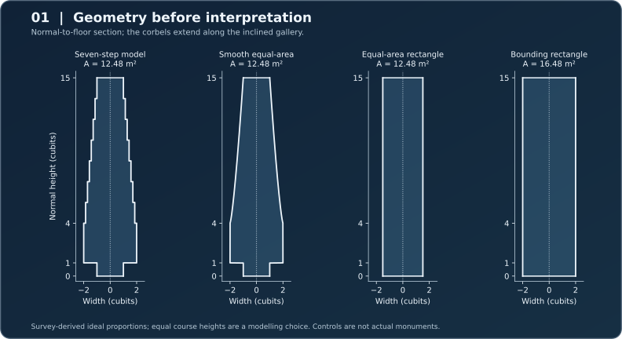
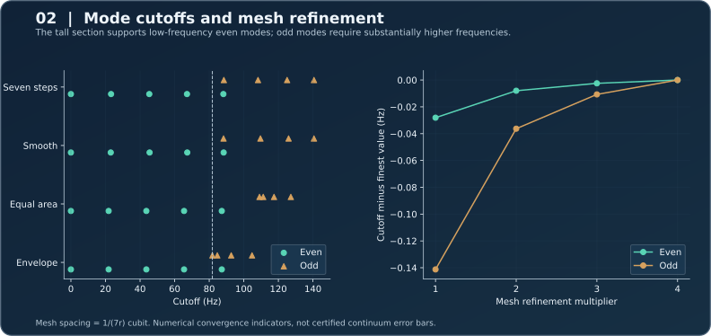
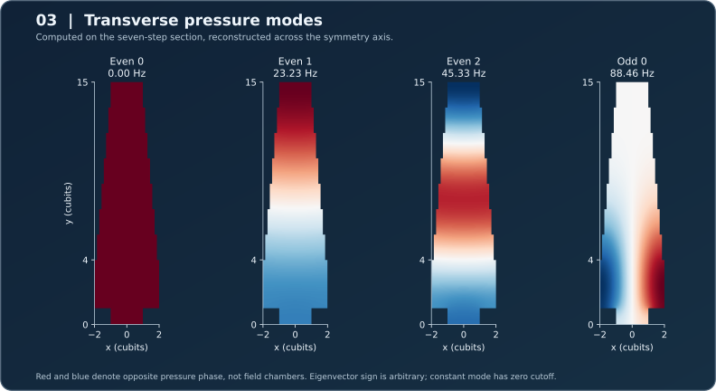
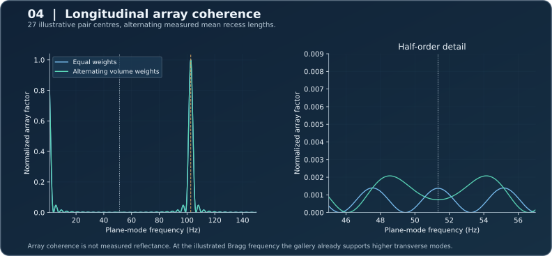
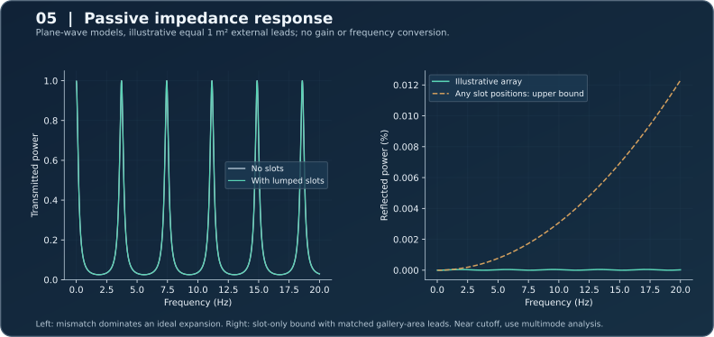
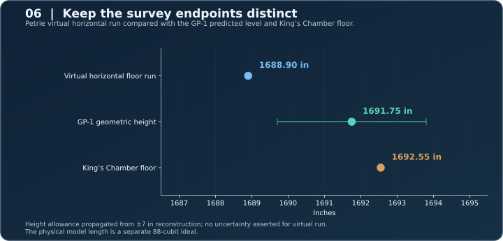
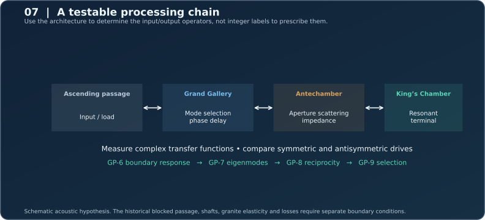

# Grand Gallery · spectral processing research

*The research note that precedes [GP-9](README.md) · Great Pyramid core framework · Gravity Field Dynamics (GFD), exploratory*

## Scope and working hypothesis

The Grand Gallery could act as a **passive spatial and frequency selector** between the ascending passage and the antechamber/King's Chamber. This is a hypothesis about ordinary pressure acoustics, motivated by GP-6 (boundary response), GP-7 (chamber modes) and GP-8 (reciprocity). It does not derive the native GFD Field Origin, a Walsh transform, a 21-sector register, or a remote coupling. We ask what the actual architecture forces before interpreting it.

The original GFD note [`04.5_grand_gallery_kernel.md`](../../pyramid_portal_research/04_apparatus_engineering/04.5_grand_gallery_kernel.md) assigned seven longitudinal phase steps to the corbels. They actually extend along the sides, so the transverse eigenproblem is the appropriate first calculation. The longitudinal slot array is a separate perturbation. This folder deliberately tests both, without assigning phase or attenuation to the integer seven. See [sources and assumptions](SOURCES.md).

## 1. Geometry, coordinates and comparison controls

Let s run uphill along the gallery, x across it, and y perpendicular to its inclined floor. The survey's plumb height is not the normal height. We use Miatello's approximately 15-cubit normal height and 88-cubit north-wall-to-Great-Step run, a 4-cubit maximum width, 2-cubit central channel and roof width, 1-cubit benches, 3-cubit broad lower wall and seven 1-palm inward offsets on each side. The seven upper tiers share 11 cubits of normal height; **equal tier heights are a modelling assumption**, not a digitized survey. The centre of each ramp-slot pair is not available as a machine-readable surveyed coordinate list; d=1.67 m is an illustrative spacing. The extra terminal pair is excluded from the regular array.

In cubit coordinates let w(y) denote half-width. It equals 1 for 0≤y<1, 2 for 1≤y<4, and 2−j/7 on upper tier j=1,…,7, each of height 11/7. The air section area is

$$A=2[1+6+(11/7)\sum_{j=1}^7(2-j/7)]=318/7\ \mathrm{cubit}^2.$$

Compare the stepped profile to (i) its 4×15 bounding rectangle, (ii) a same-area rectangle of height 15, (iii) a smooth-sided roof with the same lower section, endpoint widths and area, w=2−[(y−4)/11]^{3/4}. The smooth curve is a control, not a reconstruction. These controls distinguish taper and area from discrete stepping. No material properties are tuned to a target frequency.

## 2. Transverse eigenproblem and parity

For homogeneous air and rigid boundaries, pressure obeys the Helmholtz equation. On the ideal extruded section, solve −Δ⊥φ_j=λ_jφ_j with zero normal derivative, then expand p=Σ a_j(s)φ_j. Each amplitude solves a''+(ω²/c²−λ_j)a=0. The constant transverse mode always has zero cutoff. All other modes have cutoff f_j=c√λ_j/(2π), with λ in m⁻². Above cutoff, k_j is real; below cutoff it is imaginary and a decaying component has amplitude exp(−|Im k_j|s). A finite guide with two reflecting ends can contain both evanescent components, so this is not a universal transmission bound.

Reflection x→−x commutes with the Laplacian for a symmetric cross-section. Even and odd modes can be solved separately on the half-domain, with Neumann and Dirichlet conditions respectively on x=0. Odd modes vanish on that axis and have zero coupling to symmetric source or receiver profiles. For each horizontal interval of width W(y), the odd Poincaré inequality gives ∫|∂xφ|²≥(π/W(y))²∫|φ|². Integrating y shows λ_odd≥π²/Wmax². For this geometry the lower bound is ~82 Hz (not the first cutoff of *all* modes). A tall guide has low-frequency even vertical modes.

A useful independent upper bound uses the odd trial φ=x and the even mean-zero trial φ=y−ȳ. Their Rayleigh quotients are A/∫x² and A/∫(y−ȳ)². Thus analytic bounds bracket numerical calculations without asserting mesh eigenvalues are rigorous continuum bounds.

The half-domain cell-centred finite-volume method uses one nearest-neighbour edge per interior face; absent edges are rigid Neumann walls. A Dirichlet face on the axis adds 2/d² to the diagonal from an odd ghost cell. The matrix is symmetric PSD. Rectangular benchmarks have discrete eigenvalues 4/d² sin²(nπ/(2N)); the odd half-domain horizontal eigenvalues use n odd and full width. Refinements 1–4 align exactly with the ideal stepped profile. Smooth and equal-area controls are staircased, so their convergence is approximate. Numerical results are reported in `results/`, not promoted to exact eigenvalues.

## 3. Longitudinal scattering: the paired recesses

Miatello reports 27 ramp pairs and a terminal pair, with mean long/short lengths 0.592/0.521 m, width 0.14 m, depth 0.18 m. A small recess may act as a compliance, but its actual impedance is unknown. Model 27 illustrative equally spaced pair centres, then introduce alternating weights proportional to the rectangular volume proxy. This proxy is not a measured scattering amplitude. The weak-scattering complex array factor is F(k)=Σ w_j exp(2ik s_j). For identical weights and spacing d its modulus is |sin(Nkd)/sin(kd)|, with removable limit N at kd=mπ. Power normalized by (Σw)² is only an array coherence factor, not reflectance. Translation multiplies F by a phase; nonuniform spacings can shift or broaden the pattern.

Alternation can produce a superperiod 2d. For even N=2M at kd=π/2, F=M(a−b), whereas at kd=π, F=M(a+b). For odd N=2M+1 starting with a, the corresponding values are (M+1)a−Mb and (M+1)a+Mb. This distinguishes a true two-cell structure from a count-based phase rule. At illustrative d=1.67 m, plane-mode Bragg frequency is ~102.7 Hz and half-order ~51.35 Hz. **Higher transverse modes already propagate there**; a plane-only array cannot predict the real gallery's bandgap. For nonzero transverse cutoff f_c, the longitudinal Bragg condition gives f=√[f_c²+(c/2d)²].

## 4. Impedance and reciprocity

The normalized plane-wave state is (p, ρc U), where U is volume velocity. For a length ℓ, area A, the left-from-right transfer matrix is [[cos kℓ,i sin kℓ/A],[i A sin kℓ,cos kℓ]]. Its determinant is one and it preserves time-averaged flux, proportional to Re(p conjugate(ρc U)). At a junction, continuity of p and U gives r=(A1−A2)/(A1+A2). An expansion of area ratio m between equal-area leads has transmitted power T=[1+(m−1/m)² sin²(kℓ)/4]⁻¹. This is a standard acoustic expansion chamber, not a gain device. It is only a low-frequency model (ideally well below the first nonzero transverse cutoff); near steps, neglected evanescent modes alter effective end corrections. Its comb cannot be equated to a native 21-sector selector.

A sealed small cavity compliance gives a shunt [[1,0],[ikV,1]] in normalized variables. Cascade with ducts to obtain a conservative illustrative slot-array transfer. At higher frequency, aperture inertia, internal cavity modes, losses, stone motion and multimode scattering must replace the lumped model. No missing inserts are assumed. For any lossless reciprocal cascade its power-normalized scattering matrix is unitary and symmetric. Neither taper nor asymmetry alone is an acoustic diode. It cannot supply energy or shift a stationary input frequency in a linear time-invariant model.

## 5. Relationship to GP-1 and the surveyed elevation

Petrie's proposed geometric correspondence compares the *virtual horizontal floor run* (1688.9 inches, not the roof run of 1648.4 inches or the 88-cubit physical segment) with the elevation of the upper end. GP-1 predicts 5776(1−1/√2) = 1691.75 inches. The nominal residual is about −2.85 inches. The distinct King's Chamber floor mean 1692.55 inches gives another residual. The relation is close but not exact; do not substitute one endpoint for another or use it to choose an acoustic length. The predicted balance height and the virtual run both scale with overall size; spectral frequencies scale inversely for geometrically similar guides and unchanged sound speed.

## 6. Physical interpretation and decisive measurements

The strongest candidate is a three-part ordinary acoustic chain: Grand Gallery spatial selection and phase delay → antechamber aperture/load scattering → King's Chamber modal response. No transfer is guaranteed through the blocked lower passage; the boundaries and excitation must be specified. Model the existing accessible condition separately from any hypothesized original configuration. Relieving chambers couple through solid elasticity, not an open-air duct. A full multimode interface model must project pressure/velocity continuity onto aperture basis functions and retain evanescent modes. To distinguish effects of taper vs steps vs slots, compare matched-size and matched-area controls, measure a calibrated complex transfer matrix at multiple symmetric and antisymmetric points, record temperature and losses, and independently test the gallery/antechamber junction. Use only approved, non-invasive measurements. The exact proof is [GP-9](README.md), written after the reproducible tests; see [results](RESULTS.md).

**GFD bridge:** test whether physically measured mode selection agrees with existing GP-3/GP-4 signatures, not whether one can label 7 courses with 7 phases. A passive geometry does not establish 3 sweeps, 21 addresses, a WRT amplitude distribution, or α²¹. Bilateral reflection is Z₂, not Z₇. Seven corbels do not constitute a cyclic symmetry. A genuine native transduction law would require independent evidence.

## Package and reproduction

- [GP-9 mathematical proof](README.md): seven theorems, written after the test suite passed.
- [Results and interpretation](RESULTS.md), [sources and assumptions](SOURCES.md).
- `model.py`, `tests/`, `pytest.ini`, `requirements.txt`: standalone numerical and analytic regression tests.
- `generate_figures.py`: reproduces all seven SVG figures plus the numerical output tables.
- `results/verify_output.txt`: actual pytest output; `results/cutoffs.csv` and `results/summary.txt`: numerical data.

Run `python -m pytest -q` and `python generate_figures.py` from this folder after installing dependencies; `python verify_gp9_grand_gallery.py` runs the independent checks and the suite together.
