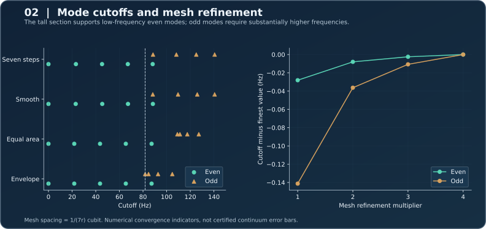
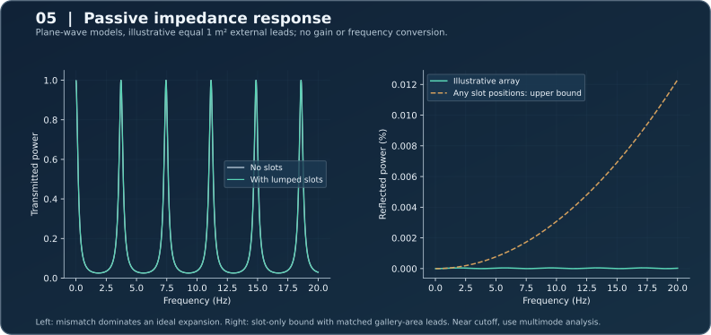

# GP-9 · Verification and numerical results

## Reproduction

```sh
python -m pip install -r requirements.txt
python -m pytest -q
python generate_figures.py
```

Use `OPENBLAS_NUM_THREADS=1` for reproducible performance on Linux/macOS. No external files, network calls, or proprietary solvers required. `results/verify_output.txt` is the actual run, not a count inferred from source. `results/cutoffs.csv` reports eight eigenvalues for each parity, every listed control and mesh. `results/summary.txt` contains computed scalars. The test suite uses deterministic seeds for randomized checks and independent analytic rectangular benchmarks.

**100 passed**. Three test files cover geometry, transverse spectra, scattering/reciprocity and the conditional slot bound. Exact analytic proofs are in [GP-9](README.md); the tests alone cannot prove continuum statements or original intent.

## Numerical investigation

| Refinement | First nonconstant even cutoff (Hz) | First odd cutoff (Hz) |
|---:|---:|---:|
| 1 | 23.20018 | 88.32044 |
| 2 | 23.22028 | 88.42540 |
| 3 | 23.22581 | 88.45097 |
| 4 | 23.22826 | 88.46169 |

Mesh spacing at r=4 is 1/28 cubit (~1.87 cm). The stepped profile aligns with the mesh. Differences between r=3 and r=4 are convergence indicators, not certified continuum errors. The controls use staircase approximations where boundaries do not align. The rectangular analytic benchmark uses the actual discrete rectangle dimensions.

| Control, r=4 | Even cutoff 1 (Hz) | Odd cutoff 1 (Hz) |
|---|---:|---:|
| Seven corbels | 23.228 | 88.462 |
| Smooth equal-area roof | 23.042 | 88.278 |
| Equal-area rectangle | 21.817 | 109.079 |
| Bounding rectangle | 21.817 | 81.812 |

The first odd cutoff in the discretized bounding rectangle is slightly below the continuum lower bound due to finite-difference dispersion; it is not a counterexample to Theorem 2. The smooth and stepped profiles differ by less than 0.2 Hz on the first cutoff of each parity at r=4. Differences at higher modes are larger. This provides no evidence that seven discrete steps are required to obtain the low-order parity selection. More precise as-built geometries, the longitudinal roof sawtooth and real junction scattering remain necessary to assess differences.



The strongest analytic result does not require the solver: at least two even propagating modes and no propagating odd modes between the exact even upper and odd lower bounds (approximately 25.642–81.814 Hz). The King's Chamber height and width fundamentals are in that range in the ideal acoustic model. Frequency compatibility does not guarantee excitation. No coupling across a closed or blocked passage is implied.

## Slots and impedance

The geometry proxy gives section area 12.476109 m², gallery volume 575.3563 m³, total slot pair rectangular volume 0.755496 m³, or approximately 0.1313% of the guide volume. At 20 Hz, the matched-guide compliance-only model gives a position-independent power reflection ceiling 0.000123039 (0.012304%). This is not a universal bound on actual recess scattering. The first plane-wave array maximum at 102.69461 Hz for d=1.67 m occurs in a multimode regime. The ideal expansion pass-frequency comb spacing is 3.718831 Hz for the 88-cubit model length. Both are theoretical scales, not observed peaks.



## Acceptance and rejection criteria

| Candidate interpretation | Outcome |
|---|---|
| Bilateral parity selection | Proved under specified symmetry and wave model |
| Several even modes below first odd cutoff | Proved for the ideal stepped profile; finite-volume corroboration |
| Seven sequential longitudinal phases | Not implied by the transverse corbel geometry |
| Unique effect of seven steps at low order | Not demonstrated; smooth equal-area control is close |
| Alternating slot scattering | Exact array law conditional on positions and weights; actual scattering unmeasured |
| Strong reflection from small empty compliance volumes alone | Excluded in the matched low-frequency point-compliance model at 20 Hz |
| Passive input/output energy gain or frequency conversion | Excluded in stationary lossless linear model |
| Native GFD phase registration / remote transfer | Not derived |

## Next stage

Digitize measured corbel boundaries and slot centres, including survey uncertainties; add actual aperture and terminal impedances; use multimode matching or a validated 3D acoustic mesh, compare with impulse-response measurements. Only if robust geometry-specific selection appears should it be compared with the inherited GFD registration signatures. Do not fit the spectrum to 13, 17, or 21.
