# Great Pyramid · Senior Referee Mathematical Audit

**GP-1 to GP-5 | Geometry, coupling signatures, spectral registration and two-site transfer**

*Gravity Field Dynamics (GFD) · Exploratory research programme · 27 November 2026*

**Recommendation: revise and strengthen all five proofs; retain the five-proof architecture.**

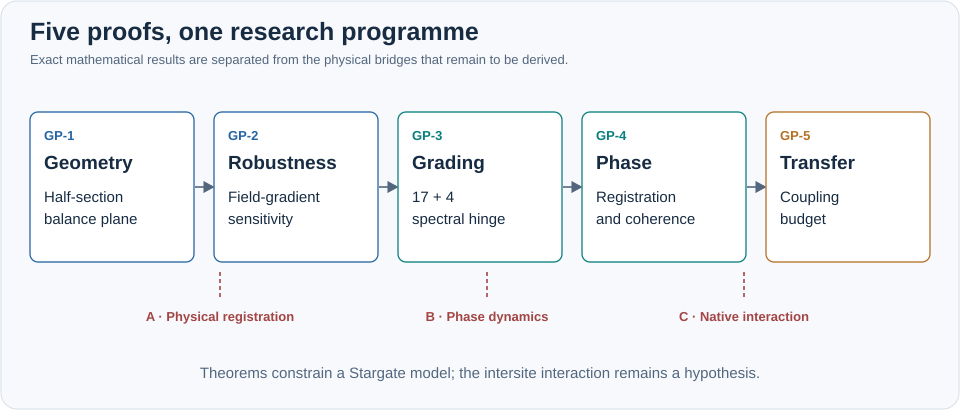

## Scope and referee assessment

This is a constructive, source-level mathematical audit of the five proofs on branch `ccr-6ef292b5-nvt989`, pinned to commit [`34d51fdc72bc8fac35806402d529906bbd57fea1`](https://github.com/fielddynamics/research/tree/34d51fdc72bc8fac35806402d529906bbd57fea1/research/exploratory/great-pyramid/proofs). It covers the written theorem statements, proofs, relevant Python verification logic and the five Lean source files. It does not represent a fresh execution of the 191 Python checks or a Lean build. The extensions below are referee derivations, not changes to the repository. Proof 26 remains unchanged.

The five proofs establish a valuable mathematical infrastructure for the proposed Stargate programme. The principal challenge is not the individual identities: it is deriving the maps that connect geometry to physical registration, registration to coherence, and coherence to a genuine intersite interaction. The report therefore provides a correction, replacement theorem, constructive derivation or discriminating test for every substantive issue. Exact results are identified separately from proposed physical transduction laws.

| Proof | Result | Referee verdict |
|---|---|---|
| [GP-1](#gp-1--the-half-section-balance-plane) | Half-section balance plane | Sound geometry; refine regularity and uncertainty |
| [GP-2](#gp-2--balance-plane-robustness) | Balance-plane robustness | Extend uniqueness, repair sharpness and sharpen self-gravity estimate |
| [GP-3](#gp-3--coupling-signatures-and-the-interlevel-hinge) | Coupling signatures and hinge | Strong algebra; classify the complete space of intertwiners |
| [GP-4](#gp-4--registration-and-coherence) | Registration and coherence | Extend to approximate locking and exact address reconstruction |
| [GP-5](#gp-5--two-site-transfer-and-the-stargate-operator) | Two-site transfer | Sound conditional dynamics; derive the effective coupling and fix addressing |

---

## GP-1 — The half-section balance plane

[Source proof and verification](https://github.com/fielddynamics/research/tree/34d51fdc72bc8fac35806402d529906bbd57fea1/research/exploratory/great-pyramid/proofs/gp1-half-section-balance-plane)

**Verdict:** mathematically sound central theorem. The extension from a right pyramid to an oblique cone demonstrates that the balance level is a consequence of homothetic geometry, not a particular slope, orientation or size.

### 1.1 Generality and regularity

For a base of positive $(D-1)$-measure $A_0$ and an apex at height $h$, the section at fractional height $u=z/h$ is the homothetic image of the base. The scale factor is $1-u$, so

$$A(u)=A_0(1-u)^{D-1}.$$

A uniform current with $J_z\ne0$ therefore has normalized signed section flux

$$\mu_B(u)=(1-u)^{D-1},\qquad u_D^*=1-2^{-1/(D-1)}.$$

The upper portion of any positive-area meridional section through the apex scales as $(1-u)^2$; its half-area level coincides with the horizontal half-flux level if and only if $D=3$. This is a particularly attractive result because Petrie's historical description of the chamber location invokes vertical area.

**Issue:** Theorem 2 starts with an arbitrary compact base and subsequently calls its frustum a Lipschitz domain. Arbitrary compact sets need not have that regularity. A meridional section must also have positive area; a tangent slice does not define a fraction.

**Solution:** State section scaling for compact measurable bases of positive measure. State the divergence-theorem identity separately for a Lipschitz frustum, or a set of finite perimeter with the Gauss–Green normal trace. For a signed constant current,

$$-J_zA_0+J_zA(u)+\Phi_{\rm lat}=0.$$

Do not require every lateral face to carry an outward current; the equation is about net signed flux. At the apex the section is a singleton of zero measure, and its centroid formula is interpreted by continuous extension. Require positive meridional area for Theorem 4. The principal theorem survives intact.

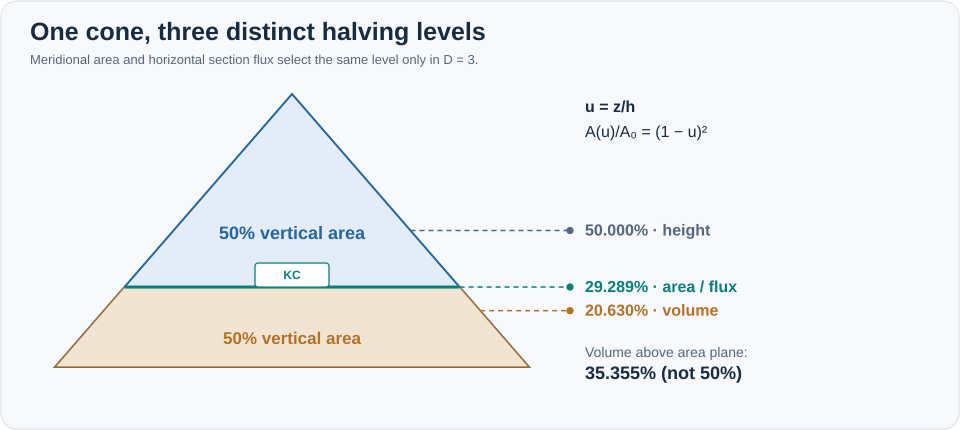

At $D=3$ the volume above the area-balance plane is $2^{-3/2}$, not one half. Height, section area and volume select genuinely distinct levels.

### 1.2 Upgrade the share labelling into a candidate operator

Proposition 6 labels the geometric share by $s_B=2\mu_B-1$. A stronger and more useful formulation, using the GP-3 grading, is

$$\boxed{A_B(u)=P_{\rm even}+[2(1-u)^2-1]P_{\rm odd}}$$

with orthogonal projectors of ranks 17 and 4. Its trace is

$$\operatorname{Tr}A_B(u)=17+4[2(1-u)^2-1]=13+8\mu_B(u).$$

At $u=u^*$, $A_B=P_{\rm even}$. Thus the proposed mapping does not merely attach three numbers to three heights; it singles out the four-dimensional component that is suppressed at structural balance.

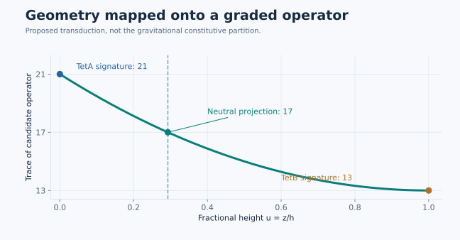

**Status:** the operator and its trace identities are exact given the definition. The identification of this operator with actual material or field dynamics is exploratory. It does not identify the structural half-flux plane with the native point Field Origin or equate $\mu_B$ with the gravitational constitutive share. GP-2 explicitly distinguishes them.

### 1.3 Preserve the King's Chamber result without overstating precision

| Quantity | Height above base |
|---|---:|
| Reconstructed pyramid height | 5776.0 ± 7.0 in |
| Geometric prediction | 1691.75 in |
| Predicted height allowance propagated from reconstruction | ±2.05 in |
| Surveyed chamber floor range | 1691.4–1693.7 in |
| Surveyed floor midpoint | 1692.55 in |
| Geometric residual (floor minus prediction) | +0.80 in |
| Phase 0 numerical half-flux residual | +0.82 in |

The Phase 0 field-model residual is reported in [P0.1](https://github.com/fielddynamics/research/blob/34d51fdc72bc8fac35806402d529906bbd57fea1/research/exploratory/great-pyramid/pyramid_portal_research/phase0/P0.1_field_model_results.md). It is distinct from the geometric residual; neither is an uncertainty estimate.

**Issue:** the script combines a floor range, a measurement allowance and the reconstructed height uncertainty into a quantity called sigma, without establishing independent Gaussian standard deviations. The quoted 186σ and 443σ exclusions are therefore not justified statistical claims.

**Solution:** propagate bounded intervals, conditional on the quoted allowances being bounds. The floor midpoint has an allowance of half the range plus the stated 0.6 in, or 1.75 in. The conservative residual is $+0.80\pm3.80$ in. This is an allowance interval, not a confidence interval.

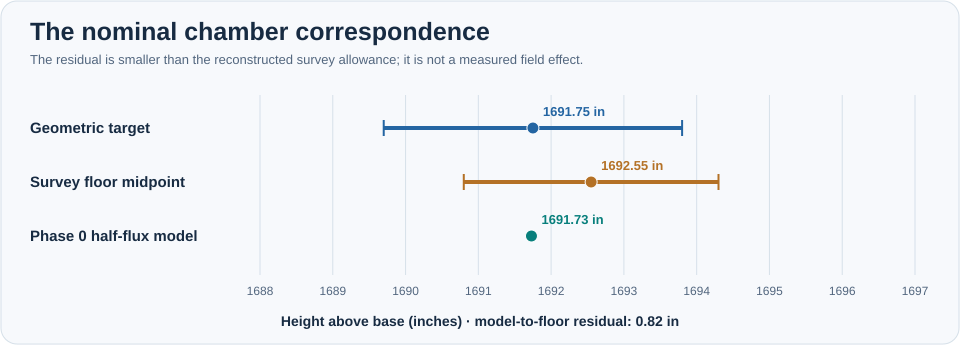

Recommended wording: **The nominal structural half-flux prediction lies within one inch of the King's Chamber floor, well inside the reconstructed survey uncertainty.** The geometric match is real at the level of the stated inputs; a physical Field Origin identification or evidence of intended function is not a consequence of that match alone.

For the illustrative uniform null on $[0,h/2]$, a target window of radius $\delta$ has probability equal to its intersection length with the search interval divided by $h/2$. At the boundary $h/2$, the window has length $\delta$, not $2\delta$. For the three nonoverlapping canonical windows and $\delta=2.70$ in, the chance is $5\delta/(h/2)\approx0.47\%$ under that specified null. This is not a calibrated archaeological p-value. Preregister an ensemble of monuments, room-selection criteria, base and height definitions, and candidate geometric ratios before testing other pyramids. Report all results, including mismatches.

**GP-1 recommendation:** retain Theorems 1–5, correct regularity, promote the graded operator to an explicitly conditional proposition, and report the nominal inch-scale correspondence using defensible uncertainty language.

---

## GP-2 — Balance-plane robustness

[Source proof and verification](https://github.com/fielddynamics/research/tree/34d51fdc72bc8fac35806402d529906bbd57fea1/research/exploratory/great-pyramid/proofs/gp2-balance-plane-robustness)

**Verdict:** strong central result. The affine centroid identity is correct and exposes the dependence on just one number, the fractional change of the mean axial density along the centroid line.

### 2.1 Global affine uniqueness

For an affine field $\mathbf J(\mathbf r)=\mathbf J_0+M\mathbf r$,

$$\int_S J_z\,dA=|S|J_z(c_S).$$

Consequently the structural share in three dimensions is

$$g_b(u)=(1-u)^2(1+bu),\qquad b=J_z(a)/J_z(c_0)-1.$$

The frustum has net outward flux $\operatorname{tr}(M)\operatorname{Vol}(V)$, not necessarily zero. The sign-changing case does not invalidate the signed section ratio as long as its base denominator is nonzero.

**Issue:** the proof restricts uniqueness to $b>-1$ and states that no flux share is defined for $b\le-1$. The ratio remains defined in these cases. A stronger uniqueness theorem holds.

**Replacement theorem:** for every $b\in\mathbb R$, there is exactly one $u\in(0,1)$ with $g_b(u)=1/2$.

*Proof.* Rearranging,

$$b=B(u)=\frac{1/[2(1-u)^2]-1}{u}.$$

Its derivative is

$$B'(u)=\frac{1-3u+6u^2-2u^3}{2u^2(1-u)^3}=\frac{(1-u)^3+u^2(3-u)}{2u^2(1-u)^3}>0.$$

Also $B(u)\to-\infty$ as $u\to0^+$, and $B(u)\to+\infty$ as $u\to1^-$. Hence $B$ is a strictly increasing bijection and the balance level exists uniquely for every real $b$. □

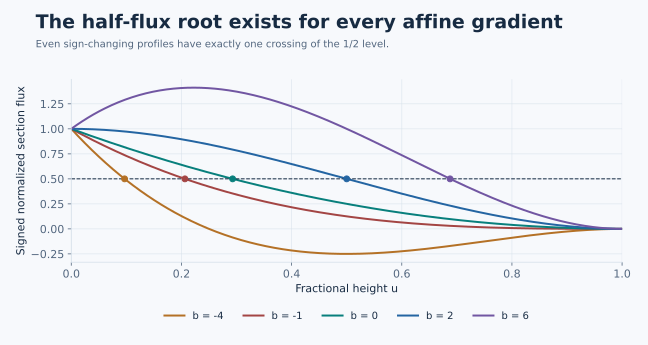

The restriction $b\ge-1$ is appropriate if nonnegativity of the axial centroid density throughout the cone is required (strict positivity at the apex requires $b>-1$). Even then $g_b$ need not be a fraction in $[0,1]$ for $b>2$. Preserve the distinction between signed normalized flux and a positive probability share.

The first and second implicit derivatives reported by the proof are retained:

$$u^{*\prime}(0)=\frac{\sqrt2-1}{4},\qquad u^{*\prime\prime}(0)=1-\frac{11\sqrt2}{16}.$$

At the Great Pyramid this is approximately 598.1 in per unit $b$ to first order. The analytic global theorem is a suitable Lean extension, rather than checking an expanded finite set of gradients.

### 2.2 Repair sharpness and state existence hypotheses

Let $r(u)=\bar\jmath(u)/\bar\jmath(0)$, with $|r(u)-1|\le\varepsilon<1$. At any balance level,

$$1-\frac1{\sqrt{2(1-\varepsilon)}}\le u^*\le1-\frac1{\sqrt{2(1+\varepsilon)}}.$$

Intersect this with the physical interval $[0,1]$. The first-order half-width is $\varepsilon/(2\sqrt2)$; for finite $\varepsilon$ the interval is asymmetric.

**Issue:** constant ratios $1\pm\varepsilon$ do not satisfy $r(0)=1$ and thus are not valid globally normalized sharpness examples. A bound on existing roots alone does not establish existence.

**Solution:** for an endpoint $u_*>0$ use the continuous profile

$$r_\pm(u)=1\pm\varepsilon\min(u/u_*,1).$$

This satisfies $r_\pm(0)=1$ and attains the required extreme at the corresponding endpoint. For the lower endpoint, exact attainment requires $\varepsilon<1/2$; for $\varepsilon\ge1/2$, zero is an infimum of attainable positive roots (choose a small positive root and a suitable ratio within the allowed range). Continuity of the normalized section flux ensures a root by the intermediate value theorem, because its values at the base and apex are 1 and 0. Differentiable positive $r$ satisfying

$$\frac{r'(u)}{r(u)}<\frac2{1-u}$$

ensures uniqueness by strict monotonicity of $(1-u)^2r(u)$.

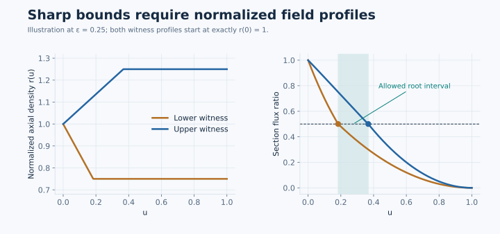

This replacement provides an actual field-ratio witness satisfying the definition, rather than only a pointwise algebraic saturation of the inequality.

### 2.3 Sharpen the self-gravity bound

The original estimate $|\mathbf g_{\rm self}|\le8\pi G\rho R_c$ is conservative. A fixed-volume rearrangement yields a smaller, rigorous shape-independent upper bound. For a mass support of volume $V$, density bounded by $\rho_{\max}$, and equivalent-volume radius $R_{\rm eq}=(3V/(4\pi))^{1/3}$,

$$\begin{aligned}
|\mathbf g_{\rm self}(x)|&\le G\rho_{\max}\int_B|x-y|^{-2}\,dy\\
&\le G\rho_{\max}\int_{|x-y|\le R_{\rm eq}}|x-y|^{-2}\,dy\\
&=4\pi G\rho_{\max}R_{\rm eq}.
\end{aligned}$$

The middle inequality follows by the radial monotonicity of the kernel (moving volume from outside the equal-volume ball into its interior cannot decrease the integral). This bounds magnitude, not an exact vector field. With reconstructed $h=146.7104$ m and side $a=230.34752$ m, $V=a^2h/3$, $R_{\rm eq}=85.246$ m. For $\rho_{\max}=2300$ kg/m³, $g_{\rm self,max}\approx1.6444\times10^{-4}$ m/s².

For a monopole background of base axial density magnitude $g_0$, with fractional height variation $\varepsilon_E$, the conservative normalization gives approximately

$$\varepsilon_{\rm total}\le\frac{g_0\varepsilon_E+2g_{\rm self,max}}{g_0-g_{\rm self,max}}.$$

Using $g_0=9.793$ m/s², Earth radius $6.371\times10^6$ m and the height above, $\varepsilon_E\simeq4.61\times10^{-5}$. If desired, include the tiny horizontal variation of the monopole across the base as an additional term (of order $10^{-9}$); this does not change the quoted precision. The total bound is about $7.96\times10^{-5}$, giving a maximum displacement of approximately 0.163 in. The original estimate should likewise use the lower (larger-magnitude) interval endpoint and a denominator corrected for the possible self-field at the base; the quoted 0.36 in is a rounded conservative estimate, not an exact bound.

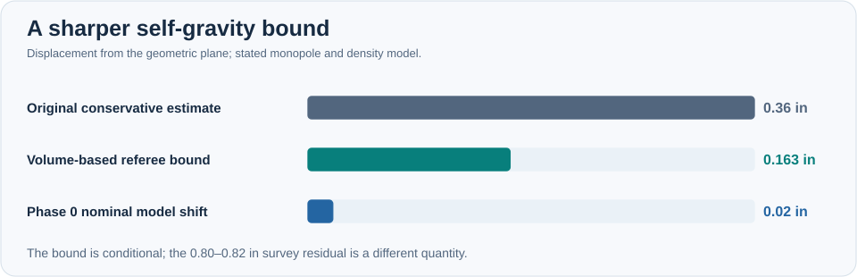

| Quantity | Original estimate | Referee refinement |
|---|---:|---:|
| Self-field magnitude bound | $6.3\times10^{-4}$ m/s² | $1.65\times10^{-4}$ m/s² |
| Combined plane displacement bound | ≈0.36 in | ≈0.163 in |
| Phase 0 computed displacement from geometric target | ≈0.02 in | unchanged |

These figures are conditional on the adopted density and gravity model, not new measurements. The result cannot resolve the survey-level difference of 0.80–0.82 in as a field effect.

### 2.4 Preserve the net-field rule and distinguish three quantities

The inherited GFD net-field rule assigns ordinary gravitational settlement in a drainless solar system to TetA, with $\mu_g=1$ in that framework. The unmodified interpolation law $x/(1+x)$ would instead give a very small TetB share of order $10^{-11}$ at Giza. Neither produces $\mu_g=1/2$ there. At the structural balance plane, $\mu_B=1/2$ is merely the ratio of integrated axial fluxes.

Use $\mu_g$ for the constitutive share, $\mu_B$ for the structural share and $s_{\rm reg}$ for a candidate registration signature. A proposed transduction law is

$$s_{\rm reg}=2\mu_B-1,$$

not $\mu_g=\mu_B$. A locally driven apparatus may be hypothesized to couple to a separate registration channel. Its existence and compatibility with the net-field rule must follow from a native action and boundary conditions. In particular, a source term cannot be called divergence-free inside stone: $\nabla\cdot\mathbf J=\rho$ in the stated normalization. Account for that source in the flux balance.

**GP-2 recommendation:** extend affine uniqueness to every real gradient; repair sharpness; add continuity and monotonicity hypotheses where needed; use the volume-based field bound and explicitly separate structural, constitutive and registration quantities.

---

## GP-3 — Coupling signatures and the interlevel hinge

[Source proof and verification](https://github.com/fielddynamics/research/tree/34d51fdc72bc8fac35806402d529906bbd57fea1/research/exploratory/great-pyramid/proofs/gp3-coupling-signatures-and-hinge)

**Verdict:** the strongest purely algebraic proof of the five. Its next step is operator rigidity, not additional numerical coincidences.

### 3.1 A shorter classification proof

Let $\zeta$ be a root of unity. Then $s=\zeta+\bar\zeta$ is an algebraic integer. If rational, it must be an integer, and $-2\le s\le2$. The endpoints give reducible squares $(K\pm1)^2$. For $s=-1,0,+1$, the discriminants are $-3,-4,-3$, respectively, hence irreducible over $\mathbb Q$. Thus precisely these three signatures are possible under the stated quadratic norm-form hypothesis. They are $\Phi_6(K),\Phi_4(K),\Phi_3(K)$ respectively, with root orders 6, 4, 3 for $-\zeta$ (orders 3, 4, 6 for $\zeta$). No totient search is necessary. The hypothesis of a monic irreducible integer quadratic of this form is still essential; the result alone does not select physical $K=4$.

### 3.2 Unitary rigidity of the grading

**Proposed theorem:** Let $J$ be a self-adjoint involution on a complex 21-dimensional Hilbert space. If $\operatorname{Tr}J=13$, the eigenvalues are $\pm1$ and their multiplicities obey

$$m_++m_-=21,\qquad m_+-m_-=13.$$

Therefore $m_+=17$ and $m_-=4$. Every such $J$ is unitarily equivalent to $I_{17}\oplus(-I_4)$, by the spectral theorem. On a real Hilbert space use orthogonal equivalence. Define

$$P_{\rm FO}=\frac{I+J}{2},\qquad P_{\rm odd}=\frac{I-J}{2},\qquad A_s=P_{\rm FO}+sP_{\rm odd}.$$

Then $A_{+1}=I$, $A_0=P_{\rm FO}$, $A_{-1}=J$; their traces are $21,17,13$. The Field Origin is the parity-even projection in this representation, not a 13-element intersection. TetB's 13 is a signed trace, not the dimension of its underlying Hilbert space. The invariant sector is 17-dimensional and the signed sector four-dimensional.

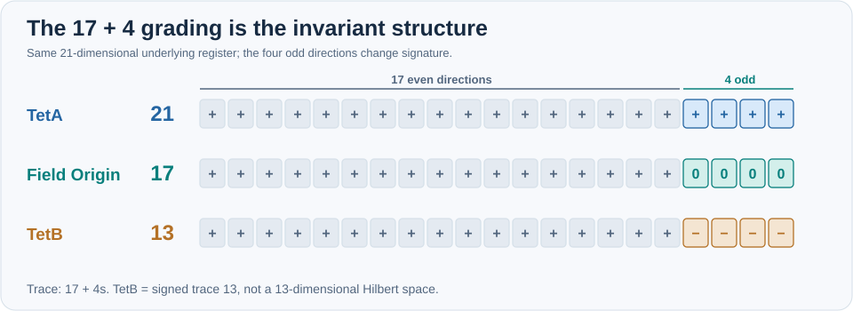

The representation also gives $\det(\alpha^{A_s})=\alpha^{17+4s}$ for $\alpha>0$ by the determinant-exponential identity. This algebra does not show that the native physical transfer is the exponential of this operator or that its determinant is the source of gravity. Unitary equivalence classifies the abstract operator but does not select a canonical basis relative to a specific Walsh read.

### 3.3 Classify every exact interlevel intertwiner

The source theorem correctly establishes the unique kind of integer coincidence between adjacent levels:

$$f_+(K)=f_-(K+1).$$

In particular 17 occurs only at $(K,s)=(4,0)$, and 21 occurs at $(4,+1)$ and $(5,-1)$. However, numerical equality does not select a physical transition or imply nonzero coupling.

**Proposed theorem:** suppose two shell Hamiltonians have exactly the signature eigenvalues (or one common affine energy normalization), with spectral projectors $P_{K,s}$. For every map $T$ satisfying $H_{K+1}T=TH_K$,

$$(f(K+1,s')-f(K,s))P_{K+1,s'}TP_{K,s}=0.$$

The uniqueness of the signature match gives

$$\boxed{T=P_{K+1,-}TP_{K,+}.}$$

Conversely, every such block-supported map intertwines. The solution space is exactly $\operatorname{Hom}(E_{K,+},E_{K+1,-})$. If both eigenspaces are one-dimensional the intertwiner is unique up to a scalar, which may be zero; otherwise a nontrivial symmetry or dynamical selection theorem is necessary. A symmetry representation may rule the entire space out even when the numerical bands match.

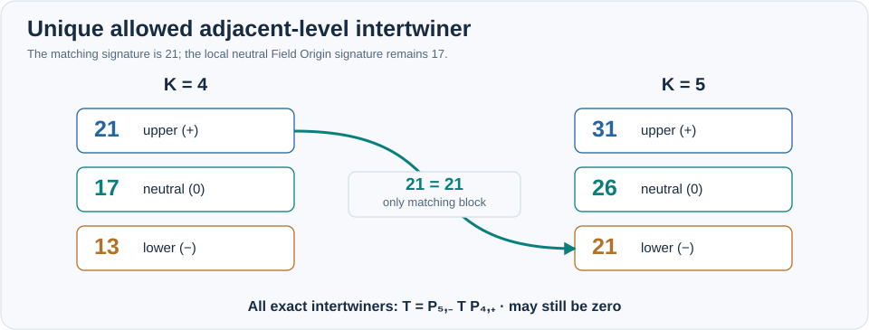

This replaces the weaker argument of defining one rank-one map and checking that it intertwines. It establishes the complete space of candidate exact signature-preserving transitions under the model hypotheses. It remains conditional on the physical interpretation of the shell labels as energy eigenvalues. The local neutral signature remains 17; the interlevel match is 21.

### 3.4 Infinite fusion-tower coprimality

Define $A_n=f_+(K^{2^n})$ and $B_n=f_-(K^{2^n})$. Then $A_{n+1}=A_nB_n$ and $\gcd(A_n,B_n)=1$ by the existing theorems. Every prior factor divides $A_n$, hence it is coprime to $B_n$. Induction proves that $A_0,B_0,B_1,\ldots$ are pairwise coprime across the full tower. At $K=4$ the first factors are $21,13,241,65281$ and the first products are $21,273,65793$. This needs no finite enumeration. Coprimality does not forbid physical interactions between sectors; it is an arithmetic property.

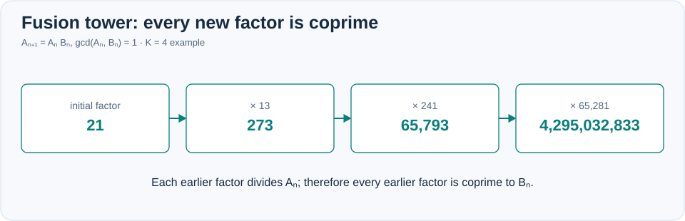

### 3.5 Bridge finite geometries on a common register

The cardinalities $|PG(2,3)|=13$, $|PG(2,4)|=21$ and the elliptic quadric $|Q^-(3,4)|=17$ are correct. They do not establish a canonical correspondence between the geometries; in particular $PG(2,3)$ is not a subplane of $PG(2,4)$.

A better route already exists in [the I Ching orientation-character research](https://github.com/fielddynamics/research/blob/34d51fdc72bc8fac35806402d529906bbd57fea1/research/exploratory/i-ching/ORIENTATION_CHARACTER_AND_SEED_DUAL.md). Construct the 21 directions from the nonzero threefold orbits of $\mathbb F_4^3$, use the Walsh-preserved common line to define the contrast register, and apply the binary orientation involution. Its positive rank and signed trace give 17 and 13 on a single algebraic space. This realizes the signature triple on one register. The separate projective objects remain useful cardinality models. The map from this common-mode complement to the physical density trace complement must be specified; the two are not interchangeable in the I Ching density-register result.

**GP-3 recommendation:** retain classification, unique coincidence, coprimality and fusion. Add the three theorems: unitary rigidity, complete intertwiner classification and infinite tower coprimality. Treat physical energy normalization and interlevel selection as separate obligations.

---
## GP-4 — Registration and coherence

[Source proof and verification](https://github.com/fielddynamics/research/tree/34d51fdc72bc8fac35806402d529906bbd57fea1/research/exploratory/great-pyramid/proofs/gp4-registration-and-coherence)

**Verdict:** strong phase-ensemble mathematics. Extend it into a quantitative address-locking theory rather than equating registration with coherence.

For a probability measure on the circle let $m_k=\mathbb E[e^{ik\theta}]$ and $C_k=|m_k|$. The proof establishes $C_N=1$ precisely when the ensemble is supported on one rotated $N$-gon. All coherence values $C_1\in[0,1]$ are compatible with perfect registration for $N\ge2$, using a mixture of the uniform polygon and a point at one vertex. Conversely,

$$1-\operatorname{Re}(e^{-iN\varphi}m_N)\le N^2(1-C_1),$$

where $\varphi=\arg m_1$ when $m_1\ne0$ (any reference phase when $m_1=0$). The bound follows from $|\sin Nt|\le N|\sin t|$ and is sharp: a symmetric pair at $\pm d$ gives a ratio approaching $N^2$ as $d\to0$, or 1 if the ratio includes the $N^2$ factor. In particular $C_{21}\ge1-441(1-C_1)$. This guarantees registration of at least one half when $C_1\ge1-1/882$; the sufficient threshold is not a necessary condition.

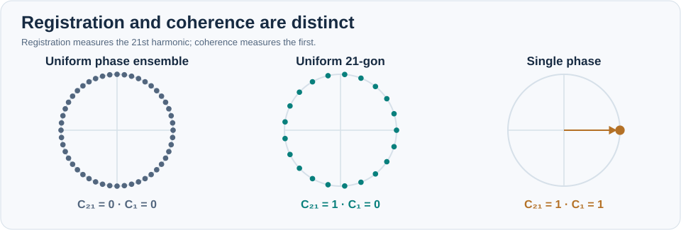

### 4.1 Correct the rotated harmonic

For a uniformly populated rotated polygon, the full harmonic is

$$m_k=\begin{cases}e^{ik\theta_0},&N\mid k,\\0,&N\nmid k.\end{cases}$$

The unrotated polygon has unit harmonics at multiples of $N$. The phase factor is important to addressing even though the magnitude does not change. State this convention explicitly.

### 4.2 Approximate coprime locking theorem

The exact result $C_3=C_7=1\Rightarrow C_1=1$ follows from Bézout's identity, but near-perfect registration is the experimentally relevant case. Let $Z=e^{i\theta}$, and $a_3,a_7$ be unit phases of the corresponding harmonics (arbitrary unit reference if a harmonic is zero). Then

$$\|Z^j-a_j\|_2=\sqrt{2(1-C_j)},\quad j=3,7.$$

Because $Z=Z^7\overline{Z^3}^{\,2}$ and $|z^2-w^2|\le2|z-w|$ for unit $z,w$,

$$\|Z-a_7\bar a_3^{\,2}\|_2\le\sqrt{2(1-C_7)}+2\sqrt{2(1-C_3)}.$$

For any unit $a$, $1-C_1\le\tfrac12\|Z-a\|_2^2$. Consequently

$$\boxed{C_1\ge\max\{0,1-[\sqrt{1-C_7}+2\sqrt{1-C_3}]^2\}.}$$

At equal stage strength $C_3=C_7=r$, $C_1\ge\max(0,1-9(1-r))$. Thus 99% registration in each stage guarantees at least 91% coherence. This is a sufficient bound, not an assertion of optimality. The CRT decomposition $\mathbb Z_3\times\mathbb Z_7\cong\mathbb Z_{21}$ labels a register; demanding separate registration in both harmonics is a stronger condition than registration at order 21.

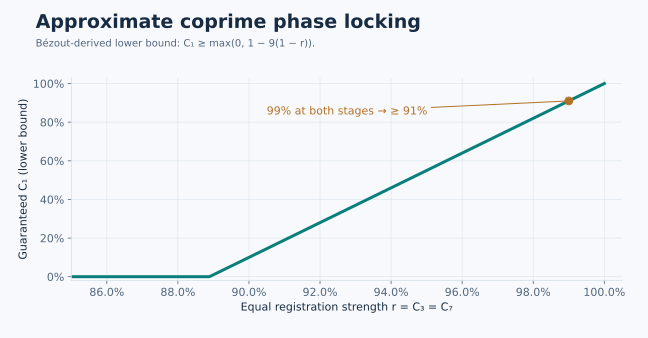

### 4.3 Complementary character reconstruction

For $N=21$ and $S=\{k:3\nmid k\}$, the 14-character filter is

$$F_{14}(d)=\frac1{14}\sum_{k\in S}e^{2\pi ikd/21}=\begin{cases}1&d=0,\\-1/2&d=7,14,\\0&\text{otherwise}.\end{cases}$$

This is exactly as established. Parseval gives $\sum_d|F_S(d)|^2=N/|S|$; any proper nonempty subset has nonzero sidelobes, and the maximum sidelobe is at least $\sqrt{(N/|S|-1)/(N-1)}$. Here it is $1/2$, larger than the floor $\sqrt{1/40}$. But the claim that the addresses cannot be distinguished is too strong. The correct match gives amplitude 1, the aliases give $-1/2$, so amplitude or phase can distinguish a match from either alias. The scalar response does not distinguish the two aliases from each other and is not an exact delta selector. Channel-resolved measurements may supply additional distinctions.

Define the complementary seven-character filter

$$F_7(d)=\frac17\sum_{3\mid k}e^{2\pi ikd/21}=\begin{cases}1&7\mid d,\\0&\text{otherwise}.\end{cases}$$

**Replacement architecture:** coherent amplitude recombination gives

$$\boxed{F_{21}(d)=\tfrac23 F_{14}(d)+\tfrac13F_7(d)=\delta_{d0}.}$$

At each alias, $\tfrac23(-1/2)+\tfrac13(1)=0$. This is a constructive solution for the incomplete scalar selector. The weighting follows from the respective number of characters; cancellation requires their relative phase and gain to be maintained. Incoherent addition of intensities cannot perform this cancellation.

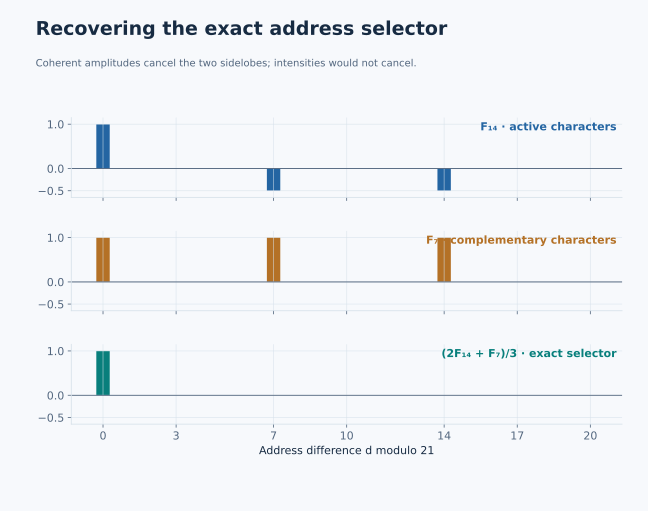

For the apparatus, ask whether the nominally suppressed sector is truly absent or available in a complementary read. Measure complex transfer coefficients and test the predicted cancellation, rather than infer an address selector from the architecture's integer counts.

### 4.4 Stabilize the amplitude-phase potential

The fixed-amplitude phase potential $-\cos21\theta$ has exactly 21 minima modulo $2\pi$. A complex order parameter with a negative degree-21 term and only a positive quartic stabilizer is unbounded below. A possible corrected model is

$$\boxed{V(\Psi)=a|\Psi|^2+b|\Psi|^4+c|\Psi|^{22}-h(\Psi^{21}+\bar\Psi^{21}),\quad c,h>0.}$$

Writing $\Psi=\rho e^{i\theta}$ gives $V=a\rho^2+b\rho^4+c\rho^{22}-2h\rho^{21}\cos21\theta$. The positive leading term is coercive. At any fixed nonzero equilibrium amplitude, the angular minima occur at $\theta_n=2\pi n/21$ and have stiffness

$$\partial_\theta^2V\big|_{\theta_n}=2h\rho^{21}(21)^2.$$

Existence of a nonzero equilibrium depends on the radial parameters (for example $a<0$ suffices for a lower-energy nonzero state); phase has no meaning at zero amplitude. A physical phase-restoring frequency also needs the kinetic normalization. This potential is a candidate model, not derived from the closure register's dimension.

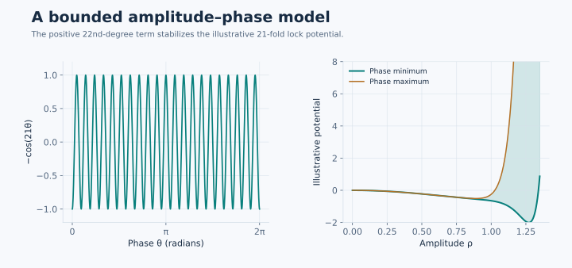

**GP-4 recommendation:** retain the central phase inequalities, correct the rotated-phase convention and interpretation of sidelobes, and add the approximate coprime-locking theorem, complementary character reconstruction and stable potential. The last requires physical selection of the harmonic, not simply the number 21.

---

## GP-5 — Two-site transfer and the Stargate operator

[Source proof and verification](https://github.com/fielddynamics/research/tree/34d51fdc72bc8fac35806402d529906bbd57fea1/research/exploratory/great-pyramid/proofs/gp5-two-site-transfer-bound)

**Verdict:** sound conditional two-mode dynamics. The highest-value task is now deriving a nonzero effective interaction from the native GFD action. Resonance selects an existing channel; it does not create one.

### 5.1 Tighten the coupling-budget theorem

For real frequencies $\omega_x,\omega_y$ and complex coupling $\kappa$, take

$$H/\hbar=\begin{pmatrix}\omega_x&\kappa\\\bar\kappa&\omega_y\end{pmatrix},\quad c(0)=(1,0).$$

With $\Delta=\omega_x-\omega_y$, the exact constant-drive probability is

$$P_{x\to y}(t)=\frac{4|\kappa|^2}{\Delta^2+4|\kappa|^2}\sin^2\left(\frac t2\sqrt{\Delta^2+4|\kappa|^2}\right).$$

When both $\Delta$ and $\kappa$ vanish, take the continuous limit $P=0$. The detuning tolerance for nonzero coupling and $0<\eta\le1$ is $|\Delta|\le2|\kappa|\sqrt{(1-\eta)/\eta}$. At resonance the first complete transfer is $t=\pi/(2|\kappa|)$.

For any bounded measurable time-dependent Hermitian drive, the interaction picture removes the diagonal phases without affecting occupations. Its generator is off-diagonal and the state speed on the unit sphere is $|\kappa|$ almost everywhere. The geodesic distance from the initial state is at least $\arcsin|c_y|$, so

$$\boxed{|c_y(t)|\le\sin\left(\min\left\{\int_0^t|\kappa(s)|ds,\frac\pi2\right\}\right).}$$

This is correct. Clarify that the resonant constant drive saturates the bound up to the first complete transfer, not for every later time. Turn off the coupling at the first full transfer to retain equality in the saturated regime; equivalently, an admissible control with a budget constraint uses no more than $\pi/2$ integrated coupling. The statement that coupling budget is the only resource should be confined to the ideal two-state bound, not a physical apparatus's power, control, energy or loss requirements.

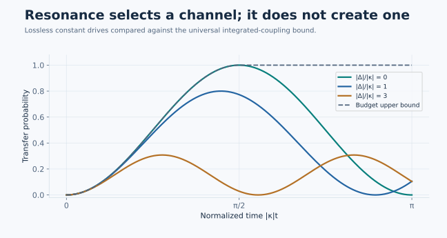

### 5.2 Derive a candidate TetB-mediated coupling by elimination

Rather than inserting $\kappa$ as an unexplained parameter, introduce an intermediate sector. Use energy units for the full Hamiltonian,

$$\mathcal H=\begin{pmatrix}H_A&V\\V^\dagger&H_B\end{pmatrix}.$$

Here $H_A$ acts on the observable terminal sector, $H_B$ on the candidate intermediate sector, and $V$ connects them. In the stationary equation, $V^\dagger a+H_B b=Eb$, hence $b=(E-H_B)^{-1}V^\dagger a$ when the resolvent exists. Substituting into the first equation gives the exact Schur-complement reduction:

$$\boxed{H_{\rm eff}(E)=H_A+V(E-H_B)^{-1}V^\dagger.}$$

Let $v_x=V^\dagger|x\rangle$, $v_y=V^\dagger|y\rangle$. The induced off-diagonal energy is

$$\boxed{\hbar\kappa_{xy}^{\rm induced}(E)=\langle v_x,(E-H_B)^{-1}v_y\rangle.}$$

An existing direct term from $H_A$ must be added separately. The diagonal matrix elements also induce self-energy shifts and modify resonance; these cannot be omitted when testing the model. This is an exact stationary reduction; treating it as a time-local two-state Hamiltonian requires a controlled approximation. In frequency units the simplest one-mode intermediate gives

$$\kappa_{xy}(\omega)=\frac{g_x\bar g_y}{\omega-\omega_B}$$

with diagonal corrections $|g_x|^2/(\omega-\omega_B)$ and $|g_y|^2/(\omega-\omega_B)$. Use this as a dispersive approximation only when detuning dominates the relevant couplings and bandwidth. At resonance the resolvent can be singular; solve the full three-mode system rather than infer unlimited gain.

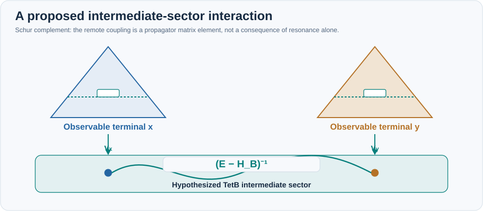

This identifies the three obligations for a native GFD derivation: $H_B$, local coupling vectors $v_x,v_y$, and an intermediate propagator with a nonzero off-diagonal matrix element. If the intermediate dynamics are block-local with disjoint invariant supports for these vectors, that matrix element vanishes identically despite equal signatures. Derive its spatial, frequency and causal behavior; it cannot be inferred from matching alone. This is an explicit research route, not a demonstration of an interplanetary interaction.

### 5.3 Correct chirality and address matching

The Gram mismatch

$$d_G(G_x,G_y)=\min_{P\in S_3}\|G_x-P^TG_yP\|_F$$

is a pseudometric on matrices, and a metric on their permutation orbits. The Gaussian selector is bounded if its width $\epsilon>0$ and chirality labels are $\pm1$. The original proof independently minimizes over all six permutations and tests handedness. But an odd permutation of an ordered triad reverses its orientation while its Gram matrix transforms by congruence. An orthonormal triad illustrates the problem: swapping two columns leaves $G=I_3$ while changing the sign of the determinant. A label-only change should not arbitrarily change acceptance.

**Candidate repair:** test chirality inside the matching operation, using the same permutation:

$$M_{xy}=\max_{P\in\mathcal P}\left[e^{-d_P^2/(2\epsilon^2)}\frac{1-\chi_x\chi_y\det P}{2}L_P\right],\qquad d_P=\|G_x-P^TG_yP\|_F,$$

where $L_P\in[0,1]$ is the permutation-consistent phase factor and $\mathcal P$ is the permitted relabelling set. If labels are freely permuted, all address data (including phase and allowed correspondences) must transform consistently. Full permutation freedom can remove chirality discrimination for symmetric Gram matrices: an odd automorphism of a Gram matrix can undo a handedness condition. Hence the stronger physical remedy is an intrinsically labelled, noncoplanar oriented frame (or distinguishable axes and a restricted relabelling group). Coplanar directions have zero determinant and no chirality sign; nearly coplanar ones are poorly conditioned. Specify a robust independent third reference before using a shaft-derived address. A Gram matrix determines relative angles and lengths, not absolute spatial direction.

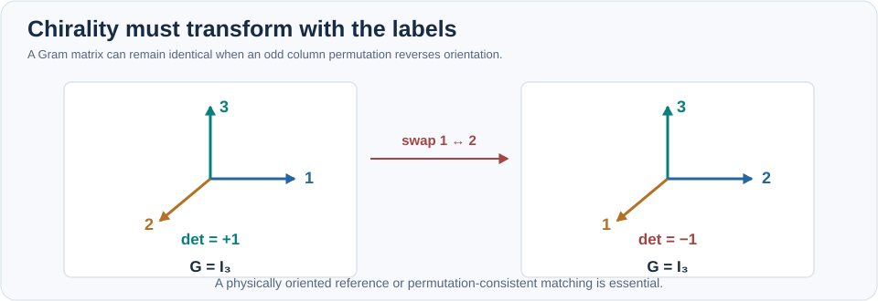

This replaces a coordinate-dependent filter with a well-defined candidate functional. In the revised Hamiltonian, $|\kappa_0|M_{xy}$ is bounded by $|\kappa_0|$; this reduces the maximum possible transfer budget, not necessarily the instantaneous probability at an arbitrary late time (Rabi oscillations can reverse that ordering).

### 5.4 Exact optimum transfer time under equal loss

Adding $-i\gamma/2$ to both diagonal entries in frequency units gives $P_\gamma(t)=e^{-\gamma t}P_0(t)$, with $\gamma\ge0$ the occupation decay rate. At resonance and $k=|\kappa|>0$,

$$P_\gamma(t)=e^{-\gamma t}\sin^2(kt).$$

The first maximum is the global maximum for $\gamma>0$, since successive lobes decay. Differentiating yields

$$\boxed{t_{\rm opt}=\frac1k\arctan\left(\frac{2k}{\gamma}\right)}$$

with limit $\pi/(2k)$ when $\gamma=0$. The peak is

$$P_{\rm opt}=\frac{4k^2}{\gamma^2+4k^2}\exp\left[-\frac\gamma k\arctan\left(\frac{2k}{\gamma}\right)\right].$$

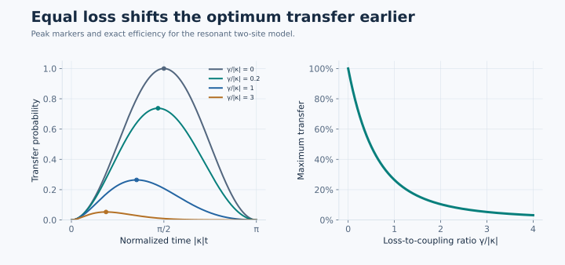

This gives an empirical specification: both coupling rate and loss must be measured. A high quality factor is helpful but not a substitute for nonzero intersite coupling. Unequal losses, dephasing or external pumping require an extended dynamical model; do not apply the equal-loss formula to them without justification.

### 5.5 Invert the transfer bound for experiments

A calibrated experiment that measures transfer probability $P$ by time $T>0$ within the two-site model must have

$$\boxed{\int_0^T|\kappa(t)|dt\ge\arcsin\sqrt P,\qquad\operatorname*{ess\,sup}_{0\le t\le T}|\kappa(t)|\ge\frac{\arcsin\sqrt P}{T}.}$$

This is a lower bound, not an upper bound on an unknown interaction. A null outcome constrains specific calibrated models of drive, detuning, loss and observation time; it cannot rule out arbitrary time-dependent coupling whose transfers cancel. Determine the ordinary electromagnetic, acoustic and mechanical contributions, define noise and confidence intervals, and use independent control channels. Compare matched and detuned configurations, deliberately alter the oriented address, and blind the analysis to the match condition. An anomalous residual must survive conventional explanations and independent replication.

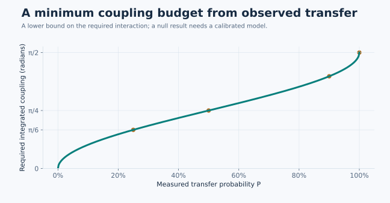

**GP-5 recommendation:** retain the exact transfer and speed-bound results; clarify hypotheses, add the Schur-complement derivation, permutation-consistent addressing, optimum equal-loss transfer and inverse experimental bound. Do not equate excitation transfer with macroscopic matter transport. Such a claim needs a state-preserving, causal theory with conservation and energy-momentum accounting.

---

## The missing unification of the five proofs

The five proofs should become a compositional framework, not five parallel mathematical facts. The following three bridges express exactly what remains to be derived.

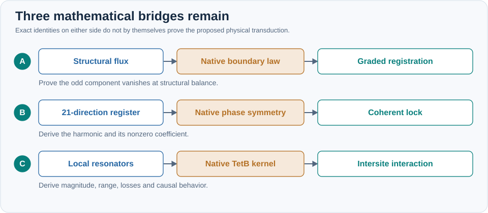

### Bridge A — Geometry to closure registration

$$\mathcal A(u)=P_{17}+[2\mu_B(u)-1]P_4.$$

This definition gives the neutral projection at the half-section plane. A native transduction theorem must show that a physical coupling actually has this spatial dependence, rather than merely define an operator with the desired trace. It must distinguish the geometric plane, the constitutive transition $x=1$ and the native Field Origin. A viable derivation would start from the native action on a bounded domain, derive the relevant boundary functional, and prove that its parity-odd matrix elements vanish at structural balance without assuming that cancellation in the action.

### Bridge B — Registration to phase dynamics

$$\mathcal V(\Psi)=V_{\rm radial}(|\Psi|)-2h|\Psi|^{21}\cos21\theta.$$

The 21-dimensional representation motivates a 21-fold phase lock, but dimension does not imply a cyclic phase symmetry. Derive the actual symmetry group and its representation on the collective order parameter. If it acts by $\Psi\mapsto e^{2\pi i/21}\Psi$, a pure phase harmonic invariant under the group must have order divisible by 21. Then the first allowed nonconstant pure harmonic is 21, though its coefficient could vanish. Show that the native dynamics produces that nonzero coefficient and stabilizes the radial amplitude. Establish whether the threefold and sevenfold apparatus stages implement registration, separate harmonic locking, or complementary spectral selection.

### Bridge C — Coherence to intersite interaction

Let the native coupling vectors at the two sites depend on the local registration and coherence variables,

$$v_x=v_x[\mathcal A(u_x),\Psi_x],\qquad v_y=v_y[\mathcal A(u_y),\Psi_y].$$

Then the stationary mediated interaction is

$$\hbar\kappa_{xy}^{\rm induced}(E)=\langle v_x,(E-H_B)^{-1}v_y\rangle.$$

Derive the local vertices and the intermediate dynamics from the native action. Test whether the resulting kernel is nonzero for separated sites and whether it actually obeys the proposed phase, geometry and chirality selection. The same kernel must predict the magnitude, range, frequency dependence and losses, not just the condition for a match. Only after such a derivation is it meaningful to test a Stargate-specific prediction beyond standard cavity physics.

## Proposed additions and verification plan

| Proof | Proposed extension | Verification target |
|---|---|---|
| GP-1 | Measure-theoretic regularity and graded-operator realization | Exact section scaling; flux identity with proper boundary hypotheses; distinguish physical premise |
| GP-1 | Survey interval and preregistered comparison | Recompute from source survey; compare defined room/height targets across monuments |
| GP-2 | Global affine-root uniqueness | Prove strict monotonicity and endpoint limits of $B(u)$ for all real gradients |
| GP-2 | Normalized sharpness and volume-based bound | Continuous endpoint witnesses; conservative lower/upper displacement; source accounting |
| GP-3 | Unitary rigidity | Actual finite-dimensional self-adjoint involution and spectral projections |
| GP-3 | Complete exact intertwiners | Block-support iff theorem; zero coupling countermodel; degenerate eigenspaces |
| GP-3 | Infinite coprimality | Induction over fusion factors, no finite enumeration |
| GP-4 | Approximate coprime locking | Exact $L^2$ triangle bound; finite and probability-measure formulations |
| GP-4 | Complementary reconstruction | Exact 14+7 character cancellation and phase/gain-error tolerance |
| GP-5 | Intermediate-sector reduction | Schur complement, diagonal shifts, zero-channel countermodel and dispersive validity |
| GP-5 | Relabelling-consistent mirror address | Odd permutations, symmetric Gram stabilizers and rank-deficient frames |
| GP-5 | Optimum loss and inverse bound | Analytic maximum, zero-loss limit, experimental inference conditions |

## Formal verification audit

The branch includes five Lean files, although its proof index still says that only scripts are available. Reconcile the index with the actual formalization and clearly identify the proved propositions. A source-level inspection is not a certificate of a successful build.

| Proof | Existing Lean coverage (source inspection) | Remaining work |
|---|---|---|
| GP-1 | Scalar powers, balance uniqueness, dimension coincidence, halving levels, labelling | Section scaling as measure theory, divergence theorem, explicit geometric hypotheses |
| GP-2 | Monotone affine range, algebraic derivative coefficient, interval bounds, constitutive arithmetic | All-real root uniqueness, normalized sharpness, continuity, gravity bound |
| GP-3 | Cyclotomic evaluations, coincidence, coprimality, fusion, scalar multiplicities | Actual Hilbert-space operators, intertwiners, infinite pairwise coprimality |
| GP-4 | Sine and cosine inequalities, finite ensemble bound, 3/7 identity, geometric sums | Probability-measure equality conditions, Parseval, complementary filter, approximate locking |
| GP-5 | Closed-form normalization, peak and tolerance, selector, pseudometric | Time-dependent speed bound, intermediate elimination, relabelling consistency, losses |

Add regression tests that specifically falsify the previous overbroad claims: negative affine gradients, normalized endpoint profiles, zero-splitting transfer, late-time Rabi ordering and symmetric Gram matrices. Existing check counts document the branch's reported suite, not independent referee execution.

## Final referee assessment

The five proofs have improved the programme; none needs to be discarded. The most striking geometrical result is the nominal King's Chamber correspondence, the strongest algebraic result is the unique numerical interlevel hinge and its possible full intertwiner theorem, and the strongest dynamical result is the coupling-budget bound.

The highest-value next task is **deriving the physical interaction of a macroscopic resonator at the proposed structural Field Origin with the native TetB closure engine**. The geometry locates a candidate interface. The grading characterizes its proposed neutral operation. The phase theorems determine what coherent addressing would require. The transfer bound specifies the interaction strength that an actual experiment would have to demonstrate.

That is the path from architectural interpretation to a testable physical hypothesis. The Stargate remains a hypothesis; the mathematics in this report supplies explicit conditions it would have to satisfy.

---

### Source and packaging note

The five pinned proof directories above are the audit basis. The accompanying SVG diagrams are newly drawn, static technical illustrations of the report; plots use equations stated here and the numerical assumptions from the source or the stated referee refinement. They are not experimental measurements. The report does not modify any source proof, Proof 26, or the remote repository.
