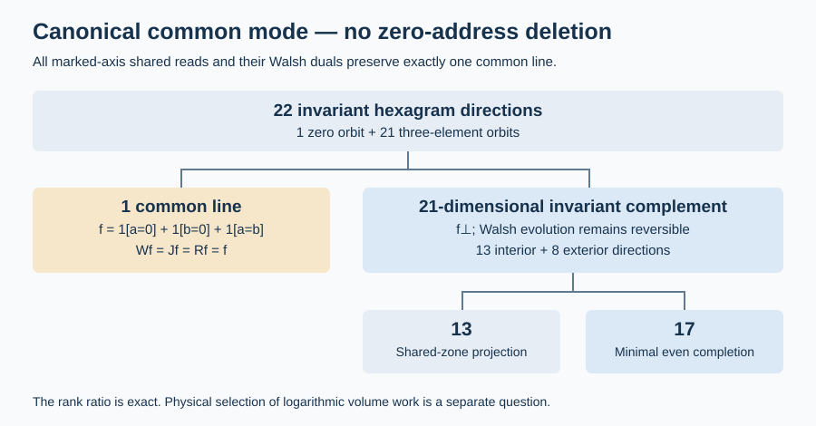

# The shared-zone theorem: canonical common mode and 13/17 contrast registers

**Status:** proved finite algebra, conditional on the binary symplectic Walsh read, threefold XOR action, and shared-zone definition. No claim of native electromagnetic or gravitational dynamics. Proof 26 is unchanged. This note resolves the zero-coordinate deletion problem for the shared-zone model, not the physical selection problem.

## 1. Set-up

Let V=F₂³ with the standard binary dot product, X=V×V, and B((a,b),(c,d))=a·d+b·c. On real functions on X use the counting inner product and normalized Walsh matrix W_xy=(-1)^B(x,y)/8. Thus W=Wᵀ and W²=I. Define R(a,b)=(b,a+b), J(a,b)=(b,a). They preserve B, so W commutes with their permutation operators. R³=J²=I and JRJ=R⁻¹. The R-invariant space H has dimension 22 (one zero orbit and 21 three-element orbits). J has even and odd dimensions 15 and 7 there (seven nonzero rank-one orbits fixed, fourteen rank-two orbits paired).

For a nonzero u, put L=span(u). Define Q_u as the coordinate projector onto U_u={ (a,b): a∈L or b∈L or a+b∈L }. Equivalently the pair in V/L is dependent. Each of the three conditions has 16 solutions; all pairwise and triple intersections have four. Thus |U_u|=40, rank Q_u on H=14. This support is R- and J-invariant. Let Q=Q_111, V_Q=WQW, and E_±=(I±J)/2. Define P=Q+(I−Q)E_+.

## 2. Theorem: unique common line

Let f(a,b)=1_{a=0}+1_{b=0}+1_{a=b}. Then f(0,0)=3, f=1 on the 21 nonzero dependent pairs, f=0 elsewhere, and ||f||²=30. Each defining support is a three-dimensional self-annihilating subspace of X under B. Its indicator is fixed by W (character orthogonality, normalization 8). R and J permute these three supports, hence Wf=Rf=Jf=f. Every Q_u preserves f, as does WQ_uW.

Conversely, the intersection of the U_u over all seven axes (or just the four odd-weight axes) is the set of dependent pairs: an independent pair spans a two-plane containing only three nonzero vectors, and U_u holds exactly when u lies in that plane. In H a function g on that intersection has value g₀ at zero and value g_v on the three pairs (v,0),(0,v),(v,v), v≠0. For independent c,d the unique nonzero n orthogonal to c,d satisfies

$$8(Wg)(c,d)=g_0-\sum_{v\ne0}g_v+4g_n.$$

Indeed the sum of the three characters is 3 if v=n, and −1 otherwise. Every nonzero n occurs. If Wg is also supported in the intersection, then every g_n has the same value t, and g₀=3t. Thus g=tf, proving uniqueness of the common line. This is a support-and-Walsh theorem, not a statement that the common mode is the physical mass inventory.

Let F=ffᵀ/30 in the counting metric. Then F is an orthogonal projector, W F=F W=F, and F commutes with J and every Q_u, with Q_u F=F. The same holds for P. The 21-dimensional space H₀=f⊥∩H is invariant under W,J,Q,P. Restriction to H₀ is equivalently represented by Q₀=Q−F, P₀=P−F (zero on f). These are genuine orthogonal projections of ranks 13 and 17, with P₀Q₀=Q₀. In particular this is not deletion of the zero address, which W does not preserve. It is also not automatically the same 21-dimensional ledger or grade flag as in Proof 26: a physical identification would be a separate theorem.

## 3. Independent analytic proof of the 60-degree planes

For u=111, decompose V=L⊕E orthogonally, E=u⊥. The restricted form on the two-dimensional E is alternating and nondegenerate. Thus X=(L×L)⊕(E×E), W=W_L⊗W_E, with both factors orthogonal involutions. The support of Q is all four axial pairs times the ten dependent transverse pairs. Write a nonzero dependent transverse pair as (s v₁,s v₂), where s∈E\{0} and v=(v₁,v₂)∈F₂²\{0}. The compression of W_E to these ten pairs, in order 0 followed by the 3×3 array (s,v), is

$$K=\frac14\begin{pmatrix}1&\mathbf1^T\\\mathbf1&J_9-2(J_3-I_3)\otimes(J_3-I_3)\end{pmatrix}.$$

The sign is negative exactly when s≠s' and v≠v': B factors into the alternating products on the two two-dimensional spaces. On the 2D space of the zero coordinate and normalized all-ones array, K has matrix [[1,3],[3,1]]/4 with eigenvalues 1,−1/2. The row-contrast / column-constant and row-constant / column-contrast spaces each have eigenvalue 1 (two dimensions each). The mixed contrasts have eigenvalue −1/2 (four dimensions). Hence K has eigenvalues 1 (5) and −1/2 (5).

The simultaneous R,J action on axial pairs permutes the three nonzero labels, leaving zero fixed. Its representation is 2 trivial copies plus one real two-dimensional standard S₃ representation S. On transverse pairs it permutes only the v index. The +1 eigenspace of K is 3 trivial copies plus S; the −1/2 eigenspace is one trivial copy plus 2S. The axial Walsh factor commutes with R,J and has square I, so the square of the full QWQ compression on its range is I⊗K². The C₃-invariant part of a trivial tensor trivial is one-dimensional and exchange-even. The C₃-invariant part of S⊗S has dimension two, one even and one odd: its invariant tensors are the metric and oriented area form. A trivial tensor S has no invariant. Therefore the squared overlap on H has the table

| Eigenvalue of QWQWQ on im Q | J even | J odd | total |
|---|---:|---:|---:|
| 1 | 7 | 1 | 8 |
| 1/4 | 4 | 2 | 6 |

This proves the six principal angles of 60 degrees. On H₀ remove the one even common vector f, leaving seven unit overlaps and six quarter overlaps. The two orthogonal reflections about Q₀ and WQ₀W rotate by ±120° on these six planes and act as identity on the common and common-excluded sectors. Their product has order 3, characteristic polynomial (λ−1)^9(λ²+λ+1)^6 on H₀. No numerical diagonalization is required.

## 4. Minimal exchange-even completion

On H, Q has even rank 11 and odd rank 3. The full even sector has rank 15. All four even nontrivial principal planes have one exterior direction; their off-block matrix has rank four because W²=I and the squared compression is 1/4. Thus the unique minimal extension containing Q that completes its even Walsh closure and leaves its odd subspace unchanged is P=Q+(I−Q)E_+. Removing f preserves this statement: Q₀ has even/odd ranks 10/3, P₀ has 14/3. P₀ is rank 17. Q₀ has rank 13. On H₀, P₀ has fifteen common dimensions, two principal mixing planes, and two common-excluded dimensions. Its reflection cycle has characteristic polynomial (λ−1)^17(λ²+λ+1)^2. Completing the odd sector instead is another possible rank-17 extension; therefore even completion must be motivated physically, not asserted as the only possible extension of Q₀.

## 5. What the theorem does and does not establish

The intrinsic rank ratio is exactly tr(P₀)/tr(Q₀)=17/13. In a model with common per-channel logarithmic volume normalization, det(exp(sP₀))=exp(17s) and det(exp(sQ₀))=exp(13s), giving the ratio. This is conditional on selection of that observable. The actual coherent three-projection return on Q₀ has seven unit modes and six −1/8 modes; P₀ has fifteen unit modes and two −1/8 modes. Their trace ratio is 59/25, not 17/13; the squared-return intensity trace ratio is 481/227, also not 17/13. Thus the threefold cycle alone does not prove the physical coupling. Neither does the common-line theorem identify f with the actual mass source, nor determine α or the long-range work stiffness. A native action must supply those identifications.

## Verification

`python -m pytest -q test_common_mode_proof.py` — 17 exact rational tests. No Lean formalization claimed. The proof uses binary characters, orthogonal projection, and elementary S₃ representations; the tests independently check the matrices, all seven axes, common-line uniqueness, reduced spectra and alternative return observables.
