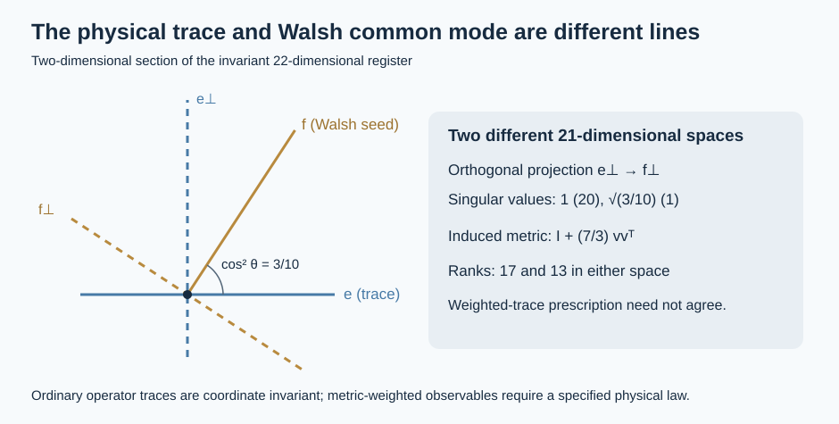

# Native density register and the three-snapshot theorem

*GFD exploratory continuation · November 2026*

**Status:** exact conditional algebra, with 20 new Python checks (some floating-point checks of analytic identities). Not a derivation of the physical gravitational action. Proof 26 unchanged. This follows the independently committed [conserved-norm metric note, 690fb6f](https://github.com/fielddynamics/research/blob/690fb6f2e61268c41a035a5f83ba305659dd9763/research/exploratory/i-ching/WORK_METRIC_FROM_THE_CONSERVED_NORM.md) and uses the existing eight-central-amplitude read of [NATIVE_WALSH_READ](https://github.com/fielddynamics/research/blob/main/research/hadamard-null-cone-vortex-flywheel/NATIVE_WALSH_READ.md) and [THREE_SUBREAD_CLOSURE](https://github.com/fielddynamics/research/blob/main/research/hadamard-null-cone-vortex-flywheel/THREE_SUBREAD_CLOSURE.md).

## 1. Embedding without 64 independent oscillators

For the eight core amplitudes z, set rho = zz†. Let B_mu be the 64 tensor products of I,X,Y,Z divided by sqrt(8), orthonormal in the Hilbert–Schmidt inner product. The real coordinates x_mu = tr(B_mu rho) obey Parseval:

$$\sum_\mu x_\mu^2=\operatorname{tr}(\rho^2)=(z^\dagger z)^2.$$

Thus there is a canonical Euclidean operator-coordinate metric, and the normalized Pauli change of coordinates is an isometry. This is not a linear embedding of 64 independently variable occupations into the 33- or 36-complex-amplitude native model: off-diagonal density entries carry coherences, and the rank-one condition constrains them. The scalar occupation is tr(rho), not the sum of squares of independent operator coordinates. For mixed rho, tr(rho²) and tr(rho)² generally differ.

The total native norm is conserved under Hermitian evolution. The **core** occupation generally is not. With core/environment split psi=(z,w), off-diagonal Hamiltonian block B, the exact continuity identity is

$$\frac{d}{dt}\|z\|^2=2\operatorname{Im}(z^\dagger Bw)=-\frac{d}{dt}\|w\|^2.$$

Consequently for pure rho, d tr(rho²)/dt = 2 ||z||² d||z||²/dt. A witness using the inherited Stage IX coupling B=-T, T rows (1,s_x,s_y,s_z), with z=i 1 and origin c=(1,0,0,0), all other amplitudes zero, has d||z||²/dt=16 and d||c||²/dt=-16 in dimensionless units. Any additional Hermitian within-block dynamics contributes zero to the respective block norm derivative. The example disproves automatic conservation of the core operator norm; it does not disprove total conservation. If the core is isolated and evolves unitarily, its density evolves by conjugation, preserving the Hilbert–Schmidt norm and the spectrum. For a subsystem with flux, this requires additional conditions or explicit accounting of its exchange. A registration isometry is not automatically a physical energy or work isometry.

## 2. Three independent snapshots: necessary and sufficient

The inherited candidate one-axis unitary U=(I+i(X+Y+Z))/2 has eigenvalues exp(±i pi/3). U3=U tensor U tensor U has three distinct eigenphases, with multiplicities 2,3,3 (the extreme phases exp(±i pi) coincide). Its conjugation has order three. Averaging that conjugation is the orthogonal block-pinching projection T onto its commutant. On Hermitian operators the image is Herm(2) direct sum Herm(3) direct sum Herm(3), of real dimension 22. At fixed trace the affine space has dimension 21.

For r weighted pure snapshots collect their columns in A (weights absorbed into columns); rho=AA†. In the spectral basis of U3, write A as three row blocks A_m, m=2,3,3. Then T(rho)=diag(A_2 A_2†, A_3 A_3†, A'_3 A'_3†). The possible positive semidefinite blocks are precisely those of rank <=r. Necessity follows from the rank bound. Sufficiency: given any such blocks, factor each as L_m L_m† with at most r columns and pad with zeros, then stack the factors. The off-diagonal blocks are discarded by T. Fixed total trace normalizes ||A||_F².

A positive semidefinite Hermitian m by m matrix of rank k has real dimension 2mk-k² (factor with full-column-rank complex m by k matrix, quotient by U(k)); the maximal stratum has k=min(m,r). At fixed nonzero trace the maximal dimension is

$$d_r=\sum_{m=2,3,3}(2m\min(m,r)-\min(m,r)^2)-1.$$

Thus d_1=12, d_2=19, d_3=21, and d_r=21 for r>=3. Three columns are necessary for generic interior targets with full-rank 3 by 3 blocks; three suffice for every invariant positive operator. These are independently variable snapshots, not three transformed copies of one snapshot. Applying R or U3 repeatedly to one snapshot and averaging gives rank one in each invariant block, not three independent columns per block. This distinction also applies to three radix-four FWHT sweeps. It is a new constraint on an implementation of the collective source, not a proof of a physical clock or of independent native snapshots.

## 3. Two different common modes

In the signless Pauli orbit labeling the zero-address basis vector e corresponds to I_8/sqrt(8), i.e. the physical trace coordinate. The previous Walsh-preserved common seed f has value 3 at zero, value 1 on 21 nonzero dependent-pair records, and zero otherwise; ||f||²=30. In the unnormalized Pauli basis its operator is

$$F_{\rm op}=\sum_{P=X,Y,Z}(I+P)^{\otimes3}.$$

It is positive semidefinite of rank three (the three polarized product states are independent), with trace 24 and squared Hilbert–Schmidt norm 240. It is not proportional to I_8. In the normalized Pauli basis the coefficient vector f represents F_op/sqrt(8). The algebraic common direction f_hat=f/sqrt(30) and the physical trace direction e overlap by c=3/sqrt(30), c²=3/10. They are not interchangeable. The threefold invariant fixed-trace tangent space is e-perp; the earlier invariant Walsh contrast space is f-perp. Both have dimension 21. P,Q preserve both e and f; subtracting either common projector separately gives ranks 17,13, but the original abstract W preserves f, not e. Indeed <e,W e>=1/8, and compression of W to e-perp has singular values 1 (multiplicity 20), 1/8 (multiplicity 1); it is not a reversible isometry on the physical trace-zero subspace. Proof: the compression of an orthogonal W to e-perp loses at most rank one in its squared Gram, with lost vector the projection of W†e into e-perp. This is a warning against identifying a coordinate transform with a physical trace-preserving state operation. An orthogonal change of coordinate chart transports the trace functional as well as the coordinates.

The projection L=(I-f_hat f_hat†)|e-perp is an isomorphism onto f-perp, since c!=0. Its singular values are 1 (20 copies), |c| (one copy). The induced metric from e-perp on f-perp coordinates is I+(7/3) vv†, with v the unit vector parallel to (I-f_hat f_hat†)e. That direction lies in both reduced projectors P0,Q0. If one inserts this metric into the earlier Euclidean weighted-trace prescription, it gives

$$\frac{17+7/3}{13+7/3}=\frac{29}{23},$$

not 17/13. This is a counterexample to silently identifying the two common modes, not a physical prediction or a claim that an invariant operator trace changes under a coordinate transformation. Ordinary operator traces with consistently transformed operators remain invariant. The work observable and its metric must be specified together. The physical trace-fixed space itself already gives ordinary ranks 17,13, while the abstract Walsh isometry fails on it. A native transduction law must choose the trace convention, the common register and how W acts.

## 4. Attenuation: amplitude, occupation, and determinant

If a microscopic transfer acts on each of the eight core amplitudes as z -> sqrt(p) z, then rho -> p rho. Hence a linear density transfer on 21 contrasts with scalar p has det=p^21, whereas det(T†T)=p^42. A channel with amplitude t=sqrt(alpha) on the 21 **operator coordinates**, rather than on z, yields det(T†T)=alpha^21. For a trace-preserving contrast channel an example is rho -> p rho+(1-p)tr(rho) I/8 with p in [0,1]; its contrast determinant has the same distinction. These are different maps. We cannot use the squared amplitude gain of a microscopic transfer and then square its density determinant again without changing the exponent. The construction of an actual exterior-power source from the native dynamics remains open.

## 5. What the next derivation must do

1. Identify the physical register (amplitudes, operator records, or independent ensemble of records), and distinguish total conserved norm from local flux.
2. Derive a temporal or spatial snapshot accumulation law that supplies the three independent columns (or another full-rank source) without assuming independent microscopic states. Derive the threefold averaging or coherent equivalent from the native action; the existing controlled Pauli rotation is not the autonomous flywheel evolution.
3. Establish the native trace convention and action of the Walsh read, and the physical source/work observable. The flat-read lemma is correct for diagonal isometric register metrics; it is not automatically a mechanical-energy theorem.
4. Derive the gain on that register and the collective volume source; a regular single-state fixed-trace tangent cannot provide an invertible 21-dimensional response. Then derive a source-carrying long-wave mode and absolute G. No physical constants are inferred from the new dimension theorem.

## Reproduction

`OPENBLAS_NUM_THREADS=1 python -m pytest -q test_density_registration.py` (20 checks; NumPy tolerances for spectral/rank examples, SymPy rational checks for common-line and attenuation identities). Cumulative local suite: 582 passed, plus seven original exact rational assertions. This suite is based on the prior local research archive, not a rerun of the independently updated main-branch 320-test suite. No Lean or external review, no remote write.
