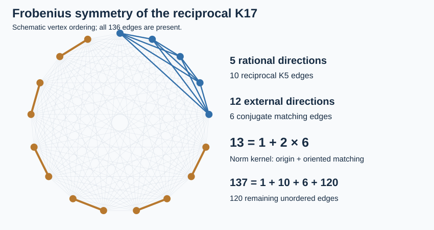
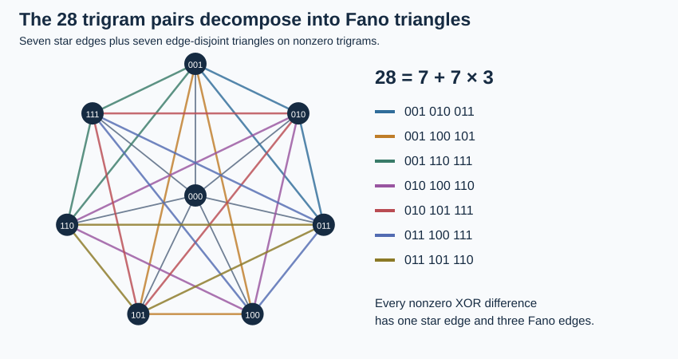

# Frobenius reciprocity, the 13-sector matching and the Fano decomposition

**Status:** exact finite algebra extending `ICHING_FINITE_FIELD_RECIPROCITY.md`. No physical electromagnetic gain, gravitational coupling or native action selection is claimed. Proof 26 is unchanged. The field representation and marked origin are inherited choices.

## 1. A split of the projective multiplicative group

Let U=GF(4096), E=GF(64), L=GF(16), F=GF(4). The cyclic group C=U*/L* has order 273=21·13; the embedded E*/F* is its order-21 subgroup B. Use a Singer generator to write C additively as Z/273 and use CRT coordinates (a,b)=(x mod 21,x mod 13). The two commuting involutions are field conjugation σ:x→x^64 and multiplicative inversion ι:x→x⁻¹. In additive coordinates they are multiplication by 64 and -1. Since 64≡1 mod 21 and 64≡-1 mod 13,

    σ(a,b)=(a,-b),  ι(a,b)=(-a,-b),  ισ(a,b)=(-a,b).

The embedded norm N(x)=x^65 has kernel A of order 13, exactly Fix(ισ), since x^64=x⁻¹ projectively. Its image is B, on which N acts by squaring; Fix(σ)=B; Fix(ι)={O}. These facts are independent of the choice of Singer generator. Each coset of B (one Baer sector) contains exactly one A point, because A∩B={O} and AB=C. Thus the kernel is a canonical transversal of the Baer sectors once the subfield tower has been chosen. A is not a Baer subplane and its diagonal mask is not the Baer averaging projector.

## 2. A new reciprocal-graph theorem

Use the previous bijection of C−{O} with the directed edges of K17: [x]→(π([x]),π([x⁻¹])). Frobenius σ preserves O and its pencil and acts simultaneously on both edge endpoints. The 17 directions consist of five rational directions and six conjugate pairs. Proof: choose a basis of U over L consisting of a basis of E over F with first vector 1. On the two-dimensional quotient U/L, σ conjugates coefficients in L via the fourth power, fixing the F-rational lines (five). The remaining twelve are exchanged in pairs. The subplane B contributes O and all directed edges of K5 on the rational directions, by the previous reciprocal-edge theorem at q=4.

If ισ fixes a directed edge (i,j), then (σ(j),σ(i))=(i,j). Hence j=σ(i) and i≠j. Conversely every such edge is fixed. Consequently A consists of O and the two orientations of a perfect matching of six edges on the twelve external directions. The denominator count now has an exact geometric realization:

    17 = 5 + 12,
    13 = 1 + 2·6,
    137 = 1 + C(17,2) = 1 + 10 + 6 + 120.

The 120 remaining unordered edges are exchanged in 60 pairs by σ. The 10 K5 edges and 6 matching edges are fixed as unordered edges. This is a structural theorem; it does not prescribe work normalization, and the matching is not a spatial set of physical field channels.

## 3. Exact operator and quotient tests

The permutation operators of σ,ι commute. On the full 273-address register their traces are 21,1,13 for σ,ι,ισ respectively. The joint sign projectors (I+sσ)(I+tι)/4 have ranks 77,70,60,66 for signs (++),(+-),(-+),(--). Inversion-even dimension is 137, but imposing Frobenius invariance as well leaves only 77. This is a discriminator against silently treating two different symmetries as identical. The norm descends to inversion orbits. Its identity fibre has 7 inversion orbits (O and six matching edges), while each of the ten other reciprocal norm classes has 13 orbits. Under both σ and ι the quotient becomes (C21/±)×(C13/±), hence 11·7=77, with seven classes above each reciprocal norm class. No claim that these numbers are physical constants.

Let Q be the full Baer averaging projector, Z the 273×13 matrix of normalized sector indicators, M the diagonal mask of A, and T the coordinate embedding of A into C. Then √21 TᵀZ is a permutation matrix: each Baer sector has precisely one kernel address. This yields a canonical lossless sampling and reconstruction of the sector-constant register, with the normalization fixed by its block size 21. It is not valid for arbitrary input records. Let V be the normalized outgoing pencil indicators (zero at O); then VᵀMV has spectrum 0 fivefold and 1/16 twelvefold. The 13th kernel address O is invisible to the pencil. Thus a direct masked overlap cannot automatically give 17/13. In particular tr(MQ)=13/21, not 17/13. These are independent predictions that distinguish a physical sector average from point sampling.

## 4. Back to the eight trigrams: a Fano plane, not just 28

Let a,b be vectors in GF(2)^3. The threefold map R(a,b)=(b,a+b) and swap S(a,b)=(b,a) generate GL(2,2)≅S3 on the ordered pairs. Orbits are classified by the span of a,b:

- rank zero: one singleton;
- rank one: seven three-element orbits (0,d),(d,0),(d,d) for d≠0;
- rank two: seven six-element orbits, one for each 2D binary subspace, with the two cyclic orientations of its three nonzero vectors.

Therefore 64=1+7·3+7·6, and the 21 nonzero cyclic orbits split as 7+2·7. Passing to unordered distinct trigram pairs gives K8, decomposed into the seven edges of the star at zero and the seven edge-disjoint triangles of the Fano plane on the nonzero trigrams: 28=7+7·3. The lines {a,b,a+b} are not arbitrary triangles; every two nonzero trigrams lie on exactly one line. The Fano incidence matrix B satisfies BBᵀ=2I+J. The four pairs for a fixed nonzero XOR difference d are the star edge {0,d} plus three opposite edges of the three Fano lines through d. This gives a second exact explanation of 28=7·4. The 28 count alone does not derive 1/28 as an electromagnetic correction.

## 5. Implications for the native action

The new tower ties the 13 Baer sectors to a distinguished reciprocal matching and supplies an independent canonical sampling operator. The 137 inverse-orbit count is naturally partitioned by the same conjugation. The Fano decomposition clarifies which part of the 21-register would be lost by imposing trigram-swap symmetry: the nonzero invariant space then has dimension 14, not 21. A physical action must specify whether swap acts covariantly or is projected out. An exact reciprocal geometry does not select a physical α or its fractional correction. Nor does the perfect matching yield the source-to-stiffness ratio on its own. A candidate native action must be tested against these spectra and symmetry distinctions before identifying its physical observables.

Run `OPENBLAS_NUM_THREADS=1 python -m pytest -q test_reciprocal_tower.py` (48 tests). The field arithmetic and projective incidence are constructed by `finite_geometry.py`. No Lean build or external review is claimed.
