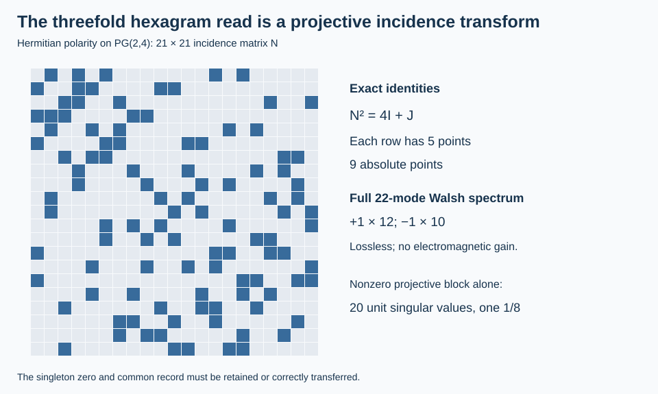
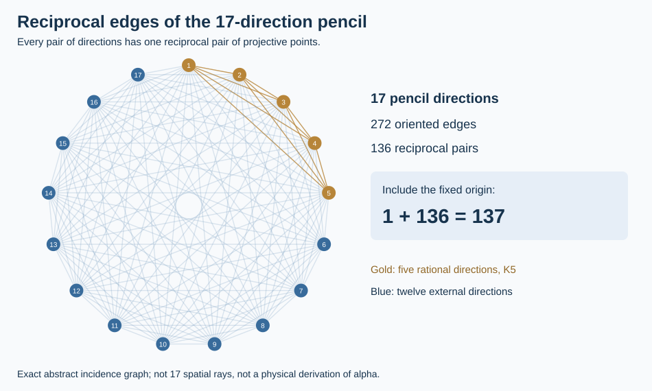

# I Ching, finite-field reciprocity and the 17-direction register

**Research status:** exact conditional finite algebra and verified countermodels. No native electromagnetic gain, G, or physical action is derived. Proof 26 unchanged. This note strengthens the geometric bridge and identifies important symmetry and traversal obstructions.

## 1. Trigrams as GF(8) in a self-dual normal basis

In GF(8) choose a root b of x³+x²+1. Then b,b²,b⁴ are distinct, their sum is 1, and Tr(b^(2^i)b^(2^j))=δ_ij. Indeed Tr(b)=1, hence diagonal entries Tr(b²)=1; Tr(b³)=0 using b³=b²+1, and the off-diagonal entries follow by cyclic Frobenius invariance. The Gram matrix is I, proving independence. Map a binary trigram (a0,a1,a2) to a=a0 b+a1 b²+a2 b⁴. Addition is XOR; cyclic line rotation is squaring; 000 is 0 and 111 is 1. Complementation is a→a+1, **not** multiplicative inversion. The normal basis is a chosen field representation, compatible with the line ordering and cyclic rotation; the I Ching does not independently prescribe field multiplication.

Choose ω∈GF(4), ω²+ω+1=0. Since GF(8) and GF(4) have coprime extension degrees over GF(2), their compositum is GF(64), with each hexagram represented uniquely by x=a+ωb. The repeated XOR read R(a,b)=(b,a+b) is multiplication by ω. Trigram swap (a,b)→(b,a) is x→ω x⁸; cyclic rotation of both trigrams is x→x¹⁶. The nonzero R-orbits are exactly E*/F* = PG(2,4), E=GF(64), F=GF(4). Thus 64=1+3×21. The three line pairs supply a coordinate flag and its grades 1,4,16, but cyclic rotation does not preserve that flag.

The norm N_E/GF8(x)=x⁹ is invariant under GF(4)* and maps the 21 projective points onto the seven nonzero trigrams, with three points per fibre. Each fibre has one binary rank-one orbit (represented by (a,0)) and two rank-two orbits exchanged by conjugation. This is a field-arithmetic refinement of 21=7+14. Swapping the two trigrams fixes seven projective points, giving even dimension 14 and odd dimension 7 on the nonzero projective register. No physical source parity is inferred.

## 2. A natural marked point for the existing projective lift

Use the compositum U=GF(4096), L=GF(16), E=GF(64), F=GF(4). The smaller projective plane embeds into U*/L* as E*/F*. The hexagram orbit of Heaven–Earth, Earth–Heaven and Heaven–Heaven corresponds to F* itself, i.e. the identity projective point O=[1]. Under the simultaneous cyclic line rotation x→x¹⁶ in U, the fixed **vectors** form L, so O is the unique projective direction with fixed vectors (there are also projective eigenlines with other eigenvalues). This supplies a natural marked-point candidate tied to the chosen time direction, without identifying a zero hexagram with a nonzero projective point or claiming a physical center is a direction.

The norm U→E is x→x⁶⁵, descends to U*/L*→E*/F* and has fibres of size 13. The embedded smaller plane is a transversal; its 13 multiplicative cosets are the Baer partition. This is the existing Proof 26 appendix construction, now explicitly linked to the paired trigrams. A 273-dimensional interaction-coordinate algebra can be bijected to this plane by the appendix's chosen flag and extension basis, not identified as an algebra homomorphism. The multiplicative coset partition and physical lift still need independent selection.

## 3. The Walsh transform is an incidence transform

Use the binary symplectic form B((a,b),(c,d))=a·d+b·c modulo 2, where dot products use the three trigram bits. Self-duality of the normal basis identifies this with Tr_GF64/GF2(x y⁸); equivalently it is Tr_F/GF2(H(x,y)), where H(x,y)=Tr_E/F(x y⁸) is a nondegenerate Hermitian form over F. The character transform W(x,y)=(-1)^B(x,y)/8 is an orthogonal involution and commutes with R. It differs from the ordinary binary-dot Walsh matrix by a swap of input coordinates, an explicitly specified permutation.

On the normalized orbit-indicator basis of the 22-dimensional R-invariant subspace, including the singleton zero, the exact induced matrix is

    W22 = (1/8) [[1, sqrt(3) 1^T], [sqrt(3) 1, 4N-J]],

where N_ij=1 iff H(x_i,x_j)=0 on projective representatives. The orbit character sum is 3 when H=0 and -1 otherwise, because a nonzero linear character of GF(4) sums to zero over all four field elements. Nondegeneracy of the form gives a projective polarity, so N is symmetric, each row contains five ones, and two distinct rows meet in one point. Therefore N²=4I+J. Its trace is nine: in the bit-coordinate Hermitian dot product, absolute points have exactly two nonzero GF(4) coordinates, giving 3×3=9. Hence its eigenvalues are 5 once, +2 elevenfold, -2 ninefold. W22 has +1 twelvefold and -1 tenfold; it is lossless. The 21×21 bottom-right block has singular values 1 (twentyfold) and 1/8 (once); it is not the full read. W22 maps the uniform physical record to the zero-frequency coordinate. A mean-zero input maps isometrically to the zero-frequency-free output; do not confuse dropping one coordinate with dropping the common inventory or derive α from this compression.

## 4. New theorem: every pair of pencil directions has a unique reciprocal edge

Let L=GF(q), U=GF(q³), and mark O=[1] in PG(2,q). Let π be the pencil map from non-origin projective points to the q+1 lines through O. Define

    E([x])=(π([x]), π([x⁻¹])).

Inversion is well-defined on projective classes in the multiplicative quotient U*/L*. If x∉L and x⁻¹ were on the same pencil line, x⁻¹=u+v x for some u,v∈L. This gives a polynomial of degree at most two for x, impossible in a degree-three field extension. Thus E has no loops.

For any distinct pencil lines L1=span_L(1,x), L2=span_L(1,y), the images of x,y in U/L are independent. Every non-origin point of L1 has unique normalized representative x+t, t∈L, and likewise y+u for L2. For them to be reciprocal projectively, their product must lie in L*. Modulo L this condition is

    [xy] + t[y] + u[x] = 0.

The quotient has dimension two, so there is exactly one pair (t,u) solving the equation. Both factors are nonzero because x,y∉L. Their product is therefore nonzero. This proves E is a bijection to the directed edges of K_(q+1), and inversion swaps edge orientations. For q=16:

    273 = 1 + 17×16
    137 = 1 + binom(17,2) = 1 + 8×17.

This is a new exact structural explanation of the integer 137 in the earlier GFD electromagnetic counting proposal, **conditional on the reciprocal quotient being the intended count**. It unifies it with the 17-direction projection without an additional eightfold counting assumption. It does not establish that 1/α counts these orbits or derive the fractional correction. The embedded Baer subplane through O is the same construction at q=4: its 20 non-origin addresses are the directed edges of K5. The other 12 pencil directions are external. Inversion maps each Baer coset of label j to -j modulo 13. It does not keep individual pencil lines fixed.

## 5. Exact inversion-parity discriminator

Let A be the 17×272 outgoing-edge incidence matrix (equivalent to the pencil incidence), V=Aᵀ/4, and K the edge-reversal permutation. Then VᵀKV=(J-I)/16: one edge per distinct ordered pair of vertices. With E_±=(I±K)/2 the pencil compressed parity operators VᵀE_±V have spectra

    even: 1, (15/32)^16
    odd: 0, (17/32)^16.

Hence their ranks are 17 and 16. On the Baer register the reversal acts by j→-j, giving even rank 7 and odd rank 6. An action selecting only inversion-even ranks would use 17/7 rather than 17/13. If it instead uses compressed traces, the pencil even trace is 17/2 and the Baer even trace is 7 (different again). This is a concrete discriminator, not a proposed replacement for G. It shows that identifying neutral mass with reciprocal-even projection needs care. The K17 graph also has Laplacian 17I-J, with nonzero eigenvalue 17 of multiplicity 16; this graph is internal incidence geometry, not a three-dimensional spatial propagation lattice.

The original 28 count has a distinct binary interpretation: there are C(8,2)=28 unordered distinct trigram pairs. The seven nonzero XOR differences partition them into seven perfect matchings of four pairs each. This is an exact count but is not the same object as the 28 geometric elements of the two tetrahedra. It does not force a 1/28 action correction.

## 6. A major symmetry and π-walk obstruction

R is the unique invertible per-bit linear shift (a,b)→(b,pa+qb), p,q∈GF(2), satisfying order three (p=q=1). However, physical rotation of the three spatial axes is a different transformation S, commuting with R. On the projective 21, S fixes three points (x→x¹⁶ on the cyclic quotient C21 fixes gcd(15,21)=3). If one requires invariance under both, only 3+(21-3)/3=9 nonzero projective orbits remain, plus zero: ten invariant coordinates, not 22. The physical time-face action must specify whether spatial rotation acts covariantly, rather than imposing both invariances on its read.

The existing π traversal uses modulo-eight addition. A prescribed digit d induces (a,b)→(b,b+d mod8); this map has rank eight as a pullback on the 64-state function space, since the old a is discarded. It cannot equal the bijective R. In the first 333 base-eight digits of π, including the integer 3, cumulative positions from zero cover all 64 successive pairs, but only 36 of the 331 successive triples satisfy c=a XOR b. The first triple (3,4,5) already violates c=3 XOR 4=7. Thus the traversal is not an implementation of R. A separate feedback/aggregation operator or a different read interpretation is required. Coverage alone cannot establish a projective Walsh read. This is compatible with treating π as a schedule rather than the transfer operation itself.

## 7. Implications for the next proof

The new finite-field representation, the Hermitian incidence transform and the reciprocal-edge theorem give exact connections from the 64 addresses to 21 projective directions, 273 interaction coordinates, 17 pencil directions, 13 Baer sectors and 137 reciprocal classes. They improve the geometry, not the physical source theorem. The following remain independent: why the native action uses the specified read symmetry and field multiplication, why it registers the top exterior volume, why the elementary gain is physical α, why 17/13 is the source-to-stiffness normalization, and why the coupled spatial system has a universal massless work response. Do not infer any of those from finite-field counts alone. Neither the BBP rule nor the π walk is newly proved here.

Verification: `OPENBLAS_NUM_THREADS=1 python -m pytest -v scripts/finite_field_reciprocity/test_iching_bridge.py` (52 named tests, exact combinatorial identities and numerical matrix spectral checks). Run from the I Ching folder. Install dependencies with `python -m pip install -r scripts/finite_field_reciprocity/requirements.txt`. Regenerate the diagrams with `python scripts/finite_field_reciprocity/make_iching_figures.py`. The new tests reproduce the geometry using the existing GF(4096) generator, and check explicit counterexamples. Source: [Book of Changes and Pi](https://github.com/fielddynamics/research/blob/main/research/exploratory/i-ching/BOOK_OF_CHANGES_AND_PI.md); [circular closure walk](https://github.com/fielddynamics/research/blob/main/research/exploratory/i-ching/notes/circular_closure_walk_synthesis.md); [Proof 26 appendix](https://github.com/fielddynamics/research/blob/main/proofs/recursive-field-closure-response/APPENDIX_PROJECTIVE_GEOMETRY.md).
