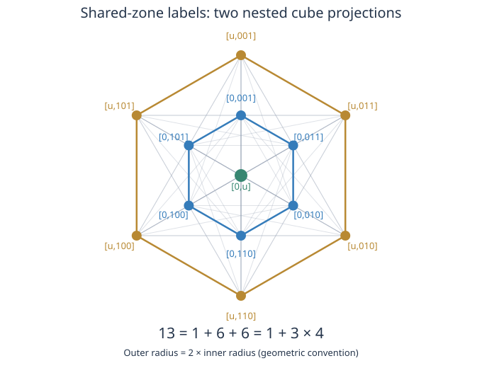
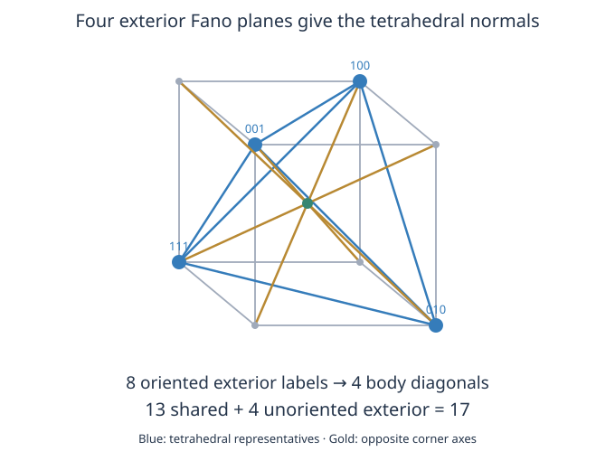

# Nested cube projection and the shared-zone geometry

**Status:** exact binary label geometry and equivariant coordinate isometry. The radial scale two is the conventional Fruit of Life drawing and is compatible with inherited dyadic refinement, not forced by the binary algebra. No claim of historical encoding, physical coupling or change to Proof 26.

## 1. Shared labels

Let u=111, [a,b] the orbit of (a,b) under R(a,b)=(b,a+b). The 13 nonzero shared-zone orbits are [0,u], six [0,v] and six [u,v] with v neither 0 nor u. These are distinct because an independent pair in a plane containing u has exactly one representative with first entry u. Exchange J fixes [0,v] and maps [u,v] to [u,v+u]. Group the six v into three complementary pairs; each pair gives four records, hence 13=1+3*4.

## 2. Exact projection

Write s(v)=((-1)^v1,(-1)^v2,(-1)^v3), n=(1,1,1), and p(v)=s(v)-(n dot s(v))n/3. Thus p(0)=p(u)=0; the six remaining projections have squared length 8/3 and inner products with each ring point (8/3)*{1,1/2,1/2,-1/2,-1/2,-1}. They form a regular hexagon. Also p(v+u)=-p(v). Map [0,u] to zero, [0,v] to p(v), [u,v] to 2p(v). This bijects the 13 labels to the standard 13-centre two-ring arrangement of Metatron's Cube, with every pair connected if one wants its complete-graph drawing. Coordinate permutations preserve the correspondence. The involution v -> v+u on both rings provides a geometric half-turn; J is NOT that half-turn (it fixes the inner ring). Together with cyclic coordinate permutation and a coordinate transposition, the former involution gives the dihedral symmetry of the two rings. The scale 2 is an explicit geometric choice; any scale >1 is algebraically possible. Reference for conventional arrangement: https://madegooddesigns.com/tools/metatrons-cube/ . The labels do not establish physical interactions along the 78 drawn segments.

## 3. Four exterior axes

The remaining eight nonzero orbits are oriented planes avoiding u. Each plane is n-perp for a unique nonzero binary normal n with n dot u=1. There are four such normals (001,010,100,111), each with two orientations. Their sign vectors s(n) have pairwise inner product -1 and squared length 3. They form a regular tetrahedron; their unoriented lines are precisely the four cube body diagonals. Sum s(n)=0 and sum s(n)s(n)^T=4I_3. Hence the partial exchange quotient has 13+4=17 directions: 13 shared labels plus four exterior plane normals. This does not identify those 4 axes with four extra planar centres. Their spatial interpretation is a dual normal construction, not an embedding of all 17 labels in Metatron's Cube.

## 4. An isometric label bridge without deleting the common mode

In the normalized 22-dimensional orbit basis, f has component 3/sqrt(30) on the zero orbit and sqrt(3)/sqrt(30) on each of seven dependent orbits, and zero on independent orbits. Let B embed the 21 nonzero orbit coordinates, M=I-ff^T, L=MB. Let k be the unit uniform vector on the seven dependent labels, K=kk^T. Directly L^T L=I-(7/10)K. Thus the canonical positive polar normalization

    T = L [I+(sqrt(10/3)-1)K]

satisfies T^T T=I21, TT^T=M. This supplies an actual orthonormal identification with the common-mode complement. T intertwines J, the marked shared projectors and coordinate permutations, since they preserve the zero orbit, f and k. Hence the shared 13 labels and positive 17 directions represent the actual reduced subspaces isometrically. The map mixes the dependent labels in the full orbit basis: the projected point labels are not raw independent physical occupations. T does not assert that the Walsh transformation is an orthogonal spatial motion of Metatron's diagram. The 21-space remains dynamically Walsh-invariant, but a pointwise planar read is not derived.

## 5. Boundary of the result

We have an exact projection of two nested cubes, an exact projective-label correspondence, the four tetrahedral dual normals, and an isometric mapping of those labels to the canonical contrast space. No physical selection of the scale ratio, the complete graph edges, the native vortex metric, the electromagnetic gain or the gravitational determinant follows. Matching the geometric pattern alone is not evidence for a physical law.

Verification: `python -m pytest -q test_metatron_shared_geometry.py` (19 tests). The geometric dot products and normal counts use integer arithmetic; the polar isometry is additionally checked numerically against the displayed exact formula.
