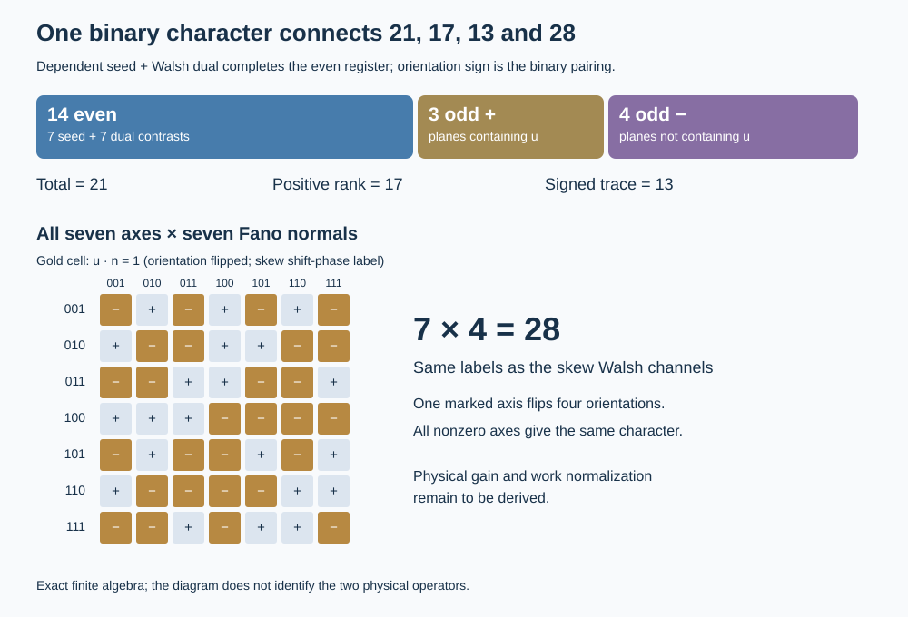

# Common-seed duality and the binary orientation character

**Status:** exact finite algebra, with independent rational operator verification. Physical selection, coupling scale and native action remain open. No change to Proof 26.

## 1. Common seed and its dual

Use the 22-dimensional threefold-invariant hexagram register V, with R(a,b)=(b,a+b), symplectic Walsh W and exchange J, all as defined in [the common-mode proof](COMMON_MODE_AND_SHARED_ZONE_PROOF.md). Let D project onto the dependent pairs and F project onto the unique common line f (norm squared 30 in the original address metric). Write V0=f-perp, M=I-F, E+=(I+J)/2 and E-=(I-J)/2. D has rank 8 and is contained in every marked shared-zone projector Q_u. Both D and WDW have ranges in the exchange-even register since dependent orbits are fixed by exchange and W commutes with J. Their intersection has dimension 1 by the common-mode theorem. Since exchange fixes eight orbits and swaps seven pairs, E+ has rank 15. Thus

    im D + im WDW = im E+.

This establishes exchange-even closure from the common seed, rather than prescribing even closure by itself. For a marked nonzero u, Q_u has 11 even and 3 odd directions, the latter belonging to Fano planes containing u. Since D is contained in Q_u, the minimal subspace containing Q_u and its universal seed's Walsh dual is Q_u + E+, of dimension 18. Its orthogonal projector is

    P_u = Q_u + (I-Q_u) E+.

After removing F, Q_u-F has rank 13 and P_u-F rank 17. The 21-space splits into 14 even and 7 odd directions; the 13-space has 10 even and 3 odd; the 17-space has 14 even and 3 odd. This is a new sufficient minimal completion criterion, not a claim that the native physical action necessarily selects the criterion. Full Walsh closure of Q_u is a different operation.

### Explicit seed spectrum

A dependent-pair function is specified by g0 and g_v for each nonzero v. For any independent pair with unique nonzero normal n, its Walsh value is (g0 - sum g_v + 4g_n)/8. Thus the seed dual supplies arbitrary values on the seven unordered Fano planes (4I-J_7 is invertible). On the seed, the matrix of DWD is 1/8 times [[1,3 1^T],[1,J_7+2H_7]], where H_7(v,w)=(-1)^(v dot w). The two constant-block eigenvalues are 1 and -1/4 (the reduced 2 by 2 matrix is [[1,21],[1,5]]/8). H_7^2=8I-J_7 and H_7 1=-1. Its trace is -1, so the contrast eigenvalues are +/-sqrt(8), three each. The remaining DWD eigenvalues are therefore +/-1/sqrt(2), three each. The squared principal overlaps of D and WDW after F removal are 1/16 (once), 1/2 (six times). None is one, proving the dual seed sum is direct after removing F, though not orthogonal.

## 2. Binary orientation representation

On V define S_u=Q_u+(I-Q_u)J for nonzero u, and S_0=I. The independent orbits are two orientations of each Fano plane. Label a plane by its unique nonzero normal n, and choose a normalized antisymmetric orientation difference e_n. Then u belongs to the plane iff n dot u=0. Therefore S_u is identity on the exchange-even subspace and

    S_u e_n = (-1)^(n dot u) e_n.

The sign comes from swapping the two orientations exactly when the marked axis is outside their plane. It follows that S_u S_v=S_(u+v), S_u^2=I, and every gate is orthogonal. The contrast representation is 14 trivial characters plus each of the seven nontrivial binary characters once, equivalently 13 trivial representations plus one regular representation of (Z/2)^3.

Hence for u != 0:

    tr_V0 I=21, rank_V0 (I+S_u)/2=17, tr_V0 S_u=13.

This realizes the structural polynomial f(4,s)=1+4s+16 as tr(P_u-F+s (I-P_u)) for s=-1,0,+1, where P_u=(I+S_u)/2. In particular the three structural numbers are one character identity, with no 273-point extension. This signed involution is not asserted to equal the inherited grade involution as an operator. Nor is Q_u-F identical to S_u|V0; they have equal trace but different spectra. The binary character gives a single-generator conditional logarithmic-volume identity: d log det exp(t(P_u-F)) / d log det exp(t S_u|V0) =17/13. A physical law selecting these volumes is still needed.

The exact all-axis averages are sum_(u !=0) Q_u=3I+4D (each independent plane contains three nonzero axes) and (1/8) sum_u S_u=E+. The sum of the seven negative projectors is 4E-. These follow from the binary character and do not require a physical axis sweep.

## 3. Same incidence produces all 28 skew channels

Each nonzero axis flips exactly four odd directions. Each nonzero normal n is flipped by four axes. Thus the complete incidence set

    C={(u,n): u,n in GF(2)^3, u dot n=1}

has 28 elements. This is literally the same label set as the signed shift/phase operators X_u Z_n with transpose -X_u Z_n from [Walsh skew-channel action](WALSH_SKEW_CHANNEL_ACTION.md). This is an explicit label-level bridge between the binary orientation gate and the electromagnetic skew register, not an identification of the two operators (they act on different spaces). Fixing only the Heaven axis gives four incident labels, not all 28. Equal weights over the 28 channels and the additive inverse-gain rule remain physical hypotheses.

The 17-dimensional positive space also has 136 independent skew generators; adjoining a scalar yields 137 as before. That is a dimension of a candidate algebra, not a proof of electromagnetic response. There is no new correction fitted to alpha.

## 4. Native-action discriminator

The gates commute with one another, but the Heaven-axis gate does not commute with Walsh: the commutator has rank four. This is consistent with two remaining Walsh mixing planes. A native model must preserve or account for that mixing; merely choosing an eigenvalue count cannot suffice. Even a gate-invariant positive work metric H can change the ratio: with unit weight on the positive space and weight two on the negative space, tr(H P)/tr(H S)=17/9, not 17/13. Thus character symmetry alone does not force uniform work normalization. The full physical operator, its source and kinetic normalization, and alpha still have to be derived.

Reproduce: `python -m pytest -q test_orientation_character.py`. The suite verifies the dual seed spectrum, all seven completions, all 64 group products, character sum, 28-channel incidence, Walsh commutator and work counterexample in exact arithmetic.
