# The I Ching and the Architecture of Field Closure

### From eight trigrams to 64 records, 21 spectral directions and the arithmetic of gravity

*Gravity Field Dynamics (GFD) · Exploratory research · November 2026*

`binary geometry` · `stellated octahedron` · `π` · `Walsh–Hadamard` · `finite fields` · `field closure`

---

In 1703, Gottfried Wilhelm Leibniz recognised his binary arithmetic in a diagram of the 64 hexagrams of the *I Ching*. Broken and unbroken lines could encode every number from zero to sixty-three. A book about change contained a complete binary address space.

But what if counting is only the beginning?

Place the eight trigrams at the corners of a cube. Separate the father's family from the mother's family. Two regular tetrahedra appear. Pair the trigrams to form hexagrams, and an order-three operation on their corresponding lines generates exactly 21 nonzero projective directions. Apply a Walsh transform, and those directions acquire an incidence geometry. Mark the shared zone, and a single orientation character exposes the three integers **13, 17 and 21** that recur throughout GFD.

The investigation is not an attempt to derive physics from an ancient text. It is an attempt to understand why the same algebra appears in binary geometry, number theory and the proposed field-closure engine—and to identify which mathematical bridges are exact, which are conditional, and which require a physical mechanism.

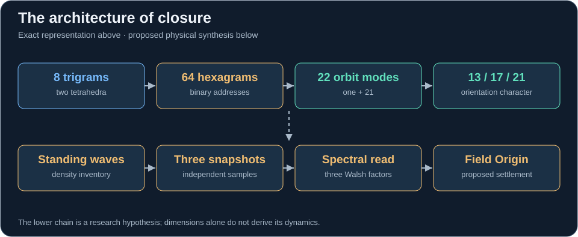

> **Core thesis:** the hexagrams provide a complete binary representation of the dual-tetrad core's candidate closure register. A threefold spectral read, a reciprocal shared-zone geometry, and the registration of standing-wave inventory may be different aspects of one field-closure mechanism. The outstanding task is to derive their composition from the native dynamics, rather than identify them merely because their dimensions agree.

## 1. The book is a cube

Read each trigram from bottom to top as three bits, with yang = 1 and yin = 0. For a bit vector $a=(a_1,a_2,a_3)$, place it at $s(a)=((-1)^{a_1},(-1)^{a_2},(-1)^{a_3})$.

| Trigram | Name | Bits | Family |
|---|---|---|---|
| ☰ | Qian · Heaven | 111 | Father, TetA |
| ☳ | Zhen · Thunder | 100 | Eldest son, TetA |
| ☵ | Kan · Water | 010 | Middle son, TetA |
| ☶ | Gen · Mountain | 001 | Youngest son, TetA |
| ☷ | Kun · Earth | 000 | Mother, TetB |
| ☴ | Xun · Wind | 011 | Eldest daughter, TetB |
| ☲ | Li · Fire | 101 | Middle daughter, TetB |
| ☱ | Dui · Lake | 110 | Youngest daughter, TetB |

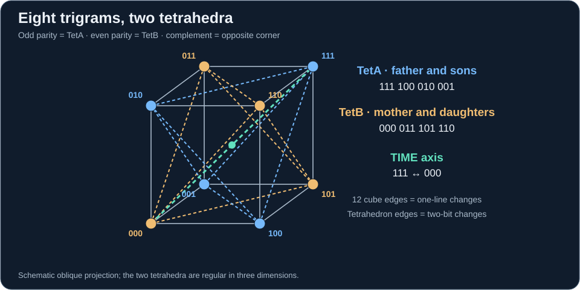

Each family has constant bit parity. Distinct members of a family differ in exactly two bits, so their distances are all $2\sqrt2$ in the sign-coordinate cube. Each family is a regular tetrahedron; their intersection is the octahedral core. Their four complementary pairs lie on the four body diagonals, meeting at the common centre, the candidate Field Origin. The Heaven–Earth diagonal is the marked TIME axis in GFD's interpretation.

A single changing line flips a bit and traverses a cube edge. There are twelve such edges. The six signed coordinate directions form an octahedron. The cycle-space dimension of the connected cube graph is $12-8+1=5$. These are not approximate correspondences; they are exact properties of the chosen binary representation.

**Read:** [The Book of Changes and π](BOOK_OF_CHANGES_AND_PI.md) · [The hexagrams and the closure read](HEXAGRAMS_AND_THE_CLOSURE_READ.md) · [Proof 25](../../../proofs/tetrad-flywheel-convergence/)

## 2. The hexagrams are the complete address space

Two trigrams form a hexagram. Write it as $(a,b)$, with $a,b\in V=\mathbb F_2^3$. The complete register is $X=V\times V$, with $8^2=64$ addresses. There are 32 pairs of the same parity and 32 of opposite parity. The labels may be viewed as a matrix, with a lower trigram indexing its row and an upper trigram indexing its column.

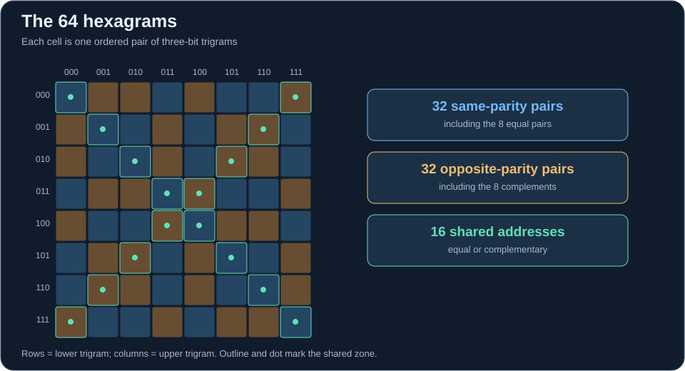

The modern algebraic operation on corresponding lines is

$$R(a,b)=(b,a\oplus b).$$

It sends $(a,b)\to(b,a\oplus b)\to(a\oplus b,a)\to(a,b)$. Thus $R^3=I$. Only $(0,0)$ is fixed. The other 63 addresses fall into 21 three-element orbits.

$$\boxed{64=1+3\times21}$$

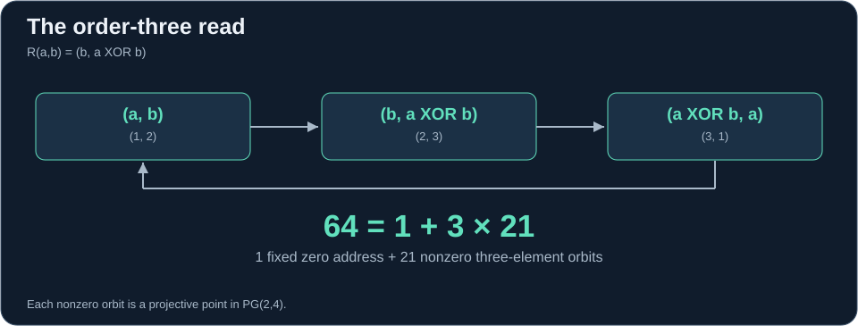

Pair each lower line with its corresponding upper line. Each pair is an element of $\mathbb F_4=\{0,1,\omega,\omega^2\}$ with $\omega^2=\omega+1$. Multiplication by $\omega$ sends $x+y\omega$ to $y+(x+y)\omega$. Therefore the threefold read is scalar multiplication by $\omega$ on $\mathbb F_4^3$.

The nonzero orbits are precisely the points of $PG(2,4)$. Filtering by the highest nonzero corresponding pair gives grades

$$21=\frac{4-1}{3}+\frac{16-4}{3}+\frac{64-16}{3}=1+4+16.$$

There is a second decomposition: seven dependent-pair orbits make the Fano subplane $PG(2,2)$; fourteen independent-pair orbits make its complement. Trigram exchange fixes the seven dependent labels and swaps the other fourteen in pairs. These two decompositions illuminate different aspects of the same register.

Do not confuse this operation with the geometric rotation cycling the three line positions about the Heaven–Earth axis. That rotation fixes four hexagrams and has 24 total orbits (23 after omitting zero), whereas $R$ has 22 total orbits. The physical time-face operation must select the correct action.

## 3. One spectral transform, three sweeps

The complete six-bit Walsh–Hadamard read can be factored in two ways, after consistently ordering its bits:

$$H_{64}=H_8\otimes H_8=H_4\otimes H_4\otimes H_4=H_2^{\otimes6}.$$

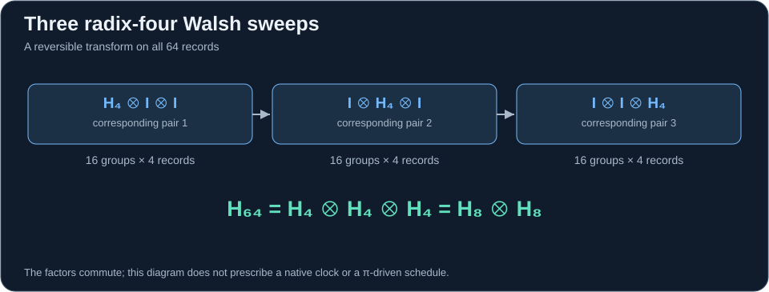

The first factorisation reads two trigrams; the second reads three corresponding pairs. Each radix-four stage applies the normalized $4\times4$ Walsh matrix along one coordinate, operating on sixteen groups of four. The stages commute and their complete product is a reversible, norm-preserving transform. This is an algebraic connection to [Proof 26](../../../proofs/recursive-field-closure-response/), not yet a demonstration of how the standing waves physically implement it.

For the symplectic version, define $B((a,b),(c,d))=a\cdot d+b\cdot c$ over $\mathbb F_2$. Then $W_{xy}=(-1)^{B(x,y)}/8$. This differs from the ordinary Walsh read by a trigram swap on its input. It is symmetric, orthogonal, and commutes with $R$ and trigram exchange.

Using a self-dual normal basis for $\mathbb F_8$, a hexagram becomes $a+\omega b\in\mathbb F_{64}$. The symplectic pairing is the binary trace of a Hermitian form over $\mathbb F_4$. On the normalized orbit basis of the invariant 22-dimensional space, the induced read is

$$W_{22}=\frac18\begin{pmatrix}1&\sqrt3\,\mathbf1^T\\\sqrt3\,\mathbf1&4N-J\end{pmatrix},$$

where $N$ is the Hermitian polarity incidence matrix on $PG(2,4)$ and $J$ is the all-ones matrix. Each row of $N$ contains five ones and $N^2=4I+J$. This is an exact, lossless incidence transform. Simply dropping the zero coordinate produces a different, non-orthogonal read.

**Read:** [Finite-field reciprocity](ICHING_FINITE_FIELD_RECIPROCITY.md) · [Hexagrams and the closure read](HEXAGRAMS_AND_THE_CLOSURE_READ.md)

## 4. Where the 13, 17 and 21 come from

Begin with the marked axis $u=111$ and let $L=\{0,u\}$. The shared zone consists of equal or complementary pairs: $a\oplus b\in L$. There are 16 shared addresses; the exclusive Hamming-distance-one and distance-two zones contain 24 each.

Saturating the shared zone under the threefold read gives

$$U=\{(a,b):a\in L\text{ or }b\in L\text{ or }a\oplus b\in L\}.$$

The three sets each have 16 addresses, and their pairwise and triple intersections all have four. Inclusion–exclusion gives $|U|=48-12+4=40=1+3\times13$. Thus the invariant shared support has rank 14, before separating the common mode.

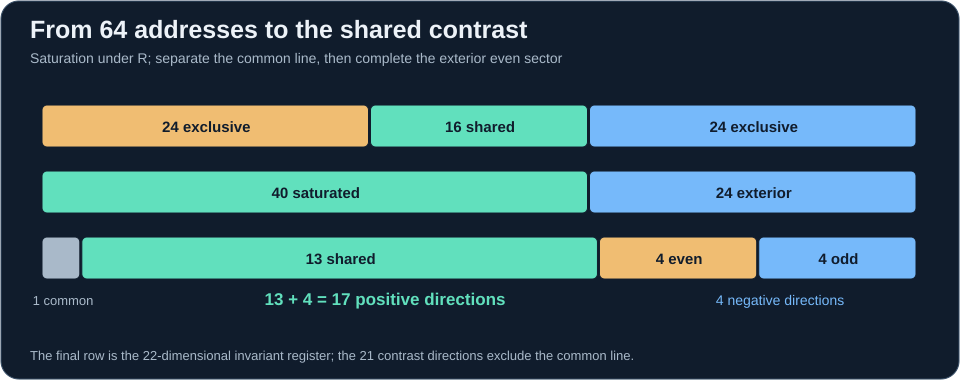

The common-mode theorem identifies the unique Walsh-preserved line simultaneously shared by all marked-axis support reads:

$$f(a,b)=\mathbf1_{a=0}+\mathbf1_{b=0}+\mathbf1_{a=b},\qquad \|f\|^2=30.$$

It is fixed by $W$, $R$, trigram exchange $J$ and every shared-zone projector $Q_u$. Separate its projector $F=ff^T/30$, without deleting any raw address. On $\mathcal H_0=f^\perp\cap\operatorname{Fix}(R)$, the reduced shared projector $Q_u-F$ has rank 13. Adjoining the universal dependent-seed Walsh dual supplies the minimal exchange-even completion $P_u=Q_u+(I-Q_u)(I+J)/2$, of reduced rank 17.

The crucial result is even simpler. Define a single orientation gate

$$S_u=Q_u+(I-Q_u)J.$$

It swaps the orientations of an independent plane exactly when the marked axis lies outside that plane. The contrast space carries fourteen trivial binary characters and each of the seven nontrivial characters once. For any nonzero $u$, exactly four of the seven nontrivial characters change sign. Hence

$$\boxed{\dim\mathcal H_0=21,\quad\operatorname{rank}\frac{I+S_u}{2}=17,\quad\operatorname{tr}S_u=13.}$$

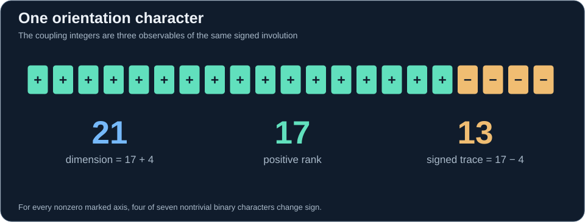

GFD's coupling polynomial $f(K,s)=1+sK+K^2$ at $K=4$ is recovered as a trace of the positive and negative sectors, $17+4s$. This is a structural identity, with no need to impose the three numbers separately. The shared projector of rank 13 and the signed involution of trace 13 are nevertheless different operators. A physical law must select the corresponding work observable.

**Read:** [Shared-zone read](SHARED_ZONE_HEXAGRAM_READ.md) · [Walsh rotation](SHARED_ZONE_WALSH_ROTATION.md) · [Common-mode proof](COMMON_MODE_AND_SHARED_ZONE_PROOF.md) · [Orientation character](ORIENTATION_CHARACTER_AND_SEED_DUAL.md)

## 5. The geometry hidden in the shared zone

The 13 nonzero shared labels consist of one central orbit, six inner-ring labels and six outer-ring labels. Project the cube along the Heaven–Earth axis. Its complementary axial corners project to the centre; the remaining six project to a regular hexagon. A second ring at twice the radius reproduces the conventional thirteen-centre drawing known as Metatron's Cube.

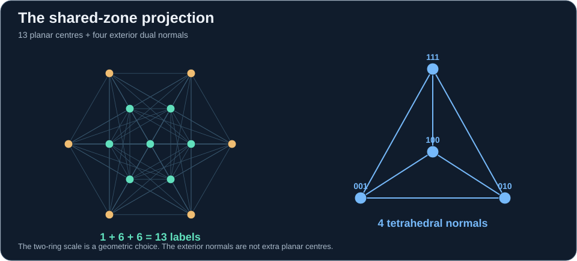

The eight exterior orbits are the two orientations of each of four planes avoiding the marked axis. Their four binary normals are $001,010,100,111$; the corresponding sign vectors are the vertices of a regular tetrahedron. The exterior even completion adds four directions, giving $13+4=17$.

The note constructs an explicit polar-normalized isometry from the 21 orbit labels to the contrast space. The radial factor two is a conventional geometric choice, not forced by the binary algebra. The drawing does not imply physical interactions along all of its lines, and the four exterior normals are not four extra planar centres.

**Read:** [Metatron shared-zone geometry](METATRON_SHARED_ZONE_GEOMETRY.md)

## 6. Reciprocity, the next scale and the number 137

The 21-point plane embeds into $PG(2,16)$ using the subfield tower $\mathbb F_4\subset\mathbb F_{16}$ and $\mathbb F_{64}\subset\mathbb F_{4096}$. The larger plane contains

$$16^2+16+1=273=21\times13$$

points. Its multiplicative quotient is cyclic of order 273; the embedded plane of order four is a subgroup of order 21. A norm map supplies a distinguished transversal of 13 points, once the field tower is chosen.

More generally, mark $O=[1]$ in $PG(2,q)$. A non-origin point $[x]$ determines the pencil direction through $O$ and $[x]$, and a reciprocal direction through $O$ and $[x^{-1}]$. These directions differ: otherwise $x$ would satisfy a quadratic over $\mathbb F_q$ in a cubic extension. The ordered pair uniquely determines the point, by intersecting the line constraints or equivalently solving the reciprocal equation. The resulting bijection identifies non-origin points with the directed edges of $K_{q+1}$.

For $q=16$, there are 17 pencil directions, 272 directed edges and 136 unordered reciprocal edges. Including the origin gives 137 inversion-even directions. Frobenius conjugation splits the pencil into five rational directions and six pairs of exterior directions; its composition with inversion fixes the origin and twelve directed matching edges, giving 13.

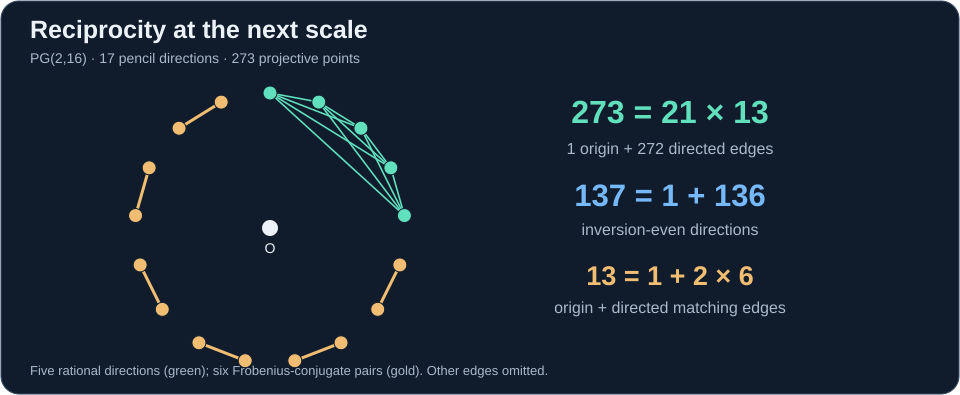

These are exact dimension and symmetry identities. They are not yet a derivation of the measured inverse fine-structure constant, $\alpha^{-1}\approx137.036$. In particular the 28 skew Walsh channels are another structural count: on $8\times8$ real matrices $W(X)=H_8 X^T H_8$, conjugate by the change of variables $Y=XH_8$ to transpose. The negative eigenspace is $\Lambda^2\mathbb R^8$, dimension 28. Its labels $(d,k)$ have $d\cdot k=1$, exactly seven sets of four. A full shift/modulation and $GL(3,2)$ symmetry average makes its channel covariance scalar, with factor $1/28$. Whether the physical response performs that average or converts it into an additive inverse gain is open.

**Read:** [Reciprocal tower](FROBENIUS_RECIPROCAL_TOWER.md) · [Walsh skew channels](WALSH_SKEW_CHANNEL_ACTION.md)

## 7. The coupling polynomial at the prime two

The three structural values also arise from integer lattice rotations of orders three, four and six:

$$\det(KI-C_n)=\Phi_n(K),\qquad n=3,4,6.$$

For $K=4$ the respective cyclotomic polynomials yield 21, 17 and 13. In the Eisenstein integers $\mathbb Z[\omega]$ the prime 2 is inert, giving residue field $\mathbb F_4$. The order-three and order-six matrices reduce to the same XOR rotation mod 2 (in the specified coordinate convention); their sign difference survives mod 4. In the Gaussian integers $\mathbb Z[i]$, $2=-i(1+i)^2$ ramifies. The order-four matrix reduces to trigram swap, conjugate to the binary Sierpiński shear.

This is why a binary register can preserve the 21-direction read while forgetting the root sign distinguishing TetA from TetB. Recovering the physical orientation therefore requires more than an undifferentiated binary address count.

**Read:** [The coupling polynomial at two](THE_COUPLING_POLYNOMIAL_AT_TWO.md)

## 8. π: the traversal of the register

The eight trigrams also supply slots for a base-sixteen, period-eight series. With the historical bottom-to-top numbering, the Bailey–Borwein–Plouffe formula is

$$\pi=\sum_{k=0}^{\infty}16^{-k}\left(\frac4{8k+1}-\frac2{8k+4}-\frac1{8k+5}-\frac1{8k+6}\right).$$

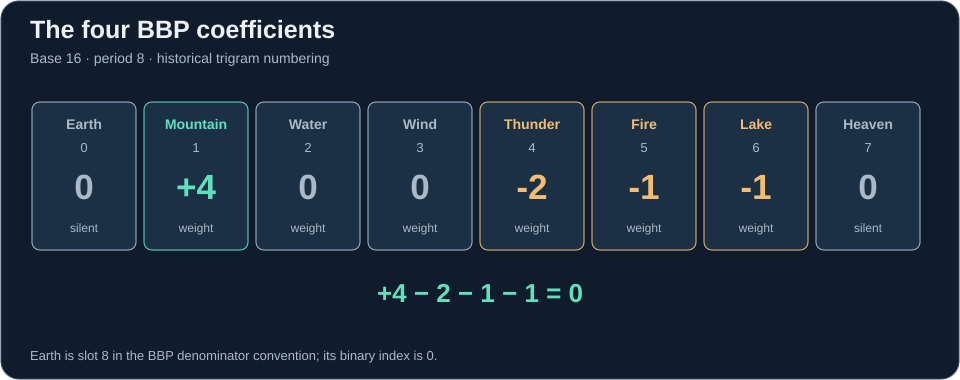

Mountain, Thunder, Fire and Lake carry weights $+4,-2,-1,-1$; the Heaven and Earth slots are silent, and the weights sum to zero. The companion work proves the selection of BBP within the stipulated rational base-16 formula family for π by requiring both axial slots silent. The slot map, base, period and line ordering are explicit premises; geometry alone does not uniquely determine arbitrary constants or orderings. The Gaussian pole $1+i$ has length $\sqrt2$ and angle $45^\circ$, the same ratios present in the cube's face diagonals.

The original closure walk uses base-eight digits $d_n$ of π. Its position follows $v_n=(v_{n-1}+d_n)\bmod8$, and consecutive positions label a hexagram. The recorded implementation first covers all 64 ordered pairs at step 332 (333 indexed positions including the initial position). It is losslessly decodable: $d_n=(v_n-v_{n-1})\bmod8$. The closure statistic itself is not exceptional against random or other well-mixed digits.

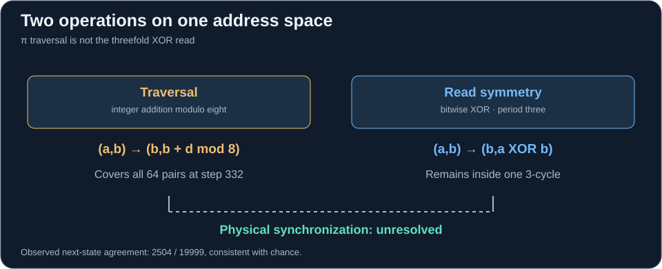

The modern research provides an important discriminator: the π-driven addition uses carries, while $R$ uses XOR. In the first 20,000 digits the next-state rule agrees with $R$ on 2,504 of 19,999 transitions, close to the random rate $1/8$. **The walk traverses the register; the XOR symmetry and Walsh transform read it.** The two may ultimately be synchronized, but the π walk is not a demonstrated step-by-step FWHT. The effective physical operator connecting them is a central open problem.

**Read:** [The Book of Changes and π](BOOK_OF_CHANGES_AND_PI.md) · [Closure walk synthesis](notes/circular_closure_walk_synthesis.md) · [Why π](notes/why_pi_formal_derivation.md)

## 9. The standing wave and the three-snapshot theorem

A new bridge to the native GFD flywheel begins not with 64 separate oscillators, but with eight complex central amplitudes $z\in\mathbb C^8$. Their density $\rho=zz^\dagger$ has 64 real Hermitian coordinates in a normalized three-qubit Pauli basis. Parseval gives

$$\sum_\mu x_\mu^2=\operatorname{tr}(\rho^2)=(z^\dagger z)^2.$$

This is a natural inventory register for amplitudes and coherences. Those 64 coordinates are constrained by the rank-one density; they are not 64 independent occupations. The full Hermitian dynamics conserves total norm, but the central core can exchange norm with its surroundings.

A candidate threefold conjugation built from $U=(I+i(X+Y+Z))/2$ on each axis has a commutant $\operatorname{Herm}(2)\oplus\operatorname{Herm}(3)\oplus\operatorname{Herm}(3)$. It has real dimension $4+9+9=22$, or 21 at fixed trace. For $r$ independent pure snapshots, the attainable positive blocks each have rank at most $r$. The maximal fixed-trace dimension is

$$d_r=\sum_{m\in\{2,3,3\}}(2m\min(m,r)-\min(m,r)^2)-1.$$

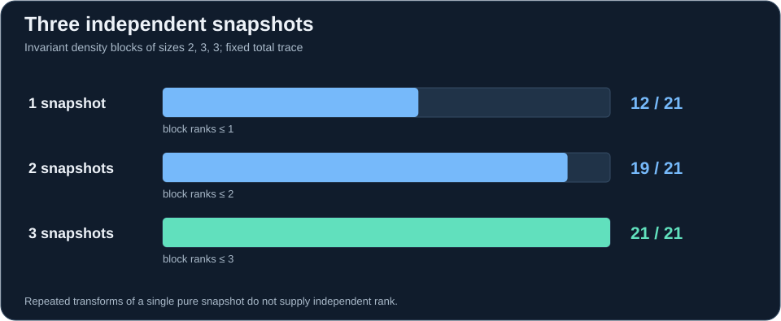

One snapshot reaches a 12-dimensional stratum; two reach 19; three span the full 21-dimensional interior. Three independent snapshots are necessary and sufficient for arbitrary invariant positive targets. Three transforms of one snapshot are **not** three independent snapshots. This theorem gives a precise candidate reason a closure engine may need three registrations, independent of the three-factor FWHT.

There is a further discriminator: the Walsh common line $f$ and the physical trace coordinate $e$ have squared overlap $3/10$, not one. Their orthogonal complements both have dimension 21 but are different. The induced metric of an uncorrected projection between them gives a weighted rank ratio $29/23$, not $17/13$. That counterexample identifies the transduction law that must be derived: how the native density is registered into the Walsh contrast space, with trace and norm conventions transported consistently.

**Read:** [Native density and three snapshots](DENSITY_REGISTER_AND_THREE_SNAPSHOT_THEOREM.md) · [Native Walsh read](../../hadamard-null-cone-vortex-flywheel/NATIVE_WALSH_READ.md) · [Three subread closure](../../hadamard-null-cone-vortex-flywheel/THREE_SUBREAD_CLOSURE.md)

## 10. Towards a single engine

The following is a research architecture, not a completed derivation. In the GFD picture, the standing-wave core holds inventory; a π-driven traversal could coordinate read timing; the three Walsh sweeps transform the register; a threefold reconciliation registers spectral directions; and the Field Origin settles the dual-tetrad exchange.

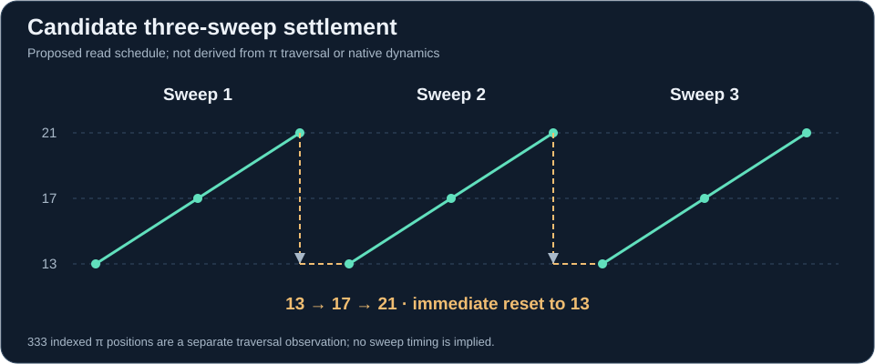

The proposed 13→17→21 sweep then resets immediately to 13, three times per closure cycle. The 333 indexed π positions are an observed traversal count under the existing convention, not yet a derived clock for these sweeps. No mathematical identity presently partitions the traversal into three physical reads. The density theorem concerns independent snapshots, not the sawtooth or the number of π steps. A successful native model must make these independent constraints agree without inserting a schedule by hand.

The work metric adds another condition. The read algebra allows exchange-even and exchange-odd weights $a,b$. Its positive-to-signed weighted trace ratio is $(14a+3b)/(14a-b)$, which equals $17/13$ exactly when $a=b$. A flat orthogonal read preserves a diagonal metric only if the metric is scalar: every diagonal entry of its conjugate is the mean of all entries. This is a rigidity theorem, not a derivation that native mechanical work is diagonal in the hexagram coordinates. The density and trace distinction remains essential.

With the premises of Proof 26, uniform density gain $\alpha$ over the 21 contrasts yields $\det(\alpha I_{21})=\alpha^{21}$. Equivalently an amplitude gain $\sqrt\alpha$ yields this density gain. The proposed GFD expression is

$$\alpha_G=\frac{17}{13}\alpha^{21}\frac{g_e}{2},\qquad G=\alpha_G\frac{\hbar c}{m_e^2}.$$

The hexagram algebra explains structural candidates for the exponent and ratio. It does not independently establish the native gain, the collective determinant as source, the electron factor, or a physical long-range gravitational action. The task is to derive that chain, not simply to reproduce the numbers.

**Read:** [Work-metric rigidity](WORK_METRIC_RIGIDITY.md) · [Conserved-norm metric](WORK_METRIC_FROM_THE_CONSERVED_NORM.md) · [Proof 26](../../../proofs/recursive-field-closure-response/)

## 11. What the next experiment must decide

| Mathematical result | Native-action discriminator |
|---|---|
| Threefold XOR read has 21 nonzero orbits | Does actual time-face evolution induce $R$, rather than spatial rotation $T$? |
| Full symplectic Walsh read is orthogonal | Does the core produce the corresponding transfer matrix with the correct trace functional? |
| Common-line and nested 13/17 projections | Does native registration select the seed dual and common mode? |
| Six nontrivial shared-zone principal planes have overlap cosine $1/2$ | Does the native transfer have the predicted 60° planes and dark modes? |
| Three independent density snapshots reach all 21 contrasts | Are the three physical samples independent in the spectral blocks? |
| Flat diagonal metric forces equal weights | Is native work registered in that metric, including core flux? |
| π traverses all 64 addresses | Can an independently defined effective operator link the walk to the Walsh sweeps? |
| Reciprocal and skew-channel dimensions 137 and 28 | Does a native electromagnetic response select the symmetry average and inverse-gain rule? |

A valuable next calculation is to instrument the native flywheel Hamiltonian over a complete candidate cycle. Record $z(t)$, core/environment flux and the three candidate density snapshots. Extract the three invariant blocks, test their ranks, measure the induced Walsh transfer and its singular values, then evaluate the physical source functional against the 13/17 work prediction. Compare to phase-randomized and non-π control schedules, specified in advance. If the proposed operator fails, preserve the algebra and reject or revise the dynamical identification.

## 12. Research map and reproduction

| Starting point | Contents |
|---|---|
| [BOOK_OF_CHANGES_AND_PI.md](BOOK_OF_CHANGES_AND_PI.md) | Geometry, BBP selection, π walk and historical context |
| [HEXAGRAMS_AND_THE_CLOSURE_READ.md](HEXAGRAMS_AND_THE_CLOSURE_READ.md) | Order-three read, projective directions and Proofs 23–26 |
| [ICHING_FINITE_FIELD_RECIPROCITY.md](ICHING_FINITE_FIELD_RECIPROCITY.md) · [FROBENIUS_RECIPROCAL_TOWER.md](FROBENIUS_RECIPROCAL_TOWER.md) | Finite fields, Walsh incidence, reciprocal edges and norm tower |
| [SHARED_ZONE_HEXAGRAM_READ.md](SHARED_ZONE_HEXAGRAM_READ.md) · [SHARED_ZONE_WALSH_ROTATION.md](SHARED_ZONE_WALSH_ROTATION.md) | Shared support, principal planes and completion |
| [COMMON_MODE_AND_SHARED_ZONE_PROOF.md](COMMON_MODE_AND_SHARED_ZONE_PROOF.md) · [ORIENTATION_CHARACTER_AND_SEED_DUAL.md](ORIENTATION_CHARACTER_AND_SEED_DUAL.md) | Common seed, orientation character and the 13/17 identity |
| [WALSH_SKEW_CHANNEL_ACTION.md](WALSH_SKEW_CHANNEL_ACTION.md) · [THE_COUPLING_POLYNOMIAL_AT_TWO.md](THE_COUPLING_POLYNOMIAL_AT_TWO.md) | Skew channels and cyclotomic bridge |
| [WORK_METRIC_RIGIDITY.md](WORK_METRIC_RIGIDITY.md) · [WORK_METRIC_FROM_THE_CONSERVED_NORM.md](WORK_METRIC_FROM_THE_CONSERVED_NORM.md) | Metric selection and its limitations |
| [DENSITY_REGISTER_AND_THREE_SNAPSHOT_THEOREM.md](DENSITY_REGISTER_AND_THREE_SNAPSHOT_THEOREM.md) | Density register, three snapshots, trace/common-mode obstruction |
| [METATRON_SHARED_ZONE_GEOMETRY.md](METATRON_SHARED_ZONE_GEOMETRY.md) | Nested cube projection and isometric label mapping |
| [notes/](notes/) · [scripts/](scripts/) · [figures/](figures/) | Earlier syntheses, verification code and original figures |
| [interactive charts](interactive/) · [Paper IX manuscript](paper/Nelson_2026_GFD_Complete_Field_Closure_from_Stellated_Octahedron_Topology.pdf) | Exploratory visualisations and original historical correspondence section |

From this directory in the existing repository:

```bash
python -m pip install -r scripts/finite_field_reciprocity/requirements.txt
python -m pip install mpmath
python scripts/verify_hexagram_closure_read.py
python scripts/verify_prime_two.py
python -m pytest -q scripts/finite_field_reciprocity
python scripts/closure_walk_proof_iching.py
```

The linked notes report their own verification counts. This overview does not claim a fresh execution of the full research suite or a new formal proof. The companion [BBP proof and model tests](https://github.com/fielddynamics/dfp-gravity-field-model/tree/test/bbp-octahedron-hypothesis/gravity_field_model/engine_core/field_closure/bbp_structure) contain the fuller formula-family analysis. Earlier notes are preserved because their conjectures motivate tests; the newer exact notes take precedence where a claim was corrected.

---

### The larger question

The ancient book provides the labels; the cube supplies the geometry; finite fields supply the threefold symmetry; the Walsh transform supplies the spectral read. The density matrix offers a way to represent the inventory of a standing wave. π supplies an independently specified traversal.

What remains is the physics of their synchronization.

If GFD can derive that synchronization from a local Field Origin action, it would connect the smallest candidate closure register to the broader programme of recursive registration and settlement. Until then, the exact algebra stands independently of that physical interpretation. No claim is made that the historical authors encoded modern field theory, or that the shared geometry alone establishes gravity.

**Background:** [GFD foundations](../../../docs/01-foundations/) · [Paper IX](../../../papers/09-complete-field-closure/) · [Great Pyramid exploratory programme](../great-pyramid/) · [Bailey, Borwein & Plouffe, 1997](https://www.ams.org/mcom/1997-66-218/S0025-5718-97-00856-9/) · [Leibniz–Bouvet correspondence](https://archive.swarthmore.edu/leibniz-bouvet/index.html)
