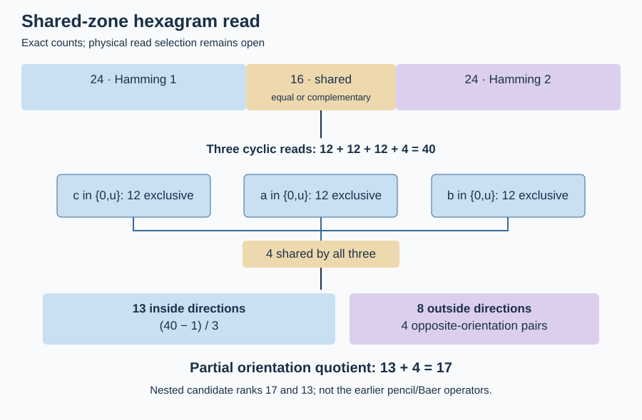

# The shared zone of the hexagram read

**Status:** exact finite algebra, conditional read selection. This does not identify the physical electromagnetic or gravitational coupling. Proof 26 remains unchanged.

## 1. Two equal exclusive zones

Let V=F₂³, u=111, and X=V×V. The distance h(a,b)=wt(a⊕b) has counts 8,24,24,8 for h=0,1,2,3. Define S={(a,b):a⊕b∈{0,u}}. Thus the shared zone has 16 entries and the two exclusive zones (h=1 and h=2) have 24 each. Complementing the second trigram interchanges the exclusive zones and preserves S. In each parity chamber block (4×4), identify opposite vertices by b↦b⊕u, giving a four-entry diagonal and two six-entry triangular coordinate zones. The Hamming classes are different from triangular orientation within a block: same-parity off-diagonal entries have h=2 and opposite-parity off-diagonal entries have h=1. Both descriptions give 24/16/24 globally, but they must not be identified entry by entry. The equal overlapping registers are coordinate sets, not the ± eigenspaces of transposition.

Unordered distinct trigram pairs have Hamming counts 12,12,4. Hence the 28-dimensional skew-Walsh space (after the reversible XH basis change of the earlier note) has a basis of 12 cube edges, 12 face diagonals and four body diagonals. The four shared reciprocal pairs are the complements. This is a 24+4 decomposition, not a proof that the 24 are physical torsion degrees of freedom.

## 2. The threefold saturation produces thirteen

Let R(a,b)=(b,a⊕b), c=a⊕b, and L={0,u}. The three translates of S are the conditions c∈L, a∈L, b∈L. Any two imply the third, so all pairwise intersections coincide with T=L×L of cardinality four. Each translate has 16 elements. Consequently U=S∪RS∪R²S has 3×16−2×4=40 entries; its complement has 24. U is R-invariant. Only (0,0) is fixed by R, and every other orbit has three members. Thus U gives (40−1)/3=13 nonzero projective directions, and its complement gives 24/3=8. Within U the special orbit T\{0} lies in all three reads and each of the other twelve orbits meets S once. Therefore a single shared register S samples all 13 directions of U, with the marked-axis orbit triply represented. This is an exact alternative origin of the count 13, not a proof that it is the earlier norm kernel in PG(2,16).

## 3. A nested 17/13 candidate without field extension

The seven rank-one projective orbits and both orientations of each of the three Fano lines through u lie in U. The other four Fano lines supply eight oriented projective orbits. Exchange J(a,b)=(b,a) acts on the 21 nonzero R-orbits; it fixes the seven rank-one orbits and interchanges orientations of every Fano line. Let Q be the coordinate projector onto the 13 U-orbits and J the induced orthogonal involution. Q and J commute. Define P=Q+(I−Q)(I+J)/2. Then P²=P, PQ=Q and rank P=13+4=17, rank Q=13. This construction retains full orientation inside U but identifies opposite orientations outside U. It is uniquely specified by this rule, which is a candidate physical boundary rule, not a consequence of the native action. Equal per-direction work or common logarithmic generator normalization gives the conditional rank ratio 17/13. Unlike the earlier pencil/Baer pair (intersection rank 1), these projectors are nested (intersection rank 13); they cannot be the same operator pair under unitary conjugation. This is an alternative mechanism, not independent verification of the earlier one.

The axis u=111 is the only nonzero vector fixed by cyclic permutation of all three binary lines. The same counts work for all seven nonzero u, but the existing Heaven–Earth axis convention selects 111 under that symmetry.

## 4. The Walsh dual has four shared channels

For the binary symplectic pairing B((a,b),(c,d))=a·d+b·c, the annihilator of S is S⊥={(v,v):u·v=0}, size four, contained in S. The normalized Walsh W is a real orthogonal involution. Let D be the coordinate projector onto S. WDW is convolution with the uniform measure on S⊥. Since S⊥⊂S, D commutes with WDW. Their product projects onto functions supported on S and constant on cosets of S⊥; its rank is |S|/|S⊥|=4. The shared read therefore yields four joint time-frequency channels exactly, without imposing isotropy.

However the 13 and 17 orbit projectors are not invariant under the full Walsh read. For the Hermitian incidence N on the 21 nonzero orbits, the lower block of the normalized 22-dimensional Walsh transform is (4N−J_all)/8. Exact integer-rational computation gives ranks 6 and 2 for leakage from Q and P respectively into their complements within the 21-dimensional space. The zero orbit is treated separately. Any native action claiming the partial quotient must explain how it handles this leakage; the Walsh transform alone does not select P or Q.

## Verification

`python -m pytest -q test_shared_zone.py`: 22 tests, including all seven possible nonzero marked axes, the exact Walsh projection intersection, the 17/13 nested ranks, chamber blocks and leakage. These results establish algebra, not measured constants or a physical force law.
