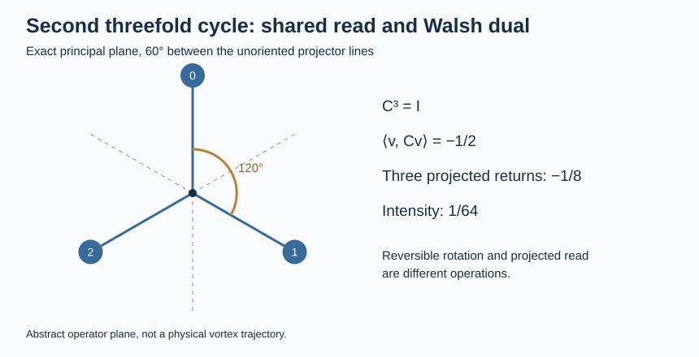
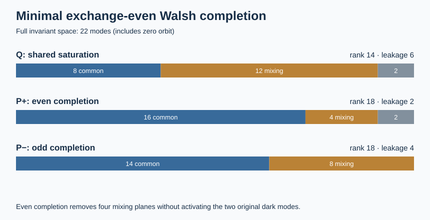

# Shared-zone Walsh rotation and minimal even completion

**Status:** exact finite algebra on the 22-dimensional threefold-invariant hexagram register. The reflection sequence and projected return are candidate read operations, not derived physical time evolution. Proof 26 unchanged.

## 1. Set-up and analytic reduction

Use the symplectic Walsh transform W, the XOR rotation R and trigram exchange J of [the shared-zone note](SHARED_ZONE_HEXAGRAM_READ.md). Work on the full R-invariant space (including the zero orbit), with its induced Euclidean metric. Let Q project onto the 40-state saturation U, which gives 14 orbit directions. The 8 exterior orbits correspond to pairs whose images modulo L=span(u), u=111, form an ordered basis of F₂³/L. Let E=u⊥. Since u·u=1, F₂³=L⊕E orthogonally. For u=111 choose e=011, f=101 in E; e·e=f·f=0, e·f=1. Each exterior orbit has one representative with spatial pair (e,f) or (f,e), and either of four time pairs (i,j), i,j∈F₂. This lists all eight exterior orbits with no duplicates. The exterior compression of W in this orthonormal orbit basis is

$$D=(I-Q)W(I-Q)|_{\operatorname{im}(I-Q)}=\frac18\begin{pmatrix} A&B\\B&A\end{pmatrix},$$
$$ A=\operatorname{diag}(0,4,4,4)-\mathbf1\mathbf1^T,\qquad B=4(e_0\mathbf1^T+\mathbf1e_0^T-e_0e_0^T)-\mathbf1\mathbf1^T.$$

Here e₀=(1,0,0,0) and the remaining three time pairs are nonzero. To derive the entries, the three spatial symplectic signs for same orientations are (+,−,−), and for opposite orientations (+,+,+). Multiply them by the time-pair signs and sum over the three R images; division by 8 is the normalized Walsh coefficient. Equivalently, on nonzero time pairs the same-orientation block is 3 on the diagonal and −1 off it; its zero row/column are −1. The opposite-orientation block is 3 whenever either time pair is zero, otherwise −1.

On the two-dimensional subspace of nonzero time-pair contrasts (zero sum), A=4I and B=0. On span(e₀,(0,1,1,1)/√3), A has matrix [[−1,−√3],[−√3,1]] and B=−3A. A has eigenvalues ±2 there. Consequently D has eigenvalues +1,−1,+1/2 (five),−1/2 (one). Exchange swaps the two orientations and the two time bits, so D has four exchange-even modes of magnitude 1/2; exchange-odd has two magnitude 1/2 and two unit-magnitude modes. In particular the latter two are genuinely invisible to Q and WQ: from W²=I the off-block norm is zero on these unit eigenvectors.

For any odd-weight u the same absolute spectrum and ranks hold (verified for all four axes). For weight-one axes E has a different restricted dot form; A and B are interchanged in the displayed exterior block using the selected basis, so the signed half-eigenvalue multiplicities change. The counts alone do not distinguish u=111 from weight-one axes. Cyclic permutation of all three line positions fixes u=111 uniquely among nonzero u. Even-weight u does not have this orthogonal decomposition; the exact reflection product instead has order four (verified for all three even-weight axes).

## 2. Exact second threefold cycle

For any orthogonal projection K, let K̃=WKW. The compression K K̃ K equals (KWK)² on its range. Block orthogonality of W shows that a nonunit exterior compression singular value c in (0,1) pairs with the same singular value of the interior compression; the associated two-dimensional principal plane has overlap cosine c. In our case all six nontrivial c=1/2. There are no zero interior singular values: the exterior compression has no zeros, hence no right-angle planes. The remaining eight interior dimensions are common to Q and WQW. The two unit exterior directions are common to the two complements.

Define C_K=(2K−I)(2K̃−I). Both factors are orthogonal involutions. On each principal plane their product rotates through twice the 60° angle (with a choice of orientation); on both common sectors it is the identity. Thus C_Q³=I, C_Q≠I, with characteristic polynomial (λ−1)^10(λ²+λ+1)^6. This is a second order-three operation, different from the address rotation R. R acts trivially on the invariant register whereas C_Q does not.

## 3. The 17-direction candidate is a minimal even completion

Let E₊=(I+J)/2 and E₋=(I−J)/2. W and Q commute with J. On the full 22-dimensional invariant space the exchange-even and exchange-odd dimensions are 15 and 7. Inside Q they are 11 and 3. The earlier orientation-neutral extension P₊=Q+(I−Q)E₊ is rank 18 including the zero orbit (17 excluding it); it now has a stronger intrinsic characterization:

$$\operatorname{im} P_+=\operatorname{im} Q+W(\operatorname{im} QE_+).$$

Indeed the four exterior even modes all have compression magnitude 1/2. Hence the map from the interior even sector to exterior even has rank four by W²=I; adding its image fills the entire exterior even sector. Thus P₊ is the unique minimal J-invariant extension of Q that is W-invariant in its even part, leaving the odd part unchanged. This is a mathematical selection criterion, not a derivation that the native physical action imposes it. Compare the opposite extension P₋=Q+(I−Q)E₋; both have rank 18, but different operator behavior.

| Register | Rank including zero | Common with Walsh dual | Mixing planes | Common excluded | Walsh leakage rank | Dimension of full Walsh closure |
|---|---:|---:|---:|---:|---:|---:|
| Q | 14 | 8 | 6 | 2 | 6 | 20 |
| P₊ | 18 | 16 | 2 | 2 | 2 | 20 |
| P₋ | 18 | 14 | 4 | 0 | 4 | 22 |

P₊ preserves both original dark modes, while P₋ includes them. Both extensions give threefold reflection rotations, but P₊ removes all four even leakage planes. Its remaining two mixing planes are odd. Full Walsh closure of Q or P₊ has dimension 20, not 17. This is a necessary qualification: the 17-dimensional nonzero read is not itself a closed reversible Walsh space.

## 4. Three projected reads give a signed return

For K=Q,P₊,P₋ define K_j=C_K^j K C_K^{-j}, j=0,1,2. The cyclic average has eigenvalue 1 on the common interior, 1/2 on each mixing plane and 0 on the common exterior. This follows by summing the three rank-one line projectors at 120-degree increments. There is also a coherent projected-return identity:

$$K_0 K_1 K_2 K_0=I_{\rm common}\oplus(-1/8)I_{\rm mixing\ line}\oplus0.$$

For a unit vector v in a mixing line, the three oriented unit vectors v,C_K v,C_K²v have pairwise inner products −1/2. Their product is −1/8, invariant under reversing any vector sign. Thus the projection sequence returns a signed amplitude −1/8 (intensity 1/64) on each mixing line, not the identity. By contrast the unprojected C_K cycle is lossless and returns exactly. For Q there are six such return channels; for P₊ there are two; for P₋ there are four. This is a new distinction between a reversible rotation and a read that actually projects. Neither amplitude factor is α, nor is the projected return an established native force.

## 5. What this changes

The 13 and 17 counts can be obtained in the same hexagram register without selecting an arbitrary subset of exterior directions: Q is shared-zone saturation and P₊ is its minimal exchange-even Walsh completion. The physically motivated but still unproved selection premise is to complete only the even sector. The shared-zone construction is not the earlier PG(2,16) pencil/Baer pair. Removing the zero orbit gives rank counts 13 and 17 but W maps the zero delta to a constant function, so removing that orbit does not preserve the reflection theorem or Walsh dynamics automatically. The origin/existence accounting and the dynamical zero mode must be distinguished. A common logarithmic work normalization would still be needed to turn these dimensions into a physical response ratio. The finite algebra does not determine α, the mass source or absolute G.

Next native-action test: extract the exchange-even and exchange-odd transfer blocks; check for the 1/2 compression singular values, the 60° principal planes, preservation of the two dark modes and the predicted −1/8 return if the actual read is projective. If these fail, reject this specific model rather than tune it.

## Verification

`python -m pytest -q test_shared_zone_rotation.py` — 52 exact tests, including all seven marked axes, weighted-metric orthogonality, characteristic polynomials, order-three/order-four discriminator, dark modes, minimal even completion and three projected returns. The complete suite passes 441 tests; the original seven rational assertions pass separately. The first draft incorrectly assumed the signed exterior compression block identical for every odd-weight axis; the corrected tests distinguish the weight-one case. No Lean formalization or physical derivation claimed.
