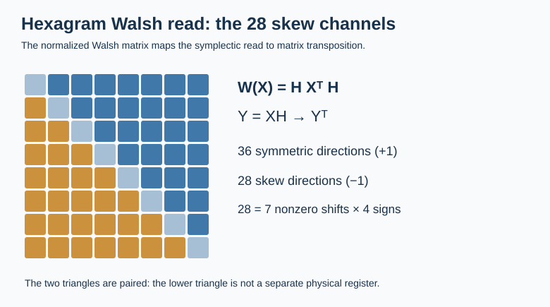
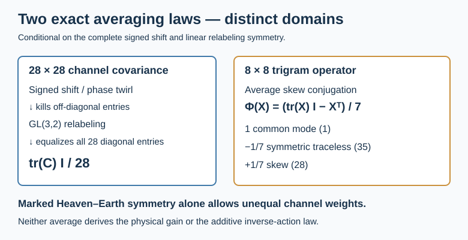

# The hexagram Walsh skew sector and the electromagnetic normalization

**Status:** exact operator identities in the inherited symplectic read, with a conditional normalized-channel construction. Not a derivation of physical alpha or G. Proof 26 remains unchanged. This note supersedes no earlier result.

## 1. The 28 is a Walsh eigenspace

Let V=R^8 with basis indexed by the three-bit trigrams. Write hexagram amplitudes as a matrix X in End(V), with Frobenius inner product. Set H_ab=(-1)^(a·b)/sqrt(8), so H=H^T and H²=I. The symplectic Walsh operator defined in ICHING_FINITE_FIELD_RECIPROCITY is W(X)=H X^T H. Right multiplication by H is an orthogonal change of variables Y=XH. Then W(X)H=Y^T. Thus W is unitarily equivalent to transpose, with +1 multiplicity 36 and -1 multiplicity 28. The negative eigenspace is isometric to the real skew matrices, or Λ² V. The negative sign is a read parity, not a negative energy or an electromagnetic charge assignment. This is the symplectic Walsh read, not the ordinary binary-dot read without the input swap.

## 2. A bit-native orthogonal basis

For d,k in GF(2)^3 define X_d e_a=e_(a+d) and Z_k e_a=(-1)^(k·a)e_a; set A_(d,k)=X_d Z_k. (The plus sign denotes XOR.) All 64 A are real orthogonal and form an orthogonal Frobenius basis, with squared norm 8. Their transpose is (-1)^(d·k) A_(d,k). Thus the 28 skew channels are **exactly** the pairs with d·k=1. For each of seven nonzero d there are four k; the same count holds with d and k reversed. Each skew A squares to -I. No choice of matrix orientation enters this count. In the original hexagram coordinate X, the corresponding W eigenvectors are A_(d,k) H /sqrt(8).

There is also an exact joint decomposition under the threefold XOR rotation R and trigram swap S. These commute with W and generate S3. On the W-negative sector, the character on (identity, transposition, three-cycle) is (28,4,1), yielding 7 trivial, 3 sign, and 9 two-dimensional standard representations. The W-positive sector has character (36,4,0), yielding 8 trivial, 4 sign, and 12 standard representations. In particular the R-invariant subspace has 10 negative and 12 positive directions, including the zero orbit. Imposing both R and S invariance leaves 7 negative and 8 positive directions. This distinguishes the 28 full-register channels from the 21 nonzero projective directions; the two operations are not interchangeable.

## 3. Conditional theorem: equal channel weight from a symmetry, not from equal inventory

Conjugation by A_(e,l) acts diagonally on the normalized skew basis, with signs (-1)^(e·k+l·d). These are distinct characters of the 64 binary shift/modulation labels. A full adjoint average over those labels therefore erases every off-diagonal covariance between the skew channels. For M in GL(3,2), the trigram relabeling U_M conjugates A_(d,k) to A_(Md,M^(-T)k). This action is transitive on d·k=1: choose a basis with first vector d and remaining vectors in ker(k), and map between any two such bases. GL(3,2) has order 168.

The successive two averages on a channel covariance C (an operator on the 28-dimensional skew space) give the exact identity

    Twirl(C) = tr(C) I_28 / 28.

Equivalently, the commutant of both adjoint symmetry families on that space is scalar. The first average forces diagonality, the second forces equality of every diagonal. For a trace-one covariance the single-channel read is therefore 1/28, regardless of the initial channel vector. This is a precise, parameter-free normalized mean, not the assertion that physical action averages over those symmetries. The normalization tr(C)=1 is an essential input. A pure state can yield a mixed effective covariance under an average; a deterministic unitary evolution alone does not produce that average.

**Marked-time obstruction.** The subgroup of GL(3,2) fixing Heaven h=111 has order 24 and preserves the four channels with d=h. The diagonal covariance supported uniformly on those four has trace one and is invariant even under all adjoint sign operations and the marked linear subgroup, yet has entries 1/4 or 0, not 1/28. Thus the stipulated time axis does not force the full isotropic channel twirl. One must derive a larger covariant operation or independently prove equal visitation/work, without erasing the physical time mark. Pure permutation symmetry of the eight trigram vectors also does not by itself force a scalar commutant on Λ²V (the invariant uniform vector gives a 7+21 split).

## 4. Exact reciprocal channel: a possible test of a real read process

A different, explicit channel acts on 8×8 matrices (not on the 28×28 channel covariance above):

    Phi(X) = (1/28) Σ_(d·k=1) A_(d,k) X A_(d,k)^T
           = (tr(X) I - X^T)/7.

Proof: the normalized A/sqrt(8) and (E_ij-E_ji)/sqrt(2), i<j, are orthonormal bases of the same real skew space. Sum-of-conjugations is independent of that basis. Direct expansion with E_ij gives Σ_(i<j) (E_ij-E_ji) X (E_ij-E_ji)^T=tr(X)I-X^T. The relative squared normalization is 4, giving the formula. The map extends complex linearly to a completely positive trace-preserving unital channel with real orthogonal Kraus unitaries A/sqrt(28). Its eigenvalues are 1 on I, -1/7 on the 35 symmetric trace-zero directions, and +1/7 on the 28 skew directions. In particular Phi²(X)=tr(X)I/8 + (X-tr(X)I/8)/49. This is a concrete distinguishing signature of an equal skew-channel average. Neither the average nor physical iteration is yet selected by the vortex. No identification of 1/7 with a measured constant.

## 5. Relation to the old fine-structure expression

The earlier reciprocal graph gives a rank-137 projector onto inversion-even functions on PG(2,16), including its identity point. The new theorem gives a trace-one isotropic weight 1/28 on a *different* register derived from the original 64 hexagrams. If a physical inverse-gain action is shown to contain the sum of a unit cost per reciprocal-even direction and one normalized skew-channel read, with exactly the same cost unit, its coefficient is 137+1/28=3837/28. The algebra does not force that additive action, unit cost, or how the two registers are coupled. In particular reciprocal-even and Walsh-negative are different involutions on different spaces; they cannot be added as projectors on the same space without an intertwiner. A symmetry-compatible unitary dilation with arbitrary gain p (retained sqrt(1-p) I and transferred sqrt(p) I) remains possible. Hence even full channel symmetry cannot determine a continuous coupling. This is a rigorous obstruction to deriving alpha from symmetry alone.

The candidate is also quantitatively approximate: 3837/28=137.035714285714..., while the reference value used in the inherited GFD note is 137.035999177, a difference of about 0.0002848913 (relative 2.08 ppm). The integer and fractional structure can be exact as mathematics while this physical prediction is not exact. No extra correction is fitted to the measured residual here. The physical fine-structure constant, α^21 transfer, and absolute Newtonian work normalization remain open.

## 6. Next decisive physical test

Derive the actual native time-face transfer superoperator in trigram coordinates. Check (i) whether the symplectic Walsh swap is physically implemented, (ii) whether the skew sector is selected, (iii) whether the two symmetry families generate its work metric despite the time mark, and (iv) whether the effective channel has the spectrum (1,-1/7,+1/7). If the native response instead preserves a marked subgroup anisotropy or is a single coherent unitary, this proposed averaging mechanism fails. Independently derive why inverse gain is an additive work, not a multiplicative volume or a squared amplitude. The native oscillator cannot be replaced by a chosen channel merely because its dimensions match.

Verification: `OPENBLAS_NUM_THREADS=1 python -m pytest -q test_walsh_reciprocal_action.py` (67 tests; exact integer identities and floating-point checks of normalized matrices). References: [I Ching research](https://github.com/fielddynamics/research/tree/main/research/exploratory/i-ching), [GFD fine-structure proposal](https://github.com/fielddynamics/research/blob/main/docs/03-fundamental-constants/01-fine-structure-constant-alpha.md), and the preceding finite-field and Frobenius notes. No external review or Lean build claimed.
