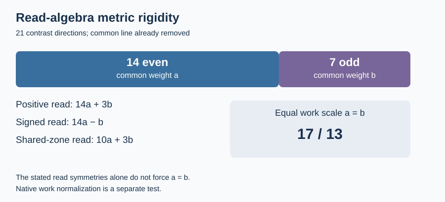
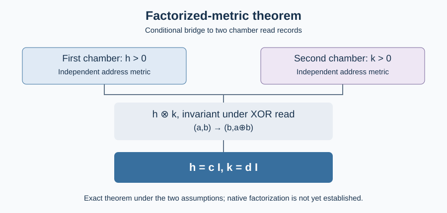

# Work metric rigidity: a bridge to the native time-face action

**Status:** exact finite algebra, conditional physical interpretation. Proof 26 remains unchanged. The native vortex has not been shown to implement the required factorized work metric or the complete-frame coupling observable.



## 1. The full read algebra has exactly two work weights

Use the weighted orbit basis and notation of [the orientation character](ORIENTATION_CHARACTER_AND_SEED_DUAL.md). Let V0=f-perp, M=I-F, E=(I+J)/2, K=(I-J)/2. Let H be a positive definite self-adjoint work metric on V0 (relative to the inherited Euclidean address metric). Assume that every shared-zone read Q_u is H-self-adjoint and that every gate S_u and W is an H-isometry. These are commutation conditions [H,Q_u-F]=[H,S_u|V0]=[H,W|V0]=0, because the inherited operators are self-adjoint or orthogonal as appropriate. The assumption is stronger than only requiring the marked Heaven-axis gate to be an isometry.

**Theorem.** The commutant among positive self-adjoint metrics is exactly

    H = a(E-F) + bK,  a,b>0.

Proof. The gate average is E and the sum of all seven Q_u is 3I+4D. Hence H preserves the exchange-even/odd split and the dependent seed. On the independent even seven-space the seven Q_u jointly distinguish the seven Fano planes (a plane is uniquely specified by its three nonzero members). Thus H is diagonal on the seven even plane lines. On the odd seven-space the binary characters similarly distinguish every line. 

In either space commutation with W forces equal weights on vertices joined by nonzero Walsh entries. In the even plane block each entry has magnitude 1/4: the sum of the binary pairing over the six ordered bases of a plane is +2 for rank-two pairing and -2 for rank-one pairing (rank zero impossible for two planes in dimension three). This can be seen by reducing the 2-by-2 pairing to a canonical rank form and summing over GL(2,2). The even plane graph is therefore complete. The odd block is connected: in normal order (4,2,6,1,5,3,7), its matrix is 1/2 times

```
 1  0  1  0 -1  0  1
 0  1  1  0  0  1 -1
 1  1  0  0  1 -1  0
 0  0  0  1  1  1  1
-1  0  1  1  0 -1  0
 0  1 -1  1 -1  0  0
 1 -1  0  1  0  0 -1
```

This is evaluated directly from the symplectic pairing on the two oriented three-orbits for each plane. The edges from normals 4 to 6,5,7; 6 to 2,3; and 5 to 1 form a spanning tree. The remaining even seed has dimension seven. The cross block between that seed and the even plane space is invertible: the Walsh image of the seed has no intersection with the seed after removing F, by the common-seed theorem; by self-adjointness the reverse cross block is also invertible. Hence commutation propagates the even plane weight to the entire even seed. Conversely both sector projectors commute with all the stated reads. QED.

With P0=(I+S_u)/2 on V0 and Q0=Q_u-F, the exact weighted work counts are

    tr(H P0) = 14a+3b,
    tr(H S_u) = 14a-b,
    tr(H Q0) = 10a+3b.

Thus the positive/signed ratio is (14a+3b)/(14a-b), when the denominator is nonzero. It equals 17/13 iff a=b. The shared-zone rank and signed trace agree as weighted observables iff a=b: their difference is 4(a-b). The equality of those physically distinct observables would be a sufficient extra constitutive condition, not a consequence of the read algebra.

## 2. Factorized-metric theorem



**Theorem (any binary dimension).** Let X=GF(2)^d. Suppose the work metric on the full paired address space R^X tensor R^X is h tensor k, with h,k symmetric positive definite. If the XOR cycle R(a,b)=(b,a+b) is an isometry for that metric, then h and k are positive multiples of the identity.

Proof. Invariance of matrix elements is

    h[a,c] k[b,d] = h[b,d] k[a+b,c+d].

Setting b=d=0 gives k proportional to h (since both 00 entries are positive). Absorb the proportionality into an overall scale. Set a=c and b=d. Cancelling the strictly positive diagonal entry h[b,b] gives h[a,a]=h[a+b,a+b], hence all diagonal entries have one value t>0. Finally a=c=0 yields t h[b,d]=h[b,d]^2. Every entry is therefore either zero or t. For b!=d, strict positivity of the two-by-two principal minor gives |h[b,d]|<t. Thus off-diagonal entries vanish. QED. The argument also holds for Hermitian positive definite factors (the same equation forces the off-diagonal entry to be zero or t).

This does not require an isotropic distribution of inventory or a thermal ensemble. Under the two assumptions it establishes the scalar metric before reduction; its restriction to f-perp is scalar too. Consequently both weighted ratios coincide with 17/13, and uniform normalization of the volume generators is compatible with the metric. The absolute work scale cancels in the ratio.

**Physical interpretation and test.** The two factors would be the work metrics on independent eight-address chamber records, before relative registration; the XOR cycle would be an actual isometric change of read, not a mere labeling permutation. The physical GFD Stage VII model has sixteen complex coordinates per chamber and an independent scalar origin, with a registered cross kernel; no identification of that model's kinetic or energy Hessian with an eight-by-eight tensor-product address metric is known. The product hypothesis must be derived or rejected by constructing the actual address map and pulling back the native work form. It cannot be inferred from norm conservation, identical chambers, or exchange symmetry alone. A positive factorized metric is not the same object as the generally indefinite stationary energy Hessian. A physical source-to-stiffness normalization and the electromagnetic gain remain open.

## 3. Alternative condition: one independent orientation phase

Let L multiply one of the two oriented independent-plane orbit basis vectors by -1 and leave every other orbit unchanged. It preserves the common mode, Q_u and the inherited metric. Within that pair it interchanges the even and odd line (up to sign). Therefore imposing [H,L]=0 in addition to the read algebra forces a=b. Likewise, a diagonal work metric in the directed orbit basis has no off-diagonal even/odd correlation and forces the two weights to coincide. Neither L nor diagonal inventory is assumed to be a native symmetry: actual coherent relative phases can be physical. This is an alternative independently testable condition, not a second derivation of the physical coupling.

## 4. Implications and blockers

The current algebra supports the following conditional chain: native chamber work form -> factorization and isometric threefold read -> common work scale -> weighted 17/13 character response. The determinant and massless spatial response still require the actual source and dynamical action; finite geometry alone cannot select a continuous electromagnetic transmission probability or a dimensionful G. No new number has been fitted. The next concrete test is the pullback of the registered Stage VII work metric and the factorization defect, not another counting construction. A failure of factorization does not disprove the shared-zone theorem but leaves the two-weight ambiguity unless an independent condition fixes it.

Reproduce with `python -m pytest -q test_work_metric_rigidity.py`. The 22 checks include exact graph connectivity, rank, character signatures, weighted counterexamples, phase symmetry, and product-metric examples and symbolic equations. The general factorization theorem is algebraic, not an inference from the tested examples. No Lean build or independent physical validation is claimed.

**Follow-up.** [The work metric from the conserved norm](WORK_METRIC_FROM_THE_CONSERVED_NORM.md) closes the condition a = b without the factorisation: a work metric that is diagonal in the records and preserved by the complete (flat) Walsh read is scalar, and the native vertex dynamics conserves exactly the Euclidean norm. The remaining premise is that registration counts occupation rather than energy.
