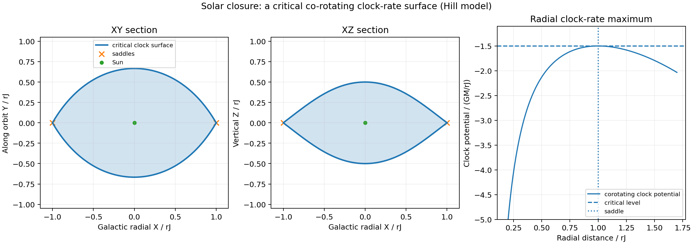

# The solar clock-closure surface and the drain aperture

*Continuation of the nonlinear Field Origin research. November 2026. Status: exact identities in an ideal stationary relativistic model and its weak-field Hill limit; conditional GFD interpretation, not Proof 26.*

## 1. The question and the source chain

The solar system's own TetA clock frame could delimit its own gravitational settlement while its centre of mass moves in the galaxy's drained NET Field. The existing [closure-surface proof](https://github.com/fielddynamics/research/blob/aad94e0e1ec766e9bf8615d8fbcf07126cbd2f95/proofs/closure-surface/README.md) establishes a critical effective-potential surface. The [mountain-scale proof](https://github.com/fielddynamics/research/blob/aad94e0e1ec766e9bf8615d8fbcf07126cbd2f95/proofs/sst-mountain-scale/README.md) establishes a conditional ownership sweep, one clock/lapse port and three free-fall ports, and the local tidal correction. The [read–settle–register bridge](https://github.com/fielddynamics/research/blob/aad94e0e1ec766e9bf8615d8fbcf07126cbd2f95/research/read-settle-register-bridge/READ_SETTLE_REGISTER_BRIDGE.md) uses a static time leg and Φ=c² ln N. Here we connect the critical potential with co-rotating clock rates, and test what this can and cannot determine about the drain. This is a new continuation, not a claim that the source proofs already derive the physical drain.

[Interactive clock-closure explorer](interactive/clock.html).

## 2. Clock norm and Jacobi energy [T given stationarity]

Let K generate time translation of an ideal co-rotating stationary spacetime, with g(K,K) = −c² N_K² and N_K>0. K's integral curves are the co-rotating observers; u_K=K/N_K has norm −c². Their proper time satisfies dτ=N_K dt. For a geodesic test body U with norm −c², E=−g(K,U) is conserved because the Killing equation makes U^a U^b ∇_a K_b vanish. Since γ=−g(u_K,U)/c²≥1,

$$E=c^2 N_K\gamma\ge c^2 N_K.$$

Thus its accessible region is contained in N_K≤E/c². If a connected interior sublevel is separated from the exterior by a saddle level N_c, bodies of E<c²N_c in the interior cannot cross it. This is a sufficient energy condition, not a necessary condition for orbital binding. The critical equipotential has a clock-geometric meaning. Moreover the Killing identity gives the acceleration of co-rotating observers

$$a_\mu=u_K^\nu\nabla_\nu u_{K\mu}=c^2\nabla_\mu\ln N_K.$$

A saddle has zero stationary observer acceleration, while a level surface elsewhere generally does not. Relative clock rates N_K(P)/N_K(Q) are invariant under a common constant rescaling of K; absolute N_c depends on normalization. For a real solar system, the circular, stationary, weak-field approximation is just that: the real orbit is not exactly circular and the moving planets, passing stars and Galactic structure break exact helical stationarity.

**Do not identify this automatically with the SST foliation lapse.** In ADM notation, g_tt=−c²N_ADM²+h_ij β^iβ^j, hence N_K²=N_ADM²−h_ij β^iβ^j/c². A co-rotating Killing congruence usually has twist and is not hypersurface orthogonal. Its clock norm is not in general the lapse of a hypersurface-normal khronon. Using it in a covariant time-leg action needs a justified choice of congruence or a reformulation retaining the shift. This is a decisive distinction for GFD, not a coordinate change that proves its dynamics. For background on stationary redshift and Fermi clocks see [Carroll, Spacetime and Geometry, Ch. 6](https://pierre.ag.gerard.web.ulb.be/textbooks/books/Carroll_GR.pdf) and [Roura, Phys. Rev. X 10, 021014](https://doi.org/10.1103/PhysRevX.10.021014).

## 3. Recovering the Hill clock surface [T within Hill limit]

In the weak field with inertial time t, a co-rotating stationary clock has dτ/dt≈1+(Φ−v²/2)/c². Expand the axisymmetric host Φ around a circular orbit. Its radial derivative is RΩ²; radial, tangential, vertical Hessian entries are κ²−3Ω², Ω², ν². The linear centrifugal term cancels the host's linear slope by circular balance. The quadratic centrifugal term subtracts Ω² from both in-plane Hessian entries. Subtract the common host+orbital clock constant. Then

$$c^2\ln(N_K/N_{\rm ref})\simeq \Phi_{\rm eff}=-GM/r-DX^2/2+\nu^2 Z^2/2,$$

where D=4Ω²−κ²>0. N_ref is the clock reference from the host circular orbit without the solar self potential, not the Sun's centre clock. The two critical points are (±r_J,0,0), r_J³=GM/D; Φ_c=−3GM/(2r_J). The Hessian there is diag(−3D,D,D+ν²). The bounded lobe is the closure of the central connected component Φ_eff<Φ_c. It reaches the saddles at its tips, not a differentiable smooth surface there. It is not the entire level set, which also includes exterior branches.

Consequently

$$\ln(N_c/N_{\rm ref})\simeq -\frac{3}{2c^2}(GM)^{2/3}D^{1/3}.$$

For fixed host and varying M, r_J∝M^(1/3), volume∝M and clock depth∝M^(2/3), not a universal fixed dilation threshold. For fixed β=ν²/D the shape is mass independent in normalized coordinates. On a ray with direction n and radius R=r/r_J, the inner root obeys

$$(\beta n_z^2-n_x^2) R^3+3R-2=0.$$

The y intercept is 2/3; the z intercept is the positive root β R³+3R−2=0. For β=4 the z intercept is 1/2 and the volume-equivalent radius is 0.6396204 r_J (angular quadrature). At r_J=1.44 pc and GM=1.3271244×10²⁰ m³/s², D≈1.51277×10⁻³⁰ s⁻², r_J≈297021 AU, |Φ_c|≈4480.12 m²/s², fractional co-rotating reference deficit≈4.98481×10⁻¹⁴, or 1.5731 microseconds per Julian year. These are model estimates, not a measured clock offset at the Oort cloud. The radial tide/solar force ratio is (r/r_J)³, ≈3.82×10⁻¹⁷ at 1 AU and 1.03×10⁻¹² at 30 AU. The actual three-dimensional tensor has a vertical eigenvalue β times the radial scale. Local internal dynamics need not inherit the bulk galactic acceleration. No actual screening of curvature or discontinuous clock rate follows. The host potential contributes a common reference term and nonzero tidal terms.

## 4. A clock-registered boundary and ownership [T given Dirichlet construction]

On the critical surface Σ, Φ_eff=Φ_c, so the trace of the *self potential* is

$$\Phi_s|_\Sigma=\Phi_c+DX^2/2-\nu^2 Z^2/2.$$

It is not generally constant. The effective potential is not harmonic: away from the mass, ΔΦ_eff=ν²−D. Let w solve Δw=1 in the interior with w|_Σ=0 (Dirichlet torsion function, unrelated to affine torsion). Then the harmonic extension of the self-potential trace is exactly

$$h=\Phi_c+DX^2/2-\nu^2 Z^2/2-(D-\nu^2)w.$$

This follows by applying the Laplacian and checking the trace; uniqueness is the ordinary Dirichlet uniqueness result. For a smooth boundary the construction is classical; at the two Hill saddle tips one may use weak Dirichlet solutions or regular subcritical lobes and take a limit. In a sphere of radius R_0, w=(r²−R_0²)/6. The true Hill lobe is not a sphere. The residual is

$$\Phi_s-h=\Phi_{\rm eff}-\Phi_c+(D-\nu^2)w.$$

This is the trace correction linking a clock-defined boundary to the existing ownership sweep. Except when D=ν², the registered Newtonian residual is not simply the clock deficit. By central reflection symmetry and uniqueness, ∇h(0)=0 for this ideal centred problem. None of these identities prove which field variables the microscopic time face must settle. They do give an explicit boundary target without a spherical approximation to the lobe.

## 5. Escape-neck opening and phase-space availability [T/D]

The conserved Hill Jacobi energy per unit mass is E_J=v²/2+Φ_eff. Write δ=E_J−Φ_c. Below zero the central energy-accessible component is closed. At the saddle, local quadratic expansion gives

$$\Phi_{\rm eff}-\Phi_c\simeq(-3D\xi^2+DY^2+(D+\nu^2)Z^2)/2.$$

At the local dividing plane ξ=0 the allowed transverse configuration ellipse has area

$$A_{\rm neck}=\frac{2\pi\delta_+}{\sqrt{D(D+\nu^2)}}.$$

The one-way *microcanonical* phase-space flux at this quadratic dividing plane is

$$\mathcal F(E_J)=\int_{v_X>0}v_X\,\delta_{\rm Dirac}(E_J-v^2/2-\Phi_{\rm eff})\,dY\,dZ\,d^3v=\frac{2\pi^2\delta_+^2}{\sqrt{D(D+\nu^2)}}.$$

To see it, integrate v_X using d(v_X²/2)=v_X dv_X. The remaining four variables lie in an ellipsoid in (√D Y,√(D+ν²) Z,v_Y,v_Z) of radius √(2δ). Its four-ball volume is 2π²δ². The formula is local and leading-order in δ; Coriolis terms do no work, and position-dependent canonical velocity shifts have unit Jacobian. It counts possible one-way crossings, including recrossings, not an actual net escape rate. There are two such saddle necks. Neither is a microscopic spatial tunnel from TetA to TetB.

This suggests a sharper physical question than simply postulating a partial aperture. If registered time-face channels had an independently derived energy distribution f_j(E)≥0, one could define a channel's accessible fraction above the appropriate threshold, e.g. τ_j=∫_{E_c}^∞ f_j(E)dE/∫f_j(E)dE, or an independently calibrated flux-weighted analogue. This is a candidate [E], not a consequence of the Hill theorem. It would connect the last study's distributed capacity law to a coherent boundary state. No channel energy distribution or map from the 16 microscopic interaction channels to macroscopic escape energies has been derived; a local matter neck is not the same thing as a gravitational drain. A closed lobe can coexist with a galaxy's internal drain and vice versa. Every Field Object can have a closure surface, including a drained galaxy, so the existence of that surface cannot alone distinguish the two regimes.

## 6. A decisive negative result: isochrony alone cannot switch off the local response

The previously derived settlement equation, at full opening and fixed p, is q=a₀ p/(a₀+|p|). At a stationary clock saddle p=c²∇ln N_K=0, q=0. But at the tangential intercept (0,2r_J/3,0), |p|=9GM/(4r_J²)>0. For the illustrative Sun it is 1.5124×10⁻¹³ m/s² and μ≈0.00123309. At finite nonzero p the fully open law still yields a nonzero registered q. The tangential gradient of the clock scalar vanishes on the surface; its normal gradient need not. The total outward gradient flux is ∮∂nΦ_eff dS=4πGM+(ν²−D)Vol(Σ), not generally zero. Thus a surface of equal clock rates does not eliminate gravitational flux or imply no TetB response. Conversely, an energy-bound population can have zero escape flux even with a nonzero gravitational gradient. These are different observables. We need a scale/ownership-sensitive selection law, not the pointwise replacement p→0 or an arbitrary imposed lapse threshold.

## 7. Consequences for the single-engine programme

- The field-object clock closure has a physically interpretable critical rate determined by its mass and host tide. In the weak circular model it coincides with the established Jacobi separatrix. Its constant trace is a natural scalar registration datum; it does not require equal clock rates throughout the interior.
- Co-rotating clock and matter energy share the same norm; this gives a possible gauge-invariant condition for a phase-space boundary. Only relative rates/normalized energy ratios are meaningful.
- A local reference-time change removes the common host redshift and bulk acceleration from local comparisons, not tidal curvature. Neither a literal spacetime bubble nor shielding of gravity is proved.
- To get exact drainless Newtonian/SST response, derive a physical coarse-grained channel selection or zero net *registered response* rule from boundary ownership. Show why a galaxy that is also a bound Field Object can maintain an internal TetB drain. Retained inventory, wave occupation, matter escape and gravitational registration must remain distinguished.
- In a time-dependent orbit, establish controlled adiabatic evolution or flux through a moving boundary. In a covariant completion, use the actual time leg/shift, enforce continuity and junction conditions, and verify clock and tidal observables. Do not promote a rotating norm to a foliation lapse without justification.

## 8. Reproduction and status

`python verify_clock_boundary.py > clock_boundary_verification_output.txt` (NumPy, SciPy, SymPy, Matplotlib). 51 new checks (17 exact symbolic + 34 numerical). They verify the algebra, shape, normalization, saddle, local neck integral, trace correction and nonzero-gradient obstruction, not the physical aperture proposal. Earlier 3,675 recorded checks are retained, not rerun. The cumulative recorded count is 3,726. The repository's Proofs 24 and 25 and their Lean sources are not changed. No live repository write or new Lean verification performed.
