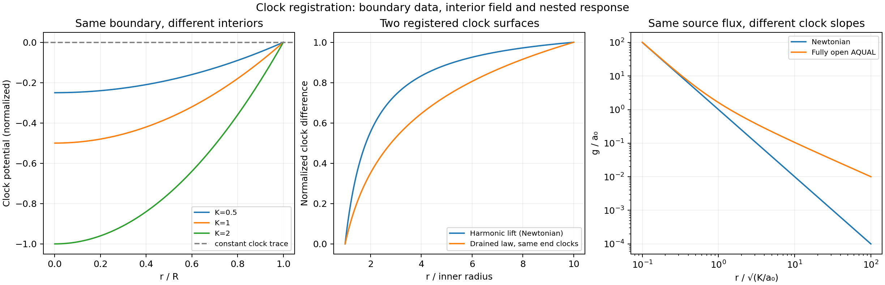

# Clock registration, boundary response and nested Field Objects

*Continuation of the nonlinear Field Origin research · November 2026 · conditional analysis, not Proof 26.*

## 1. The question

The solar system may be a local TetA clock domain inside the galactic NET Field. The previous [clock-closure study](CLOCK_CLOSURE_AND_DRAIN.md) established that, in an ideal stationary rotating Hill model, the critical Jacobi lobe is an equipotential of the co-rotating clock norm. It also showed that equal clocks do not imply zero normal acceleration. Here we ask whether the clock trace itself can select the drainless branch and whether nested clock surfaces supply a common mathematical description of interior and exterior response.

Sources: the exact cumulative clock-closure archive (reopened for this continuation), its pinned upstream [closure-surface proof](https://github.com/fielddynamics/research/tree/aad94e0e1ec766e9bf8615d8fbcf07126cbd2f95/proofs/closure-surface), [mountain-scale proof](https://github.com/fielddynamics/research/tree/aad94e0e1ec766e9bf8615d8fbcf07126cbd2f95/proofs/sst-mountain-scale), and [read–settle–register bridge](https://github.com/fielddynamics/research/blob/aad94e0e1ec766e9bf8615d8fbcf07126cbd2f95/research/read-settle-register-bridge/READ_SETTLE_REGISTER_BRIDGE.md). The upstream notes were inspected in the clock continuation; no new upstream build is claimed. The present potential theory and variational constructions are new derivations, not results quoted from those proofs.

[Offline interactive explorer](interactive/registration.html).

## 2. A constant clock surface removes detail, not the gravitational field [T]

Use the normalized scalar clock potential $\phi=c^2\ln(N_K/N_{\rm ref})$. In the weak-field rotating approximation it is the effective potential up to an additive reference. At a regular closure surface $\Sigma$, $\phi|_\Sigma=C$. In the exact stationary idealization $N_K$ is the norm of a specified co-rotating Killing field, not necessarily the ADM lapse or the time leg in SST. The following scalar elliptic analysis is a weak-field model, not an exact covariant junction theory. Work on a bounded connected Lipschitz domain $\Omega$ (or a smooth subcritical lobe approaching the critical saddle surface); assume finite energy and appropriate regular sources. For a point mass one must regularize the source or excise its singularity.

For any 16 samples of the same constant trace, let $f=C\mathbf1$ and $P=I-\mathbf1\mathbf1^T/16$. Then $Pf=0$ and $\operatorname{rank}P=15$. All Walsh contrasts vanish. This is a conditional observation about scalar clock samples, not proof that the 16 microscopic complex amplitudes equal these samples or that the Stage VII kernel closes.

Let $H$ be harmonic extension of Dirichlet data and write

$$\phi=h+w,\qquad h=H(\phi|_\Sigma),\qquad w\in H^1_0(\Omega).$$

Weak harmonicity gives $\int_\Omega \nabla h\cdot\nabla w=0$. Thus

$$\|\nabla\phi\|_2^2=\|\nabla h\|_2^2+\|\nabla w\|_2^2.$$

If the trace is constant, uniqueness gives $h=C$ and $\nabla h=0$. But the residual still satisfies $\Delta w=\Delta\phi$. In the Hill approximation the latter includes both matter and the rotating host trace $\nu^2-D$; the effective potential is not the pure gravitational potential. Do not interpret this trace as a new matter density. This distinction matters when importing the static GFD acceleration read.

Counterexample: take a smooth uniform-density ball of radius $R$, with $K=GM>0$, and

$$\phi(r)=C+\frac{K}{2R^3}(r^2-R^2).$$

Its trace is $C$, but $\Delta\phi=3K/R^3$, $\partial_n\phi=K/R^2$ and the integrated flux is $4\pi K$. Any positive mass gives identical boundary contrasts after choosing the reference. A constant trace, or the vanishing of its tangential gradient, is therefore insufficient to infer zero radial response. The value of an absolute clock norm is also normalization-dependent. This is why a scalar clock match cannot be equated to the microscopic aperture.

## 3. The inside/outside asymmetry [T]

The Dirichlet-to-Neumann operator $\Lambda$ maps a clock trace to the outward derivative of its harmonic extension. For bounded connected $\Omega$, $\langle f,\Lambda_{\rm in} f\rangle=\int_\Omega|\nabla Hf|^2\ge0$; its kernel is exactly the constants. For a sphere, a harmonic of degree $\ell$ has regular interior continuation $(r/R)^\ell Y_{\ell m}$ and decaying exterior continuation $(R/r)^{\ell+1}Y_{\ell m}$. With outward normals from the respective domains,

$$\Lambda_{\rm in}Y_{\ell m}=\frac{\ell}{R}Y_{\ell m},\qquad \Lambda_{\rm out}Y_{\ell m}=\frac{\ell+1}{R}Y_{\ell m}.$$

In particular the same nonzero constant clock trace relative to a fixed distant reference is invisible to the **interior harmonic gradient** but has a nonzero exterior monopole. The exterior derivative uses the normal pointing into the sphere, opposite to the interior outward normal. For an actual gravitational source, derivative matching requires the residual field too; using just $h$ on both sides would introduce an artificial sheet. This is a precise mathematical counterpart of a field object having a common clock record but a nontrivial relationship to its parent. It is not gravitational shielding. The exterior reference cannot be dropped: shifting both the boundary and infinity equally changes no field.

## 4. A conditional action-level separation, without an extra oscillator [D]

Define the energy-orthogonal harmonic-gradient projection $\mathcal P\nabla\phi=\nabla H(\phi|_\Sigma)$. This is an elliptic projection on potential gradients, not a new dynamical field. Consider the following candidate response action with fixed domain, trace map and reference, in static units:

$$\mathcal E[\phi]=\int_\Omega \left(\tfrac12|\nabla\phi|^2+4\pi G\rho\phi\right)dV-a_0^2\int_\Omega L(|\mathcal P\nabla\phi|/a_0)dV,$$

where $L(x)=x-\ln(1+x)$ is the existing settlement dual. The coefficient makes the derivative of the subtraction equal to the registered acceleration $q=a_0\mu(x)\hat p$, with $p=\mathcal P\nabla\phi$; define $q=0$ at $p=0$. The factor $1/(4\pi G)$ has been stripped from the action. No new oscillator or functional shape is introduced. **The selection of this projected drive is a new model assumption.** The geometry does not yet derive it. For the effective rotating potential, the appropriate known inertial/host source must additionally be included rather than treated as physical mass.

For every zero-trace variation $v$, $\mathcal P\nabla v=0$. Consequently the entire nonlinear correction has identically zero interior variation. The local Euler equation is $\Delta\phi=4\pi G\rho$ (with the stated source conventions). If the trace is constant, the response $q$ itself is zero even for nonzero internal gravity. This realizes the drainless branch conditionally and exactly, rather than setting the microscopic occupation to zero.

**Limitation / no-go:** any functional depending only on the trace has zero first variation on compactly supported interior perturbations. It cannot generate a bulk AQUAL modification in that same domain. In gradient space the projected correction has zero weak divergence in the interior and its integrated flux through an enclosing interior surface vanishes under regularity. Thus the same single-boundary projection cannot explain a galaxy's distributed enhanced monopole. Applying it universally to the galaxy's own critical clock surface would incorrectly close its interior correction as well. Constant-clock closure occurs at both levels; it cannot alone distinguish them. A parent must use a different owned response space (or a derived, scale-sensitive restriction of the same action). This is a necessary selection problem, not yet its resolution. Also the variation of moving closure surfaces, relativistic matching and causal evolution of the elliptic read are not derived here.

## 5. Nested clock surfaces: a candidate coarse record [T/D]

In a connected annulus $a<r<b$ with constant potentials $U,V$ on its two boundary components, the harmonic extension is

$$h(r)=U+(V-U)\frac{1/a-1/r}{1/a-1/b}.$$

Its current is $K=r^2h'(r)=ab(V-U)/(b-a)$. Its energy is

$$\frac12\int|\nabla h|^2dV=\frac{2\pi ab}{b-a}(V-U)^2.$$

The clock capacitance is $4\pi ab/(b-a)$. Each boundary is internally isochronous, yet the clock difference between them produces a nonzero field. With multiple disjoint boundary components the harmonic energy restricted to componentwise constants becomes a symmetric positive semidefinite capacitance matrix; for a connected bounded region its only null direction is the common constant. This follows from energy positivity and the uniqueness of the harmonic lift, not from counting components. The sphere formula is illustrative; actual ownership surfaces are anisotropic and may overlap. Overlapping geometric lobes must be resolved by ownership before using a disjoint-domain capacitance model. The Sun also has nested children, so nesting alone cannot select the galaxy's drained branch.

In a spherical source-free shell, take $K=GM>0$ to be the specified enclosed constitutive current and apply the established fully open law $\mu(g/a_0)g=K/r^2$. Then

$$g=\frac{K+\sqrt{K^2+4a_0Kr^2}}{2r^2}.$$

The exact clock-potential gap between $a$ and $b$ is $F(b)-F(a)$, where

$$F(r)=-\frac{K+\sqrt{K^2+4a_0Kr^2}}{2r}+\sqrt{a_0K}\,\operatorname{asinh}(2r\sqrt{a_0/K}).$$

This is larger than the Newtonian gap $K(1/a-1/b)$ for the same enclosed source flux. Conversely a given nonzero gap on the same shell is compatible with both laws, with different $K$, because the nonlinear gap increases strictly from zero to infinity as $K$ increases. Thus relative clock measurements plus an independent source flux can discriminate constitutive responses; clocks alone do not pick a law. The finite shell matters: the ideal untruncated deep-MOND potential grows logarithmically with radius, so it cannot use the decaying Laplace exterior normalization at infinity. This drained shell is a distinct AQUAL model, not the preceding harmonic-projection action (which cannot give this bulk law).

## 6. Consequence for the proposed TetA–TetB engine

The promising interpretation is not a literal insulating membrane, but **ownership-dependent clock registration**. One common record can be passed to a parent; the parent's relative clock differences can remain nontrivial; the child's residual may be governed by bare TetA equations if its response is restricted to the registered trace. The exact projection identity suggests a concrete no-double-accounting mechanism. No physical proof that the Field Origin implements this projection follows. The earlier bubble picture remains compatible with this model, but not uniquely selected by it.

Next acceptance test: derive the ownership-dependent response projection from the actual paired time-face operators, including the normal flux record and coherent phase reference. A scalar trace-only read is provably inadequate for the galaxy; the registered object must retain mass/flux separately, and the parent must permit collective bulk response on the correct owned modes. Test a nested star–galaxy–cluster action with variable boundaries, nonharmonic host trace, conserved matching currents and the correct local Newtonian and galactic drained limits. The stationary clock norm versus SST lapse distinction must be resolved before claiming a covariant result. Do not promote this to Proof 26 or modify Proofs 24/25 yet.

## 7. Reproduction

`OPENBLAS_NUM_THREADS=1 python verify_clock_registration.py > clock_registration_verification_output.txt`

112 passing assertions (24 symbolic, 88 numerical). Includes 3D graph Dirichlet-to-Neumann Schur complements on 4³, 6³ and 9³ grids; exact radial identities; randomized orthogonal-energy and nonlinear trace-invariance checks; numerical gap integrals and inversions. These checks verify the conditional calculations, not the physical premises. Prior 3,726 recorded checks are retained, not rerun.
