# Updated research: Field Origin continuations toward G

*Gravity Field Dynamics (GFD) · Field Dynamics Research*

This folder holds the newer Field Origin continuations that bear on G and the coupling polynomial. They continue the [vertex research](../../hadamard-null-cone-vortex-flywheel/vertex-research/) in the vortex-flywheel folder, which keeps the earlier scheme, antenna, spectral, constitutive, ordered-response and aperture studies. These notes are conditional finite-domain mathematics, not numbered proofs. They do not complete a derivation of G. Proofs 24 and 25 and their Lean files are unchanged.

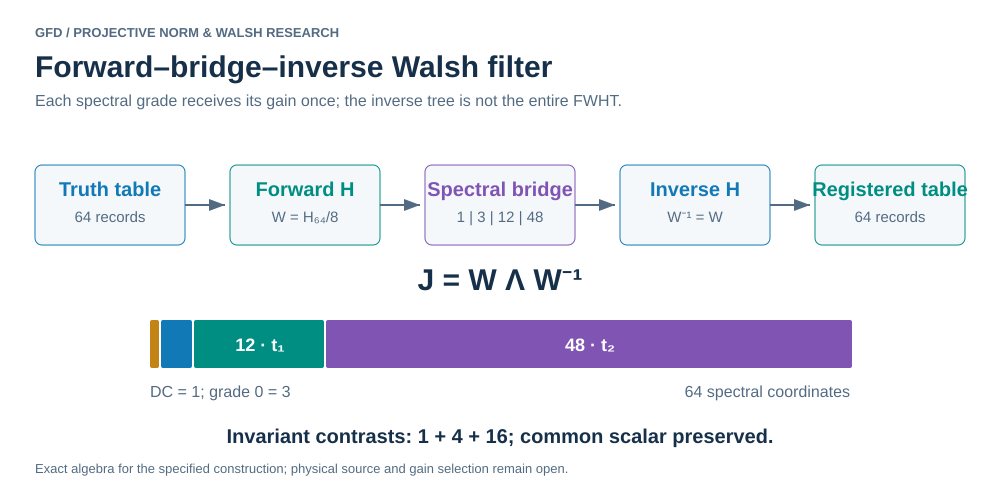

## Interactive explorers

Each explorer is a self-contained browser page with embedded data, no external libraries or server required. The [explorer index](interactive/index.html) covers all fourteen: the eight below, and the six earlier ones in the vertex-research folder.

| Explorer | What you can change |
|---|---|
| [Clock closure and escape necks](interactive/clock.html) | Mass, host tide, critical clock rate, Hill shape and local phase-space aperture |
| [Clock registration and nested response](interactive/registration.html) | Interior/exterior harmonic response, same trace with differing masses, nested clock gaps and current |
| [Hierarchical NET Field closure](interactive/hierarchy.html) | Local residual, host clock lift, source registration, nonlinear leakage and double application |
| [Projective norm and Walsh bridge](interactive/projective_walsh.html) | Projective plane modes and grade gains, forward H → bridge → inverse H (with a √α preset), the Baer partition and norm fibres, trace compression, and the alternating-shear rotation (with an animated sweep) |
| [Necessity of read, settlement and registration](interactive/closure_necessity.html) | Neighbouring states, sufficient information, and settled energy varied to give a conservative force |
| [Closure information and Green response](interactive/closure_information.html) | The exact separator read, and the settled force scale compared with ordinary and complete-frame transmission |
| [Fixed geometry, responsive vortex](interactive/fixed_vortex_response.html) | Stationary susceptibility of the inherited vortex branch against the constitutive curvature h, up to the soft point h_c |
| [Atomic inventory and vortex response](interactive/atomic_vortex_response.html) | Even (inventory) and odd (signed) drives of one fixed-geometry vortex energy |

## Reading order

### 1. [Clock closure and drain](CLOCK_CLOSURE_AND_DRAIN.md): 51 checks (17 exact + 34 numerical)

- In the stationary circular Hill limit, the critical Jacobi surface is a constant co-rotating clock-rate surface. Its clock norm is not automatically the SST foliation lapse, and it is not a horizon or a shield.
- The local quadratic escape neck has area proportional to the positive excess energy.
- Isochrony does not imply a closed drain.


### 2. [Clock registration and nested response](CLOCK_REGISTRATION_AND_NESTED_RESPONSE.md): 112 checks (24 exact + 88 numerical)

- A constant clock trace has no Walsh contrasts, but matter still produces a residual and normal flux. Interior and exterior Dirichlet-to-Neumann eigenvalues differ by 1/R.
- A boundary-only functional cannot produce the bulk galactic correction.
- Nested clock gaps are encoded by a capacitance matrix.

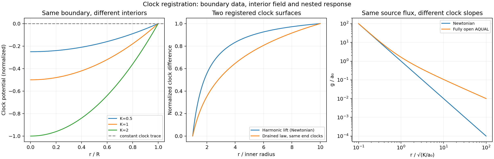

### 3. [Hierarchical NET Field closure](HIERARCHICAL_NET_FIELD_CLOSURE.md): 273 checks (29 exact + 244 numerical)

- The solar residual is the locally settled result of TetA and TetB together, not an inactive TetB.
- Nested stiffness-orthogonal projectors compose without double counting, and partial minimization composes even for nonlinear child and parent.
- A fixed ownership-separable action preserves internal residuals, while pointwise μ on the sum leaks. The left panel shows the same settled residual under different host traces; the right panel shows the leakage if μ is reapplied.


### 4. [Atomic inverse reconstruction](ATOMIC_INVERSE_RECONSTRUCTION.md): 89 checks (32 exact + 57 numerical)

- A conditional complete-frame registration theorem gives a unique squared determinant, and so α²¹ on the 21 invariant contrasts when |t|² = α.
- Atomic agreement alone is insufficient.
- Determinant counting cannot replace the source calculation.

### 5. [Recursive Sierpiński generator](RECURSIVE_SIERPINSKI_GENERATOR.md): 83 checks

- The signed count f(K,s) = 1 + sK + K² on the four-child hierarchy.
- The unipotent L(z) cannot attenuate.
- Detail-only grade gain versus tensor replication.
- The conservative paired time-face read.

![Three Sierpiński blocks L⊗⁰, L⊗², L⊗⁴ with L = [[1,0],[1,1]]](figures/projective_02_sierpinski_blocks.svg)

### 6. [Native generator normalization](NATIVE_GENERATOR_NORMALIZATION.md): 65 checks

- The isolated native-pulse obstruction.
- The unique minimum-trace positive reciprocal completion.
- Conditional metric-normalized common transmission.

### 7. [Projective norm and Walsh bridge](PROJECTIVE_NORM_WALSH_BRIDGE.md): 71 checks

- Exact GF(4)/GF(16) projective enumeration and Baer transversals.
- Compression of the global trace constraint.
- The six diagrams are regenerated by `make_projective_visuals.py`. The Walsh filter and Sierpiński blocks appear above; the other four follow.

The finite-field tower: F₆₄ ∩ F₁₆ = F₄, and the norm descends to the projective multiplicative quotients.


The 273-point interaction ledger: 13 disjoint Baer subplanes × 21 norm fibres.

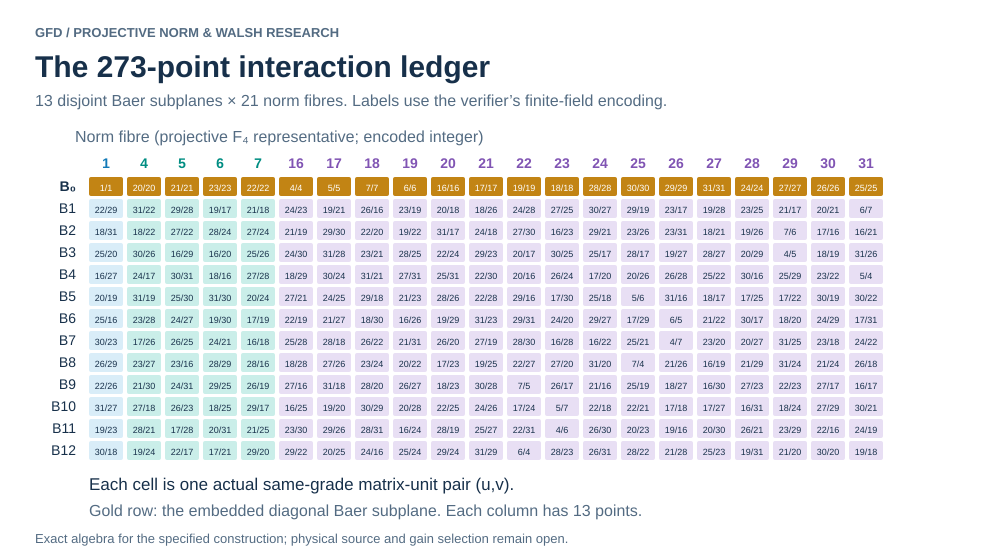

Trace constraint to registered response: remove the global identity direction, then compress through the 13-point norm fibres.


Alternating sweeps form a rotation. All three shears have determinant one; loss appears only after retaining one output port.


### 8. [Necessity of read, settlement and registration](NECESSITY_OF_READ_SETTLE_REGISTER.md): 35 exact checks

- Blind closure works for every environment only if all the feasible sets share a point. For genuinely coupled neighbours, closure cannot be blind.
- A read is sufficient exactly when equal reads force equal settlements (S = F∘R). It need not record the raw interior.
- Nested closure is partial minimization of one action, so a parent registers each child's boundary functional without counting its source twice.
- Force is the variation of the settled energy, F = −dE*/dr. The sign and the distance law come from the actual interaction, not from closure alone.

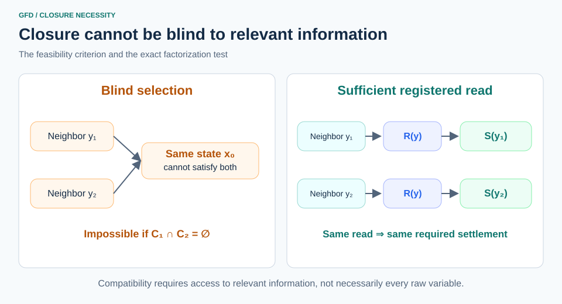

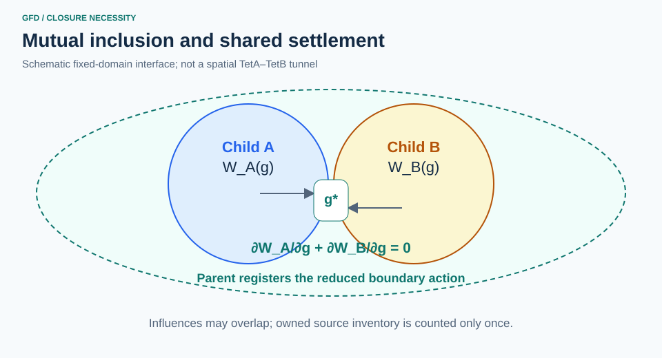

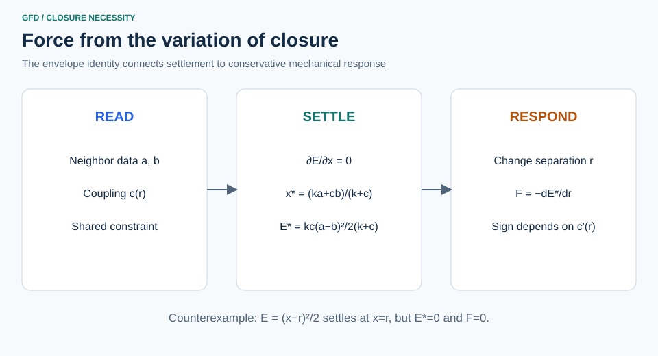

### 9. [Closure information and Green response](CLOSURE_INFORMATION_AND_GREEN_RESPONSE.md): 100 exact checks

- The minimum sufficient linear read across a boundary has dimension rank C, the interface coupling. It is set by the interface, not the total inventory.
- On a connected grounded graph the Green function is strictly positive, so a positive local closure law cannot be blind to any connected source.
- The cross energy of two sources is a mixed derivative of the same settled energy. In an isotropic 3D continuum this gives E_AB = −(q²/4πκ) m_A m_B / r, so G_eff = q²/(4πκ).
- Two obstructions: scaling the energy by λ leaves every closure condition unchanged, so geometry cannot fix G's scale; and an ordinary static read scales as |t|², not |t|⁴², so the α²¹ complete-frame source cannot come from it.

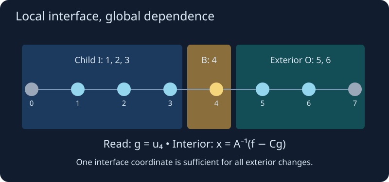

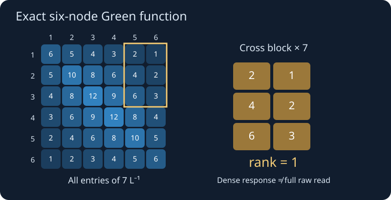

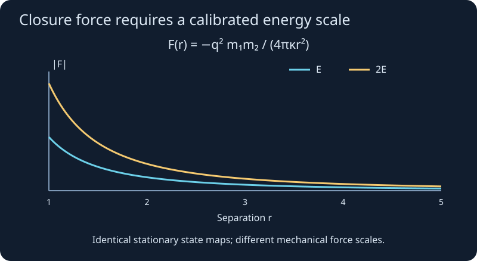

### 10. [Fixed geometry, dynamical vortex response](FIXED_GEOMETRY_VORTEX_RESPONSE.md): 38 exact checks

- The address geometry (W, the graph, C, the projective counts) stays fixed while the vortex amplitudes respond.
- On the inherited balanced stationary branch, an external registered drive gives the exact susceptibility u′(0) = 2k/(1 − hk), with k = 42815/290521. At the constitutive example h = 308/59, u′ = 5052170/3953719 ≈ 1.278.
- The response diverges at h_c = 1/k, where the branch gains a soft direction.

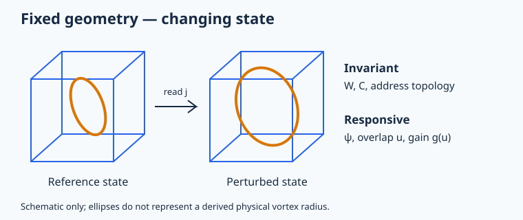

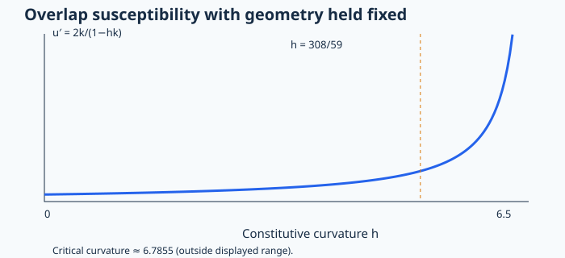

### 11. [Atomic inventory and vortex bridge](ATOMIC_INVENTORY_VORTEX_BRIDGE.md): 53 exact checks

- Reconciles the atomic sources: the nuclear walk counts A, the electron note counts occupancy, and inventory (s = n_A + n_B) is kept distinct from signed charge (q = n_B − n_A).
- An exact witness energy with fixed geometry gives an exchange-even response x* = s/k_e + βq²/d² and an exchange-odd response y* = q/d from one energy. The even response to signed drive is quadratic.
- This is a conditional model, not the native H36 action.

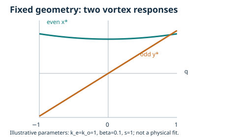

## What stays open

Across all eleven notes, these remain open:

- the physical gain t, which is where α enters;
- the native selection of the detail-only map;
- the complete-frame source read;
- the ownership selection from the time-face vertex;
- the energy scale and source normalization: closure alone fixes neither q²/(4πκ) nor the α²¹ complete-frame source.

## Reproduce

Each verifier writes its own log in this folder. The clock and hierarchy verifiers also regenerate their figures.

```
OPENBLAS_NUM_THREADS=1 python verify_clock_boundary.py        > clock_boundary_verification_output.txt
OPENBLAS_NUM_THREADS=1 python verify_clock_registration.py    > clock_registration_verification_output.txt
OPENBLAS_NUM_THREADS=1 python verify_hierarchical_closure.py  > hierarchical_closure_verification_output.txt
OPENBLAS_NUM_THREADS=1 python verify_atomic_reconstruction.py > atomic_reconstruction_verification_output.txt
OPENBLAS_NUM_THREADS=1 python verify_recursive_generator.py   > recursive_generator_verification_output.txt
OPENBLAS_NUM_THREADS=1 python verify_native_generator.py      > native_generator_verification_output.txt
OPENBLAS_NUM_THREADS=1 python verify_projective_bridge.py     > projective_bridge_verification_output.txt
OPENBLAS_NUM_THREADS=1 python verify_closure_necessity.py     > closure_necessity_verification_output.txt
OPENBLAS_NUM_THREADS=1 python verify_closure_information.py   > closure_information_verification_output.txt
OPENBLAS_NUM_THREADS=1 python verify_fixed_vortex_response.py > fixed_vortex_verification_output.txt
OPENBLAS_NUM_THREADS=1 python verify_atomic_vortex_response.py > atomic_vortex_response_verification_output.txt
python make_projective_visuals.py
python make_closure_necessity_visuals.py
python make_closure_information_visuals.py
```

All eleven verifiers have been run from this folder: 970 checks pass. Sources for each continuation are in [SOURCE_REGISTER.md](SOURCE_REGISTER.md).
