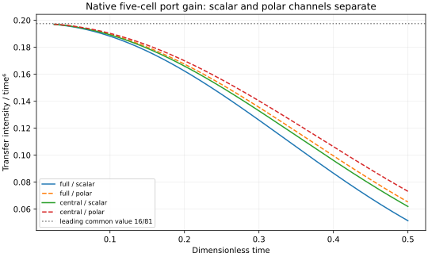

# G from native settlement: port-gain obstruction and the collective source vertex

Research continuation. Proof 26 unchanged. Exact finite-model statements are distinct from candidate physical premises.

## 1. Native Hamiltonian result

Reconstruct the Stage IX 36-coordinate Hamiltonian H from the original tile intersections and sign-record couplings (see [source verifier](https://github.com/fielddynamics/research/blob/main/research/hadamard-null-cone-vortex-flywheel/verify_coupled_origins.py)). Build an isolated star of five whole cells, with central cell linked to four neighbours through the actual Flower tile injections. Use the full W or central-mediated Wc defined in [four-port optical resonator](https://github.com/fielddynamics/research/blob/main/research/hadamard-null-cone-vortex-flywheel/OPTICAL_FOUR_PORT_RESONATOR.md). No new Hamiltonian parameters; dimensionless hopping is one. The star has an open outer boundary, not an infinite lattice.

Let B inject the four source-origin coordinates and C select the sixteen receiving-origin coordinates, J the star Hamiltonian, K_j=C J^j B. The transfer is K(t)=C exp(-itJ)B. Exact integer powers of 54J through order five give K_1=K_2=0, K_3 block i = -(2/3)n_-s n_s^T. Consequently K(t)^*K(t) has order-six coefficient (16/81)I. The order-seven coefficient vanishes. The order-eight coefficient is

```
K4^T K4/576 - (K3^T K5 + K5^T K3)/720.
```

Both kernels give diag(-A,-B,-B,-B). Full: A=125041/131220, B=105583/131220, A-B=1081/7290. Central: A=111377/131220, B=19291/26244, A-B=829/7290. Tetrahedral permutation symmetry forces scalar/triplet block diagonality; real H implies these real diagonal gains are even in time. Thus next remainder is O(t^10). No claim about all finite-time crossings or an autonomous settlement cycle. The local star calculation, not an infinite network simulation, refutes exact time-independent equality of scalar and polar gain in this particular read. Spatial isotropy remains exact by symmetry.



## 2. Determinant selection theorem

For a 21-dimensional bridge T, a scalar source *amplitude* which is multilinear in its 21 column vectors and vanishes whenever they are linearly dependent is necessarily a multiple of det T. Proof: vanishing when two columns coincide, followed by multilinearity applied to their sum, makes the amplitude alternating. The space of alternating 21-linear forms on a 21-dimensional space is one-dimensional. Fixing the response on the identity to one fixes the constant. This theorem does not follow from norm conservation or a threefold cycle. In particular, requiring a full read without specifying linear dependence and alternating multilinearity does not establish a determinant. A permanent is also multilinear but fails the dependence condition. A norm-squared read is basis-invariant but is nonzero for many rank-deficient bridges.

Equivalently, an oriented complete source amplitude carries the determinant character under independent changes of orthonormal source/receiver frames; ordinary quadratic scalar observables do not. If rank loss extinguishes the source only for a particular chosen basis, that is weaker than the stated condition. The physically testable hypothesis is rank-loss extinction of the complete source at fixed positive owned mass, not extinction of an individual port. No such condition has yet been derived from the native action. A 4-dimensional instantaneous transfer cannot itself implement a nonzero 21-dimensional determinant. A physical coherent history or other independent register, with a proved read map, is necessary.

For an ordinary quadratic internal energy 1/2 x^T A x + t x^T b q, A positive definite, stationary elimination gives -t^2 q^2 b^T A^-1 b/2. Hence a nonzero ordinary source correction begins at t^2, even if there are 21 internal dimensions. A uniform T=tI_21 has determinant amplitude t^21 and determinant intensity |t|^42. Putting the latter into a classical source vertex is an additional selection rule, not a consequence of Gaussian elimination. In particular integrating a Gaussian produces a determinant in its normalization, or log determinant in free energy, not automatically the required source coupling.

## 3. Conditional action and mass composition

Use a fixed, universal real positively oriented bridge T in the drainless weak-field limit, number-equivalent density n=rho/m_e, reference source amplitude j_* and positive stiffness s_G. The candidate static action is

```
E[phi] = integral [s_G |grad phi|^2/2 - j_* det(T) n phi] d^3x.
```

The scalar has Poisson equation -s_G Delta phi=j_* det(T)n. Eliminate phi with isolated boundary conditions. Two separated electron-equivalent sources have attractive pair energy -j_*^2 det(T)^2/(4 pi s_G r). If the electrical channel has amplitude t, stiffness s_E, and Coulomb coefficient j_*^2 |t|^2/(4 pi s_E)=alpha hbar c, then G m_e^2/(alpha hbar c)=(s_E/s_G)|det(T)/t|^2. T=tI_21, |t|^2=alpha and s_E/s_G=17/13 give the upstream formula. A complex bridge needs a phase-consistent source/test completion; the real oriented convention here is deliberate. This action demonstrates exactly where a determinant vertex would enter; it does not derive it from the native H. It is not a replacement for SST.

Because n is additive and the coefficient is universal, source amplitudes compose linearly over disjoint regions, with the physical rho including binding energy. It would be wrong to multiply determinants anew for successive enclosing Field Objects; that would make charge depend on the arbitrary hierarchy. The source selection, universal normalization, and coupling to binding energy remain open. No fitted G or physical clock introduced.

## 4. Next decisive native tests

1. At fixed registered mass and scalar background, change the rank of the proposed collective read through a native dark state or controlled perturbation. Determine whether the long-wave source amplitude vanishes or remains an ordinary scalar projection. Establish an independent source observable first.
2. Derive the alternating full-frame response from the coupled time-face action or rule it out; demonstrate actual independent directions accessible to settlement. Do not add fictitious channels or assume the 21 labels are independent simultaneous amplitudes.
3. Derive elementary electromagnetic transmission and physical stiffness from that same action; neither the star gain nor the chosen pulse duration fixes alpha. Full/central microscopic curvatures do not give 17/13 in the existing model. Maintain mass universality and separate loop correction.

Reproduction: `OPENBLAS_NUM_THREADS=1 python verify_native_settlement.py`. Exact rational calculations except labelled numerical Taylor tests/plot. Previous suites not rerun; no remote changes.
