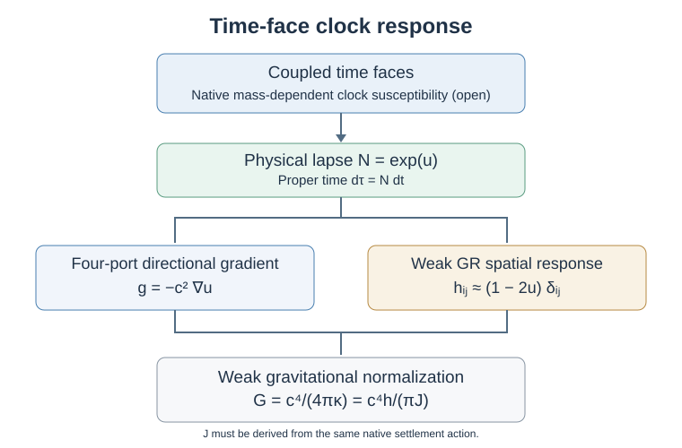

# G from coupled time-face clock susceptibility

Research continuation; exact mathematical identities and conditional microscopic targets. No modification to Proof 26 or the SST. The geometric time face is the existing designated face, not an additional physical time dimension. The new variable u is the logarithm of the physical lapse, not a new independent gravitational scalar.

## 1. Existing foundation and new target

The upstream [SST time-leg proof](https://github.com/fielddynamics/research/tree/main/proofs/sst-covariant-time-leg) sets Phi=c² ln N and identifies the acceleration of a hypersurface-normal timelike congruence with the spatial gradient of ln N. The [native field read](https://github.com/fielddynamics/research/blob/main/research/hadamard-null-cone-vortex-flywheel/FIELD_ORIGIN_GRAVITY_READ.md) supplies the four-port gradient geometry. The [G normalization](https://github.com/fielddynamics/research/blob/main/research/hadamard-null-cone-vortex-flywheel/G_NORMALIZATION_BRIDGE.md) remains conditional on the upstream attenuation and ratio. The task is to derive the response of a physical clock to retained mass-energy from the coupled time faces, not to introduce another gravitational constant.

For a static zero-shift metric ds²=-N²c²dt²+h_ij dx^i dx^j, u=ln N; the acceleration of a stationary observer is c² D^i u and the acceleration of an initially comoving free particle relative to those observers is its negative. This is a local acceleration, not a general coordinate acceleration for a moving particle. A uniform scaling N→aN is a change of time normalization; fix N→1 at infinity. A gradient alone does not imply curvature (Rindler is a counterexample).

In GR's static vacuum, Δ_h N=0 and Ric(h)_ij=N⁻¹ D_i D_j N. A flat spatial metric therefore requires the spatial Hessian of N to vanish in vacuum; a generic mass-like lapse cannot retain flat spatial geometry. In the static linear metric diag(-(1+2u),1-2v,1-2v,1-2v), in x⁰=ct coordinates, R00=Δu, Rij=∂i∂j(v-u)+δij Δv. G00=2Δv and Gij=(∂i∂j-δij Δ)(v-u). Negligible spatial stress and asymptotically flat boundary conditions imply v=u at linear order. These are GR identities, not a derivation of the entire SST. In isotropic Schwarzschild coordinates q=GM/(2c²r), N=(1-q)/(1+q) and h=(1+q)^4 I=[2/(1+N)]^4 I. This exact relation is specific to the Schwarzschild exterior; it is not a general metric ansatz.

## 2. Four-port clock-gradient identity

Take the existing diamond model's sign vectors s_i=(1,1,1),(1,-1,-1),(-1,1,-1),(-1,-1,1), coordinate unit h, and site volume V=8h³. For lapse-log differences d_i=u(x+hs_i)-u(x), the polar read (1/4h)Σ_i s_i d_i recovers ∇u exactly for affine fields, since Σs_i=0 and Σs_i s_iᵀ=4I. Each node has four active bonds, each counted once in a global sum. At long wavelength, Σ_undirected (Δu)^2 per site = 2h²|∇u|² to leading order. Thus the candidate weak clock energy

E[u]=(J/2)Σ_undirected (u_i-u_j)^2+Σ_i M_i c²u_i

has the continuum energy ∫[(κ/2)|∇u|²+ρc²u]d³x, κ=J/(4h). J is energy per bond per squared logarithmic clock contrast, not a hopping amplitude. J>0 is needed for stability. The source follows at linear order from the usual minimally coupled rest action -Mc²∫N dt; no separately tuned test-particle coefficient. For general relativistic systems, the full stress-energy and binding must be included; additivity here is the weak-source coarse-grained assumption.

Vary: J L_D u=-M c². For the acoustic mode L_D→-2h²Δ; hence Δu=4hc²ρ/J. Comparing with ΔΦ=4πGρ yields

G=c⁴/(4πκ)=c⁴h/(πJ).

This is a normalization target, not a numerical G prediction. With λ_e=ħ/(m_e c), J=j ħc/h, obtain α_G=Gm_e²/(ħc)=(h/λ_e)²/(πj). The GFD target γ=(17/13)α²¹ requires j=(h/λ_e)²/(πγ). No fit or identification h=λ_e is made. The stiffness of the real clock variable is not the curvature of the dimensionless optical Hamiltonian by assumption.

## 3. Why a determinant must control clock susceptibility rather than absolute clock rate

Suppose a closure clock is read from a positive normalized determinant N(z)=|det T(z)|/|det T(z0)|. For T(z)=t B(z), constant t≠0, all t^21 factors cancel. Moreover δ ln|det T|=Re Tr(T⁻¹δT) for invertible complex T; it is independent of any common constant t. An absolute factor α^(21/2) cannot supply physical redshift under a common time normalization. A rank-deficient T does not imply that a massive body's gravity vanishes: the clock read may cease to exist instead. This is an important restriction on the previous determinant-source candidate.

A different candidate uses an internal coordinate q and a physical clock deformation u=b q to leading order. Let the internal gradient stiffness be κ_q. Then E=∫[κ_q |∇q|²/2+ρc² bq]d³x and G=c⁴ b²/(4πκ_q). If the native differential clock coupling b=|det T|, not N itself, and T=√α I21, the factor α²¹ enters G. This is a conditional equivalent of the previous collective vertex; it is not forced by the metric. Constant rescalings of q change both b and κ_q, so only b²/κ_q is invariant. The electron-scale matching target is b²/κ_q=(4π/c⁴)(17/13)α²¹ ħc/m_e². To test this, calculate b from physical clock frequency and κ_q from the same normalized microscopic action, not by matching G.

## 4. Native proof experiment

A candidate physical clock is the phase of a stable circulating periodic solution with frequency Ω measured relative to a distant reference Ω0. For identical clocks N=Ω/Ω0 if phase is accumulated as Ω0 dτ. This interpretation requires physical frequency normalization, not an arbitrary energy offset of the linear hopping Hamiltonian. Choose a mass load through registered stress-energy, derive the stationary/periodic branch and its response to the load. Compute the long-wave Hessian in the clock coordinate and the physical frequency derivative. Compare scalar and polar perturbations, preserve the full four-port metric and verify weak universal coupling, causal covariant propagation, drainless GR and drained net-field SST. Uniform local changes of the clock frequency alone cannot give spatial attraction. A gap in the physical long-wave response would invalidate the massless 1/r pole.

The prior work's determinant, α, and 17/13 stiffness ratio remain physical proof obligations. The metric formulation reduces the free normalization problem to a clock stiffness/compliance rather than treating source and test strengths as independently tunable. The toy discrete energy here is not a full covariant completion; it cannot settle the net-field rule or predict lensing beyond the stated GR limit.

## Reproduce

`python verify_time_face_lapse.py` uses SymPy, verifies the linearized curvature, discrete/continuum normalization, determinant cancellation and Schwarzschild lapse identity. See `verification.txt`. No H36 simulation or prior suites were rerun. 21/21 new checks.

External context: Blanchet and Marsat, *Modified gravity approach based on a preferred time foliation*, https://doi.org/10.1103/PhysRevD.84.044056 (2011). The GFD lapse identification is upstream; the discrete normalization and differential-determinant distinction are this continuation.
