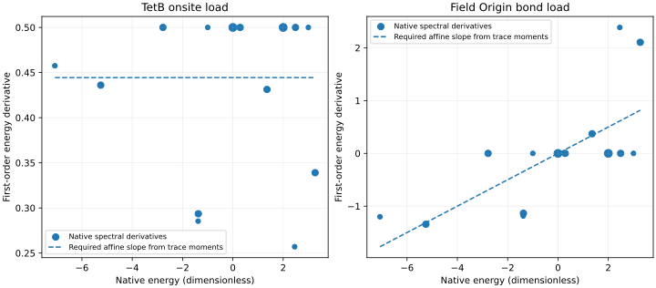

# Native Field Origin clock universality and the G normalization

Continuation of G_TIME_FACE_LAPSE.md and G_NATIVE_SETTLEMENT_VERTEX.md. Exact algebra of the inherited dimensionless H36 model, numerical spectral derivatives, and conditional physical interpretation. No change to Proof 26 or the SST; no new physical load law is asserted.

## 1. What a clock must do

The [SST time-leg proof](https://github.com/fielddynamics/research/tree/main/proofs/sst-covariant-time-leg) uses u=ln N, Phi=c²u and the static acceleration of stationary observers c² D u. The acceleration of an initially comoving free body has the opposite sign. A constant N is a choice of time normalization. The coupled time-face hypothesis should determine the response of N to registered mass-energy, rather than equate an arbitrary eigenfrequency with physical time.

An identical local clock with proper-time Hamiltonian H0 obeys i hbar dψ/dτ=H0 ψ. Because dτ=N dt, its coordinate-time Hamiltonian is N H0. Thus all observable transition frequencies scale by N. An additive identity term contributes only a common phase. This is a consequence of the assumed physical lapse, not a microscopic derivation of the lapse. Only clocks in a physical observable sector need obey the criterion; H36 has not been proved to consist solely of physical clocks.

## 2. Exact native spectral obstruction

Reconstruct the unchanged Stage IX Hamiltonian from the repository's [coupled origins](https://github.com/fielddynamics/research/blob/main/research/hadamard-null-cone-vortex-flywheel/COUPLED_FIELD_ORIGINS.md): 24 lateral tiles, eight base tiles, and a four-component origin. The original 33 positions and 104 bonds are retained. H is real symmetric with zero diagonal, and its characteristic polynomial is

```
x^5 (x-3) (x-2)^5 (x+1) (x^3-7x+2)^3
(x^3+6x^2-11x-24) (x^4+2x^3-19x^2-4x+32)^3
```

It has 14 distinct eigenvalues. Tr H=0, Tr H²=256, Tr H³=-624. Consider a differentiable load H(q)=H+qV+O(q²). In each degenerate eigenspace of energy E, the first derivatives of the eigenvalues are the eigenvalues of the restriction of V to that eigenspace. If *all* gaps scale universally to first order, those derivatives must equal a+bE (the same a,b for every state). Consequently Tr(H^k V)=a Tr(H^k)+b Tr(H^(k+1)) for every nonnegative k. Conversely, the full eigenspace block condition P_E V P_E=(a+bE) P_E is sufficient for first-order universal gap scaling, not necessarily universal matrix elements or higher orders.

Test two natural, explicitly hypothetical load perturbations: B, the diagonal projector onto all 16 TetB tile amplitudes; and V_O=P_O H+H P_O, the derivative of rescaling all existing centre-to-base couplings (no new bond). The results:

| Load | Tr V | Tr HV | Tr H²V | a from k=0 | b from k=1 | residual k=2 |
|---|---:|---:|---:|---:|---:|---:|
| TetB onsite |16|0|112|4/9|0|-16/9|
| Origin bond |0|64|-96|0|1/4|60|
| Uniform H |0|256|-624|0|1|0|

Both candidate local loads fail the necessary moment identity exactly. More generally any diagonal V has Tr HV=0 for this zero-diagonal H, so no diagonal load can give nonzero universal first-order dilation of *all* gaps. This is not a no-go for a projected physical sector or a derived nonlinear collective action. In the actual H, the central parity mode p_s=s_x s_y s_z (zero elsewhere) obeys Hp=3p, has B expectation 1/2, and V_O p=0. It illustrates how some internal modes avoid a direct throat perturbation. Numerical degenerate perturbation theory independently finds ground-referenced fractional gap derivatives between -0.03023 and +0.00988 for B and -0.07773 and +0.37646 for V_O, in the chosen dimensionless load conventions. Signs and magnitudes depend on the clock transition; the uniform H control gives 1 for every gap.



These load choices are not a physical retained-matter Hamiltonian. They rule out the simple identifications, not the coupled time-face hypothesis. The model contains no physical scale or α, so the derivatives cannot determine G.

## 3. A phase is not automatically a lapse

A synchronized phase oscillator is another tempting candidate: u=b θdot/Ω0 (up to reference subtraction). In a local phase action with ordinary kinetic and gradient terms, a static mass coupling -ρ c² b θdot/Ω0 is a total time derivative at fixed ρ and gives zero bulk Euler-Lagrange source for θ, for fixed temporal endpoints. A stationary, nonuniform phase rate θ=Ω(x)t+θ0(x) also causes its spatial phase gradient to grow in time if the phases share a common differentiable field. Neither argument rules out a constrained lapse, nonlocal couplings, time-dependent matter, phase slips, or independent clock frames. It does show that replacing the physical lapse by the derivative of a simple coherent phase does not automatically yield the static Poisson equation.

A more direct architecture is that the coupled time faces set the relative proper-time normalization for the whole local physical action. The lapse is a metric variable (in ADM GR, a constraint multiplier), not an independently postulated phase oscillator. In the weak static reduction it can be represented by a real collective coordinate q with u=bq. The previous four-port energy gives G=c⁴ b²/(4π κ_q) with κ_q the physical stiffness of q. Universal minimal matter coupling supplies the source ρ c² bq. Under q rescaling the invariant b²/κ_q is unchanged. A derivation must compute it from a physical action including the spatial metric; the toy scalar model is not that action.

## 4. Keep the actual G target

The native lapse normalization from the preceding note is G=c⁴ h/(π J), where h is the coordinate unit of the four-port diamond graph, J is its physical log-clock stiffness per bond. With J=j hbar c/h and λ_e=hbar/(m_e c),

G m_e²/(hbar c)=(h/λ_e)²/(π j).

The topology target remains γ=(17/13) α²¹. The matching condition is (h/λ_e)²=π j γ. This is equivalent to h=√(π j) ℓ_P, where ℓ_P=√(hbar G/c³), and therefore not an independent prediction of the cell length. A common determinant in an absolute clock rate cancels under normalization; it must affect differential metric coupling or physical stiffness. Neither α²¹ nor 17/13 follows from the present spectral experiment.

## 5. Next decisive microscopic test

Start from the actual coupled time-face action rather than adding load terms until they match the known G. Seek a common metric clock mode shared by the physically observable states. Derive how a registered positive mass-energy load deforms that mode and the spatial coframe; verify universal relative redshift, the massless static pole, the weak drainless Einstein constraint (including spatial curvature), and the scale-separated drained time-leg rule. Compute the Hessian of the same action in physical units and use its clock response invariant to compare with γ, without fitting. A fixed-volume or flat-spatial-metric ansatz must not substitute for the spatial Einstein equation. Preserve mass/energy registration across enclosing Field Objects; clock susceptibility is a universal coefficient, not multiplied once per particle or enclosing closure.

## Reproduction

Run `OPENBLAS_NUM_THREADS=1 python verify_native_clock.py` with NumPy, SymPy, SciPy, Matplotlib. `native_geometry.py` extracts the already verified Stage IX geometry implementation from the previous settlement package. 33 checks pass, including exact characteristic polynomial, moment obstruction, parity mode, numerical degenerate perturbations and phase-source test. See `verification.txt` and `clock_spectral_slopes.csv`. Earlier tests not rerun; no empirical validation, no remote commit, no fitted G.
