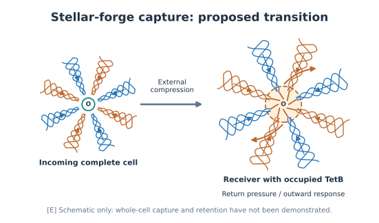
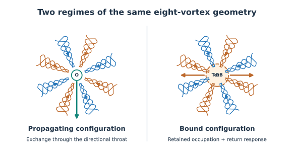
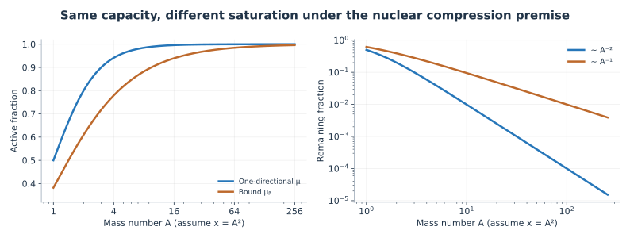
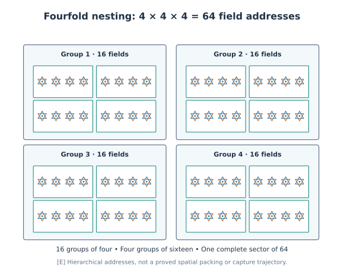

# Bound Field Capture in the Stellar Forge — Stage X research specification

> **Matter/charge extension:** [Eight-register vortex and charge research](MATTER_VORTEX_CHARGE.md) distinguishes retained matter from optical occupation, proves the bare chamber-charge conservation obstruction, and supplies conditional inward/outward response models. Full microscopic capture, charge and physical work coupling remain open.

> **Optical extension:** [Four-port optical resonator](OPTICAL_FOUR_PORT_RESONATOR.md) proves the four-bright/eight-dark coherent mode split and models the isolated central-mediated overlap branch. It preserves the full previous geometry and distinguishes dark modes from inactive individual neighbours; capture remains unproved.

> **Integration update.** The [unified Flower lattice](UNIFIED_HADAMARD_FIELD_DYNAMICS.md) now supplies an explicit conservative multi-cell transport architecture. It does not model whole-cell capture, physical compression or retention. The two-factor screening proposal below remains conditional.

**Status [E]: physical research premise and mathematical targets, not a new validated dynamical theorem.** Companion to [Stage IX](COUPLED_FIELD_ORIGINS.md). The 2,852 previously verified checks are unchanged; this note adds no tests or new physical constants.

## 1. The mechanism to investigate

A complete Hadamard cell consists of eight constituent vortex stellations, the shared octahedral core and the Field Origin. In the ordinary mesh, neighbouring cells exchange field information through matched Triforce subchannels. In the stellar-forge hypothesis, sufficiently strong compression drives a complete incoming cell through a receiving cell's Field Origin into its TetB. The incoming cell becomes internally bound. Its presence changes the vortex response of the receiving cell: both participants are now source and response. The physical proposal is that an outward vortex response accompanies this bidirectional compression.

This is the picture in [The Pixel and the Lattice](https://github.com/fielddynamics/research/blob/main/research/photonic/the-pixel-and-the-lattice.md), now linked explicitly to the [Triforce face synthesis](https://github.com/fielddynamics/research/blob/main/research/faces/enterprise_triforce_synthesis.md) and the bound-law discussion in [llms.txt](https://github.com/fielddynamics/research/blob/main/llms.txt). The hypothesis of microscopic TetB binding is distinct from the macroscopic closure-surface rule that matter stays in its cell or snaps to a neighbouring cell. A star's internal nuclear binding does not imply a drain in the gravitational field between stars or planets; the drainless net-field rule remains unchanged.

*Figure: conceptual capture hypothesis. The eight-ring identity of the incoming field, compression through O and subsequent outward response are targets, not a computed capture trajectory.*

## 2. Three operations must not be conflated

- Propagation: reciprocal exchange of occupation through a geometrically matched face. Stage IX proves this for a specified graph Hamiltonian.
- Capture: a complete incoming field configuration becomes an internal bound object in the receiver's TetB. The graph's transferred occupation is not yet a proof of transfer of a complete cell, or of capture.
- Bidirectional settlement: the two interacting fields determine one another's response. This does not imply reversal of chirality or mass flow; those are separate observables.

*Figure: the two proposed regimes, with inward circulation and through-flow on the left and a retained TetB configuration with outward response on the right. Arrows are schematic; they do not assert a reversal of chirality or material flux.*

## 3. The mathematical target

Retain both chambers and the directional Field Origin of each cell. Introduce an ownership/registration record for the incoming complete cell, and a model of compression supplied by the surrounding mesh. Capture must conserve the total accounting, including any energy carried out into other field channels. After compression subsides, persistent TetB binding must be demonstrated by an invariant set, an energetic barrier, or a stable bound state, not by an imposed irreversible sink or a switch that disables the reverse hopping.

For a candidate autonomous finite Hermitian linear Hamiltonian, an initially empty invariant bound subspace cannot be populated: its spectral projector P commutes with H, hence d(psi†P psi)/dt = 0. In addition, reversible finite occupation transfer does not imply permanent capture. These obstructions motivate nonlinear coupling, time-dependent compression with accounted work, or energy redistribution into a larger conservative lattice. They do not preclude an exact linear localized eigenstate already occupied at initialization.

Test an incoming coherent eight-ring cell, initially outside the receiver, passing through the actual O channels. Monitor all eight ring coherences, transfer into the receiver's TetB, total occupation, total energy including the forge, angular circulation, and outward flux. Demonstrate that capture persists after the driving compression is removed and under perturbations. Distinguish internal bound occupation from reversible mesh propagation. Compare against control runs without compression and without nonlinear feedback. Do not treat mere scalar occupation as proof of whole-cell capture.

## 4. Connection to the existing bound law

The one-directional exterior constitutive law is `x(1-mu)=mu`, with `mu=x/(1+x)`. The nuclear bound law in Paper XIII is `x(1-mu_b)^2=mu_b`. Its physical root is

$$\mu_b(x)=\frac{2x}{2x+1+\sqrt{4x+1}}.$$

This is algebraically equivalent to the root stated in llms.txt for positive x and extends continuously to zero. A proposed microscopic route is that each of two coupled responses contributes a remaining-capacity factor; proving that factorization and the acceleration-strength normalization from actual dynamics is still required. Mere reciprocal Hermitian coupling does not force the squared factor. The target is to derive the bound law rather than insert it into a rate equation. SST names only the full four-term covariant action.

### Reciprocal settlement candidate [E]

If two matched faces have remaining fractions $(1-u)$ and $(1-v)$, and **if** their screening factors multiply, the candidate transmitted strength is $J=x(1-u)(1-v)$. A symmetric relaxation model is

$$\dot u=\kappa[J-u],\qquad \dot v=\kappa[J-v],\quad \kappa>0.$$

Subtracting gives $\dot u-\dot v=-\kappa(u-v)$, so equality is approached exponentially. At a physical equilibrium $u=v=\mu_b$, the bound law follows. This is a conditional algebraic route; multiplicative screening and the relaxation mechanism have not been derived from the conservative Triforce dynamics.

Under the nuclear compression premise $x=A^2$, the one-directional remaining capacity scales as $A^{-2}$, whereas the bound remaining capacity scales as $A^{-1}$. The equal-share points differ: $x=1$ for the one-directional law and $x=2$ for the bound law. Neither is automatically an identification with the geometric centre O.

*Figure: exact functions evaluated under the stated compression mapping. The residual-capacity panel makes the different asymptotic rates visible. These curves are not a new fit or a capture simulation.*

### Nuclear papers and recursive closure [E]

The proposed capture/expansion mechanism is described in [Paper VII, version 7](https://github.com/fielddynamics/research/blob/main/papers/07-dual-tetrad-topology-field-origin/v7/Dual_Tetrad_Gravity_And_The_Field_Origin.tex) and [Bound and Unbound Gravity](https://github.com/fielddynamics/research/tree/main/research/bound-gravity-and-packing). [Paper XI](https://github.com/fielddynamics/research/tree/main/papers/11-nuclear-shells-tetrahedral-packing) uses an electron-mass-based energy normalization, while [Paper XIII](https://github.com/fielddynamics/research/tree/main/papers/13-nuclear-binding-bidirectional-sst) uses a Zn-64 calibration and sector reflections. The [Triforce–nuclear intersection](https://github.com/fielddynamics/research/tree/main/research/nuclear-triforce) proposes a two-face screening path. The [vortex nesting note](https://github.com/fielddynamics/research/blob/main/research/matter/gfd_vortex_nesting_teaching_critical_finding_understanding.md) describes the fourfold hierarchy.

*Figure: 16 groups of four, grouped into four sets of sixteen. This illustrates the proposed $K^D=64$ address sector; it does not establish actual spatial packing, the gate exclusion, nuclear shell energies, or the proposed $K^K=256$ ceiling dynamically. The individual fields retain their identity in the proposed hierarchy.*

## 5. Stage X acceptance criteria

1. An incoming whole-cell coherence is identifiable before and after capture, and counted once in ownership.
2. Transfer crosses the directional Field Origin and enters TetB, not merely the central triangles or an exterior outlet.
3. The bound configuration remains localized after the compression is removed, with stability and a quantified threshold or basin of capture.
4. Total occupation and energy are conserved when the forge/environment is included; no unexplained loss.
5. Mutual back-reaction generates a bidirectional response and an outward vortex signature, without prescribing either as the result.
6. The bound law is recovered only if independently established microscopic assumptions imply its squared screening factor. No inference from the bound law to a macroscopic modification of a drainless system.

This is a research specification. No capture, stability, whole-cell transfer or microscopic bound-law derivation is claimed by Stage IX or by this note.
