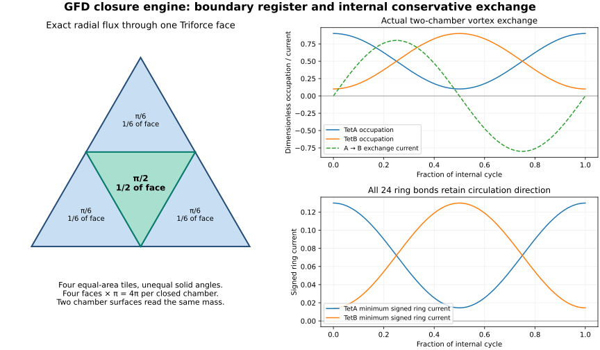

# Inside the four-port closure engine

*GFD Standard Field Model · November 2026 · [T] exact mathematics; [D] conditional model result; [E] proposed physical mechanism.*

This note extends [electron closure settlement](ELECTRON_CLOSURE_SETTLEMENT.md), [dynamic tetrad settlement](DYNAMIC_TETRAD_SETTLEMENT.md), [optical resonator](OPTICAL_FOUR_PORT_RESONATOR.md), and [Paper V](https://github.com/fielddynamics/research/tree/main/papers/05-field-closure-and-topology-of-gravity). It uses the existing 36-coordinate graph unchanged. The electron hypothesis is inward TetA circulation with no retained matter in TetB; ordinary TetB field occupation is not retained matter. The model below is not a physical electron solution.

## 1. The boundary conjugate is a rest-energy register [D]

For a drainless weak-field scalar read $d=-\Phi/c^2$, with $o=0$, the previous static action is

$$S[d]=\int_\Omega\left[\frac{c^4}{8\pi G}|\nabla d|^2-c^2\rho d\right]d^3x.$$

Varying at fixed source gives $-c^2\nabla^2d=4\pi G\rho$ and the boundary variation $\frac{c^4}{4\pi G}\oint \partial_n d\,\delta d\,dA$. Under uniform boundary shift $\delta d=\delta d_b$, define $E_{reg}=-\partial S_{on-shell}/\partial d_b$. The divergence theorem gives

$$E_{reg}=-\frac{c^4}{4\pi G}\oint \partial_n d\,dA=-\frac{c^2}{4\pi G}\oint \mathbf g\cdot\mathbf n\,dA=mc^2.$$

This is a boundary source charge, not a new stored energy. It is not the full relativistic ADM energy for arbitrary fields. The source is an input to this action; it is not generated by the equation. At fixed universal G, the **spherical closure capacity** at the inherited threshold $g_{sat}=a_0/K^2$ is

$$E_C(R)=\frac{c^2}{4\pi G}(4\pi R^2)g_{sat}=\frac{a_0 c^2}{K^2G}R^2.$$

Thus the quadratic record follows from the boundary conjugate and saturation premise without introducing a volume force or surface-tension coefficient. It is a *capacity*, not the actual energy of a fixed mass at every radius. The latter flux remains constant. Matching to $E_E=\alpha\hbar c/R$ gives the previously derived closure radius. The physical origin of the threshold and the unnormalized 16-fold read is still open. No galactic constitutive law is applied to the electron.

## 2. Resolve the boundary into the actual 16 Triforce tiles [T/D]

For a radial inverse-square field centered at the regular tetrahedron's origin, flux through a tile is proportional to its solid angle $\Omega_T$. All four faces subtend $\pi$ steradians by tetrahedral symmetry. The central tile has three mutually orthogonal radial vertex directions (the corresponding central octahedron face); its spherical image is an octant, hence $\pi/2$. The three congruent lateral tiles share the remaining $\pi/2$, so each subtends $\pi/6$. The 16 tiles have equal Euclidean area but not equal flux.

| Tile group (one chamber) | Count | Solid angle each | Fraction of registered energy each |
|---|---:|---:|---:|
| Central | 4 | pi/2 | 1/8 |
| Lateral | 12 | pi/6 | 1/24 |
| All | 16 | — | sum 1 |

All four central tiles together register half the flux, all twelve lateral tiles the other half. Each complete face registers one quarter. Each of TetA and TetB, taken as a separate enclosing geometric surface, registers the same source. Do not add them as independent mass. This statement requires the radial source, not a generic anisotropic state. A normalized central-only flux read therefore needs a factor two, not 16. The actual tetrahedron area at circumradius R is $8\sqrt3 R^2/3$, not $4\pi R^2$; spherical-average saturation and constant face-normal saturation are different assumptions. The original Paper V port ratio is not derived by this geometry.

The area-kernel central-mediated amplitude read is proportional to $w=(1,1,1,6)$ in lateral-first order, whereas the radial solid-angle functional on tile-indexed values is proportional to $f=(1,1,1,3)$. If the same tile coordinates are used for both, they are not proportional. The squared projection of f onto w is $49/52$ of its squared norm; $3/52$ lies outside the bright direction. The test vector $(2,2,2,-1)$ is invisible to w but has nonzero f-read. These are linear functional comparisons, not actual missing physical flux fractions. An assumed uniform source response can be calibrated, but the general flux cannot be reconstructed from that one instantaneous amplitude. Temporal scalar observability or the full interface can supply more information; the physical conversion from optical amplitudes to boundary gradients remains open.

## 3. Optical mismatch is the restoring drive in the proposed radial model [T/D]

At fixed G and a0, let $A=\alpha\hbar c$ and $B=a_0c^2/(K^2G)$. The two records obey $E_E^2E_C=A^2B$, independent of radius. Hence their geometric weighted mean is constant: it fixes the matching energy scale, but cannot drive the radius. For the earlier arithmetic registration $V=(2E_E+E_C)/3$, define the optical reflection amplitude $\mathcal R=(E_E-E_C)/(E_E+E_C)$ (impedance premise). Then

$$\frac{dV}{d\ln R}=\frac23(E_C-E_E)=-\frac23(E_E+E_C)\mathcal R.$$

A radial Hamiltonian with positive inertia therefore has restoring force $-V'(R)=2(E_E+E_C)\mathcal R/(3R)$. The sign of reflection changes exactly at the closure point; a compressed configuration is pushed outward and expanded one inward. This derives the feedback relation **within** the prior radial functional, not the functional or physical inertia from H. A conservative system oscillates around equilibrium and does not automatically relax. The two records are not additive independent energies.

## 4. The actual eight-vortex exchange cycle [T/D]

The exact invariant chamber basis $a,b$ from [dynamic tetrad settlement](DYNAMIC_TETRAD_SETTLEMENT.md) consists of four local pure winding rings per chamber. The original H restricted to these normalized states is $\begin{pmatrix}1&-1\\-1&1\end{pmatrix}$, eigenvectors $v_\pm=(a\pm b)/\sqrt2$, eigenvalues 0 and 2. For $0<\epsilon<1$, the unchanged H has the exact solution

$$z(\tau)=\frac{v_++\epsilon e^{-2i\tau}v_-}{\sqrt{1+\epsilon^2}}.$$

The chamber occupations are

$$N_A=\tfrac12+\frac{\epsilon}{1+\epsilon^2}\cos2\tau,\quad N_B=1-N_A,\quad J_{A\to B}=\frac{2\epsilon}{1+\epsilon^2}\sin2\tau.$$

Every original ring's three bond currents retain their orientation, with magnitude $N_A/(4\sqrt3)$ or $N_B/(4\sqrt3)$. The global minimum is $(1-\epsilon)^2/[8\sqrt3(1+\epsilon^2)]>0$. Thus compression-like occupation imbalance, transfer, reverse imbalance and return occur without extinguishing the eight circulating rings. The imbalance is an occupation, not a demonstrated radial compression. The transfer integrates to zero over the period $\pi$. The model conserves norm and H expectation $2\epsilon^2/(1+\epsilon^2)$, a dimensionless quantity, not a derived rest energy. For epsilon=1/2 the occupation range of each chamber is 0.1 to 0.9. The cycle is exactly periodic, not a sequential mechanical combustion engine.

Both modes are annihilated by all eight filtered port functionals and have zero Field Origin and central amplitude. This **internal clock is invisible to the filtered optical read**. The full W need not be dark. For a static electron candidate, a new physical coupling between this cycle and the scalar boundary register is necessary. No ordinary occupation is equated to retained TetB matter. No continuous inward matter flow into a closed steady state is implied.

## 5. The clock test: no automatic Compton period [T/D]

The original chamber-even scalar sector has quotient matrix $M=\begin{pmatrix}0&-8&0\\-1&-3&-6\\0&-2&-3\end{pmatrix}$ with coordinates (scalar origin, common central, common lateral). Its characteristic polynomial is $\lambda^3+6\lambda^2-11\lambda-24$, irreducible over Q (rational-root theorem). Its roots are approximately -7.075280, -1.380992, 2.456272. A superposition containing both vortex eigenmodes and any one such scalar eigenmode cannot be exactly periodic even up to global phase: the relative frequencies 2 and lambda would have to be rationally commensurate. This is an isolated-cell result, not a proof about nonlinear synchronization or every lattice band.

If one provisionally assigns microscopic hopping rate c/R, the exchange angular frequency is $2c/R$. Paper IV's electromagnetic closure relation gives $\omega_C=mc^2/\hbar=\alpha c/R$. Their ratio is $2/\alpha\approx274.072$. The clock identification would require a derived attenuation of the rate or a different physical phase. Matching by hand to Compton frequency is not a derivation. Neither a classical electron radius nor a quantum spin has been obtained. The dimensionless vortex sector alone cannot fix G, alpha, a0, m or the length scale.

## 6. Decisive next proof [E]

The boundary read now has a precise mathematical meaning and the existing engine has an explicit clock. The missing equation is a conservative, radius-dependent interaction between the internal circulation/occupation cycle and the common scalar boundary charge. Derive its selection rules, normalization and possible phase locking from the full Triforce geometry. A physical model must reproduce the weak-field metric constraint, the upstream single-G normalization and the closure threshold, not insert them again as independent adjustable couplings. The unchanged geometry and filtered linear graph do not themselves provide this interaction.

## Reproduce

`OPENBLAS_NUM_THREADS=1 OMP_NUM_THREADS=1 python verify_closure_engine.py`

[Verifier](verify_closure_engine.py) · [104-check log](closure_engine_verification_output.txt) · [Cycle CSV](closure_engine_cycle.csv) · [Master index](README.md). Previous 5,074 recorded assertions preserved, not rerun. No new Lean compilation, physical validation or remote repository changes.

## Subsequent research: computational closure read

[π-addressed Walsh–Hadamard closure](PI_WALK_FWHT.md) tests the distinction between the π address walk and the spectral read. The resulting algorithm has not yet been derived from this vortex exchange cycle.
