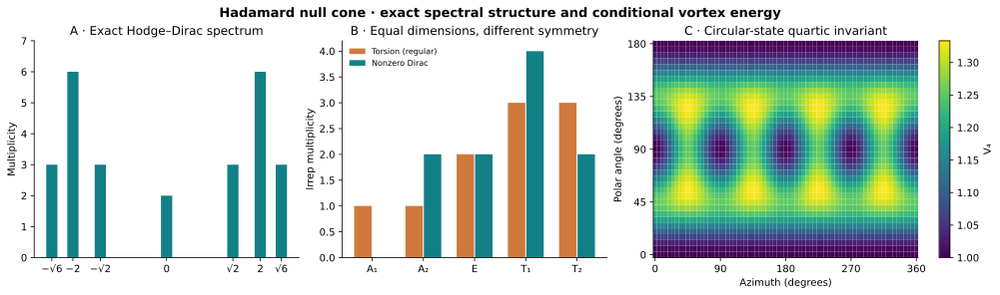

# Core hardening: the Hodge–Dirac algebra, spin transport and stable vortex flywheel

*Gravity Field Dynamics — stage IV · exact finite algebra and conditional dynamics · Python verified, Lean draft uncompiled*

The Hadamard cube is the GFD null-cone object; its stellated octahedron is the internal geometry of the same object. The finite directional structure is the premise, not an assertion that eight rays exhaust the continuum Lorentz null cone. The following results concern that geometry and specified dynamics. SST denotes only the full four-term covariant action; the constitutive law is μ(x) = x/(1+x). No new physical scale is selected here.

**Validation:** 170 new checks; 1,195 inherited checks rerun; 1,365 total. See [script](verify_core_hardening.py) and [log](core_hardening_output.txt). Repeated assertions are not independent theorems.

## 0. Dependency audit: what the other GFD proofs contribute

The [proof index](https://github.com/fielddynamics/research/tree/main/proofs) and [llms.txt](https://github.com/fielddynamics/research/blob/main/llms.txt) were reviewed, with the following underlying sources inspected for this stage. Earlier Hadamard, Walsh, and vortex results are used through the inherited suite.

| Existing proof | Use and boundary of the inference |
|---|---|
| [Hadamard cube frame](https://github.com/fielddynamics/research/tree/main/proofs/hadamard-cube-frame) | The two roots exhaust the eight corners; parity times frame is the Walsh read. |
| [Walsh eigenmodes](https://github.com/fielddynamics/research/tree/main/proofs/walsh-eigenmodes-of-the-cube) | The two T₂ corner copies and core T₂ copy yield the multiplicity Hamiltonian. Scalar partition is independent of T₂ under the linear read. |
| [Vortices](https://github.com/fielddynamics/research/tree/main/proofs/vortices-of-the-stellated-octahedron) | Graph and current convention; existence of winding states does not establish nonlinear stability. |
| [Torsion regular representation](https://github.com/fielddynamics/research/tree/main/proofs/torsion-regular-representation) | The magnitude-read permutation representation of the 24 torsion slots supplies a precise comparison target. It is not a Lorentz-covariant identification. |
| [Chiral holonomy](https://github.com/fielddynamics/research/tree/main/proofs/chiral-holonomy-closed-frame) | Uniform transport gives the spinor sign −1 on Hamiltonian cycles. The new connection tests extend the uniform case, not the transposed TetB transport. |
| [AQUAL energy functional](https://github.com/fielddynamics/research/tree/main/proofs/aqual-energy-functional) | Convexity and uniqueness of the macroscopic static energy are a precedent for energy-based settlement, not a derivation of the microscopic energy used here. |
| [Constitutive law as a tug of war](https://github.com/fielddynamics/research/tree/main/proofs/constitutive-law-tug-of-war) | Screening + exchange + degree-one strengths select μ; a T₂ vortex does not by itself change the linear scalar share. |
| [Mountain scale](https://github.com/fielddynamics/research/tree/main/proofs/sst-mountain-scale) | Least-energy settlement given a registered boundary yields balayage and nested sweeps. The new finite registration theorem has different premises; it is a candidate microscopic analogue. |
| [Closure surface](https://github.com/fielddynamics/research/tree/main/proofs/closure-surface) | Registration at the stagnation surface remains a premise. Every Field Object closes; drained or drainless changes the interior law only. |

The proof index also identifies the forced-frame, half-space, tetrad-scheme and Gram-matrix dependency chain, the net-field rule and the SST covariant time-leg and khronon results. No claim below replaces those proofs. In particular the 28 geometric-element count in the framework is not the 26 surface-chain coordinates used here.

## 1. [T] Exact Hodge–Dirac spectrum

Let L be the oriented vertex-edge incidence (6×12), D the outward face-edge incidence (12×8), in the ordering of the inherited proof. LD = 0 and DᵀD = 3I − A_cube. On C₀ ⊕ C₁ ⊕ C₂ set

$$\mathcal D=\begin{pmatrix}0&L&0\\L^T&0&D\\0&D^T&0\end{pmatrix}.$$

Then the off-diagonal blocks of its square vanish by LD=0:

$$\mathcal D^2=\operatorname{diag}(LL^T,L^TL+DD^T,D^TD).$$

The vertex graph is K_{2,2,2}. Its Laplacian has eigenvalue 0 on constants, 4 on the three odd antipodal vectors, and 6 on the two antipodally even traceless vectors. This follows directly by summing the four neighbours of each vertex. The face block has Walsh eigenvalues 0,2,4,6 with multiplicities 1,3,3,1. The edge space is the orthogonal direct sum im Lᵀ ⊕ im D: dimensions 5+7=12 and orthogonality from LD=0. On each subspace the edge Laplacian is equivalent to the corresponding nonzero vertex/face Laplacian by Lᵀ or D.

| Block | Eigenvalue : multiplicity |
|---|---|
| Vertex | 0:1, 4:3, 6:2 |
| Edge | 2:3, 4:6, 6:3 |
| Face | 0:1, 2:3, 4:3, 6:1 |

The degree grading Γ=diag(I₆,−I₁₂,I₈) anticommutes with the Dirac operator. Hence nonzero eigenvalues come in ± pairs. The exact characteristic polynomial is

$$\det(tI-\mathcal D)=t^2(t^2-2)^3(t^2-4)^6(t^2-6)^3.$$

The two zero modes are constant vertex occupancy and the oriented fundamental surface class. No harmonic edge mode exists on this sphere. For λ∈{0,2,4,6} the squared-operator spectral projectors are exact rational matrices:

$$P_\lambda=\prod_{\eta\ne\lambda}\frac{\mathcal D^2-\eta I}{\lambda-\eta}.$$

They are orthogonal, complete and give a canonical grade-resolved read. This is a discrete Hodge–Dirac operator with the unweighted inner products, not a physical relativistic Dirac operator.

## 2. [T] Torsion: an exact symmetry bridge and an obstruction

For a signed permutation R∈T_d, act on vertices by permutation U, on edges by signed permutation T, and on faces by det(R) times the face permutation V. The orientation sign is essential: TD=det(R)DV. Therefore diag(U,T,det(R)V) commutes with 𝒟. The oriented cycle representation is 2T₁⊕A₂; the two T₁ copies are the two Walsh triplets with the orientation twist. The torsion proof supplies the regular representation A₁⊕A₂⊕2E⊕3T₁⊕3T₂ (using magnitude-read leg permutations). The nonzero Dirac subspace is twice the reduced vertex and face representations:

$$\operatorname{im}\mathcal D\cong 2A_2\oplus2E\oplus4T_1\oplus2T_2.$$

It is **not** the regular representation even though both dimensions equal 24. In particular the Dirac subspace has no A₁. Equating the spaces by counting would be false.

By Schur's lemma the dimension of equivariant real maps from the cycle space to the torsion space is 2·3+1·1=7. The six axial intertwiners are not selected by symmetry. The parity cycle Dp (p=xyz) carries A₂ and has precisely one possible target line in the torsion representation, up to normalization: the sign tensor

$$\omega^a{}_{bc}=\sum_d\epsilon_{abcd}.$$

Thus the map taking Dp to ω and killing the two T₁ sectors is equivariant and is unique up to its scale on that line. This is a concrete bridge to the orientation-sensitive connection sector, **not** a derivation of spacetime torsion from a core current. A physical normalization, tetrad/connection map and Lorentz covariance remain open. The code verifies every symmetry on the explicitly antisymmetric 24-slot tensor action.

## 3. [T] The uniform spin holonomy has its own exact spectrum

For each cube direction n_s=s/√3 introduce the rank-one Pauli projector

$$P_s=\frac{I+n_s\cdot\boldsymbol\sigma}{2}=|u_s\rangle\langle u_s|.$$

This is the usual spin-½ line over that direction. The trace of an ordered product of these projectors is the gauge-invariant Bargmann overlap product. Exact arithmetic gives, for each of the six outward-oriented cube squares,

$$\operatorname{tr}(P_1P_2P_3P_4)=\frac{2+2i\sqrt3}{9}.$$

Its phase is +π/3 in this overlap convention; reversing orientation conjugates it. All twelve directed Hamiltonian cycles (with a fixed start) give −16/81, i.e. phase π, reproducing the existing uniform holonomy result. This verifies the sign independent of spinor gauge. It does not derive the chiral transposed-step prescription or its weighting by the constitutive law.

Define U_{st}=⟨u_s,u_t⟩/|⟨u_s,u_t⟩| on adjacent corners, zero elsewhere, and Δ_spin=3I−U. Both chambers are tight spin frames: their four projectors sum to 2I. The antipodal cross-chamber overlaps vanish and the other cross-chamber squared overlap magnitudes are 2/3. Write F_A,F_B as 2×4 matrices with spinors as columns. The off-diagonal block of U is √(3/2) F_A† F_B. Its two nonzero singular values are √6, by the tight-frame identities. Consequently

$$\operatorname{spec}(\Delta_{\rm spin})=\{(3-\sqrt6)^{[2]},3^{[4]},(3+\sqrt6)^{[2]}\}.$$

Gauge changes are diagonal unitary conjugation. Nontrivial face phase excludes any nonzero covariantly constant state: zero energy would require parallel matching across every link, inconsistent with a nontrivial loop phase. This is the precise reason the spin Laplacian cannot simply be identified with the scalar face Gram DᵀD, whose kernel contains constants. A covariant extension must keep curvature/holonomy rather than silently using the flat scalar boundary identity. Spinor parallel transport, circulation of a graph wave, and spacetime torsion are distinct until a dynamics relates them.

## 4. [T] Multiplication rigidity, conditional on corner locality

For the Walsh character product w_Aw_B=w_{A△B}, the eight-mode function algebra is unital, associative and commutative. Suppose a bilinear multiplication is point-local: its value at s depends only on the two inputs at s. Bilinearity forces m(f,g)(s)=k_s f(s)g(s); the constant unit fixes k_s=1. Hence locality and unit select the ordinary product uniquely. Without locality, even symmetry, unit, commutativity and associativity do not select it. Rescale each Walsh character by a nonzero grade-dependent factor t_A with t_empty=1 and transport the ordinary multiplication: w_A∘w_B=(t_A t_B/t_{A△B})w_{A△B}. The test checks all 512 associativity triples for an explicit example with x∘x=4 rather than 1. The finite algebra of the complete Hadamard state is selected by the stated locality assumption, not symmetry alone.

## 5. [T] Conditional nonlinear orbital stability (candidate microscopic energy)

**Clarification (stage V):** this section optimizes the orientation of one collective spatial triplet, not the number of stellation vortices. The eight physical outer rings are one per octahedral face and collectively constitute the flywheel. The six axial minima below are alternative central core orientations. [The complementary face-energy theorem and simultaneous eight-ring model tests](FACE_CORE_CLARIFICATION.md) establish eight face-normal minima of the complementary candidate and 36 stationary states in which all eight local ring currents and a nonzero registered axial component coexist. Neither restricted energy theorem alone proves full nonlinear stability of the detailed 33-tile model.

The eight-direction invariant obeys the exact polynomial identity

$$V_4(z)=\frac18\sum_s|s\cdot z|^4=\|z\|^4+4\sum_{i<j}\Re(\bar z_i z_j)^2.$$

For a normalized circular state z=(u+iv)/√2 with u,v orthonormal, n=u×v, its value is 1+Σ_{i<j} n_i²n_j². The range is [1,4/3], with axes at the minimum and body diagonals at the maximum; face diagonals give 5/4. This follows from Σn_i²=1. The quartic alone does not select a vortex, since real axial and elliptic states also minimize it.

Introduce a positive candidate energy on the unit sphere:

$$E_\beta(z)=V_4(z)-\|z\|^4+\beta|z\cdot z|^2,\qquad\beta>0.$$

All terms are nonnegative. If E=0, the three two-dimensional real vectors (Re z_i,Im z_i) must be pairwise orthogonal, so at most two are nonzero. The condition z·z=0 requires exactly two equal magnitudes in quadrature. The minima are therefore precisely the six alternative oriented core-axis vortex states modulo U(1), (e_i±i e_j)/√2 for i<j. At z₀=(1,i,0)/√2 the four real directions transverse to norm and phase have exact Hessian eigenvalues 8β, 8β+8, 4, 4. Every minimum is nondegenerate on CP². The Hamiltonian equation iż=∂E/∂z̄ conserves E and norm (time translation and phase invariance). By the positive-definite constrained Hessian, a sufficiently small initial energy neighbourhood cannot exit a neighbourhood of the phase orbit: orbital Lyapunov stability. This is not attraction, nor a spontaneous selection of handedness. Conjugation maps minima to opposite circulations. The implicit function theorem on the phase quotient shows these strict minima persist for sufficiently small smooth perturbations, including real symmetric symmetry-breaking quadratic perturbations. Numerical checks test nine perturbed minima and three long integrations; these illustrate the analytic local theorem, not a universal quantitative perturbation radius.

**Coupled flywheel lift.** Let M be the real symmetric multiplicity Hamiltonian of the full three-triplet sector, m₀ its unit simple lowest eigenvector with eigenvalue ε₀, and gap Δ>0. For Z with rows the core and two outer triplets, define the candidate energy at norm one

$$\mathscr E(Z)=\operatorname{tr}(Z^\dagger(M-\epsilon_0 I)Z)+E_\beta(m_0^T Z).$$

Both terms are nonnegative. Zero requires Z=m₀zᵀ, where z is one of the six alternative axial circular minima. The hidden branch energy is bounded below by Δ‖(I−m₀m₀ᵀ)Z‖². The positive transverse Hessian on the retained branch plus this gap gives orbital stability on the whole nine-complex-dimensional sector, modulo common phase. For nonzero outer couplings the lowest branch has nonzero components in the core and both chambers: the stable mode is collective, not a separate inserted central oscillator. If the core current coefficient is zero, the mode has no physical edge circulation in that graph; the energy theorem is for chirality, and actual nonzero current additionally requires the nonzero coefficient from the vortex proof. The chosen quartic coefficient, β and branch-dependent nonlinear coupling are model premises [E] as physical claims. No physical coupling constants are fitted. Stability with all scalar/E modes, drain channels and external forcing is not established by this restricted theorem.

## 6. [T] Registration from explicit geometric routing and a norm principle

The previous result left a 16-dimensional ambiguity in C₁ with conservation, T_d symmetry and outer-ring constraints. The new statement selects precisely the earlier C₁ under additional assumptions. For a triangular simplex, let λ_i be barycentric coordinate functions. Its Whitney edge form is

$$w_{ij}=\lambda_i\,d\lambda_j-\lambda_j\,d\lambda_i.$$

Along the straight segment from barycentric a to b the integral is a_i b_j−a_j b_i, by substituting λ=a+t(b−a). This is exactly the earlier wedge formula. Choose the specified barycentric locations of fine sites; inside one simplex use the straight path; for crossing two simplices route through the midpoint of their shared edge. For the centre-to-site bonds select the unique minimum Euclidean-norm edge current satisfying Lf=b−a. It is f=Lᵀ(LLᵀ+11ᵀ/6)⁻¹(b−a), since it is feasible and orthogonal to ker L=im D. These conditions reproduce all 104 columns exactly: 84 single simplex, 12 shared-edge midpoint, 8 central gradient-minimum.

Thus the ambiguity is removed **conditional on these explicit path and inner-product rules**, not by conservation alone. Path independence is false: routing along the other two sides of a triangle instead of its direct edge adds a nonzero triangle boundary with no change in divergence. Straight-path subdivision is exactly additive (line integral additivity), giving composition on compatible refinements of the same prescribed paths with the same pulled-back forms. It does not prove arbitrary closure-level composition or the physical stagnation-surface registration premise. The mountain-scale Dirichlet principle motivates, but does not force, the chosen centre norm. A physical work principle must select routes and weights, and the exact memory kernel from stage III still applies to hidden dynamical modes.

## 7. What is hardened, and what is not

- [T] Hodge spectrum and projection algebra; orientation-twisted representation decomposition; exact uniform spin transport spectrum; conditional uniqueness of local multiplication; conditional nonlinear minimum/stability theorem and conditional Whitney registration theorem.
- [E] Physical choice of nonlinear energy, current-to-torsion dictionary, route and metric selection, actual drain dynamics, microscopic selection of acceleration strengths, relativistic continuum limit.
- Existing constitutive law remains μ(x)=x/(1+x) under its existing premises; the spherical field equation is not SST. No claim of a new derivation of G or the SST action. Every Field Object closes, with ownership single-valued and overlap permitted; registration must work on drained and drainless fields alike.
- [Lean audit](LEAN_DRAFT.md): a finite integer certificate draft is included; not compiled here, and not a formalization of the continuous stability theorem. The repository has not been modified.
