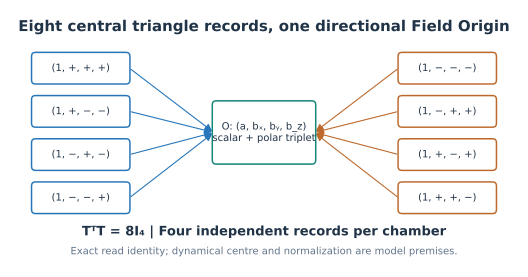
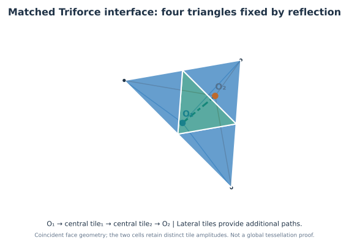
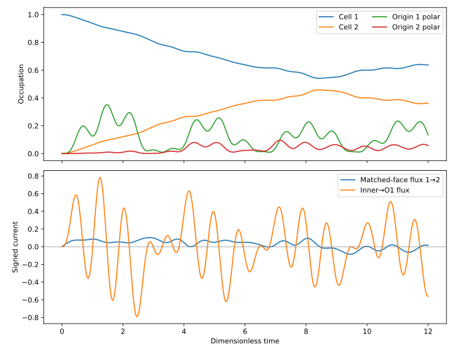

# Stage IX — Coupled directional Field Origins

> **Integration update.** The [unified Flower model](UNIFIED_HADAMARD_FIELD_DYNAMICS.md) preserves the 36-coordinate cell but uses an overlapping hexagonal midplane area kernel instead of this matched-face reflection. Its exact cubic origin-to-origin term has central overlap factor 2/3 and opposite port record at the receiving origin. The two-cell nonlinear tests below are specific to this earlier interface.

**[T] Conditional finite-graph results. [E] Physical interpretation.** This continues [Stage VIII](OPEN_THROAT.md). SST denotes only the full covariant action; no constitutive-law or gravitational-constant derivation is claimed. All eight constituent stellation vortices remain essential. The Field Origin is the central octahedron, with directional degrees of freedom now explicitly located at its centre O.

## 1. The missing throat, not another geometric object

The original 33-site graph has 24 lateral triangles, eight central triangles, and O. Keep all those positions, all 104 original bonds (unit negative hopping), and zero site energies. Replace the *scalar-only description* of O by four complex coordinates `(a,b_x,b_y,b_z)`: an A1 scalar and a T2 polar triplet. There are 36 complex coordinates per cell, but still 33 geometric positions. This is a candidate local representation, not a proof that these coordinates are a Lorentz tetrad or physical matter channels.

For the eight central triangles indexed by their outward signs `s=(±1,±1,±1)`, define the 8×4 real matrix `T` with rows `(1,s_x,s_y,s_z)`. It satisfies

$$T^T T=8I_4.$$

The four rows of either tetrahedron alone form a Hadamard matrix, with Gram matrix `4I`. Thus the four face-normal records of either chamber suffice to recover the four centre coordinates. The direction-dependent read is not an unrelated oscillator geometry: it is the Walsh read of the eight central triangles. With the Euclidean inner product specified, the sign weights are equal in magnitude. We choose the coupling matrix `-T` (so the original scalar hopping stays -1), and its transpose as the return coupling. This adds 24 signed coordinate couplings. The weight scale, choice of one shared triplet, and parity convention are assumptions. Normalized Walsh weights would instead be `T/sqrt(8)`; geometry alone does not select their physical scale.

*Figure: the Hadamard records encode one scalar and three polar coordinates; the diagram is an algebraic read, not a physical Lorentz tetrad derivation.*

The centre equation is

$$i\dot c=-T^T y,\qquad c=(a,\mathbf b),$$

where `y` contains the central triangle amplitudes. The transpose appears in the equation for `y`, so the coupling is reciprocal. All 24 tetrahedral symmetries intertwine the extended Hamiltonian exactly. Spatial inversion exchanges the chambers, preserves the scalar, and reverses the polar triplet. Chirality of the triplet is axial, not the direction of transported matter.

### A precise remaining selection rule

For opposite central faces with the same reference tetrahedron signs, `y_A=y_B` is inversion-even and its polar read cancels. `y_A=-y_B` is inversion-odd and its polar read is bright. Thus adding the directional coordinates does **not** make every former dark mode bright. Stage VII's inversion-even witness remains dark in this particular extension. It is necessary to test the relative phases between the chambers, not just change the weights.

## 2. Eight local rings drive the actual centre

Start with no occupation of any central triangle or O coordinate. For each lateral tile `(i,j)` in its own tetrahedron, assign amplitude proportional to

$$X_{ij}=\tfrac13(s_i\cdot z)+(s_j\cdot z),$$

with `z=(1,i,0)/sqrt(2)` in the numerical witness. Use the actual signs `s` in both chambers, so their amplitudes are inversion-odd. All eight rows sum to zero, and all 24 outer ring bonds have nonzero directed currents. These are locally circulating states, not necessarily pure single-helicity states on every ring.

Let `B` be the 36×3 outer basis with row `s_i+3s_j` on each lateral tile and zero elsewhere. Exact integer identities are

$$B^TB=192 I_3,\quad (HB)_O=0,\quad (H^2B)_O=\begin{pmatrix}0\\-64 I_3\end{pmatrix}.$$

For normalized initial `psi=Bz/sqrt(192)` with unit `z`, expansion of `exp(-itH)` therefore gives

$$\mathbf b(t)=\frac{4}{\sqrt3}t^2z+O(t^3),\qquad \|\mathbf b(t)\|^2=\frac{16}{3}t^4+O(t^5).$$

The leading coefficient follows from the actual lateral-to-central bonds followed by the directional read at O. The eight rings excite O itself without a scalar forcing, sink, or external pump. In an isolated inversion-symmetric cell the scalar component stays dark for this initial condition; the polar components do not. Coupling one face to a neighbour generally breaks the isolated cell's inversion symmetry.

## 3. Join the actual four Triforce subtriangles

Choose the original tetrahedral face in the plane `s·x=1`, with `s=(1,1,1)`. Its four tiles are three lateral triangles and one central triangle. A reflected identical cell at position `2s/3` is given by

$$x'=(I-2ss^T/3)x+2s/3.$$

Every vertex of every one of the four chosen subtriangles is fixed by this reflection. This is an exact local face match; it is not a proof that stellated octahedra tile space without overlapping or that this is the unique physical neighbour orientation. The two cells are represented in their own local coordinate frames; in world coordinates the second cell's polar vectors transform by the reflection and axial vectors by its determinant times the reflection.

*Figure: the exact triangular interface at the selected plane, with both centres on the normal line. The matching geometry is exact; the hopping rule and physical neighbour identification are model premises.*

Let `F` be the 36×4 selection matrix of the matched tiles, `K=FF^T`. Introduce reciprocal hopping -1 between each matched pair:

$$\mathcal H=\begin{pmatrix}H&-K\\-K&H\end{pmatrix}.$$

The intercell block has rank four. No edge-only or vertex-only intercell hopping is included. The four subchannel occupations are distinct cell degrees of freedom connected by a bond, not identified as one degree of freedom; the matching rule is a model premise.

### Origin-to-origin transmission theorem

For the first three powers of the full Hamiltonian, the 4×4 block from O1 to O2 obeys

$$\mathcal H_{O_2O_1}=(\mathcal H^2)_{O_2O_1}=0,\qquad (\mathcal H^3)_{O_2O_1}=-n n^T,\quad n=(1,s_x,s_y,s_z)^T.$$

There is only one shortest path between centres: O1 → central tile 1 → its matched central tile 2 → O2. For initial amplitude `c1` only at O1,

$$c_2(t)=-\frac{i t^3}{6}nn^T c_1+O(t^4).$$

The leading term transports only one face-normal projection, mixing the scalar with the normal polar component. Four tetrahedral faces together have independent records (`sum n n^T=4I`). It would be wrong to claim one face alone transmits the entire centre vector at this leading order, or that every outer-to-neighbour path must pass O1. The other three matched subtriangles provide additional lateral paths.

## 4. Exact interface conservation and compositional accounting

For Hermitian hopping, define `J_ij=2 Im(psi_i H_ji conjugate(psi_j))`, positive from i to j. Then `J_ij=-J_ji` and `d|psi_i|²/dt=-sum_j J_ij`. Sum over each cell and cancel all internal bonds. For `F12=sum_{i in cell1,j in cell2} J_ij`,

$$\dot N_1=-F_{12},\quad\dot N_2=F_{12},\quad N_1+N_2=\mathrm{constant}.$$

The same cancellation works for any finite group of cells with Hermitian matched-face couplings: interior interfaces telescope exactly, leaving only the exterior boundary flux. The statement holds independently of overlap of the geometric support, provided coordinates have single-valued ownership. This is a candidate microscopic analogue of compositional scale universality in Distributed Field Processing, not a derivation of gravitational closure surfaces.

Importantly, flux into O1 does not generally equal F12 at each instant. Occupation can accumulate inside a cell and travel via lateral subchannels. The correct balance is the integrated one, including storage. A closed finite pair cannot support indefinitely positive mean net transport: `∫_0^t F12=N2(t)-N2(0)` is bounded, so its time average tends to zero. A sustained drain would require a larger network with return routes, or incoming and outgoing boundary conditions supported by an environment. A local circulation with zero net transfer across a cut is possible; indefinite one-way throughput across a cut is not.

## 5. Numerical two-cell witness

The initially occupied first cell contains all eight winding rings; the other cell is empty. Exact matrix exponentiation using the Hermitian spectrum, sampled at 1,201 times from 0 to 12, gives:

- Maximum directional occupation at O1: 0.351778; O2: 0.096091.
- Maximum occupation in cell 2: 0.458390.
- At 126 sampled times the original 24 ring currents retain their initial directions while the net inner-to-O1 flux and cell1-to-cell2 flux are both positive and O2 is directionally occupied. These are sampled witnesses; strict signs imply open intervals by continuity, not an all-time guarantee.
- The interface flux reverses in the closed pair. No net occupation or energy is destroyed.

See [the interactive explorer](coupled_origins_explorer.html) and [the actual data](coupled_origins_dynamics.csv). The positive flux into O1 and positive intercell flux are simultaneous observables, not a proof of a unique particle trajectory through the first origin.

## 6. Full neutral axial back-reaction

Stage VIII's axial canonical pair is neutral under global U(1). Now place a real axial pair `(a_c,p_c)` at each O, in addition to its charged scalar/polar wave coordinates. To avoid confusing the neutral coordinate with the complex scalar, write it as `r_c` below. Use the Hamiltonian

$$E=\psi^\dagger\mathcal H\psi+\sum_c[\tfrac12(|p_c|^2+\Omega^2|r_c|^2)-g p_c\cdot C(b_c)],\qquad C(b)=-i\bar b\times b.$$

Let `[p]_\times` denote the cross-product matrix. Since `p·C(b)=b†i[p]_×b`, the wave equation adds `-g i[p]_×` to the local polar block. The full equations are

$$i\dot\psi=\mathcal H\psi-\sum_c g I_c i[p_c]_\times b_c,\quad \dot r_c=p_c-g C(b_c),\quad \dot p_c=-\Omega^2r_c.$$

Here `I_c` embeds the polar triplet into the full wave state. This evolves all amplitudes and both receivers simultaneously. There is no frozen chirality. Each added polar matrix is Hermitian, preserving the wave occupation; the canonical equations conserve the total Hamiltonian energy exactly. The local nonlinear term contributes zero to each cell's occupation derivative, so the previous interface balance is unchanged. The system respects U(1) and time reversal `(psi,r,p)→(conjugate(psi),r,-p)`. The real variables are axial; the neutral receiver is not an extra source or sink of wave occupation.

For a single isotropic triplet with no intercell coupling, the chirality obeys `dot C=-g p×C`. Starting with `r=p=0`, p stays collinear with C. Thus Stage VIII's constant-C solution really is self-consistent even with wave back-reaction:

$$r=-g C\sin(\Omega t)/\Omega,\qquad p=g C(1-\cos(\Omega t)).$$

The new verifier integrates this case and the coupled system. For the latter it tests the eight-ring initial condition and three general noncollinear initial conditions, with `g=.7`, `Omega=1.3` (illustrative, not physical predictions). Worst total energy error <9e-10 and norm error <1.3e-10; noncollinear torque is nonzero. Both receivers are excited in the face-first case. These integrations validate the analytic conservation laws, not nonlinear orbital stability or permanent drainage.

## 7. What is now proved and what is not

**[T]** Within this model: exact local symmetry; four directional centre records; phase-selective centre activation by eight local circulations; exact matched-face geometry; nonzero normal-channel origin-to-origin transfer; conservative reciprocal interface accounting; compositional cancellation; and a phase-invariant fully back-reacting nonlinear axial receiver.

**[E]** The microscopic Hamiltonian, its inner product and hopping normalization, reflection neighbour rule, two real receiver parameters, and identification with physical gravitation remain hypotheses. The neutral receiver is not material through-flow; the charged graph current is occupation transport. No claim is made that the 21/17/13 capacity values are hopping weights, that the 40/24 connection split is dynamically recovered, that the throat direction is selected by a physical drain, or that the constitutive law, a0 or the full SST follow. The next target is a multi-cell network with four matched faces per chamber and self-consistent boundary supply and return, testing stationary circulating transport without an artificial pump inside any cell. The whole tessellation, causal continuum limit and physical drain selection remain open.

## 8. Reproduction

Run `python verify_coupled_origins.py` (NumPy, SciPy, SymPy, Matplotlib). The new 115 checks pass. The historical 2,737 checks have all been rerun successfully after reorganization; see [verification guide](VERIFICATION.md). No Lean compilation or repository change has been performed.
