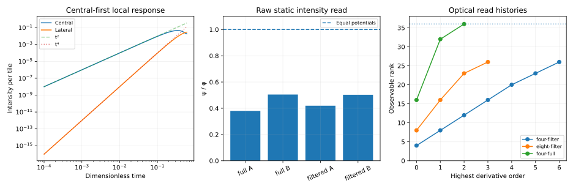

# Dynamic tetrad read: central activation, optical observability and relativistic settlement

*GFD Standard Field Model · November 2026 · [T] exact mathematics, [D] conditional model result, [E] physical hypothesis.*

This extends the [Triforce–tetrad dictionary](TRIFORCE_TETRAD_READ.md), the [spectral gravity read](SPECTRAL_GRAVITY_READ.md), and the [optical resonator](OPTICAL_FOUR_PORT_RESONATOR.md). The original 36-coordinate Hamiltonian and the exact Flower overlap matrices are reused without retuning. The ten lines of investigation below are separate analyses performed by one assistant, not ten independently executed agents. The results do not constitute a derivation of the full covariant SST action, Einstein's equations, or the physical value of G.



## 1. Central-first response from the actual graph [T/D]

The exact integer Hamiltonian of `verify_coupled_origins.py` has a scalar origin coordinate $e_O$, eight central triangles and 24 lateral triangles (three per ring). Its first and second moments on a unit scalar origin excitation are

- $(He_O)_C=-1$, $(He_O)_L=0$;
- $(H^2e_O)_C=3$, $(H^2e_O)_L=2$.

The evolution $z(t)=\exp(-iHt)e_O$ consequently has $z_C=it-3t^2/2+O(t^3)$ and $z_L=-t^2+O(t^3)$. The real Hamiltonian and real initial state make intensities even in time. Hence $I_C=t^2+O(t^4)$ and $I_L=t^4+O(t^6)$, per tile. With an equal-gain signed intensity-contrast dictionary $d=I_C$, $o=I_L$, the previous scalar tetrad map gives $\phi=-d-3o$, $\psi=-d+o$ and $\psi/\phi=1-4t^2+O(t^4)$ as $t\to0$ (not at the zero-amplitude point itself). The local perturbation begins in the GR-like equal-potential direction. No long-time static equality follows. Time is dimensionless; a scalar origin excitation is not an established physical mass source.

## 2. Exact scalar sector and temporal read [T]

The invariant scalar subspace has five uniform amplitudes $q=(a,C_B,C_A,L_A,L_B)^T$ (the label of a central tile is its original face's chamber, not the apex whose base it forms). The actual graph induces

$$i\dot q=R q,\quad R=\begin{pmatrix}0&-4&-4&0&0\\-1&0&-3&-3&-3\\-1&-3&0&-3&-3\\0&-1&-1&-2&-1\\0&-1&-1&-1&-2\end{pmatrix}.$$

This quotient uses unnormalized uniform coordinates, so $R$ is self-adjoint with the inherited weighted norm $\operatorname{diag}(1,4,4,12,12)$, not the ordinary Euclidean norm. The purely scalar evolution cannot generate circulation within a ring because its three amplitudes are equal at every instant.

A filtered port on the first active chamber reads $y=Cq$ with $C=(0,6,0,3,0)$, up to the overall normalization of the interface. The coherent read history supplies the stack $y,i\dot y, i^2\ddot y, i^3 y^{(3)}, i^4 y^{(4)}=\mathcal O q$, with rows $CR^k$, $k=0,\ldots,4$. Exact rational calculation gives

$$\mathcal O=\begin{pmatrix}0&6&0&3&0\\-6&-3&-21&-24&-21\\24&132&78&141&138\\-210&-609&-771&-1050&-1047\\1380&5250&4764&7287&7284\end{pmatrix},\qquad \det\mathcal O=-5225472\ne0.$$

Thus the five scalar coordinates can be read from one port with its first four derivatives. This assumes an isolated known linear Hamiltonian, ideal complex phase-resolved observations, no unknown incoming forcing, and noiseless data. An ordinary intensity-only detector or an unknown externally driven system is not covered. Four ports can give directional information as well. The inverse is an exact observability result, not a derived physical measurement protocol or an automatic read of the metric.

## 3. The static band exposes a counterexample [D]

The existing 72-coordinate Bloch operator has a simple scalar lowest mode at zero momentum in both the full and filtered versions. All its central and lateral tile amplitudes are nonzero. A weak scalar perturbation of the real background changes raw tile intensity by $2u_i\delta u_i$, whose leading long-wavelength profile is proportional to $u_i^2$ for the band-edge source considered. With the same positive gain on every tile, the candidate read has $\gamma=\psi/\phi=(I_C-I_L)/(I_C+3I_L)$:

| Interface | Chamber | Central intensity per tile | Lateral intensity per tile | Raw $\gamma$ |
|---|---|---:|---:|---:|
| Full | A | 0.03077655 | 0.00891266 | 0.380146 |
| Full | B | 0.03633426 | 0.00715823 | 0.504697 |
| Filtered | A | 0.03146188 | 0.00808401 | 0.419606 |
| Filtered | B | 0.03711829 | 0.00735510 | 0.502896 |

The small-k full resolvent checks approach the same ratios. The raw equal-gain intensity identification therefore fails to recover the static GR equal-potential limit. These are model-dependent dimensionless read ratios, not empirical PPN predictions or predictions of the full SST. A change of physical read could alter them; fitting arbitrary gains to force equality would not be a derivation. A central-only read must be justified by a genuine settlement constraint. Two separate chambers also require a physical matching rule to define one metric.

## 4. Exact full-cell coherent observability [T]

Let $C$ consist of the four active rows $w^TF_s^T$ where $w=(1,1,1,6)^T$. The rank-one interface is $W_c=ww^T/54$. The stack of $CH^k$ is formed over the rationals until its row space becomes invariant under right multiplication by $H$. The following ranks are exact:

| Read | Ranks at derivative orders $0,1,\ldots$ | Dark dimension |
|---|---|---:|
| Four filtered ports | 4, 8, 12, 16, 20, 23, 26 | 10 |
| All eight filtered ports | 8, 16, 23, 26 | 10 |
| Four full four-coordinate ports | 16, 32, 36 | 0 |

The four full ports use the nonsingular overlap matrix, which does not change their observation rank. The ten-dimensional kernel $\mathcal K$ for filtered read histories is invariant under $H$, is the same with either four or eight filtered ports, and is annihilated by all eight port rows. It satisfies $H(H-2I)\mathcal K=0$ with five dimensions at each eigenvalue 0 and 2 in this particular Hamiltonian. These statements are exact integer/rational linear algebra. In the filtered diamond network these modes cannot hop to another node: the two-site primitive cell has twenty exactly flat local directions (ten at each of the two eigenvalues, counted with multiplicity). This follows from annihilation by each bond factor, not from sampling the Bloch spectrum. It is not a statement that every other band is dispersive.

## 5. The hidden modes include a metric sector [T/D]

Map a real signed tile perturbation of either chamber to $h=U(Y+Y^T)U^T$ using the actual face/vertex labels. The image of $\mathcal K$ in this dictionary has dimension two, precisely the spatial traceless diagonal sector

$$\operatorname{span}\{\operatorname{diag}(0,1,-1,0),\operatorname{diag}(0,1,0,-1)\}.$$

The same image dimension and form hold for the linearized phase-neutral intensity Jacobian about the calculated positive scalar band backgrounds (numerical check). This is the tetrahedral $E$ sector. For example, a spatial diagonal traceless perturbation can include the plus polarization of a wave along a coordinate axis; the current filtered read cannot transmit that local degree of freedom. Do not identify this two-dimensional sector with the two physical GR polarizations for arbitrary wave directions. The result rules out complete metric recovery from filtered coherent histories under this dictionary and Hamiltonian, not every possible nonlinear read. The full interface removes the isolated-cell linear observability obstruction, but does not establish a massless spin-2 field.

## 6. Circulation coexists with scalar propagation [T/D]

Take the earlier Klein-four translated pure winding on the four TetA rings and its inverted copy on TetB, normalized columns $v_A,v_B$. Direct evaluation of the original local H gives the invariant restriction $\begin{pmatrix}1&-1\\-1&1\end{pmatrix}$. The combination $v=(v_A+v_B)/\sqrt2$ has eigenvalue zero, zero amplitudes at all central triangles and Field Origin coordinates, and eight nonzero circular rings. Each of the 24 ring bonds has magnitude $1/(8\sqrt3)$. All filtered interfaces annihilate this vector; the full overlap does not. Hence a stationary local vortex is an exact independent solution in the filtered lattice. Add the scalar Bloch mode $u$ with relative coefficient $0.1$: in the two-sublattice periodic example $z(t)=(v,0)+0.1 e^{-iE_0t}u$. This is an exact linear superposition, not an equilibrium of a nonlinear matter model. A triangle inequality on the cross-current terms gives an all-phase lower bound $0.06482757$ on the signed ring current magnitudes (sampled minimum $0.06581111$). The eight rings retain their senses for all time in this example. Cycle averaging removes cross-frequency intensity interference. A filtered vortex background and scalar read can coexist; the state is not a proof of persistent inward radial flow, matter capture or self-sustaining nonlinear equilibrium. The coefficient is illustrative, not universal. Full overlap transmits the winding mode and the localized construction then fails.

## 7. Lorentz symmetry and frame transport [T/D]

The tetrad dictionary is invertible, but a boost preserves the Lorentz metric and changes the positive Euclidean norm of its raw channel array. A finite-dimensional positive-norm unitary dynamics therefore cannot simply be identified with noncompact Lorentz boosts acting directly on those same amplitudes; an emergent gauge redundancy, constrained read, or other covariant realization is needed. The present Hamiltonian does not establish local Lorentz gauge invariance. Likewise the metric-compatible link $L_{i\leftarrow j}=e_i^{-1}e_j$ has identity holonomy around every closed loop, including a six-link diamond ring. A nontrivial spin transporter or a different curvature construction is needed. Counting 64 connection slots does not produce Levi-Civita curvature. This preserves the distinction between tetrad gauge modes and connection torsion.

## 8. What the weak-field Einstein constraint actually requires [T/D]

From the candidate channel metric $h_{00}=-2\phi$, $h_{ij}=-2\psi\delta_{ij}$ in static Cartesian scalar gauge, direct linearized curvature algebra yields

$$G_{00}^{(1)}=2\nabla^2\psi,\qquad G_{ij}^{(1)}=(\delta_{ij}\nabla^2-\partial_i\partial_j)(\phi-\psi).$$

Write $\phi=-d-3o$ and $\psi=-d+o$. If the ordinary weak, static Einstein equations are imposed with negligible spatial stress and appropriate asymptotically flat conditions, then $\nabla^2(\phi-\psi)=0$ and $o=0$. Therefore the equality of potentials is a *settlement constraint*, not merely a choice of basis. A convenient equivalent restricted static variational functional, using physical $\Phi=c^2\phi$ and $\Psi=c^2\psi$, is

$$\mathcal S_{\rm stat}=\int\left[\frac{2\nabla\Phi\cdot\nabla\Psi-|\nabla\Psi|^2}{8\pi G}+\rho\Phi\right]d^3x.$$

Its two variations yield $\nabla^2\Psi=4\pi G\rho$ and $\nabla^2(\Phi-\Psi)=0$. In channel variables set $q=d+3o$ (here a scalar, not the five-vector in section 2). The equivalent functional is

$$\mathcal S_{\rm stat}=\int\left[\frac{c^4}{8\pi G}(|\nabla q|^2-16|\nabla o|^2)-c^2\rho q\right]d^3x.$$

The slip coordinate $o$ is unsourced, and its stationary equation with vanishing boundary data gives $o=0$. The functional is indefinite in this restricted gravitational variational description, not a microscopic positive energy to minimize over both scalars. The resulting reduced central equation is $-c^2\nabla^2d=4\pi G\rho$, $\mathbf g=c^2\nabla d$. The source coupling and this functional are standard weak-GR constraints expressed in the channel dictionary, **not derived from the SFM Hamiltonian**. They give a precise target for a constrained effective theory. The present scalar inverse-Laplacian pole has the right spatial operator but not the demonstrated constrained read or universal matter coupling.

## 9. Spin-2 and time evolution [E]

The established static band-edge pole has rank one and the dispersion $E-E_0\sim Dk^2$ for the chosen dimensionless first-order Hamiltonian. It does not supply the two independent propagating tensor polarizations of GR or relativistic wave dispersion. The dark flat sector makes the problem more specific: a model using the filter as the only physical interface must explain how tensor modes propagate without destroying the protected local circulation. Full overlap is an available candidate additional path, not a solved gauge theory. A valid continuation must derive constraints, nontrivial spin transport, a tensor kinetic operator, continuous gauge symmetry or a consistent covariant preferred-frame formulation, and universal stress-energy coupling. The existing GFD drained/drainless distinction and full SST action must not be replaced by the scalar optical toy model.

## 10. Normalization and a falsifiable next target [E]

The microscopic read scale is not fixed by a normalized eigenvector; multiplying the amplitude by a constant changes its intensity quadratically. The original GFD expression $G^{(0)}_{\rm GFD}=(17/13)\alpha_{\rm EM}^{21}\hbar c/m_e^2$ remains the sole normalization target, under its stated optical attenuation and combination premises. The proposed loop correction is still not derived here. Neither the constrained scalar functional above nor the optical read history determines the physical coupling or the complete 21-mode closure selection. Do not calibrate another G. See [normalization bridge](G_NORMALIZATION_BRIDGE.md) and [collective optical closure](G_CLOSURE_DERIVATION.md).

The most decisive next derivation is a microscopic matter source and constrained read that makes the lateral scalar contrast vanish in the drainless weak-field limit while retaining the full tensor response when required. Test the resulting read against the calculated raw slip counterexample, hidden E modes, nontrivial curvature and causal tensor dispersion. For drained galactic fields, derive the constitutive law and its matching to the full covariant SST separately. No physical scale or particle identity is inferred from the present calculations.

## Reproduce

```
OPENBLAS_NUM_THREADS=1 OMP_NUM_THREADS=1 python verify_dynamic_tetrad.py
```

[Verifier](verify_dynamic_tetrad.py), [log](dynamic_tetrad_verification_output.txt), [time response CSV](dynamic_tetrad_response.csv), [static ratios CSV](dynamic_tetrad_static.csv). 210 new assertions; exact integer and rational identities plus numerical spectral/response checks. Earlier 4,777 recorded assertions are retained, not rerun. No independent agents, Lean compilation, external empirical test or remote repository modification.

**Continuation:** [Electron closure settlement](ELECTRON_CLOSURE_SETTLEMENT.md) connects Papers IV/V and the existing topology normalization with a joint solution, conditional radial energy and optical matching.
