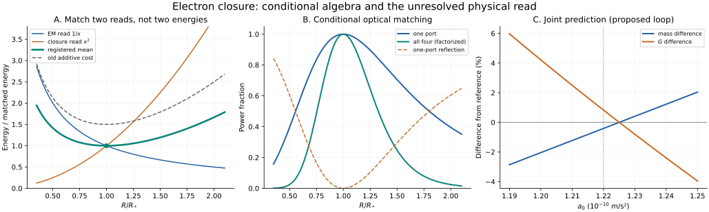

# Electron closure settlement: a four-port operating point

*GFD Standard Field Model, November 2026. [T] exact algebra; [D] result conditional on stated premises; [E] physical hypothesis.*

This note integrates [Paper IV](https://github.com/fielddynamics/research/tree/main/papers/04-hubble-tension-through-tetrad-topology), [Paper V](https://github.com/fielddynamics/research/tree/main/papers/05-field-closure-and-topology-of-gravity), [G from topology](https://github.com/fielddynamics/research/tree/main/research/g_from_topology), [dynamic tetrad settlement](DYNAMIC_TETRAD_SETTLEMENT.md), [optical ports](OPTICAL_FOUR_PORT_RESONATOR.md) and [matter configuration](MATTER_VORTEX_CHARGE.md). Paper V's V4 analogy is a four-port chamber and closure boundary, not a fuel-burning engine. The proposed inward electron state has no retained TetB matter; ordinary TetB field amplitudes need not vanish. The present note does not establish electron spin, quantum charge, or a physical electron radius.

## 1. One simultaneous solution [D]

Use the inherited premises $mc^2=\alpha\hbar c/R$, $a_0=K^2Gm/R^2$, and $Gm^2=\gamma\hbar c$, where $K=4$, $\gamma=(17/13)\alpha^{21}$ at tree level. The existing proposed loop factor multiplies gamma by $1+\alpha/(2\pi)$; it is not derived here. All quantities are positive. Then

$$m=\frac{a_0\alpha^2\hbar}{K^2\gamma c^3},\quad R=\frac{K^2\gamma c^2}{\alpha a_0},\quad G=\frac{K^4\gamma^3 c^7}{\alpha^4\hbar a_0^2}.$$

The logarithmic residuals in $(\ln m,\ln R,\ln G)$ have Jacobian rows $(1,1,0),(-1,2,-1),(2,0,1)$, determinant 1. Thus the positive solution is unique. With fixed measured G the first two residuals instead have determinant 3 and give the original cube-root mass formula. At fixed alpha and gamma, $m\propto a_0$, $R\propto a_0^{-1}$, $G\propto a_0^{-2}$. With the topology relation included the mass becomes linearly sensitive to a0, not cube-root sensitive. At fixed a0, $m\propto\gamma^{-1}$, $R\propto\gamma$, $G\propto\gamma^3$. This is a closure compatibility relation, not three independent predictions or a derivation of its premises.

Numerical illustration using the prior package constants (SI, not new measurements):

| a0 (m/s²) | gamma convention | m (kg) | R (fm) | G (SI) |
|---|---|---|---|---|
| 1.20e-10 | proposed loop | 8.9232773e-31 | 2.876712 | 6.9555211e-11 |
| 1.22e-10 | tree | 9.0825349e-31 | 2.826270 | 6.7059482e-11 |
| 1.22e-10 | proposed loop | 9.0719986e-31 | 2.829553 | 6.7293405e-11 |
| 1.225e-10 | proposed loop | 9.1091789e-31 | 2.818004 | 6.6745192e-11 |

At a0=1.22e-10 the loop mass differs by -0.4104% and G by +0.8247% from reference. The a0 needed to reproduce the reference mass is 1.22502754249e-10 with the proposed loop factor; this is an inversion, not independent evidence. The much-quoted 12 ppm G comparison uses measured electron mass as an input and does not transfer automatically to the joint prediction. The closure R is the classical electromagnetic scale under the Paper IV premise, not a measured extended electron size. Do not apply the galactic constitutive law to the electron's own field. The full SST action and drainless/drained distinction are unchanged.

## 2. Where the sixteenfold read can enter [T/E]

In the tetrad dictionary the equal-potential scalar central tile state is $d_i=d$, $i=1,\ldots,K$, and $\mathbf g=c^2\nabla d$. Define a linear two-index record $P_{ij}=(d_i+d_j)/2$. Its raw sum is $\sum_{ij}P_{ij}=K\sum_i d_i=K^2 d$ in the equal state. It is invariant under a common permutation of the four ports. The raw pair-read gradient is then $K^2\mathbf g$. The normalized pair mean instead gives exactly $\mathbf g$; symmetry alone does not select the normalization. This is a precise candidate realization of the original saturation read, NOT sixteen times the physical force. The microscopic meaning of summing instead of averaging the pairs, the saturation threshold and the assignment of the paired records to the true tensor channels remain [E]. Counting sixteen tetrad coordinates does not establish sixteen independent equal physical responses.

## 3. Two closure energy records, one registration [D/E]

With G held fixed during a radial variation, define $A=\alpha\hbar c$ and $B=a_0c^2/(K^2G)$. The electromagnetic and gravitational-saturation records are $E_E=A/R$ and $E_C=BR^2$. Both have energy units. Closure means they agree with the same $mc^2$, not that they are additive energies. The intersection is $R_*=(A/B)^{1/3}$, $E_*=A/R_*$. The earlier cost $E_E+E_C/2$ does have the correct minimum radius but equals $3E_*/2$, so it cannot also be the rest energy under the inherited electromagnetic closure premise.

A minimal alternative [E] is a constant-weight idempotent registered energy $V_w=wE_E+(1-w)E_C$. Idempotence means identical records give the same energy, not twice the energy. Requiring stationarity at their matching point yields $w=2/3$ uniquely within this class. Consequently

$$V_{reg}=\frac{2E_E+E_C}{3},\qquad V_{reg}(R_*)=E_*,\quad V_{reg}''(R_*)=2B>0.$$

With $x=R/R_*$, $V_{reg}/E_*=(2/x+x^2)/3$ and $V_{reg}/E_*-1=(x-1)^2(x+2)/(3x)$. This proves a unique global minimum. An illustrative conservative breathing Hamiltonian adds $p_R^2/(2M_R)$ with positive effective radial inertia; its small-oscillation frequency is $\sqrt{2B/M_R}$. Neither the inertia nor the energy functional follows from the original 36-coordinate H yet. Conservative dynamics oscillate; they do not generically relax to the minimum without an energy transfer mechanism. Hold G fixed during variation and impose the universal topology relation on the equilibrium mass; varying G with instantaneous radial excursions would not be a consistent universal coupling.

The weights do not prove this is the unique physical energy. The power means $V_p/E_*=[(2x^{-p}+x^{2p})/3]^{1/p}$ share the matching stationary point; the curvature at x=1 is $2p$. Positive p gives a minimum, p=0 is constant, negative p gives a maximum. Choosing the arithmetic mean is a new model premise, not a derivation from geometry alone.

## 4. Lossless optical matching [T/E]

As a separate candidate interface, interpret the two positive energy records as proportional to two real wave impedances in the same units. Then the reciprocal power-normalized scattering matrix is $S=[[r,t],[t,-r]]$, with $r=(1-x^3)/(1+x^3)$ and $t=2x^{3/2}/(1+x^3)$. It is exactly orthogonal. Transmission $T=4x^3/(1+x^3)^2=\operatorname{sech}^2((3/2)\ln x)$ is unity precisely at closure; reflection vanishes there and is $9(x-1)^2/4+O((x-1)^3)$ nearby. Four identical factorized port scatterers have all-port transmission probability $T^4$. This illustrates simultaneous four-port matching without loss or double-counting. It is not derived from the actual W or Wc; identifying the two energy records as impedances and factorizing the ports are additional physical hypotheses. Neither optical matching nor a stationary cost demonstrates a self-sustaining physical electron cycle. The existing eight-ring vortex remains a separate verified linear solution.

## 5. Boundary action check and limitations [T/E]

The positive exterior gradient-energy read for a spherical source is $Gm^2/(2R)$. If a hypothetical excluded-volume cost $4\pi P_0 R^3/3$ is added, stationarity gives $g(R)^2/(8\pi G)=P_0$. Paper V's saturation would correspond to $P_0=a_0^2/(8\pi G K^4)$. This is a possible boundary stress interpretation, not derived from the action: the source-included weak-GR on-shell static action for a shell is instead $-Gm^2/(2R)$, so the positive gradient energy cannot silently be substituted for it. No vacuum pressure is asserted. The prior weak-field scalar settlement functional supplies the exterior Poisson read; it does not supply the radial matter energy or volume term.

The fixed dimensionless 36-coordinate Hamiltonian has no dynamical radius. Even assigning an overall energy scale $\hbar c/R$ gives eigenenergies proportional to $1/R$; a nonzero eigenenergy alone has no finite stationary radius. The zero of the existing linear vortex eigenvalue is also arbitrary up to a uniform energy shift. A physical self-consistent model requires a radius-dependent H, conserved physical stress-energy, and a boundary coupling that gives the saturation term and the correctly normalized charge and mass. The Compton length is $\hbar/(mc)$; the paper's closure length is alpha times this. A traversal at c over that length is not automatically a Compton period. Do not identify geometric circulation with electron spin without its quantum transformation law.

**Proof target:** derive both closure energy records, their non-additive registration and pair-sum saturation from the actual vortex degrees of freedom, and derive the topology attenuation/ratio rather than fitting it. Test stability against all internal, radius and lattice degrees of freedom. Until then the model is a conditional closure construction, not a first-principles electron or gravity derivation. The original Papers IV/V port ratio is not derived by this construction and is unnecessary for the joint solution using independent a0.

## Reproduce

`OPENBLAS_NUM_THREADS=1 OMP_NUM_THREADS=1 python verify_electron_closure.py`

[Verifier](verify_electron_closure.py) · [87-check log](electron_closure_verification_output.txt) · [Numerical cases](electron_closure_values.csv) · [Master index](README.md). Previous 4,987 assertions preserved, not rerun. No empirical validation, new Lean compilation, or GitHub change.
