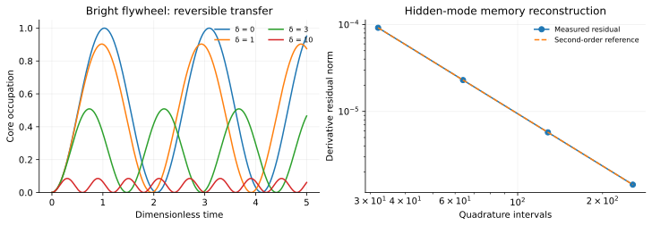

# Extended validation: Hadamard null cone and collective vortex flywheel

*Field Dynamics Research · Python-first continuation · November 2026*

**Status:** [T] exact finite algebra and conditional mathematical theorems; [E] candidate microscopic and lattice dynamics. Numerical tests certify instances, not physical identification or general theorems by themselves. [D] reserved for consequences of stated GFD premises; no new observational [O] claim.

## Naming and scope

The canonical source is the repository's [`llms.txt`](https://github.com/fielddynamics/research/blob/main/llms.txt), last updated 2026-11-21 as retrieved for this work. The Hadamard cube is the GFD null-cone object under the framework premise. The eight stellations form its collective flywheel and the octahedral core is its shared coupling geometry. TetB is the throat interior, reached through the Field Origin, not reverse time or the deep field. A galaxy is a drained vortex with occupied TetB; its exterior obeys the one-directional constitutive law. Every Field Object settles and registers, whether drained or drainless. Closure fields overlap; ownership is single-valued. The drain decides the interior law, not whether closure occurs. A larger closure reads the pointer without reopening the smaller object's internal accounting. Scale universality is compositional, not geometric self-similarity.

Use **constitutive law** for `μ(x)=x/(1+x)`, `x=g_t/a_0`; **capacity function** for `f(x)=(21x+13)/(x+1)`; **share difference** for `σ(x)=(x−1)/(x+1)`; **kinetic functional** for `F(y)`; **spherical field equation** for `g_s=g_t²/(a_0+g_t)`. **SST** names the full four-term covariant action (curvature, kinetic, electromagnetic and matter terms) only. The discrete label `s` in `f(K,s)` is not `σ(x)`. This note neither derives the full SST nor introduces a per-galaxy parameter. Dimensionless model parameters used in tests are not measured physical constants.

Run `python verify_extended_validation.py` (NumPy, SciPy, SymPy). It imports and reruns the two earlier stages and then checks seven validation topics. The earlier 984 checks and the new 211 checks all pass. See [actual output](extended_verification_output.txt). Counts include repeated parameter and symmetry tests; they are not counts of independent theorems.

## 1. [T] Complete exact Hodge read and its algebraic limitation

Write `W` for the unnormalized Walsh matrix (columns indexed by grades 0,1,1,1,2,2,2,3), `D` for the oriented face boundary, `L` for the edge boundary. We have `W^T W=8I`, `D^T D=W Λ W^T/8`, `Λ=diag(0,2,2,2,4,4,4,6)`.

Define the rational matrix

$$ F_D=(D^TD)^+D^T=\frac18 W\Lambda^+W^TD^T. $$

Here `F_D` is a face-ledger reconstruction operator, not the kinetic functional `F(y)`. The pseudoinverse has entries `0,1/2,1/2,1/2,1/4,1/4,1/4,1/6` in the Walsh basis. Direct multiplication gives `F_D D=I−11^T/8`, `D F_D=P_cycle`. The latter is the orthogonal projector onto `ker L`, since `im D=ker L`. Every conserved edge current has the unique zero-mean face ledger `F_D J`. Other ledgers differ only by a constant. This proves uniqueness of the read once the zero-mean convention is fixed. All 4096 independent edge orientation choices and 24 paired frame relabelings preserve the relevant identities. Under arbitrary reordering the matrices transform by the corresponding permutation, so the result is coordinate-independent within this finite geometry.

**New obstruction:** the full eight-dimensional pointwise Walsh algebra is associative, with `w_U w_V=w_(U symmetric difference V)`. The zero-mean seven-dimensional face ledger does not inherit that associative product. If `a⋆b=P_0(a b)` with `P_0=I−11^T/8`, then `(x⋆x)⋆y=0` but `x⋆(x⋆y)=y`. Nor is the constant subspace an ideal: multiplying a constant by x produces x. Thus the cycle quotient cannot simply be declared an algebra with the inherited product. Nonlinear settlement must retain the scalar component during multiplication, even though the oriented boundary read annihilates it. This is a concrete reason to keep the full Hadamard state in nonlinear accounting.

## 2. [T] Collective flywheel dynamics; [E] physical realization

In the invariant `3T2` sector let `Z` be the 3×3 complex matrix whose rows are core, TetA and TetB triplets. Under `i dZ/dt=M Z`, with M Hermitian, `Z(t)=exp(−iMt)Z(0)`. The **entire spatial Gram matrix** `Z†Z` is conserved, not just its trace. The sum of the three chirality vectors follows from its imaginary antisymmetric part and is conserved. This is a stronger closure invariant than separate chamber occupations. Individual triplets can exchange chirality; total chirality cannot be generated by this isolated multiplicity dynamics from a separable real spatial polarization. No claim is made that physical angular momentum has been identified.

For equal diagonal energies, subtract the common phase and set `g=√(a²+b²)` for core couplings a,b. Bright and dark outer combinations are `(a p+b q)/g` and `(−b p+a q)/g`. From an initially normalized bright state and empty core, core occupation is `sin²(gt)`. The reciprocal transfer is exact; dark occupation stays dark. With core/bright detuning δ, peak conversion is `g²/(g²+δ²/4)`. Unequal chamber energies couple bright and dark, so initially dark amplitudes excite the core at order t² (occupation at order t⁴), except when the mixing coefficient vanishes. Numerical tests check that leading coefficient, unitary time reversal and conserved Gram/energy.

For the same linear Hamiltonian the distance between two states is preserved: there is neutral Hilbert-norm stability but no attraction to a vortex state. Random phases are not a mechanism for spontaneous chirality. Nonlinear stability of the actual physical flywheel and selection of its initial circulation remain open. Earlier candidate harmonic conversion models are conservative, not evidence of an attracting physical vortex.

## 3. [T] Registration ambiguity and memory of hidden modes

Use the previously constructed chain map `C1` with `L C1=C0 L33` and `C1 R=D/4` for the eight fine ring columns R. Let `P_R=R(R^T R)^−1 R^T`, and `P_cycle=D F_D`. Define

$$ A=P_{cycle} C_1(I-P_R). $$

The exact rational test finds `A≠0`. Since `L P_cycle=0`, `L A=0`. Since `(I−P_R)R=0`, `A R=0`. All matrices in this construction are equivariant under the signed edge action of Td. Hence `C1+τA` preserves both the conservation and ring identities for any real τ. This is an explicit counterexample to uniqueness.

More generally allowable differences are intertwiners from the quotient of the 104-dimensional fine oriented-bond space by the eight-dimensional ring subspace into the seven-dimensional core cycle space. The real irreps of Td are absolutely irreducible. The dimension is the character inner product

$$ \dim \operatorname{Hom}_{T_d}(V_{fine}/\operatorname{im}R,V_{cycle})=\frac1{24}\sum_{g\in T_d}(\chi_{fine}(g)-\chi_R(g))\chi_{cycle}(g)=16. $$

This is the dimension with **only** conservation, fixed ring map and tetrahedral equivariance imposed. Local routing, positivity or other constraints may reduce it. No uniqueness claim survives without further premises. This is not a flaw in the barycentric choice: it distinguishes a valid registration from a physically selected one.

The 33→15 observation constructed from triangle incidences has full rank 15. In orthonormal coordinates for its rowspace and kernel, split a fine Hamiltonian as `[[A0,B],[B†,C]]`. Then the exact observed resolvent is

$$ [wI-A_0-B(wI-C)^{-1}B^\dagger]^{-1}. $$

For initial hidden amplitude `h(0)`, the observed time evolution obeys

$$ \dot y(t)=-i A_0 y(t)-iB e^{-iCt}h(0)-\int_0^t B e^{-iC(t-u)}B^\dagger y(u)\,du. $$

This follows by solving the hidden linear equation and substituting. In the tested Hamiltonian `B≠0`. Thus the same observed y can have distinct derivatives, so a universally exact autonomous 15-state equation cannot reproduce arbitrary fine initial conditions. The resolvent matches numerically at three complex energies; trapezoidal quadrature of the time-domain memory kernel converges with second-order error to the exact projected derivative. Retention of a memory or boundary response operator is the proposed microscopic analog of registration, not a derivation of the macroscopic closure rule. The proof does not establish that the original 15-site graph is the unique coarse model or that the above observation is the actual physical register.

## 4. [T] Complete scalar invariant enumeration through degree six, for one and two complex T2 triplets

Use formal independent variables `z_(i,a), bar z_(i,a)` (axis i, copy a=1,...,m), with physical conjugation imposed at evaluation. Td acts by permutations of axes and sign changes with even total sign parity. For any invariant monomial under the sign subgroup, the total exponents on the three axes must all have equal parity. Then orbit sums under S3 form a basis: they have disjoint support and every invariant coefficient is constant on an orbit. This is a constructive classification of scalar polynomials (not all tensor-valued couplings). U(1) neutrality requires equal total z and conjugate degree. Time-reversal-even real scalars are symmetric orbit sums under conjugation. Imaginary antisymmetric combinations produce time-reversal-odd real scalars.

The Python enumeration is independently certified by exact character counts: for representation R repeated m times, `d h_d=Σ_(k=1)^d tr(R^k) h_(d−k)` where h_d is the trace on Sym^d. For neutral degree 2k, average `h_k(R)^2`. For the conjugation-swapped trace, average `h_k(R²)`. The even count is half their sum. For a single holomorphic triplet the independent Hilbert count through degree 12 agrees with the generators of degrees 2,3,4.

| Degree | One triplet: all / neutral / time-even neutral | Two triplets: all / neutral / time-even neutral |
|---:|---:|---:|
|0|1 / 1 / 1|1 / 1 / 1|
|1|0 / 0 / 0|0 / 0 / 0|
|2|3 / 1 / 1|10 / 4 / 3|
|3|4 / 0 / 0|20 / 0 / 0|
|4|11 / 3 / 3|90 / 28 / 19|
|5|12 / 0 / 0|200 / 0 / 0|
|6|32 / 6 / 5|654 / 156 / 89|

For two triplets the four neutral quadratic scalars can be represented by `|p|²`, `|q|²`, `Re(p†q)`, `Im(p†q)`; the last is odd under time reversal. [T] The one-triplet sixth-order neutral space already contains a time-odd scalar. An explicit basis element is `Im[(Σ z_i²)(Σ z_i bar(z_i)^3)]`, which equals −2 at `z=(1,1+i,0)`. The two factors carry opposite common-phase charges, each is invariant under the even signed permutations, and conjugation reverses the imaginary part. This supplies a concrete sixth-order chirality-sensitive scalar rather than merely a dimension count. This does **not** mean a time-reversal-invariant Hamiltonian can include such a term with a fixed time-even coefficient. It needs a compensating odd variable or explicit symmetry breaking. [E] A physical drive/brake interaction needs this selection and the actual measured-strength dictionary, not simply a sign of chirality.

Pointwise multiplication on the full cube is exactly Walsh convolution (symmetric difference of character indices), tested for integer coefficient vectors. This selects the interaction tensor for *that chosen local multiplication operation* without free coefficients. It does not select the physical nonlinear energy, its coefficients or the canonical dynamical variables. A full invariant classification including the core triplet, scalar receivers, E sector, mixed irreps and all tensor covariants remains future work. The two-triplet classification is a tractable first stage, not a unique Hamiltonian.

## 5. [T] Constitutive-law obstruction; [D] existing selection; [E] microscopic mechanism open

The existing tug-of-war proof supplies the selection premises. Under mass-action screening and exchange, the odds are `Ω=x^k`; acceleration strengths (degree one) select k=1. Then `μ=x/(1+x)`, `g_s=μg_t`, and the TetB pull `μ a_0` is capped by a_0. Exchange symmetry alone allows the whole family, verified across `10^−6≤x≤10^6`. The tests use the stable complement `1/(1+x^k)` rather than subtracting nearly equal floats. They also demonstrate that adding scalar chamber amplitudes changes the linear partition while preserving spatial coefficients. Therefore the new flywheel algebra does not independently select the acceleration odds.

Conditional interior check: with an externally prescribed drain flag, use the constitutive law for the drained field and pure TetA for the drainless interior; the two shares add to total acceleration. This is a consistency test of the framework rule, not a derived microscopic drain marker. Every Field Object still closes. The physical scale a_0 is not obtained here; all tests use dimensionless x. The kinetic functional derivative is verified symbolically, `dF/dy=μ(√y)`. This is one term of the SST; the full covariant action, including EM and matter, is not obtained from these tests. No per-body application of μ in a drainless system is made. No new SPARC fit or drive/brake prediction is claimed.

## 6. [T] Angular obstruction and a candidate finite-step causal walk [E]

For the eight unit null spatial directions `n_s=s/√3`, their second moment is exactly isotropic, `⟨(n·v)^2⟩=|v|²/3`. Fourth moments differ: for a unit coordinate axis the average is 1/9; for a unit body diagonal it is 7/27. Thus second-moment closure does not establish continuum angular isotropy of a propagation law. The six octahedral axes, already part of the same geometry, can be included as *candidate* additional propagation channels with weight 2/5 total and diagonal directions 3/5 total; the all-direction symbolic identity then gives `⟨(n·v)^4⟩=|v|⁴/5`. Derivation: with `A=Σv_i⁴`, `B=Σ_(i<j)v_i²v_j²`, diagonal average `(A+6B)/9`, axial `A/3`; the mixture gives `(A+2B)/5`. This is the unique mixture of these two uniform direction orbits with fourth moment isotropic. It is not an instruction to replace the Hadamard null cone, nor a proof that core axes physically carry these extra propagation channels.

The tested candidate discrete walk mixes eight amplitudes by `W/√8`, then shifts each channel to its adjacent diagonal lattice site. Both operations are unitary, and after t steps support is within the cube of coordinate radius t (and Euclidean radius √3 t in lattice units). Assigning a length and clock step can impose maximum step speed c, but no physical scale or Lorentz covariance is derived. By contrast a continuous-time nearest-neighbour hopping Hamiltonian has nonzero tails outside a one-step neighbourhood: the matrix exponential connects arbitrary finite graph distance by higher powers. It cannot simply be assumed to yield an exact light-speed front. Long-range gravitation, nonlinear synchronization, continuum field equations and compositional macroscopic ownership are not derived by this walk.

## 7. [T] Structural counts and attenuation nonuniqueness; [D] existing G route with premises

`K=4`, `f(K,s)=1+sK+K²`; the values 21,17,13 belong exclusively to discrete s=+1,0,−1. The continuous capacity is a separate function of x. The 21-dimensional scalar/vector/tensor sum permits at least two distinct attenuation conventions: uniform α on all 21 slots gives determinant α^21; the tensor functor `1 ⊕ α I_4 ⊕ (α I_4 ⊗ α I_4)` gives α^(4+32)=α^36. Both use the same representation dimensions. Thus the counts do not determine the attenuation operator, nor the 17/13 normalization. The existing G from Topology result remains [D] with stated premises (one α factor per coupling level, proposed combination rule and mass scale; the one-loop correction is a separate stated factor). The new circulation tests do not prove these premises or a new value of G.

## Priorities after these tests

The finite Hodge read, coordinate-independence, nonassociativity example, representation character count and registration nonuniqueness are suitable for Lean formalization. Before a physical unification claim, solve the following:

1. Select a registration by independent physical locality/response requirements, reducing the 16-dimensional ambiguity; preserve ownership and boundary accounting at each level.
2. Extend invariant classification to all three spatial triplets and scalar/E receivers; derive a canonical energy and conservative dynamics including a drain criterion. Test nonlinear orbital stability and actual transfer, not only eigenstates or a prescribed flag.
3. Determine why the physical scalar read measures acceleration strengths, and demonstrate the continuum response of the coupled null cones; keep the constitutive law separate from the SST.
4. Identify the operational transfer invariant for G and derive its attenuation normalization rather than impose it.

No repository files have been modified remotely. No Lean build or proof, full covariant dynamics, observational validation, or first-principles microscopic derivation of the constitutive law is claimed in this extension.
