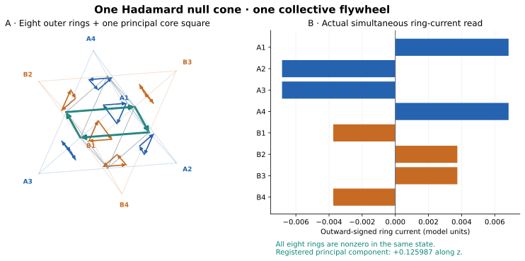

# Eight stellation vortices and the collective core: orientation is not vortex count

*Field Dynamics Research · correction and extension to stage IV · [T] finite/model theorems; [E] physical energy selection*

**The GFD Hadamard null cone is one integrated object.** Each of the eight triangular faces of its common octahedron is the base of one stellation, and its three lateral tiles form that stellation's local vortex ring. Together those eight face vortices constitute the flywheel. The central core vortex is their collective rotational response. Six axial orientations are six possible directions of that response, not six outer vortices, and not six simultaneous core vortices. The geometry is not a cube plus independent vortices inserted into it.

The figure uses the actual ring-current values of one normalized stationary Triforce state; its projected triangular paths and core square are schematic geometric paths, not particle trajectories or a proof of axial through-flow. The core arrow indicates the principal registered axial component, not the entire registered current.

## 1. [T] Eight simultaneous physical ring currents in the specified model

Use the eight sign triples `s` and outward normals `n_s=s/√3`. The outward-oriented triangular lateral ring of each stellation consists of its three outer Triforce tiles. On an isolated T₂ branch, the earlier symmetry theorem gives `j_s=κ_chamber (s·C)` with the **unnormalized sign-triple convention** of `verify_hadamard_null_cone.py`; the normalized-normal convention absorbs √3 into κ. The vector `C=-i conj(z)×z` is the collective chirality. For `C=±e_i`, every dot product is +1 or −1. If both κ are nonzero, all eight rings circulate simultaneously. The eight signs are constrained by the shared chirality; they are not eight independent phase choices. A uniform outward-oriented ledger cancels (`D1=0`), so merely postulating eight identical outward ring strengths would not produce a core square.

For the signed ring ledger `j`, let `κ±=(κ_A±κ_B)/2`. The boundary sum is `Dj=2κ+ K C + κ− D diag(p) S C`, where `p=xyz`, `DS=2K`, and `KᵀK=4I`. Thus the principal square-ring coefficient of **Dj** is `(κ_A+κ_B)C`. The complete physical registered current is `C₁ J_fine`, with a ring contribution `Dj/4` and a remainder from other bonds. Do not equate those two currents. In the tested Triforce Hamiltonian all six isolated T₂ branches and all six oriented axial polarizations give 36 actual stationary states, each with eight nonzero physical ring currents **and** a nonzero principal registered core component parallel or antiparallel to C. All satisfy local current conservation. This is a model existence result; symmetry does not forbid a vanishing ring coefficient or a cancelling core response in another Hamiltonian.

## 2. [T] Complementary circular-state stability theorems

For `N=||z||²`, `Q=z·z`, and `V₄=Σ_s |s·z|⁴/8`, exact expansion yields

$$V_4=2N^2+|Q|^2-2\sum_i |z_i|^4.$$

The previous axial candidate is `E_A=V₄−N²+β|Q|²` for β>0. Its six minima on the unit sphere modulo phase are the circular states with chirality along the three core axes, in either sense. This theorem pertains to a collective spatial triplet, not the number of local stellation rings.

The complementary homogeneous candidate is

$$E_F=\frac43 N^2-V_4+\beta|Q|^2
=2\sum_i(|z_i|^2-N/3)^2+(\beta-1)|Q|^2.$$

For β>1 its unit-norm zero minima have equal component intensities and Q=0. Circular polarization implies `|z_i|²=(1−C_i²)/2`, so all three `C_i²=1/3`. There are exactly eight oriented face-normal circular minima modulo phase. These are eight possible orientations of a single triplet; they are **not** a proof that eight independently polarized modes are simultaneously stable.

At `z₀=(1,ω,ω²)/√3`, use the complex orthonormal tangent basis `conj(z₀), (1,1,1)/√3`, where ω=exp(2πi/3). In real and imaginary coordinates the constrained Hessian has two blocks, `B` and `diag(1,−1) B diag(1,−1)`, with

$$B=\begin{pmatrix}8(\beta-1)+8/3&8/3\\8/3&8/3\end{pmatrix},\qquad \det B=\frac{64}{3}(\beta-1).$$

Both blocks are positive definite for β>1. The phase-invariant conservative Hamiltonian flow therefore has orbital Lyapunov stability at each of these isolated minima by the constrained-energy argument. This is conditional on the candidate Hamiltonian, not attraction or a first-principles choice of its coefficient. The two complementary candidates select opposite extrema of the same geometry. A joint energy that selects the full eight-ring flywheel and the central response has not been derived.

## 3. [E] What the complete nonlinear theorem must establish

The existing three-triplet stability lift proves a collective minimum in a restricted state space. The stationary 33-tile test establishes simultaneous local ring currents and a core registration. Combining those two facts is not a proof of unrestricted nonlinear stability of the 33-tile state. The next theorem must use the detailed graph with all eight outer rings and their shared bonds, derive the nonlinear interaction and then verify stability transverse to the entire collective sector (including scalar and E modes). The registered core response must remain nonzero. A drain is an additional through-flow mechanism, not implied by circulation. The constitutive law is μ(x); SST names the full four-term covariant action only.

## Validation

Run `python verify_face_core_stability.py` (NumPy, SciPy, SymPy). It reruns 984 earlier checks on import and adds 132 checks, including exact symbolic Hessian identities and the 36 stationary-state cases. The prior 1,365-check hardening log is preserved; the cumulative distinct assertion count is 1,497, not a claim that all 1,365 were rerun in this correction. See [actual log](face_core_verification_output.txt). All quantities are normalized model units; no galaxy-specific fit. Lean is unchanged and remains uncompiled. No repository changes were made.
