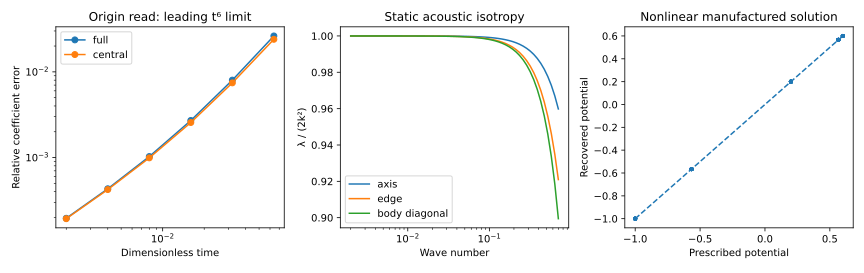

# Field Origin read — from the vortex to a static gravitational field

> **Matter/charge extension:** [Eight-register vortex and charge research](MATTER_VORTEX_CHARGE.md) distinguishes retained matter from optical occupation, proves the bare chamber-charge conservation obstruction, and supplies conditional inward/outward response models. Full microscopic capture, charge and physical work coupling remain open.

**[T] Algebra and geometry. [D] Consequences of specified models. [E] Physical identification.**

This extension asks whether the whole stellated octahedron is the processor and gravity is the read of its internal state. It builds on the [directional origin](COUPLED_FIELD_ORIGINS.md), [unified Flower dynamics](UNIFIED_HADAMARD_FIELD_DYNAMICS.md) and [optical resonator](OPTICAL_FOUR_PORT_RESONATOR.md), preserving all 36 complex coordinates and both existing interface choices. It adds a distinct, real, static potential model on the same four-port graph; it does not claim that the Hermitian amplitude model already has a gravitational potential or a mass source.

## 1. The neutral read of the whole field [T]

Let the eight sign directions be $S=\{\pm1\}^3$, and $T_s=(1,s^T)$. The previously established directional origin is $c=(a,\mathbf b)\in\mathbb C^4$. Its reconstructed central face records are $r_s=T_sc=a+s\cdot\mathbf b$. These are records of the origin state, not necessarily the actual independently evolving eight central tile amplitudes $y_s$. If reading actual $y$, projection onto the four-coordinate subspace is $T(T^Ty/8)$; discarded components cannot be assumed absent.

By sign orthogonality $T^TT=8I$. Define the neutral mean and polar read:

$$N_O=\frac18\sum_s|r_s|^2=|a|^2+|\mathbf b|^2,$$

$$\boxed{\mathbf P=\frac18\sum_s s|r_s|^2=2\operatorname{Re}(a^*\mathbf b).}$$

The identity follows from $\sum_s s_i=0$, $\sum_s s_i s_j=8\delta_{ij}$, and vanishing third moments. The read is invariant under global phase and complex conjugation; under spatial inversion it changes sign. $|\mathbf P|\le N_O$ by AM–GM and Cauchy–Schwarz. A dimensionful acceleration would need a calibration and a physical reference; neither is supplied by the read.

Contrast with the axial circulation record $\mathbf C=-i\bar{\mathbf b}\times\mathbf b$. It is inversion-even and conjugation-odd. In particular, $a=0,\mathbf b=(1,i,0)/\sqrt2$ gives $\mathbf C=(0,0,1)$ but $\mathbf P=0$. Thus the existing eight-ring initial state, which excites a pure polar triplet in an inversion-symmetric isolated cell, need not generate a nonzero neutral polar read. Vortex circulation is not itself gravitational acceleration. A nonzero scalar reference $a$ and a coherent in-phase component of $\mathbf b$ suffice. In a real background $a=\alpha$, $\mathbf P=2\alpha\operatorname{Re}\mathbf b$ to first order in the triplet. This is a possible transduction mechanism, not a derived physical background.

## 2. The existing coupled vortex model gives a source-directed read [T/D]

Use the actual 36-coordinate H, and the port maps and kernels W and Wc of the unified model. Both kernels have central-to-central entry 2/3. For the bond from i to j along sign $s$, put $n_s=(1,s)^T$ and take intercell hopping $-\kappa F_{-s}\mathcal W F_s^T$. The existing shortest-path identity gives

$$({\cal H}^3)_{O_jO_i}=-\frac{2\kappa}{3}n_{-s}n_s^T.$$

With only source origin $c_i$ initially excited, the target origin is

$$c_j(t)=-\frac{i\kappa t^3}{9}n_{-s}(n_s^Tc_i)+O(t^4).$$

Set $A_s=n_s^Tc_i$. Substituting the scalar and polar components into the exact neutral read gives

$$\boxed{\mathbf P_j(t)=-\frac{2\kappa^2 t^6}{81}|A_s|^2s+O(t^7).}$$

For a non-dark input $A_s\ne0$, this points toward the source at leading order (the physical unit direction is $-s/\sqrt3$). The direction is independent of overall complex phase and hopping sign; the intensity depends on the source's port projection. Both interface variants have this same leading term, despite different later dynamics. All four ports were checked with exact integer matrix powers and numerical evolution at six early times each. This is an inward directional **read**, not a force on matter, not irreversible attraction, not a 1/r² law. No equivalence principle, sign of actual force, mass calibration or static potential relation follows solely from this result.

## 3. Four port records resolve a potential gradient [T given a scalar potential]

At node i let the four unit active vectors be $n_{ik}=s_{ik}/\sqrt3$, alternating parity on the diamond sublattices. Let the nearest-neighbour spacing be $\ell=\sqrt3 h$. Introduce an independent real potential $\Phi_i$ (units m²/s² if physically calibrated), and differences $d_{ik}=\Phi_{j_k}-\Phi_i$. The four records resolve

$$m_i=\tfrac14\sum_k d_{ik},\qquad p_i=\frac{3}{4\ell}\sum_k n_{ik}d_{ik}.$$

The inverse is $d_{ik}=m_i+\ell n_{ik}\cdot p_i$; $\sum_k n_{ik}=0$ and $\sum_k n_{ik}n_{ik}^T=4I/3$. Hence

$$\sum_k d_{ik}^2=4m_i^2+\frac{4\ell^2}{3}|p_i|^2.$$

For an affine potential $p_i=\nabla\Phi$ exactly and $m_i=0$. For smooth potentials $p_i=\nabla\Phi+O(h)$, $m_i=O(h^2)$. With the conventional attractive-potential sign, the gravitational acceleration read would be $g_i=-p_i$. This read respects potential shift symmetry and local rotational covariance of the tetrahedral frame. It has three directional components plus the common residual, not four independent accelerations. Identifying $\mathbf P_i$ with a calibrated multiple of $-p_i$ is a **new [E] closure relation**, not proven by either algebraic identity; arbitrary microscopic states need not satisfy integrability or even a discrete potential representation.

## 4. A real static settlement model on the same four-port lattice [D]

Choose the gauge-invariant positive edge-difference energy of the scalar potential with a mass-source term. For constant spacing and volume per site $V=8h^3$ (primitive diamond volume $16h^3$ with two sites), the Newtonian functional is

$$E_N=\frac{V}{8\pi G}\sum_i\left(|p_i|^2+\frac{3m_i^2}{\ell^2}\right)+V\sum_i\rho_i\Phi_i.$$

By the exact read identity the first term is a positive sum of squared bond differences. Varying it gives

$$-\frac{3}{2\ell^2}L_D\Phi=4\pi G\rho,\qquad L_D=4I-A_D.$$

Here $L_D$ is the positive diamond graph Laplacian. For a connected finite periodic graph its kernel is exactly the constants; a periodic solution requires zero total source and a fixed mean potential. Isolated physical positive sources instead require appropriate open/Dirichlet/asymptotic boundaries. This static stiffness is **chosen** from the same port geometry; it is not the original hopping Hamiltonian H, whose eigenvalues are not a gravitational stiffness spectrum. In particular, time evolution of the occupation ledger is not this static equation.

The Bloch symbol on the two sublattices has eigenvalues $4\pm|f(k)|$, $f(k)=\sum_s e^{ih k\cdot s}$ over four positive-parity signs. Its acoustic branch obeys $4-|f(k)|=2h^2|k|^2+O(h^4|k|^4)$. Thus the normalized static operator has isotropic leading symbol $|k|^2$; its continuum formal equation is $\nabla^2\Phi=4\pi G\rho$. With isolated spherical source and ordinary boundary conditions this gives $g_s=GM/r^2$. The inverse Laplacian, not the single-neighbour t^6 read, supplies the long-range Newtonian Green function. This is a consistency result, not a proof of microscopic dynamics yielding the static model.

### The 12-channel static read emerges exactly

Order the diamond nodes by sublattice, so $L_D=\left(\begin{smallmatrix}4I&-C\\-C^T&4I\end{smallmatrix}\right)$. Eliminating one scalar sublattice gives

$$L_{\mathrm{eff}}=4I-\tfrac14CC^T=\tfrac14(12I-A_{\rm FCC}).$$

Each of four two-step routes leads to three distinct same-sublattice neighbours; $CC^T=4I+A_{\rm FCC}$. Eliminated source terms are also transformed: if $L_D\Phi=f$, the retained equation has RHS $f_A+C f_B/4$. Thus the four physical direct links generate an exact twelve-neighbour effective scalar stencil, with no double counting of sources. These are not twelve direct physical neighbours of which eight are inactive. The independent optical 4-bright/8-dark result remains conditional on the central branch.

## 5. Conditional nonlinear vector settlement and the constitutive law [D]

For a drained level, use the established GFD constitutive law $\mu(x)=x/(1+x)$, $x=|p|/a_0$, not a new prediction of the finite graph. A vector settlement realization (consistent with the earlier auxiliary-vector research) is to minimize over $|q|<a_0$:

$$\mathcal E(p,q)=\tfrac12|p|^2-p\cdot q+W(q),\qquad W=a_0^2[-u-\ln(1-u)],\quad u=|q|/a_0.$$

The radial and transverse eigenvalues of the Hessian of W are $(1-u)^{-2}$ and $(1-u)^{-1}$, both positive. W diverges at the boundary. The unique minimizer solves $\nabla W=q/(1-u)=p$, giving

$$q=\frac{a_0 p}{a_0+|p|},\qquad p-q=\mu(|p|/a_0)p.$$

Gradient relaxation in q decreases this specified energy at fixed p. It does not follow from the closed linear vortex Hamiltonian. The minimized energy is $\tfrac12 a_0^2 F(|p|^2/a_0^2)$, with $F(y)=y-2\sqrt y+2\ln(1+\sqrt y)$ and $F'(y)=\mu(\sqrt y)$. The functional encodes the constitutive law; topology does not select W, the relaxation rate or $a_0$.

Put this local settlement into the port read energy:

$$E_D=\frac{V}{8\pi G}\sum_i\left[a_0^2 F(|p_i|^2/a_0^2)+\frac{3m_i^2}{\ell^2}\right]+V\sum_i\rho_i\Phi_i.$$

The common residual penalty stabilizes the staggered scalar mode that a gradient-only read misses; it is a discretization choice retaining the quadratic normalization. It vanishes to leading continuum order for smooth fields. Differentiation yields local bond records proportional to

$$t_{ik}=\frac{3}{4\ell}n_{ik}\cdot\mu_i p_i+\frac{3m_i}{4\ell^2}.$$

For the energy with overall factor $V/(4\pi G)$ stripped, these are derivatives of the half-bracket. Its derivative at node i is $\sum_{j,k:j_k=i}t_{jk}-\sum_k t_{ik}$. Every oriented internal record cancels from the sum over a group. This exact boundary ledger is independent of overlapping envelopes and consistent with single-valued ownership; it is not yet a proof of GFD stagnation-surface mass registration. The numerical periodic nonlinear solve recovers a manufactured potential on 128 nodes, using its known discrete source, not astrophysical data. Under smooth continuum sampling the energy tends formally to the aquadratic potential functional, and its weak stationary equation is

$$\nabla\cdot[\mu(|\nabla\Phi|/a_0)\nabla\Phi]=4\pi G\rho.$$

This is the AQUAL form (Bekenstein & Milgrom, 1984, https://doi.org/10.1086/162570). No general continuum convergence theorem or relativistic completion is supplied here. In spherical symmetry with regular flux and an enclosed source, $g_s=\mu(g_t/a_0)g_t=g_t^2/(a_0+g_t)$. A drained galaxy uses this law internally in GFD's terminology; a bound drainless level uses the bare-G Newtonian functional at leading order. Every Field Object closes regardless of drain. This work neither changes SST (the full covariant action) nor derives the separate nuclear bound law.

## 6. Decisive next bridge [E]

The phase-neutral polar record $\mathbf P$ and the static potential read $-p$ have compatible transformation properties, but a dynamical constraint must link them. Establish a stationary or slow manifold of the full microscopic vortex network with: (i) coherent scalar reference, (ii) a phase-neutral potential variable and integrability, (iii) mass/source coupling with universal normalization, (iv) a positive effective stiffness from microscopic energy or response, (v) the local settlement W (or equivalent), and (vi) the correct drained/drainless selection and causal covariant limit. A counterexample is pure circulation with zero polar read. The present two-cell source-directed signal provides a target observable to constrain that reduction, not a proof of gravity. The 21/17/13 structural capacities, G, a0, and physical cell spacing remain independent inputs or earlier research premises; no new fitted galaxy parameter is introduced and no physical-scale determination is claimed.

## Reproduction

`OPENBLAS_NUM_THREADS=1 OMP_NUM_THREADS=1 python verify_field_read.py`.

[Log](field_read_verification_output.txt) · [early transfer data](field_read_transfer.csv) · [dispersion data](field_read_dispersion.csv). 130 new passing assertions, including exact moment matrices and origin-to-origin leading terms, gradient reconstruction, Schur reduction, static ledger, variational derivative and 128-site nonlinear recovery. Earlier 3,981 recorded assertions preserved, not rerun. No Lean compilation, empirical validation or repository write.

**Follow-up:** [Spectral gravity read](SPECTRAL_GRAVITY_READ.md) calculates a scalar stiffness and gradient response from the actual microscopic Bloch operator; physical identification remains open.
