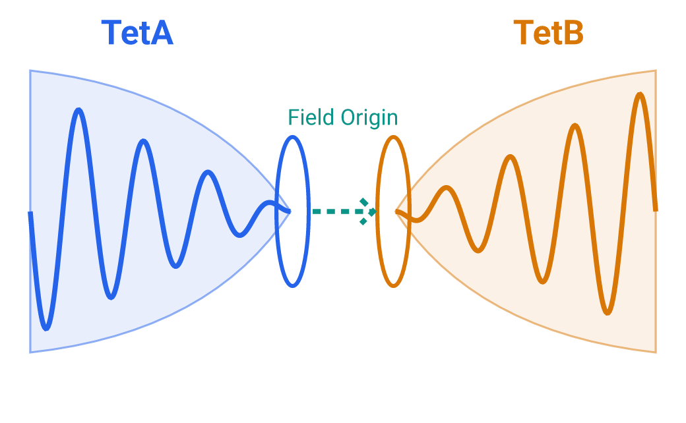

# The Field Origin Vertex: Resonance and Nonspatial Transfer
*Opening note of the vertex research direction: how TetA and TetB couple through the Field Origin without a spatial bond · Gravity Field Dynamics (GFD) · Field Dynamics Research · November 2026*

**Status:** [T] exact symmetry and conservation identities for candidate couplings ([`verify_field_origin_vertex.py`](verify_field_origin_vertex.py), 8/8, [output](verify_field_origin_vertex_output.txt)); [E] the candidate vertex law itself, which is not yet derived from GFD. Background: [TetB is the subspace](../../TETB_THE_SUBSPACE.md).

*TetA (spacetime) and TetB (subspace) are one coupled vortex structure across two distinct domains. They couple only through the Field Origin, through the time faces, with no spatial continuity between them.*

> **Continued in [`vertex-research/`](vertex-research/):** the 48 cross-chamber links as one factorised matrix, the 16-channel time-face read, nonlinear dynamics, the registered spectrum and curvature thresholds, and a constitutive vertex built from μ(x), with an [interactive atlas](vertex-research/interactive/index.html). Conditional research, not a derived law.

## Why this research exists

TetB shares no vertex, edge or face with TetA and has no Christoffel sector of its own ([synthesis](../../TETB_THE_SUBSPACE.md), steps 3–4). Its only contact with TetA is the Field Origin, the nonlinear interaction vertex where the two time faces couple. The [Stage VII flywheel](SUSTAINED_TRIFORCE_FLYWHEEL.md) instead joins the chambers by 48 direct linear bonds (12 outer transpose pairs, 12 central edges and 24 outer-to-opposite-face-centre edges). [Proofs 24](../../proofs/flywheel-tetrad-geometry/) and [25](../../proofs/tetrad-flywheel-convergence/) are exact within that stated model and are not changed by this note. The open question is whether the Stage VII model **emerges** from the nonlinear vertex as an effective approximation. If it does, both proofs gain a physical foundation without any change to their mathematics.

## Three ways two domains can interact

| Mechanism | Meaning | In GFD |
|---|---|---|
| Spatial transport | Something travels through the space between them | Ruled out: there is no shared edge, face or spatial path |
| Resonance | The domains influence each other through frequency and phase | Allowed, through the time faces |
| Vertex-mediated transfer | Something leaves one domain and enters the other without crossing space between them | Allowed: a drained galaxy feeds its TetB this way |

The Field Origin permits the last two. They should come from **one vertex law with two operating regimes**, not two mechanisms.

## The candidate law [E]

Write each chamber's collective amplitude as $q_A$, $q_B$, with occupations $N_A=|q_A|^2$, $N_B=|q_B|^2$ and phase overlap $\chi=q_A^\dagger q_B$. The candidate Hamiltonian is

$$ \mathcal H=\mathcal H_A+\mathcal H_B+\mathcal H_O,\qquad \mathcal H_O=\lambda|\chi|^2+\kappa\,\mathrm{Re}\!\left(e^{i\theta}\chi^2\right). $$

Each chamber keeps its own internal vortex dynamics; they meet only through $\chi$, a read of their relative phase. No spatial coordinate is shared.

## What is exact [T]

Under independent chamber phase rotations $q_A\to e^{i\alpha}q_A$, $q_B\to e^{i\beta}q_B$, the overlap becomes $\chi\to e^{i(\beta-\alpha)}\chi$. Hamilton's equations then give, exactly:

1. **Resonance.** $\lambda|\chi|^2$ is unchanged by both rotations, so $N_A$ and $N_B$ are each conserved. The chambers lock phase and orientation but exchange nothing.
2. **Transfer.** $\kappa\,\mathrm{Re}(e^{i\theta}\chi^2)$ is unchanged only by the common rotation $\alpha=\beta$, so only $N_A+N_B$ is conserved, and
$$ \frac{dN_A}{dt}=-\frac{dN_B}{dt}\;\propto\;\kappa\,\mathrm{Im}\!\left(e^{i\theta}\chi^2\right). $$
3. **The linear term is the spatial bond.** The simplest transfer term, $k\,\mathrm{Re}(\chi)$, is exactly the bilinear bond $k\sum_i \mathrm{Re}(\bar q_{A,i}q_{B,i})$ between the chambers' amplitudes: the Stage VII form, written collectively. So the linear coupling is precisely what the framework excludes, and $\mathrm{Re}(\chi^2)$ is the lowest-order transfer term that is not a spatial bond. **The nonlinearity of the Field Origin is what allows transfer without a tunnel.**
4. **Locking stops transfer.** Transfer vanishes exactly when the relative phase locks so that $\mathrm{Im}(e^{i\theta}\chi^2)=0$. Resonance continues.

## Two regimes of one law [E]

- **Draining:** the relative phase is unlocked, occupation moves through the vertex, and the total is conserved. In water-vortex terms, the throat is flowing.
- **Drainless:** the relative phase is locked, there is no net transfer and resonance remains. The throat is co-rotating but nothing passes. The drainless field is a fixed point of the same law, not a separate mechanism.

## Tests, in order

Each is grounded in water-vortex behaviour and is checked in Python before any formal proof.

1. **Net-field rule (first, and decisive).** The [net-field rule](../../proofs/net-field-rule/) (+ Lean) gives a TetB share of exactly zero locally in a drainless field. Here, drainless means *no net transfer*, which is not the same as an empty TetB. The locked state must also yield no TetB share in the local field; if it does not, the candidate fails.
2. **Core vortex through the vertex alone.** With all 48 Stage VII cross-chamber bonds removed, the eight constituent vortices must still drive the core vortex, through $\mathcal H_O$ only.
3. **Linear limit.** Linearising the vertex about a locked state should recover the Stage VII cross-chamber coupling as an effective approximation, with its coefficient fixed by $\lambda$, $\kappa$ and the locked phase. If it does, Stage VII survives as a limit and its documents gain one status line saying so.
4. **Drain as drive or brake.** An open drain should produce transfer whose effect on TetA reads as drive or brake by the [decoding-mass method](../../papers/letter-decoding-mass-from-rotation-curves/): the area between the decoded and photometric mass curves.

## Recorded, not claimed

The transfer term moves occupation through $\chi^2$, that is, in pairs. It may relate to the two time faces. Nothing supports this yet; it is noted so it is not lost.

## What this note does not establish

The candidate law is illustrative, not derived. It fixes no value of $\lambda$, $\kappa$ or $\theta$, it makes no claim about the vertex's microscopic nature (anything beyond the Field Origin vertex, and TetB, is quantum), and it changes nothing in Proofs 24 and 25 or their Lean formalisations.
