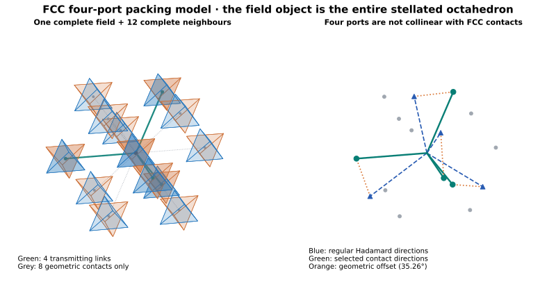

# Whole-field packing: twelve neighbours, four active links

> **Integration update.** The [unified synthesis](UNIFIED_HADAMARD_FIELD_DYNAMICS.md) compares this FCC selector model with the exact regular Hadamard corner-origin diamond. These are distinct adjacency geometries; the original 12-total/4-active/8-inactive regular-port claim has not been established.

**Stage IX extension — geometric and graph witnesses, not a physical selection theorem.**

One lattice node is one complete gravity field in the GFD model: the entire stellated octahedron, both TetA and TetB, eight constituent vortex rings and one Field Origin. Neither a sphere contact nor a constituent tetrahedron is a separate field. This extends [Coupled Field Origins](COUPLED_FIELD_ORIGINS.md) and supports the proposed [stellar-forge capture research](BOUND_FIELD_CAPTURE.md) by specifying the external neighbour graph separately from the internal vortex graph.

Each star in the drawing has the same dimensions. The enclosing equal spheres (toggle in the explorer) touch; the inscribed stars do not. Green denotes active links, not literal shared triangular surfaces. Grey denotes contacts with no direct transport in the selected graph.

[Rotatable whole-field model](four_port_packing_explorer.html) · [Verifier](verify_four_port_packing.py) · [Fresh output](four_port_verification_output.txt)

## 1. Contact geometry [T]

Use the FCC lattice $\Lambda=\{(i,j,k)\in\mathbb Z^3:i+j+k\equiv0\pmod2\}$. Equal spheres of radius $1/\sqrt2$ touch at offsets $D=\{(\pm1,\pm1,0),(\pm1,0,\pm1),(0,\pm1,\pm1)\}$. There are exactly twelve distinct nearest neighbours of every node. Every centre is assigned one identical stellated-octahedral field. The internal regular Hadamard directions are $S=\{s\in\{-1,1\}^3:s_xs_ys_z=1\}$ (the four face-normal directions of one chamber, up to convention); their parity partners are $-S$. No separate lattice node is allocated to TetB.

**No-go.** Two distinct unit FCC contact directions have inner product $d\cdot e/2$, a half-integer, whereas regular tetrahedral unit directions have inner product $-1/3$. No four contacts form a regular tetrahedral set, even after rotating the internal field. Moreover, the proper tetrahedral rotation group acts transitively on the twelve FCC directions in this alignment. A selection of exactly four actual contacts therefore cannot be invariant under that entire group. Selection must come from an orientation state, symmetry breaking, or modified contact geometry, not the equal-sphere contact count alone.

For each contact $d$, exactly one $s\in S$ obeys $s\cdot d=2$. It is the closest of these four port directions. Its angular separation is $\arccos(2/\sqrt6)\approx35.2644^\circ$. Each port has three candidate contacts, but we choose one actual neighbour per port; the other two are inactive. This is different from a symmetric read of three contact amplitudes into one collective mode.

## 2. Balanced four-contact model [T conditional on the selector]

At even $i$, select $A=\{(1,1,0),(1,-1,0),(-1,0,1),(-1,0,-1)\}$; at odd $i$, select $-A$. Every selected offset is a sphere contact, every node has degree four, one contact per ideal port, and the reverse link is selected at the neighbour because $i$ changes parity. All eight other contacts are inactive. The selected directions sum to zero and span three dimensions. Their normalized second moment is $\sum_{d\in A}dd^T/2=\mathrm{diag}(2,1,1)$, not the regular tetrahedral isotropic tensor $4I/3$. Exhaustive enumeration of all $\binom{12}{4}=495$ subsets finds six balanced spanning quartets, all permutations of this moment spectrum.

This periodic graph is **not** a single connected mesh. The invariant $j+\lfloor(i+1)/2\rfloor\pmod2$ separates two components. The period-four quotient has 32 sites, 64 active undirected bonds and two 16-site components. The lift of each component spans its full period translation group (one follows from exact cycle displacements; the other by translation symmetry). This obstruction belongs to this selector, not a proof that every conceivable balanced selection is disconnected.

## 3. Connected four-contact model [T conditional on the selector]

One periodic two-edge reconnection, repeated modulo 4 in all coordinates, removes

- $(0,0,0)\leftrightarrow(1,1,0)$ and $(0,1,1)\leftrightarrow(1,0,1)$,

and adds

- $(0,0,0)\leftrightarrow(0,1,1)$ and $(1,0,1)\leftrightarrow(1,1,0)$.

Both added bonds are FCC contacts. The change maintains degree four, reciprocity, three-dimensional span and one actual contact per ideal port at **every** node. The period-four quotient is connected. To rule out disconnected copies in the infinite lattice, lift a spanning tree, compute each non-tree edge's residual displacement divided by the period, and take the gcd of all three-column integer determinants. The gcd is one, so the cycle shifts generate all of $\mathbb Z^3$. Thus the infinite periodic lift is connected, not just the quotient.

Trade-off: four of 32 sites lose the exact zero-sum contact property. The regular internal stars remain identical; the external link pattern is periodic rather than invariant under all FCC symmetries. Neither the reconnection nor the choice of orientation is derived dynamically. The model is an existence witness, not a claim that the physical lattice chooses it.

## 4. Transport and DFP [T within a reciprocal model]

For any active edge $uv$, assign a reciprocal hopping $H_{uv}=\overline{H_{vu}}$; put $H_{uv}=0$ for inactive contacts. The uniform scalar example uses $H_{uv}=-1$ on active edges, with $i\dot\psi=H\psi$. The inflow current $J_{u\leftarrow v}=2\operatorname{Im}(\bar\psi_u H_{uv}\psi_v)$ is antisymmetric and $\dot N_u=\sum_v J_{u\leftarrow v}$ for $N_u=|\psi_u|^2$. Summing cancels every internal edge. This is the same local conservation accounting as Stage IX. A scalar per node is merely an external transport read; it does not replace the internal 36 complex coordinates of Stage IX. To integrate the full model, use the reciprocal four-tile block interface maps there, after deriving how each physical FCC contact routes into its corresponding Triforce face. Neither this scalar test nor the local Stage IX face-reflection construction proves that congruent complete stars can share those four planar faces without overlap in a global FCC packing.

## 5. Research boundary

- [T] Twelve FCC nearest contacts, no regular tetrahedral quartet, six balanced nonplanar quartets, and explicit reciprocal periodic selectors with four active neighbours and eight inactive contacts.
- [T] Connected selector with a finite-period imbalance trade-off; exact conservative transport on its graph.
- [E] Physical selection of four links, why eight contacts are sealed, actual non-overlapping field-envelope/Triforce interfaces, dynamic selection and restoration of isotropy, and a continuum limit connected to SST. Neither a 12-to-4 mode projection nor a diamond lattice with four nearest and twelve *second* neighbours establishes the original literal 4-of-12 claim.

Sources: [GFD Face Structure and Spin](https://github.com/fielddynamics/research/blob/main/docs/01-foundations/08-face-structure-and-spin.md); [Hadamard cube frame](https://github.com/fielddynamics/research/tree/main/proofs/hadamard-cube-frame). These motivate the model; the FCC selector and limitations are new conditional results.

Reproduce: `python verify_four_port_packing.py` (NumPy); `python generate_four_port_visual.py` (Matplotlib). The HTML is standalone. 348 new checks passed. Older 2,852 checks are preserved, not rerun here.

**Follow-up:** [Corner-first theorem](CORNER_FIRST_PACKING.md) proves that exact regular tetrahedral contact directions cap rigid equal-sphere kissing at eight; the FCC 12/4/8 graph remains a different conditional construction.
