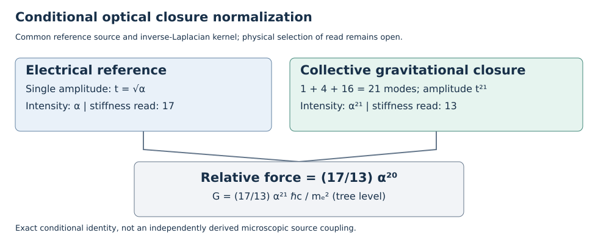
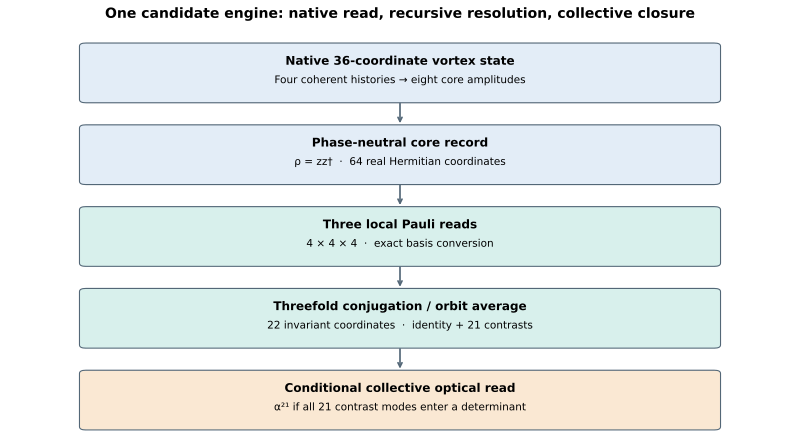

# G from a collective optical closure: electromagnetic reference normalization

*GFD Standard Field Model · [T] exact algebra, [D] conditional realization, [E] physical identification. November 2026.*

## 1. Scope and upstream premises

This extends [G normalization bridge](G_NORMALIZATION_BRIDGE.md), not a second definition of G. The upstream [matrix read](https://github.com/fielddynamics/research/blob/main/research/g_from_topology/g_matrix_synthesis.md), [closure climb](https://github.com/fielddynamics/research/blob/main/research/g_from_topology/g_from_the_closure_climb.md) and [read and rotation](https://github.com/fielddynamics/research/tree/main/research/g_from_topology/read-and-rotation) establish the structural counts 21, 17, 13 and propose the attenuation/combination rule. The goal here is a conservative optical realization and a test of whether the existing 36-coordinate field actually implements it.

Use $\alpha=\alpha_{\rm EM}$, $K=4$, and distinguish $K$ from physical stiffness. The tree-level upstream target is $\alpha_G=Gm_e^2/(\hbar c)=(17/13)\alpha^{21}$. The proposed loop factor $1+\alpha/(2\pi)$ is separate and not derived here.

## 2. Eliminate absolute normalization by comparing the two reads [T/D]

For a scalar linear static kernel with energy stiffness $s_X>0$ and source amplitude $j_X$, the magnitude of the pair potential for identical sources is $j_X^2/(4\pi s_X r)$. For example minimizing $\int s_X|\nabla\phi|^2/2-\rho_j\phi$ gives a negative pair term with precisely that magnitude. Electrostatics instead has positive same-charge energy through its Gauss constraint; this magnitude argument does not derive that sign. Assume both electron reads share the same continuum inverse-Laplacian kernel and a common bare source magnitude $j_*$, with transmission amplitudes $T_X$ so $j_X=j_*T_X$.

$$\frac{Gm_e^2}{\alpha\hbar c}=\frac{|T_G|^2}{|T_E|^2}\frac{s_E}{s_G}.$$

This uses measured electromagnetic normalization, not measured G. It does not yet establish universal mass coupling: for a general Field Object its gravitational source amplitude must be proportional to its registered rest mass independently of charge, constitution and binding. The existing model has no such theorem.

## 3. Why a full closure could supply the exponent [T/D]

Let the graded read space be $V=\mathbb C\oplus\mathbb C^4\oplus(\mathbb C^4\otimes\mathbb C^4)$ of dimension 21. Assume each normalized elementary transmission amplitude is $t=\sqrt\alpha$ (one factor of alpha in intensity). This is the upstream attenuation premise made explicit as an amplitude convention. A lossless two-channel splitter with entries $t,\sqrt{1-\alpha}$ and orthogonal rows realizes it without destruction of probability. The retained subblock across 21 independent modes is $T=tI_{21}$; a full simultaneous closure read in the top exterior power $\Lambda^{21}V$ has amplitude $\det T=t^{21}$. A one-mode read has amplitude $t$. Hence

$$|T_G/T_E|^2=|t^{21}/t|^2=\alpha^{20}.$$

This construction is exact and unitary when reflected branches are retained. One can equivalently use the all-transmit outcome of 21 distinguishable splitters in a tensor product. No electron is identified with a 21-fermion state. The determinant describes a full oriented volume read, not a conventional sum of optical amplitudes. A normalized ordinary port projection of the same operator gives $t$, NOT $t^{21}$. Serial independent filtering is another realization but no 21 mandatory serial transitions have been established in the Triforce graph. An all-pass probability alone does not establish a static source vertex. The physical requirement is that the gravitational coupling selects this complete collective amplitude while the electrical source selects the elementary amplitude. That selection is [E]; it does not follow from the existing four-port resonator.

## 4. Derive the prefactor under an isotropic locked-read premise [T/D]

Use the upstream connection swap on the 16-dimensional face tensor. Let $\tau(x\otimes y)=y\otimes x$, with $P_\pm=(I\pm\tau)/2$. Their ranks are 10 and 6. On $\mathbb C\oplus(\mathbb C^4\otimes\mathbb C^4)$ define positive semidefinite operators

$$C_A=1\oplus2P_+,\quad C_O=I_{17},\quad C_B=1\oplus2P_-.$$

Their traces are 21, 17, 13; $C_O=(C_A+C_B)/2$. The TetB operator has rank 7, not 13. Its trace is a weighted capacity. The scalar stiffness read of an isotropic ensemble with covariance $I_{17}/17$ is $s_X=s_*\operatorname{Tr}(C_X)/17$, if the modes share a common physical stiffness unit $s_*$ and the scalar gradient is locked to that ensemble before averaging. Thus if the elementary electrical read uses $C_O$ and the gravitational response is supported by $C_B$,

$$s_E/s_G=s_O/s_B=17/13.$$

These are conditional physical assignments, not consequences of the swap identity. A read only along the scalar coordinate yields ratio 1; one along the antisymmetric sector yields 1/2; a purely symmetric tensor read has zero TetB stiffness. Free relaxation of zero-stiffness channels is not equivalent to an imposed isotropic average. Tetrahedral symmetry alone does not force equal weights on distinct irreducible sectors. The existing optical model does not prove the required locking, isotropic averaging, or assignment of electrical and gravitational stiffnesses to these operators.

## 5. Conditional normalization theorem [D]

If (i) the two physical source reads share the reference magnitude and static kernel, (ii) the elementary optical amplitude is $\sqrt\alpha$, (iii) gravity selects the complete 21-mode closure and electricity a single mode, and (iv) the normalized locked stiffness reads are $C_O$ for the electrical channel and $C_B$ for the gravitational channel, then

$$\frac{F_G}{F_E}=\frac{17}{13}\alpha^{20},\qquad G^{(0)}=\frac{17}{13}\alpha^{21}\frac{\hbar c}{m_e^2}.$$

No coefficient was fitted to G; this is a constructive realization of the existing combination rule, not a first-principles proof of its physical premises. The loop factor is not implied by splitter orthogonality or the mode count. The electron mass is the reference mass, not independently derived here.

## 6. What the actual microscopic lattice fixes [T/D]

In the overlapping-origin diamond coordinates, primitive vectors $(2,2,0),(2,0,2),(0,2,2)$ have determinant magnitude 16. For physical coordinate unit $a_{\rm cell}$ the primitive volume is $16a_{\rm cell}^3$. The lowest-band envelope $f$ is defined using a unit-normalized 72-coordinate primitive-cell eigenvector and microscopic energy unit $E_*$. With dimensionless band curvature $D$ the continuum gradient term is $\int K_{\rm stiff}|\nabla f|^2d^3x$, where

$$K_{\rm stiff}=\frac{E_*D}{16a_{\rm cell}}.$$

This follows by expanding the energy per cell $E_*D a_{\rm cell}^2|\nabla f|^2$ and dividing by cell volume. It assumes the one-band envelope normalization and the noncirculating scalar reference of the spectral note. It neither equates cell size to the Compton length nor fixes $E_*$ or $f_0$. For the quadratic intensity work model the dimensionless matching invariant is therefore

$$\alpha_G=\frac{8}{\pi D}\frac{a_{\rm cell}}{\lambda_e}\frac{m_ec^2}{E_*}\left(\frac{\eta}{c^2}\right)^2 f_0^2.$$

The recomputed curvatures are 0.1242946733 (full) and 0.1050941805 (central). Their ratio is approximately 1.1827, not 17/13. Do not identify the full and central interface variants with electrical and gravitational stiffnesses solely to obtain the ratio.

A Feynman–Hellmann test adds a symmetry-preserving scalar-origin defect $\delta V$ to the existing 72-coordinate Bloch matrix at zero momentum, with V the projector onto the two scalar origin coordinates. Its energy slope $u^T V u$ is 0.0774121642 (full) and 0.0808201854 (central), nonzero at first order. This is not a physical matter defect derivation; it shows that symmetry alone does not force suppression by 21 factors. Multiplying the original microscopic Hamiltonian by a positive factor preserves its geometry and eigenvectors but multiplies its curvature by that factor. The original dimensionless Hamiltonian contains no alpha or energy-scale equation. Therefore the numerical model as currently defined cannot uniquely fix G.

## 7. Proof obligations and next test

- Find a canonical physical map from the 36-coordinate vortex state to the graded 21-mode closure read (not merely counting dimensions or installing independent splitters). Derive alpha from a physically normalized electromagnetic interaction or inherit it explicitly as the observed coupling.
- Prove why the source vertex is a top exterior-power or equivalent all-channel read rather than a usual scalar projection, and why electrical read selects only one level. Establish the source and test coupling by a common action.
- Derive the two stiffness read assignments and the locked isotropic covariance from the same dynamics. The four bright optical modes and eight dark modes are not the 21 graded states.
- Establish universal gravitational charge for electrons and for occupied TetB configurations and composed closures, and a positive-energy/attractive work coupling. Derive the background circulation and physical scales consistently.
- Derive the proposed loop correction, and the GFD drained constitutive law separately; drainless systems use bare G. Do not call the spherical field equation SST.

Reproduce: `OPENBLAS_NUM_THREADS=1 OMP_NUM_THREADS=1 python verify_g_closure.py`. See [33 checks](g_closure_verification_output.txt) and [coefficients](g_closure_coefficients.csv). No measured G used to select the verification parameters; the upstream combination rule was already known, so this is not independent empirical confirmation.

Back to [master README](README.md).

**Continuation:** [Electron closure settlement](ELECTRON_CLOSURE_SETTLEMENT.md) connects Papers IV/V and the existing topology normalization with a joint solution, conditional radial energy and optical matching.

**Continuation:** [Projective Walsh–G bridge](PROJECTIVE_WALSH_G_BRIDGE.md) derives the exact 22-dimensional quotient read and 1/4/16 flag embedding; the 21 projective records alone are not closed under the full Walsh transform. Physical selection and attenuation remain open.

## Three-subread continuation

See [Three sub-reads of one closure engine](THREE_SUBREAD_CLOSURE.md) for the reversible tree, actual native core Pauli ledger, projective invariant contrast count and controlled-rotation obstruction. This continuation does not derive physical attenuation or change the prior model.

