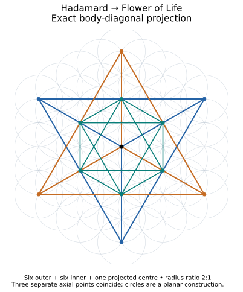
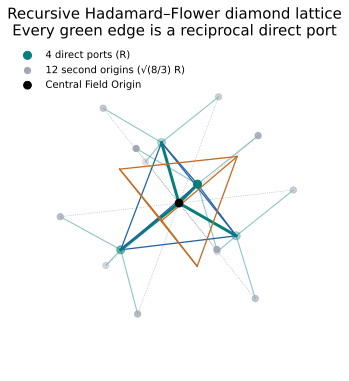
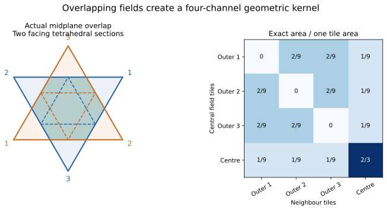

# Hadamard–Flower lattice: projection, overlap and four-port propagation

> **Optical extension:** [Four-port optical resonator](OPTICAL_FOUR_PORT_RESONATOR.md) proves the four-bright/eight-dark coherent mode split and models the isolated central-mediated overlap branch. It preserves the full previous geometry and distinguishes dark modes from inactive individual neighbours; capture remains unproved.

> **Integration update.** The [unified synthesis](UNIFIED_HADAMARD_FIELD_DYNAMICS.md#4-exact-overlap-geometry-becomes-a-full-cell-interface-td) now embeds W into the actual Stage IX 36-coordinate tile graph through an explicit opposite-face routing, checks tetrahedral covariance and simulates 54 complete fields. This supplies the previously missing model-level interface map, not a physical derivation of it.

**Status:** [T] exact Euclidean geometry and finite algebra; [D] conservative transport conditional on the area-kernel Hamiltonian; [E] identification with physical GFD field dynamics. This extends the [corner-first packing theorem](CORNER_FIRST_PACKING.md), not its rigid-sphere assumptions. One complete stellated octahedron is one field; its eight constituent vortices and single Field Origin are retained. The diagrams are newly constructed from the coordinates, motivated by the user's Flower of Life / Metatron reference drawings. No numerology or additional field identity is inferred from the projection.

## 1. Exact thirteen-point projection

Let $S=\{(1,1,1),(1,-1,-1),(-1,1,-1),(-1,-1,1)\}$, $C=S\cup(-S)$, $E=\{\pm e_1,\pm e_2,\pm e_3\}$. The two tetrahedra are $\operatorname{conv}(S)$ and $\operatorname{conv}(-S)$; their intersection is the central octahedron $\operatorname{conv}(E)$. Their union is the stellated solid. Each field has envelope radius $R=\sqrt3$ in cube coordinates. The orthogonal projection along $s_1=(1,1,1)$ is $P=I-\mathbf1\mathbf1^T/3$. The 15 spatial points $C\cup E\cup\{0\}$ project to exactly 13 distinct positions: $P(C)=\{0\}\cup 2P(E)$, with the sign of individual matches determined by the corner. In particular, $0,s_1,-s_1$ have the same projection. The six $P(E)$ have radius $\sqrt{2/3}$ and form a regular hexagon; the outer hexagon has twice this radius and identical angular directions. A triangular lattice generated by $P(e_1)/2,P(e_2)/2$ supports equal circles of pitch $\sqrt{2/3}/2$ with centres at the reference pattern's ring positions. These planar circles are not the projected spherical envelopes of radius $R$.

The six inner projected points are octahedral vertices, not automatically six neighbouring Field Origins. Likewise the projected centre contains three distinct geometric points, not three automatically occupied field nodes. A drawing cannot replace the three-dimensional adjacency proof.

## 2. Reciprocal corner-origin construction

Instead of non-overlapping tangent spheres, put neighbouring origins at the four corners $s_i$ on the spherical boundary. Reverse the active parity at every adjacent origin: an A-site has links $+S$, a B-site has links $-S$. These sites carry **identical complete dual tetrahedra**; A/B here denotes lattice sublattice and active port orientation, not separate TetA-only/TetB-only fields.

Define the translation lattice $L_A=\{p\in(2\mathbb Z)^3:\sum p_i\equiv0\pmod4\}$ and $L_B=s_1+L_A$. Their union is diamond cubic. The three vectors $s_1-s_2,s_1-s_3,s_1-s_4$ form a primitive basis of $L_A$ (determinant magnitude 16). Each is reachable by two active edges. Therefore all A-sites are connected, and all B-sites attach to an A-site. Every site has exactly four reciprocal nearest-neighbour edges of length $R$. Internal directions retain $s_i\cdot s_j=-1$ for $i\ne j$ and Hadamard orthogonality. Every non-backtracking two-step displacement is $s_i-s_j$ for $i\ne j$ (sign reversed on B), giving 12 distinct FCC directions of length $\sqrt8$.

## 3. Count the neighbours without conflating definitions

| Relation to central origin | Count | Distance / R | Actual geometric meaning |
|---|---:|---:|---|
| First shell | 4 | 1 | Corner-origin links; solid overlap with positive volume |
| Second shell | 12 | $\sqrt{8/3}$ | Two-step origins; two point contacts of stellated solids |
| Third shell | 12 | $\sqrt{11/3}$ | Spherical envelopes overlap; stellated solids do not |

The exact shell enumeration follows from the parity conditions defining $L_A,L_B$. For strict overlap of equal spherical envelopes, distance must be less than $2R$; exactly 28 other origins satisfy this. No squared distance 12 occurs. For a second-shell displacement, two coordinates equal $\pm2$ and one is zero. The containing cubes meet along a cube edge. The stellated solid intersects a cube edge only at its endpoints, since each tetrahedron contains exactly one endpoint of each cube edge and is convex. Hence the two stellated solids meet at exactly those two vertices. Each of the eight cube corners is incident to three such second-shell neighbours; each shared edge connects opposite parities. Third-shell offsets include a coordinate of magnitude 3, so their containing cubes are disjoint. The first-shell overlap has positive volume because its midpoint is interior to both facing tetrahedra (all barycentric weights strictly positive).

A distinct geometry is the ordinary Voronoi partition of the same origin lattice. At the origin it is defined by $s_i\cdot x\le3/2$ and $(s_i-s_j)\cdot x\le4$. Enumerating the intersections of triples of those 16 planes gives 16 vertices: the four opposite-parity cube corners, and the twelve permutations of signed magnitudes $(3/2,1/2,1/2)$ with negative coordinate product. The verifier uses exact rational plane intersections. All vertices lie in the radius-$R$ ball. For third-shell neighbours, the Voronoi inequality is satisfied with equality only at one vertex; for farther origins, $\|d\|>2R$ implies strict inequality by Cauchy–Schwarz. Thus the cell has exactly 4 hexagonal first-shell facets and 12 triangular second-shell facets, not 4 facets and 8 point contacts. The B-site cell is the inverted A-site cell.

**Conclusion:** the model yields four active links (if transmission is defined on positive-volume stellated-solid overlaps), twelve inactive *solid-contact* neighbours, and twelve more envelope-only neighbours. It does not realize the originally proposed twelve total = four active + eight inactive. The twelve second-shell directions form a single orbit of the tetrahedral symmetry group, so selecting eight of them without an extra symmetry-breaking rule is impossible. The 13-point drawing is not evidence of a 12/4/8 lattice. These different definitions of neighbour are not interchangeable.

## 4. New result: exact overlapping Triforce interface

Consider the active neighbour at $s=(1,1,1)$. The midplane of the two origins is $s\cdot x=3/2$. The central TetA cross-section has the three vertices given by permutations of $(1,1/4,1/4)$, from interpolating $5/8$ of the apex and $3/8$ of the opposite face vertices. The neighbouring facing tetrahedron has the reflected vertices $s-x$, permutations of $(0,3/4,3/4)$. The other two tetrahedra do not meet this plane: their support bounds are respectively $s\cdot x\le1$ and $s\cdot x\ge2$. The common cross-section is a regular hexagon with vertices the six permutations of $(1/4,1/2,3/4)$. Its area is $3\sqrt3/16$, or exactly $2/3$ of the area of either triangle. This midplane is a chosen symmetric interface within the volume overlap, not the physical boundary of either field.

Subdivide each triangular section into four equal-area medial Triforce tiles. In barycentric coordinates of the first triangle, the second triangle's vertices are $2\mathbf1/3-e_i$. Normalize pairwise tile intersection areas by the area of one tile. Exact rational polygon clipping gives

$$W=\frac19\begin{pmatrix}0&2&2&1\\2&0&2&1\\2&2&0&1\\1&1&1&6\end{pmatrix}.$$

All four channels remain independent: $\operatorname{rank}W=4$ and $\operatorname{spec}W=\{7/9,1/3,-2/9,-2/9\}$. Each outer tile shares $5/9$ of its area, while the central tile shares its entire area. The sum of entries is $8/3$, giving the $2/3$ total overlap fraction after dividing by four. The negative eigenvalues describe signed amplitude modes of a nonnegative area matrix; no negative overlap is implied. This is a **different** interface from Stage IX's matched triangular face: the present matrix describes overlapping midplane cross-sections, not the original 33-site Triforce tiles. It provides a geometric candidate for an interface map. It is not yet a derivation that this map is the physical transmission kernel or an embedding of this map into the 36-coordinate cell Hamiltonian.

## 5. Conditional conservative propagation

If $W$ is used as an amplitude coupling kernel between two four-component interface states, the Hermitian interaction is $H_{12}=-\kappa W$, $H_{21}=-\kappa W^T$. For $i\dot z=Hz$ the bond current $J_{a\to b}=2\Im(\bar z_b H_{ba}z_a)$ satisfies $\dot N_1=-\sum J,\ \dot N_2=+\sum J$. The same telescoping law holds on the connected diamond graph. This makes the geometry compatible with conservative Distributed Field Processing; the physical value of $\kappa$, the projection from full vortex dynamics into the interface states, relativistic propagation, capture, and the constitutive and bound laws remain open. The test model uses $\kappa=1$ as a dimensionless normalization, not a fitted physical constant.

## 6. Reproduction and next target

Open [interactive explorer](hadamard_flower_explorer.html) offline; rotate the three-dimensional geometry or reset to the exact Flower projection, and switch between all shell origins and active paths. [Verifier](verify_hadamard_flower.py) and [output](hadamard_flower_verification_output.txt) contain 314 new passing assertions. Run `python verify_hadamard_flower.py` and `python generate_hadamard_flower_figures.py` (NumPy, SciPy, SymPy, Matplotlib). Historical 3,243 recorded assertions are retained, not rerun. A subsequent stage should derive the physical interface operator and determine whether a twelve-total-neighbour relation follows from a different closure definition or a dynamically selected symmetry-breaking state, rather than relabelling the 12 second neighbours as eight.
