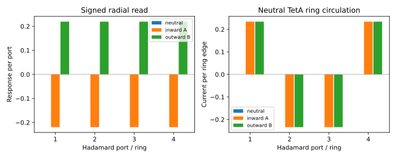
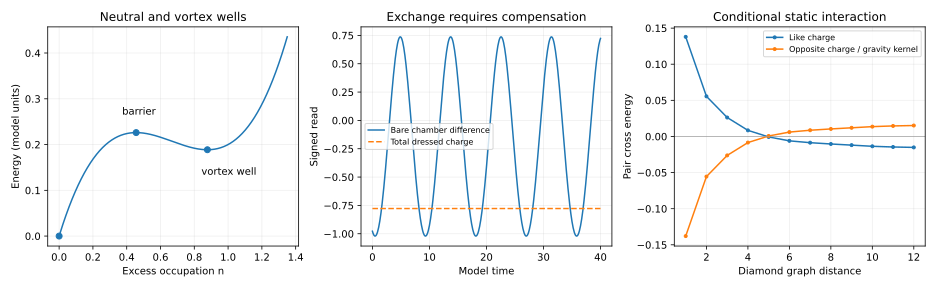

# Matter, inward/outward vortex response and charge — eight-register extension

**Normalization convention (current):** use the existing GFD topology-derived bare G, conditional on its upstream premises. Any microscopic effective coefficient must match it; no independent G fit is introduced. See the [G normalization bridge](G_NORMALIZATION_BRIDGE.md).

*GFD Standard Field Model (SFM), November 2026. [T] algebraic identities; [D] results of specified reduced Hamiltonians and graph problems; [E] physical interpretation. Companion to [spectral gravity read](SPECTRAL_GRAVITY_READ.md), [bound capture](BOUND_FIELD_CAPTURE.md), [optical resonator](OPTICAL_FOUR_PORT_RESONATOR.md) and [unified field dynamics](UNIFIED_HADAMARD_FIELD_DYNAMICS.md).*

## 1. Physical premise and separation of reads

[E] The proposed electron configuration is an inward TetA vortex with no retained matter in TetB. A specific configuration of vortices retained in TetB produces an outward TetA vortex response and a positive electric-field read. Empty TetB alone does not identify an electron: an ordinary unbound mesh cell may have no retained TetB matter without carrying an electron. A neutral mesh field may still have its original eight constituent vortices. A retained-object register and the original optical field amplitudes are different quantities. In particular, the four-coordinate Field Origin and the 36-coordinate graph do not yet supply a count of retained complete fields.

The target is one geometry with three distinct observables: radial electric response (signed), axial circulation, and gravity (positive energy source and collective polar read). A static radial field is not a stationary nonzero net material or occupation flux. In a finite closed stationary state, net flux across any cut is zero. The graph currents calculated below circulate; the independent signed static read is not a probability current. The helical through-flow, binding process and background-plus-excitation microscopic solution remain research targets.

## 2. Exact complete Walsh read [T]

Write $s=(s_x,s_y,s_z)\in\{\pm1\}^3$, $p_s=s_xs_ys_z$, and

$$r_s=a+s\cdot b+p_s(d+s\cdot e).$$

The eight columns of $U=[1,S,p,pS]$ obey $U^TU=8I_8$, so there is an exact inverse $c=U^Tr/8$. Define chamber coordinates $z_A=(a+d,b+e)$ and $z_B=(a-d,b-e)$. Orthogonality of the four records in each chamber yields

$$n_A=\frac14\sum_{p_s=1}|r_s|^2=\|z_A\|^2,\quad n_B=\frac14\sum_{p_s=-1}|r_s|^2=\|z_B\|^2.$$

Consequently the chamber-even intensity and chamber-odd intensity are

$$N=n_A+n_B=2(|a|^2+|b|^2+|d|^2+|e|^2),\qquad q=n_B-n_A=-4\operatorname{Re}(a^*d+b^\dagger e).$$

$|q|\le N$, with equality exactly when one of the two chamber registers vanishes. Interchanging the chamber registers preserves $N$ and reverses $q$. This is an algebraic sign read, not a physical charge derivation. Neither its magnitude nor its units are fixed by the Hadamard matrix. For each chamber $z=(z_0,v)$, the polar read $2\operatorname{Re}(z_0^*v)$ and the axial read $-i\bar v\times v$ remain distinct. The vertex intensity moment also contains the quadrupole alias $Q(v)=2\operatorname{Re}(\bar v_yv_z,\bar v_zv_x,\bar v_xv_y)$ with opposite parity signs. With independent chamber states the alias does not generally cancel simply by averaging; it can be separated using the reconstructed registers. The old restricted $d=e=0$ read has $q=0$ identically.

## 3. A microscopic conservation obstruction [T/D]

In the actual existing 36-coordinate SFM Hamiltonian $H$ (all previous internal hopping coefficients unchanged), let $Q_0$ be diagonal, -1 on tiles belonging to TetA, +1 on TetB and 0 at the four shared origin coordinates. The sign read $\psi^\dagger Q_0\psi$ would be conserved for every state only if $[H,Q_0]=0$. The old graph has 48 explicit interchamber tile bonds and the commutator is nonzero. For the equal-amplitude relative-$i$ state on tiles 1 and 21, $\dot q_0=2$ in the specified dimensionless units. The ordinary optical occupation difference is therefore not a conserved charge. This counterexample also holds if an arbitrary diagonal read is assigned at the shared origin, since it uses a direct tile-to-tile bond.

A new charge symmetry, or a compensating field contribution, is necessary. This is why the following excess-mode model is separate from the original graph's full state. It does not erase any old modes or silently identify its extra registers with the old Field Origin coordinates.

## 4. Three conservative nonlinear configurations [D given premises]

Use $z_A,z_B\in\mathbb C^4$ as **excess vortex registers**, with canonical complex Hamiltonian normalization. Their physical relationship to the exact Walsh field read is a proposed identification (a rescaling is needed if inheriting the original Walsh coordinate norm). The neutral reference is a zero excess register, not a claim that the original background vortex is zero. Let $z_X=(z_{X0},v_X)$, $n_X=\|z_X\|^2$ and $q=n_B-n_A$. Choose four real outward radial response coordinates $u_k$ and their canonical momenta $p_k$. A rotationally invariant candidate energy is

$$V(n)=\epsilon n+\lambda n(n-1)^2,$$

$$\mathcal H=V(n_A)+V(n_B)+\gamma n_An_B+\delta\sum_X |z_{X0}|^2+\xi\sum_X|v_X\cdot v_X|^2+\frac12\sum_{k=1}^4[p_k^2+(u_k-q/4)^2].$$

All coefficients are positive, phenomenological and dimensionless; the unit occupation is a chosen normalization, not elementary charge or the number of complete fields. The condition $0<\epsilon<\lambda/3$ produces two positive stationary radii,

$$n_\pm=\frac{2\pm\sqrt{1-3\epsilon/\lambda}}3.$$

$n_-$ is a barrier of $V$ and $n_+$ a local minimum. At a nonzero pure-sector minimum set $z_{X0}=0$, $v_X\cdot v_X=0$ and $\|v_X\|^2=n_+$. Such a circular vector has $|-i\bar v_X\times v_X|=n_+$. Take $v_X=\sqrt{n_+/2}(1,i,0)$. The other sector is zero. The radial read minimizes at $u_k=q/4$, $p_k=0$. Since $V'(0)>0$, $V''(n_+)>0$ and every other term is nonnegative and vanishes on each pure-sector state, these are local energy minima (not strict along phase and orientation symmetries). The neutral zero register is also a local minimum, with lower energy. The conserved Hamiltonian implies local energy stability of the minima as sets in this finite-dimensional model; there is no dissipative attraction to a minimum. This is not a proof of a bound complete cell in the forge.

The equations are $i\dot z_X=\partial_{\bar z_X}\mathcal H$, $\dot u_k=p_k$, $\dot p_k=-(u_k-q/4)$. Global independent chamber phase symmetries conserve $n_A,n_B$ separately, hence $q$. This also prevents creation of a nonzero excess chamber from zero in this autonomous reduced model; capture would require an incoming state or another accounted interaction. At the static minimum $\sum_k u_k=q$. The sign choice couples a signed chamber difference to radial response; it is a premise, not forced by geometry. Equal ports follow from the symmetric response energy. Each $u_k$ is a local static read, not a continuous occupation flux and not yet the external self-consistent electric field.

For example take $\epsilon=0.2$, $\lambda=1$, $\gamma=0.7$, $\delta=0.5$, $\xi=0.8$. The results are:

| Reduced configuration | $n_A$ | $n_B$ | $q$ | Energy above reference |
|---|---:|---:|---:|---:|
| Neutral | 0 | 0 | 0 | 0 |
| Inward (electron candidate) | 0.877485 | 0 | -0.877485 | 0.188668 |
| Occupied TetB, outward read | 0 | 0.877485 | +0.877485 | 0.188668 |

The paired states have equal energy because this illustrative energy has chamber-exchange symmetry. No proton/electron mass ratio, actual electron mass, positron identity, stability in the full SFM, or quantum particle statistics follows. An inward spiral requires more than an inward radial read. The radial sign is distinct from circulation handedness; complex conjugation reverses the axial read while preserving the densities and $q$.

## 5. A TetB configuration can accompany neutral TetA circulation [D given premises]

Use the actual four TetA lateral ring triplets of the existing tile graph. Let $s_i$ be its four Hadamard directions; project an internal circular vector onto each zero-sum row:

$$v_{Xi,j}=(s_j+s_i/3)\cdot v_X,\quad j\ne i,\qquad\sum_{j\ne i}v_{Xi,j}=0.$$

This projection is exactly covariant under the 24 tetrahedral symmetries. Introduce neutral TetA response amplitudes $w_i\in\mathbb C^3$ on those triplets and $S_i=\sum_X v_{Xi}v_{Xi}^\dagger$, $t_i=\operatorname{tr}S_i$. An additional nonnegative energy is

$$E_w=\sum_i\left[h\left|\sum_j w_{ij}\right|^2+\tfrac12(\|w_i\|^2-\nu t_i)^2+\zeta(t_i\|w_i\|^2-w_i^\dagger S_iw_i)\right],$$

for positive $h,\nu,\zeta$. The last term is nonnegative since $0\preceq S_i\preceq t_i I$. It is independent of the two matter phases, so it does not transfer their charge. For either pure-sector circular state, $w_i=\sqrt\nu v_{Xi}$ makes every term vanish. Thus appending $E_w$ preserves those local minima. The neutral branch has $w_i=0$ in excess coordinates. At the stationary pure-sector solution the alignment hopping contributes zero imaginary bond read; the remaining symmetric-read energy $h|\sum_j w_{ij}|^2$ supplies a uniform ring current $J_{j\leftarrow k}=2h\operatorname{Im}(\bar w_{ij}w_{ik})$. Every ring circulates for the example axis, with no divergence at a ring site. The effective hopping +h is a chosen neutral response coefficient, not the original -1 Hamiltonian. This explicit equilibrium supplies four circulating TetA response rings even when only the TetB *matter* register is occupied. It does not show that the old dynamics spontaneously generates them from zero or that the new amplitudes are independent physical degrees of freedom. Coupling $w$ into the original 36-coordinate dynamics without double counting is a research gate.

*Calculated values at the three specified minima; for $h=0.4,\nu=0.5,\zeta=0.9$, all four nonzero ring currents have magnitude 0.233996 per oriented edge. The sign of the radial read flips, while the chosen circulation is unchanged. The response is static, not a simulated outward helical flow.*

## 6. Dressed exchange and a missing charge carrier [D given premises]

The independent chamber symmetries in Section 4 forbid bare A–B hopping. A separate conservative completion allows transfer while preserving a dressed charge. For two scalar modes $A,B$ introduce a periodic angle $\theta$ and momentum $p_\theta$, and choose

$$H_{\rm ex}=2h\operatorname{Re}(e^{i\theta}A^*B)+\frac{p_\theta^2}{2I}.$$

Under $A\mapsto e^{i\alpha}A$, $B\mapsto e^{-i\alpha}B$, $\theta\mapsto\theta+2\alpha$, the energy is invariant. With canonical equations, writing $Z=e^{i\theta}A^*B$ gives $\dot q=-4h\operatorname{Im} Z$ and $\dot p_\theta=2h\operatorname{Im} Z$. Thus

$$Q_{\rm total}=n_B-n_A+2p_\theta$$

is conserved even during interchamber exchange. Total occupation $n_A+n_B$ is conserved as well. The rotor is a mathematical compensator; deriving it from the existing Triforce/Field Origin geometry and identifying a physical charge is open. This is a global symmetry witness, not local electromagnetic gauge invariance. Nonzero linear exchange, even dressed, does not leave an exactly empty $B$ invariant for nonzero $A$. Do not merge this separate example with the pure-sector energy minima and claim simultaneous exact retention or capture. An actual charge-preserving nonlinear capture mechanism must also satisfy the bound-field criteria.

## 7. Electric and gravitational static reads on the same lattice [D given premises]

On the existing four-port diamond graph, orient edges and let $D$ be its incidence matrix with +1 at the tail and -1 at the head. Thus $DE$ is the net outward electric read. **Assume** discrete Gauss settlement $DE=q$ and minimum positive quadratic field energy $\|E\|^2/2$. On a connected periodic graph require zero-mean source (subtract a uniform compensator or use neutral pairs). With $L=DD^T$ and pseudoinverse $L^+$ the unique minimum is

$$\phi=L^+q,\qquad E=D^T\phi,\qquad \mathcal U_e=\tfrac12q^TL^+q.$$

Proof: $L\phi=q$; every other feasible edge vector differs by $c\in\ker D$, orthogonal to $D^T\phi$, increasing energy by $\|c\|^2/2$. This yields exact regional Gauss accounting $\sum_{i\in U}q_i=\sum_{\partial U}E_{\rm outward}$. On a lattice with the same geometry the already established scalar long-wavelength Laplacian gives a Coulomb-form kernel under this additional electrostatic premise. The local $u_k$ from Section 4 is an isolated symmetric source read, not an edge value solving this global constrained problem. A variational matching of local and global energies is needed for a full self-consistent model.

For sources at separated vertices the electric pair energy is proportional to $q_iq_jG_{ij}$, where $G=L^+$. The corresponding charge-even candidate gravitational pair energy, if mass is positive excitation energy and the gravitational work coupling has the attractive sign as in [spectral gravity read](SPECTRAL_GRAVITY_READ.md), is proportional to $-m_im_jG_{ij}$. In the continuum weak-source regime the inverse-Laplacian gives $G(r)\propto1/r$. Opposite electric signs attract, equal signs repel, and gravity is independent of electrical sign in that conditional model. The attraction sign and the coupling of mass to the scalar band are physical premises, not consequences of graph symmetry. Physical normalization (including $c,\hbar,G,e,\varepsilon_0$), Maxwell dynamics, causal propagation, Lorentz symmetry, charge quantization, electron spin-1/2, universal mass coupling and observed particle masses are not derived. The periodic Green function is mean-zero and can be negative at long distances; the finite graph plot is a kernel comparison, not a physical force prediction.

*Calculated dimensionless reduced-model results and 432-node periodic diamond graph. The two Hamiltonians in Sections 4 and 6 are separate examples, not a single fully coupled matter simulation. In particular the chosen gravitational kernel is not a replacement for the drained GFD constitutive law or the drainless bare-G Newton/GR rule.*

## 8. Next research gates

1. Derive the retained-matter register and response coefficients from the existing eight-ring, 36-coordinate vortex dynamics, including a nonzero neutral circulating background. No charge should be double-counted as ordinary optical occupation. Establish exact physical charge symmetry and its coupling to the four ports; test the dressing hypothesis using existing geometry.
2. Find an invariant inward electron state with no retained TetB matter, and a stable bound configuration formed by compression with actual outward TetA response. Verify radial flux versus static field, account for the energy carried into surrounding cells, and maintain single-valued field ownership. Every Field Object closes, regardless of drain; microscopic binding is not a change to the drainless macroscopic law.
3. Prove quantization, universal normalization, physical spin/statistics and particle stability. Derive electromagnetic dynamics and distinguish positive elementary charge, proton and other composite states; no identification based on the sign alone.
4. Derive common matter-to-electric and matter-to-gravity work couplings from the same stationary circulating microscopic system. The existing spectral gravity coefficient is dimensionless; neither $G$ nor $e$ has been predicted. Derive the existing constitutive law and nuclear bound law without inserting them. SST names only the full covariant action.

## Reproduce

`OPENBLAS_NUM_THREADS=1 OMP_NUM_THREADS=1 python verify_matter_charge.py`.

[Verification log](matter_charge_verification_output.txt) · [response rings](matter_charge_rings.csv) · [dressed exchange](matter_charge_rotor.csv) · [static graph kernel](matter_charge_green.csv). 157 new passing assertions; previous 4,305 recorded checks retained, not rerun. These are checks of algebra and explicitly chosen reduced models, not independent theorems or empirical tests. No Lean compilation, remote GitHub write, or full microscopic matter solution claimed.

## Collective optical closure follow-up

See [G from a collective optical closure](G_CLOSURE_DERIVATION.md) for the conditional electromagnetic-reference normalization, primitive-volume stiffness derivation and the unresolved source-selection and stiffness assignments. This does not introduce another G.

**Continuation:** [Electron closure settlement](ELECTRON_CLOSURE_SETTLEMENT.md) connects Papers IV/V and the existing topology normalization with a joint solution, conditional radial energy and optical matching.
