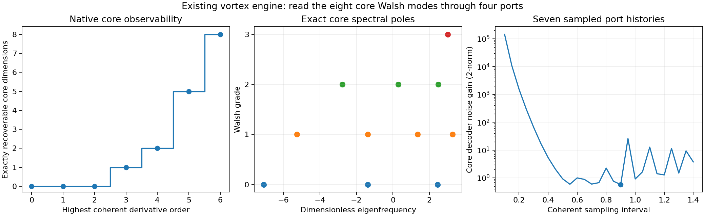

# Native Walsh read of the closure engine

*GFD Standard Field Model — continuation of the π-addressed read, November 2026*

**Status:** [T] exact algebra of the stated finite model; [D] conditional computational implementation; [E] proposed physical identification. The π walk is an addressing schedule, not itself a physical FWHT. This extension retains one whole stellated octahedron per gravity field and does not introduce a new G or alter the full covariant SST action.

## 1. Native read, not an added Hamiltonian

Use the original 36-coordinate H from [coupled Field Origins](COUPLED_FIELD_ORIGINS.md), with its eight central triangles indexed by their outward sign triples s. Let E embed those eight coordinates into the complete state. The four active ports measure coherent amplitudes Cψ, where each row of C is the filtered port factor (1,1,1,6) on the original three lateral and one central tile. This is the same read as in [optical four-port resonator](OPTICAL_FOUR_PORT_RESONATOR.md), up to a common known scale. Set i ψ̇=Hψ. The history at time zero obeys i^k y^(k)=CH^kψ(0).

[T] Stack M=(C;CH;…;CH^6). Its exact rank is 26, its kernel dimension is 10, and Eᵀ ker M=0. Thus all eight central amplitudes are determined even for arbitrary unknown initial conditions in the other 28 coordinates. The ten invisible directions are not all metric-invisible; see [dynamic tetrad settlement](DYNAMIC_TETRAD_SETTLEMENT.md). No claim to reconstruct every one of the 36 coordinates or an independent arbitrary 64-slot physical connection.

## 2. The geometric Walsh read

Let p=s_x s_y s_z. The eight characters are 1, s_x,s_y,s_z, p s_x,p s_y,p s_z,p. Let W be their 8×8 evaluation matrix, in the order used by H, so W Wᵀ=8I. The desired read is w=W Eᵀψ/8. (For a unitary transform use division by √8 instead.)

For the four active signs form T=(1,s_x,s_y,s_z) and define r=Tᵀy/4. Each recovered core Walsh coefficient is a polynomial in the differential operator D=i∂_t applied to one r channel. The exact coefficients below are in ascending powers, with omitted higher powers zero.

| Core Walsh grade | Port combination | Numerators of polynomial coefficients | Denominator |
|---|---|---|---:|
| 0 | r_0 | −180, −39, 129, −17, −5 | 336 |
| 1 | r_j | −26952, 40842, 196079, −41050, −38820, 4432, 1725 | 521792 |
| 2 | r_j | 266048, −77256, −207346, 49613, 76298, −4805, −1715 | 887888 |
| 3 | r_0 | −24, −35, −5, 7, 1 | 576 |

[T] Direct rational matrix multiplication verifies all eight read identities for every initial state, not just a π input. Highest derivative orders 0 through 6 give 0,0,0,1,2,5,8 recoverable central dimensions. The physical implementation of coherent temporal readout and differentiation is [E]; no measurement backaction is included. Coefficients refer to the dimensionless H, and change with Hamiltonian or port normalization.

## 3. Four exact spectral channels of the existing engine

The core response Eᵀ(zI−H)^−1 E is Walsh diagonal, and within each grade degenerate. This follows from the cube symmetries (sign flips and coordinate permutations); the verifier also checks exact rational Krylov reductions for all eight characters. For a normalized core character the diagonal resolvents are:

| Grade | Multiplicity | Core Green function |
|---|---:|---|
| 0 | 1 | z(z+3)/(z³+6z²−11z−24) |
| 1 | 3 | z(z²+z−4)/(z⁴+2z³−19z²−4z+32) |
| 2 | 3 | (z−1)(z+2)/(z³−7z+2) |
| 3 | 1 | 1/(z−3) |

[T] The parity mode is already an exact core-only eigenstate at energy 3. Scalar and directional modes couple to other internal coordinates. None of these dimensionless frequencies determines a physical Compton clock. The finite resolvents are rational functions of z, not a BBP digit generator. Their poles are not independent experimental predictions.

[D] A seven-sample coherent experiment at dimensionless t=0,0.9,…,5.4 recovers all central amplitudes with operator residual 3.57e−15; nonzero singular-value condition number 50.87 and core decoder 2-norm 0.577 in the specified unnormalized port convention. Sampling interval selected from 27 test spacings to minimize core decoder norm among numerically adequate reconstructions. Not a physical time or optimum theorem. See [sample scan](native_walsh_sampling.csv).

## 4. The raw butterfly is a different operation

[T] H commutes with full inversion I, so exp(−iHt) preserves inversion parity. A normalized eight-point Hadamard transform maps the uniform central vector to a single corner, which is not inversion even. Consequently the original autonomous H cannot implement that transform on arbitrary core inputs, even up to global phase, with output back in the core. Reading Walsh coefficients through a temporal decoder does not require such a gate.

[D] A controlled circuit is geometrically possible using the twelve actual central-to-central cube edges. For axis j, pair vertices differing in bit j and isolate those four existing hopping bonds; add opposite diagonal potentials −Z_j, so H_j=−(X_j+Z_j) on the core (zero on the remaining coordinates). Since H_j²=2I on the core, a pulse of duration π/(2√2) implements i times the normalized one-bit Hadamard. Three pulses yield −i H8/√8. Two passes on an independently stored 8×8 table give −H8 X H8/8, a known global sign. All tested gates are unitary, but switching Hamiltonians can do work; this is not a proof of autonomous energy conservation or continued vortex circulation. Controls, isolation, memory and routing are additional assumptions. The native history read above needs no modification to H.

## 5. Link to π and settlement

The [π ledger](PI_WALK_FWHT.md) addresses all 64 ordered vertex pairs after 332 fractional digits with its original convention. Complete coverage is not simultaneous acquisition and is not unique to π. If each field table is stationary or its known coherent evolution is compensated, the ledger can be read by the same Walsh kernel on both indices. For the particular native core propagator, symmetry already diagonalizes the response by Walsh grade. A general independent connection table would need further input access or storage; the equality of counts is not enough. The core is observable through the four ports even though the sustained dark vortex sector is not. Consequently an internal cycle cannot be equated to an external read without a source/transduction law.

[E] Proposed next steps: derive an actual coherent register and a physical π/BBP clock from the nonlinear vortex dynamics, then derive the read/settle work law that connects the register to the central gravitational tetrad. The time-invariant Hamiltonian does not implement a digit-address controller, and its history alone does not select π over another complete schedule. The gravitational normalization is the existing topology expression, conditionally stated in [G normalization](G_NORMALIZATION_BRIDGE.md); this note does not derive G, a0 or m_e anew.

## Reproduction

`OPENBLAS_NUM_THREADS=1 python verify_native_walsh.py` (NumPy, SciPy, SymPy, Matplotlib). [74/74 new checks](native_walsh_verification_output.txt), 5,304 previous recorded assertions preserved but not rerun; 5,378 cumulative. No remote changes. This verifies mathematical readout, not the physical existence of a π-driven vortex processor.
