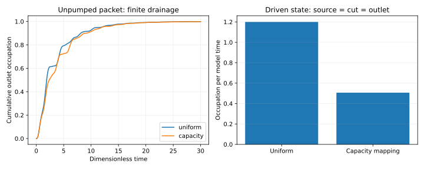

# Stage VIII — From circulation to an open directional throat

**Status:** [T] conditional finite-graph theorems; [E] physical identification with a GFD drain. Builds on [Stage VII](SUSTAINED_TRIFORCE_FLYWHEEL.md) and the [archived geometry](archive/stages-I-VI/TRIFORCE_FLYWHEEL.md). The eight constituent vortices remain one per octahedral face. The Field Origin is the central octahedron; its scalar centre O is only one site of the finite model.

## 1. The selection rule

For a linear Td-invariant operator, a scalar centre (A1) cannot receive a T2 or T1 amplitude. In Stage VII each chamber's inner amplitudes are proportional to q_i = s_i·z, and their sum is zero. This follows from tetrad closure, not a weight choice. Nonlinear scalar forcing is not forbidden: e.g. |z|² is A1. The dark scalar centre does not prove that the whole Field Origin is dark.

The axial chirality C = -i conjugate(z) × z is T1, and is even under spatial inversion, odd under complex conjugation. Its bilinear alternating part is unique up to normalization for a single spatial triplet, because Λ²T2 = T1. It is not the pressure drop: intensity/pressure-like quantities are time-reversal even. Nor is C a polar velocity. A directed material flux would need a polar direction or an oriented outlet; multiplying an axial vector by an A2 pseudoscalar can give a polar vector but its physical selection is open.

Under the conserved phase z → exp(iθ)z, C is neutral. A source of the form i ḃ = λ C for an ordinary phase-charged complex vector b violates this symmetry. Three directional components at O are not automatically three extra complex occupation sites. We distinguish the neutral axial receiver from the charged transport channels below.

## 2. [T] Closed neutral axial receiver

In the six spatial triplets of the 33-tile graph, choose orthonormal multiplicity coordinates z_m. The unperturbed Hamiltonian is M⊗I3 and the total axial read C_tot = Σ_m -i conjugate(z_m)×z_m is conserved. Introduce a real axial canonical pair a,p with energy

$$H=H_0+\tfrac12(|p|^2+\Omega^2|a|^2)-g p\cdot C_{tot}.$$

Take a time-even and p time-odd. The energy is time-reversal even, Td invariant and U(1) invariant. The coefficients g and Ω are model premises. The wave norm and total energy are conserved by Hamilton's equations; the C components have the rotation Lie-Poisson bracket (up to normalization), so their backreaction is proportional to p×C. From a=p=0, the following collinear solution is self-consistent with C constant:

$$a(t)=-g C\sin(\Omega t)/\Omega,\qquad p(t)=g C(1-\cos(\Omega t)).$$

Indeed ȧ=p-gC, ṗ=-Ω²a, p×C=0 and the receiver plus interaction energy is identically zero. Conjugating the initial wave reverses C and reverses this receiver response. This is a quadratic axial response, not loss of occupation or steady through-flow. The receiver is an additional candidate dynamical variable, not a derived tetrad connection. The verifier checks the closed-form receiver energy and collinearity, not general nonlinear integration.

## 3. [T] A directional outlet on the actual Triforce graph

Keep the existing 33 sites and 104 bonds. For each chamber index the central triangles by the four tetrahedral directions, and read the three spatial amplitudes using the isometry Y_± with row s_i^T/2 on its own four central triangles (use the same reference directions A on the paired opposite chamber). Assemble Y=[Y_+,Y_-], a 33×6 matrix. Then Y†Y=I6 and P=YY† is an orthogonal projector. These are six outgoing complex spatial channels (three per chamber); in the inversion-even subspace they reduce to three. They are T2 amplitudes, not an imposed axial T1 amplitude. Their quadratic angular read is T1.

A Markovian outgoing boundary condition, with γ>0, and coherent outer boundary forcing f exp(-iνt) gives

$$i\dot\psi=(H-i\gamma P)\psi+f e^{-i\nu t}.$$

Here f is normalized to unit norm, with support on the 24 outer tiles. Its pure row-mean-zero pattern is proportional to q_i/3+q_j on each chamber, q_i=s_i·z. Choose z=(1,i,0)/√2 for the explicit witness; all eight ring means initially circulate. No scalar centre injection is used. H is real symmetric on the actual graph. No outlet is added at the original scalar O. The projector is an effective boundary loss at the inner triangles, representing unresolved directional channels; a neighbouring cube or bath is not explicitly solved.

The exact occupation balance is

$$\frac{d}{dt}\|\psi\|^2=2\operatorname{Im}(\psi^\dagger f e^{-i\nu t})-2\gamma\|Y^\dagger\psi\|^2.$$

The outgoing occupation flux is F_out=2γ||Y†ψ||². For f=0, N(t)+∫F_out dt=N(0), so an isolated packet cannot support a positive steady throughput forever. With f≠0, a driven steady wave x exp(-iνt) satisfies

$$(\nu I-H+i\gamma P)x=f.$$

Its injection equals its loss. Because f is supported only on outer tiles and loss only on inner tiles, summing the local continuity equation over the outer tiles shows that net actual bond current across the outer→inner cut equals F_out. This is a throughput theorem, not a conclusion inferred from a picture of winding.

## 4. [T] Uniform-weight exact witness: all eight vortices feed the core

Set every one of the 104 hoppings to -1, every site energy to zero, γ=1/2 and ν=2 in dimensionless units. Unlike Stage VII, this witness does not need separate tuned bond or site energies. The frequency and outlet strength are selected boundary-model parameters, not predictions. The graph restriction is exact on the six spatial triplets (18 complex coordinates). In the inversion-even subspace the three reduced row/column/inner coefficients, with the same normalization as f, are

$$u=-19/60-i/5,\quad v=-17/60-3i/5,\quad w=8/5+4i/5.$$

All 24 outer ring bond signs are nonzero and directed cyclically. The exact rational net inward current from **each of the eight rings** is 3/20. Thus the total inner cut, outlet and source all equal 6/5. The actual inner-to-inner angular moment has norm 8/15. There can be backflow on individual outer/inner bonds; this establishes net inward flux per ring, not monotone spiral trajectories on every bond. The scalar centre is still dark. Its darkness is not an obstacle to directional transmission through the inner tile interface. The strict inequalities persist in an open neighbourhood of the stated drive and graph parameters by continuity of the invertible reduced resolvent.

For an unpumped normalized packet, numerical integration to time 30 exports approximately 0.998841 of the initial occupation; closed evolution conserves norm. This is not a perpetual vortex without a source.

## 5. [T] Angular read of the outgoing flow

For each chamber let b_±=Y_±†x. Define

$$\mathcal A_{out}=2\gamma\sum_\pm(-i\bar b_\pm\times b_\pm).$$

Within the collective ansatz b_±=c_± z for scalar c_±, so for unit z,

$$\mathcal A_{out}=F_{out}C.$$

This is an exact quadratic directional read of the transported occupation. Replacing z by its conjugate at the same driven frequency reverses this angular read and the eight ring means but leaves F_out unchanged. It does **not** reverse the outlet direction; the full time reverse would turn an outgoing boundary into an incoming one. This corrects the proposed test that simply reversing circulation should reverse material through-flow.

## 6. [E] Chamber asymmetry and the structural capacity numbers

A second explicitly marked candidate sets hopping magnitude to 21/17 on same-TetA bonds, 13/17 on same-TetB bonds, and 1 on cross-chamber or centre bonds. This is a mapping hypothesis inspired by f(4,s)=17+4s, not a derivation of those hopping strengths from the capacity polynomial. Site energies remain zero, and γ and ν unchanged.

All eight ring means and all 24 directed ring signs remain nonzero, and actual inner circulation persists. Total outlet flux ≈0.506461; port occupation shares in the chosen ordering are ≈0.337452 and 0.169009. But the first four rings have net inward cut ≈−0.08066 each, the last four ≈+0.20728 each. One chamber returns some occupation outward. The combined inward flux remains positive and source-balanced. Thus chamber asymmetry can change the *distribution* and direction of transport. It is not yet gravitational quiet/drive/brake, which compares measured strength w with a0; this model has no acceleration read or gravitational calibration. No constitutive law, 16+24+24 connection dynamics, or SST derivation is claimed.

## 7. Reproduce and limitations

Run `python verify_open_throat.py` (NumPy, SciPy, SymPy, Matplotlib). The script records 160 checks, including exact rational reduced coefficients and all eight net inward cuts and 24 directed ring signs in the uniform witness; symmetry, local continuity and conjugation checks; integrated packet occupation balance; and the neutral receiver formula. It generates the figure and `open_throat_dynamics.csv`. See [actual output](open_throat_verification_output.txt). No prior suite was rerun in this stage. No Lean compilation, repository changes, physical drain derivation or neighbouring-cell propagation theorem. The open model uses imposed driving and a Markovian outlet, not derived Field Origin physics. It is not a hydrodynamic pressure or Navier–Stokes solution. The receiver and open outlet are separate consistent constructions, not yet one nonlinear self-selecting Hamiltonian.

Next: replace the prescribed boundary by reciprocal links between actual neighbouring Triforce cells; derive a directional transport law and source from the shared faces, distinguish polar flux from axial angular momentum, and test whether a stable drain appears without selecting the drive and loss externally. Only then test the acceleration-strength premises of the constitutive law. SST names the full four-term covariant action exclusively.
