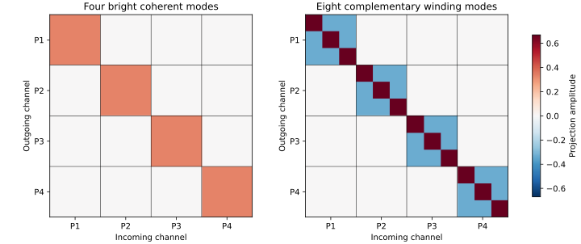
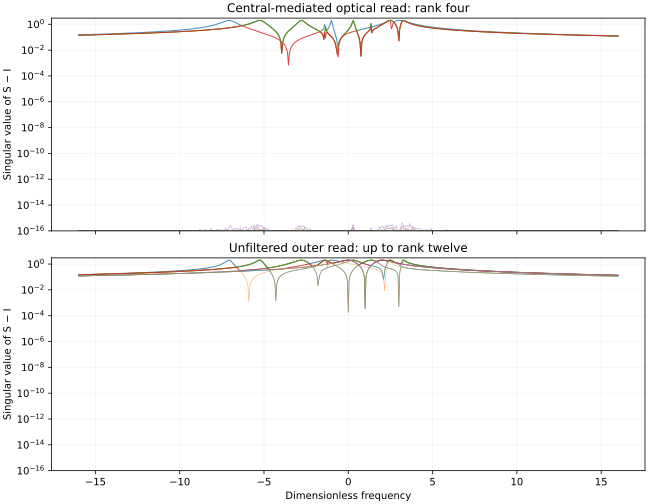
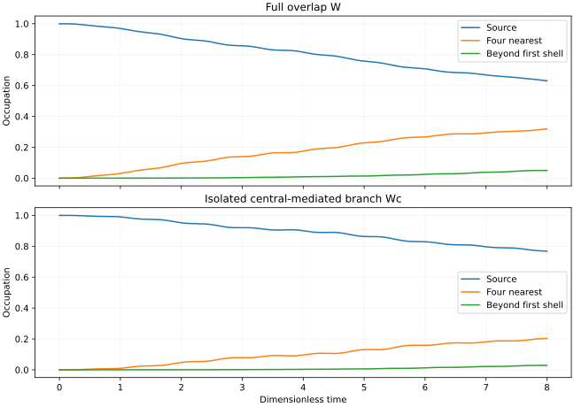

# Four-port optical resonator: twelve channels, eight dark modes

*Gravity Field Dynamics · Field Dynamics Research · November 2026*

**One complete stellated octahedron per field; eight constituent vortices; one Field Origin; four reciprocal optical ports.**

[T] exact mathematical result; [D] consequence of stated candidate dynamics; [E] physical identification still under research. This note extends [the unified Hadamard–Flower model](UNIFIED_HADAMARD_FIELD_DYNAMICS.md), preserving its full 36-coordinate internal Hamiltonian and its unfiltered overlap kernel. It does not replace the covariant SST action, or derive the constitutive or bound law.

## 1. Count neighbours and channels separately [T]

In the overlapping-origin diamond lattice, each node is a whole field. Its four first-neighbour origins are at the active Hadamard corners $s_i$, with $s_i\cdot s_j=-1$ for $i\ne j$. At each first neighbour, one link returns to the source and three continue onward. The twelve distinct non-backtracking routes have endpoints $s_i-s_j$, $i\ne j$. They are the twelve second-neighbour origins, not twelve first-neighbour contacts. The four direct links and twelve second neighbours are disjoint; the solid-contact count is 16 and the spherical-envelope overlap count is 28. See [geometry and shell enumeration](HADAMARD_FLOWER_LATTICE.md#3-count-the-neighbours-without-conflating-definitions).

The same ordered-pair labels $(i,j)$ index the twelve lateral tiles of the four active stellations of a single field. This is a useful exact permutation correspondence, not an identification of a tile with a separate gravity field. Each port has a triplet of lateral tile amplitudes, or equivalently a candidate triplet of route input amplitudes. The remaining four stellations are still present in the internal Hamiltonian. The active parity is reversed on the opposite diamond sublattice.

## 2. Exact optical mode decomposition [T]

Let $a_{ij}$, $i\ne j$, be the twelve amplitudes and $R$ the four-by-twelve row-sum matrix: $(Ra)_i=\sum_{j\ne i}a_{ij}$. Set $Q=R/\sqrt3$. Then

$$ QQ^T=I_4,\quad P=Q^TQ,\quad Z=I_{12}-P,\quad PZ=0. $$

$$\boxed{\operatorname{rank}P=4,\qquad\operatorname{rank}Z=8.}$$

The natural basis of each triplet is $(1,1,1)/\sqrt3$ and $(1,\omega,\omega^2)/\sqrt3$, $(1,\omega^2,\omega)/\sqrt3$, where $\omega^3=1$, $\omega\ne1$. The latter two have zero symmetric read. They are coherent winding amplitudes, not two disabled physical neighbours.

Every individual basis channel has $\|Qe_k\|^2=1/3$, so no individual channel is dark. All twelve ordered pairs are one orbit under tetrahedral permutations. A diagonal on/off selector invariant under the whole group must be proportional to identity, and cannot select four individual contacts. A coherent rank-four projector can be invariant: it commutes with the full permutation representation. This distinction explains why a symmetric four-port resonator is possible even though a symmetry-preserving literal four-of-twelve neighbour selector has not been proved.

## 3. A necessary correction: internal circulation is not permanently sealed [T/D]

For the unmodified Stage IX 36-coordinate Hamiltonian $H$ (unit noncentre hopping, sign-record coupling at O), let $B$ inject the twelve active lateral tiles and $C_O$ read the scalar and polar centre. Let $L$ be the column-sum matrix of $a_{ij}$ and $A$ the four-by-three matrix of the Hadamard sign directions. With $T=[\mathbf1,A]$, $T_-=[\mathbf1,-A]$, the exact moments are

$$C_OB=C_OHB=0,$$
$$C_OH^2B=T^TR+T_-^TL,$$
$$C_OH^3B=\begin{pmatrix}-12\mathbf1_{12}^T\\A^T(-5R+L)\end{pmatrix}.$$

The stacked two- and three-hop read has rank seven. In fact, the common kernel is exactly $\ker R\cap\ker L$, of dimension five. To see the upper bound, $RR^T=LL^T=3I$ and $RL^T=\mathbf1\mathbf1^T-I$ imply rank seven of the stacked row and column read; to see the lower bound, the two polar equations separate the two triplet sums, while the scalar equation fixes their common total. For the five-dimensional common kernel the verifier checks $C_OH^kB=0$ restricted to it for all $k=0,\dots,35$; Cayley–Hamilton gives the result for all times. These are exact integer/rational matrix computations. This is a theorem for the specified isolated Hamiltonian, not for arbitrary intercell coupling.

Consequently, of the eight modes initially dark to the row port, **three can excite the directional Field Origin via column coupling** and five remain origin-dark under isolated unfiltered evolution. Full unfiltered geometry does not justify an assertion of eight permanently inactive channels. This agrees with the earlier collective flywheel: winding can feed a different read without violating the original zero row sum.

## 4. Exact central-mediated branch of the Flower interface [T]

The established area kernel is

$$W=\frac19\begin{pmatrix}0&2&2&1\\2&0&2&1\\2&2&0&1\\1&1&1&6\end{pmatrix}.$$

Its full rank is four, and its two zero-sum outer winding modes transmit with signed amplitude $-2/9$. Hence there is no eight-dark filter in the full kernel alone. The central tile has equal overlap with each outer tile. This permits an exact algebraic split using the central coordinate $e_c=(0,0,0,1)^T$:

$$\boxed{W_c=We_c(e_c^TWe_c)^{-1}e_c^TW=\frac1{54}\begin{pmatrix}1\\1\\1\\6\end{pmatrix}(1,1,1,6),\quad W_p=W-W_c.}$$

$W_c$ has rank one, eigenvalue $13/18$ on $p=(1,1,1,6)^T/\sqrt{39}$, and the same central row and column as $W$. The rank-three remainder $W_p$ has zero central row and column. Both commute with every permutation of the three lateral labels. In particular, $W_c$ annihilates both zero-sum outer winding modes. Its third null direction in the four-dimensional tile space mixes the outer mean and central tile; it is distinct from the two winding modes. These are exact Schur-complement identities. $W_c$ is not a second independently measured area matrix; the remainder may have signed entries and the splitting is not a decomposition into disjoint physical areas.

**[E] Optical selection hypothesis:** isolate this central-mediated amplitude branch at each direct port, suppressing the peripheral branch $W_p$ in that read. Geometry fixes the candidate branch once this central-channel factorization is adopted, but does not require the physical interface to reject $W_p$. The full kernel stays in the original model.

## 5. Lossless reciprocal optical resonator [D]

Use the actual tile port maps $F_{s_i}$ from the unified synthesis. Define $U=[F_{s_1}p,\ldots,F_{s_4}p]$ and the twelve-channel coupling $G=UQ$. The four columns of U are orthonormal because the four active port tile sets are disjoint. Thus $GZ=0$ and $\operatorname{rank}G=4$. A standard dimensionless lossless wide-band input-output witness is

$$S(\nu)=I_{12}-2iG^T(\nu I-H+iGG^T)^{-1}G.$$

The unit coupling normalization is chosen, not calibrated. At real nonsingular frequencies, the resolvent identity gives $S^\dagger S=I$, and real symmetric H and real G imply $S^T=S$. Since $GZ=0$, $SZ=Z$ and $\operatorname{rank}(S-I)\le4$. At large $|\nu|$, $S-I=-2iG^TG/\nu+O(\nu^{-2})$ has rank four generically (except isolated response zeros or singular frequencies); the dark block is exact for every frequency where the scattering formula is defined. The identity term is the direct reference scattering channel: dark means no resonator-mediated response, not that optical energy is absorbed, or that it cannot travel in a separate reference path. A specific reflecting or transmitting reference termination needs its own boundary model.

The numerical comparison couples all twelve outer coordinates directly in the unfiltered reference $G=B$, with the same internal H and normalization. At 641 sampled nonsingular frequencies, the filtered response has four nonzero singular values of $S-I$ and eight zero to machine precision. The unfiltered response can have twelve nonzero singular values. Max unitarity error $3.65\times10^{-15}$, max reciprocity error $3.71\times10^{-15}$, max dark response $6.10\times10^{-17}$. The minimum sampled fourth singular value is $7.06946\times10^{-4}$. The unfiltered twelfth singular value reaches 0.768886. No physical optical frequency or gravitational time unit is assigned.

## 6. Conservative transport with isolated central interfaces [D]

For each directed diamond bond $i\to j$ at active corner $s$, use the same whole-cell interface embedding, with the alternative kernel:

$$H_{ji}^{(c)}=-\kappa F_{-s}W_cF_s^T,\qquad H_{ij}^{(c)}=(H_{ji}^{(c)})^\dagger.$$

The four-port geometry is unchanged. At every interface the coupling block has rank one; the original full W model has rank four per interface. The zero-sum outer winding state has no instantaneous direct central-branch transfer, but local H can convert it to bright states which propagate. This differs from permanently isolating internal winding dynamics.

The verifier evolves 16 complete fields (576 amplitudes, a periodic two-by-two-by-two primitive-cell repeat) from the same row-closed eight-ring pattern used in the unified model, with $\kappa=1$. At 321 times each, both Hamiltonians conserve occupation and energy and agree with the local antisymmetric flux ledger. Peaks (at different times):

| Quantity | Full W | Central-only Wc |
|---|---:|---:|
| First-neighbour occupation | 31.964% | 20.304% |
| Beyond first-neighbour occupation | 5.019% | 2.871% |
| Source directional O | 36.051% | 37.701% |
| First-neighbour directional O | 9.066% | 7.097% |

The largest errors across both models are $5.56\times10^{-15}$ in total occupation, $1.85\times10^{-14}$ in energy and $3.68\times10^{-16}$ in local continuity. Summing the ledger over any group cancels internal interfaces exactly. This is compatible with Distributed Field Processing but does not establish physical mass settlement or relativistic propagation. The isolated central read can be applied to a future bound-state model; it does not prove capture or the bound law.

## 7. What the result establishes and what remains open

| Question | Answer |
|---|---|
| Four active / eight dark optical modes among twelve? | [T/D] Yes, for the coherent symmetric read and the explicit central-mediated optical architecture. |
| Four whole-field active neighbours? | [T/D] Yes, on the overlapping Hadamard diamond graph; the same four links are used by both models. |
| Twelve total neighbours, of which eight individual fields cannot couple? | [E] No theorem yet. Twelve routes or modes are not twelve first neighbours. In the diamond lattice there are four first and twelve second neighbours. |
| Eight local winding modes permanently isolated by the full vortex Hamiltonian? | [T/D] No. Three may reach O, five are permanently O-dark in the specified isolated cell. |
| Does geometry force the central branch to be selected instead of W? | [E] Not yet. A dynamical boundary/polarization law must select it. |

Next research target: derive the boundary selection from a wave equation or an electromagnetic torsion coupling, preserving reciprocity and explicit port symmetry. If eight *individual neighbouring fields* must be inactive, the model needs a different adjacency or a symmetry-breaking selector; a coherent rank-four filter alone cannot establish that claim. Preserve the distinction between geometrical Field Origin and acceleration transition, and between TetB occupation in a bound field and a drainless object's exterior GR field.

## Reproduction

`OPENBLAS_NUM_THREADS=1 OMP_NUM_THREADS=1 python verify_optical_ports.py` (NumPy, SymPy, SciPy, Matplotlib). The script reads the actual Stage IX geometry/H definition prefix and does not rerun or change the prior verifier body. [Log](optical_ports_verification_output.txt) · [Scattering CSV](optical_scattering.csv) · [Network CSV](optical_network_dynamics.csv). 108 new assertions passed; 3,873 previous recorded checks are preserved, not rerun. No Lean compilation, physical experiment or GitHub write was performed.
