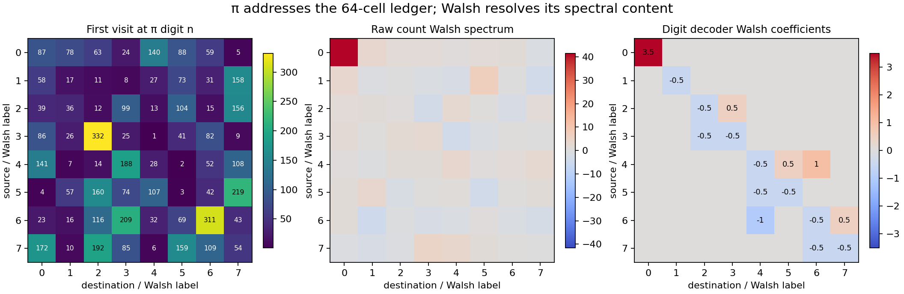
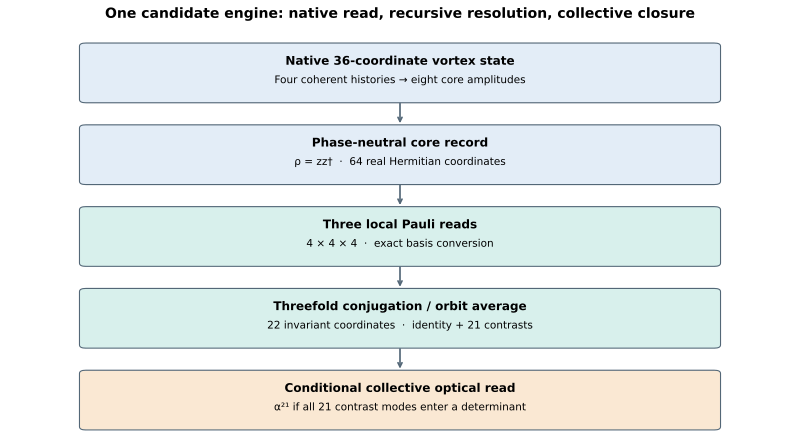

# π-addressed Walsh–Hadamard closure read

*GFD Standard Field Model · computational interpretation of the closure engine · November 2026*

**Status:** [T] denotes exact algebra, [D] results conditional on explicit premises, [E] exploratory physical identification. This note does not derive π from vortex dynamics, nor claim the walk is itself the FWHT. It links the existing walk to an exact spectral read.

## 1. Upstream and scope

- [The π/BBP walk](https://github.com/fielddynamics/research/tree/main/research/exploratory/i-ching): base-8 digits, cumulative addition modulo 8, ordered pairs, first coverage at step 332. The upstream tests explicitly say coverage time is typical of well-mixed digits, not special to π.
- [The cube and its Walsh spectrum](https://github.com/fielddynamics/research/tree/main/research/universe-is-pixelated): eight Walsh modes, the dual-tetrad parity and the chamber-resolved H2 × H4 factorization (with appropriate ordering).
- [The null rotation proof](https://github.com/fielddynamics/research/tree/main/proofs/g-null-rotation): the trace of the four-dimensional null rotation is 4; the Hadamard read itself has trace zero in the specified representation. These must not be equated.
- [Inside the closure engine](CLOSURE_ENGINE_INTERNALS.md): actual two-chamber periodic exchange and energy registration. [Dynamic tetrad settlement](DYNAMIC_TETRAD_SETTLEMENT.md): coherent observation of internal amplitudes, and its limitations.

## 2. Two different operations

[T] Write π = 3 + Σ d_n 8^(-n), n ≥ 1. Start v_0 = 3 and set v_n = (v_(n-1) + d_n) mod 8. The address is (u,v) = (v_(n-1),v_n). The digit decoder is D_uv = (v-u) mod 8. This is addition in Z/8, **not** XOR in (Z/2)^3. Their translations are different: the cyclic shift has order 8, whereas nonidentity XOR shifts have order 2. H8 diagonalizes XOR translations, not the cyclic shift. Nevertheless the cyclic shift preserves the nested Walsh blocks of sizes 1,1,2,4, verified exactly (the shift preserves functions of the low k bits, and their orthogonal differences).

[T] Define H_ab = (-1)^popcount(a AND b), a,b = 0,...,7. H^T=H, H²=8I. The bit-parity character H_7 distinguishes the two tetrahedra (the sign convention assigns the chamber). For a fixed eight-vertex signal f, its full unnormalized read is Hf. For a pair-addressed table X, the two-index read is Y=HXH. In row-major coordinates this is H64=H⊗H=H2^⊗6. Six butterfly stages, 32 pair butterflies per stage, 192 total (384 scalar additions/subtractions). X=HYH/64; ||Y||_F²=64||X||_F². An eight-point read requires three stages, 12 butterflies. The 21 structural levels are neither the number of FWHT stages nor its operation count.

## 3. π-scheduled read of an arbitrary field table

[D] Assume the table X is stationary over the closure, or that a coherent history model compensates for the evolving values. On the first occurrence of pair (u,v), sample X_uv, mark its mask bit, and add X_uv H[:,u]H[:,v]^T to Y. On a repeat, do nothing to this particular first-visit accumulator. At full coverage every summand is present once, so Y=HXH independently of order. Equivalently fill X by random-access reads, then apply the FWHT. The latter is the fast algorithm; the streaming outer-product rule is a direct transform, not a fast butterfly implementation. If observations are only four rank-one optical ports, arbitrary independent X entries are not automatically accessible; see existing observability limits.

[T] At n=332, π first covers all 64 addresses (reproduced independently with 400-digit mpmath π, not an independent BBP derivation). The final newly visited pair is (3,2). Coverage means complete sampling, not physical simultaneous settlement. A changing table instead produces a mixed-time ledger, and no claim of an atomic snapshot follows without a synchronization model.

## 4. Three ledgers must not be confused

- Coverage mask M_uv=1 if visited, 0 otherwise. At closure M=11^T, HMH=64 e0 e0^T. All nonconstant Walsh coefficients vanish; the mask cannot encode π at completion.
- Counts C_uv=# visits. HC H retains count information but generally loses order. Row minus column marginals equal e_start−e_end exactly for any walk.
- Discounted ledger L^(N)_uv=Σ_(n≤N)8^(-n) 1[(v_(n-1),v_n)=(u,v)]. Each entry has base-8 digits 0 or 1; at every digit position precisely one entry is 1. Hence L retains the entire ordered finite walk. This requires temporal precision/memory; it is not a free compression of π.

## 5. An exact sparse spectral read of π

[T] Define B=HDH/64 and S=HLH. Frobenius orthogonality implies

$$\pi_N=3+\langle D,L^{(N)}\rangle_F=3+\langle B,S^{(N)}\rangle_F.$$

The decoder B has **16 nonzero entries**, including B_00=7/2. It is block diagonal in the dyadic blocks (0),(1),(2,3),(4,5,6,7), with respectively 1,1,4,10 nonzero entries. The last block is sparse. This count is tied to the chosen binary numbering and the modular subtraction decoder. It is not evidence that these entries are the 16 physical tetrad coordinates.

The exact read error satisfies 0 ≤ π−π_N < 8^(-N). At N=332 it is below 8^(-332), roughly 10^(-300). The numerical check uses exact integer ledgers (common denominator 8^N), no floating cancellation. The relation holds for every sequence of base-8 digits; π is selected by the supplied digit generator, not by the transform. The FWHT is a change of basis, not an independent evaluation of π.

## 6. Candidate engine interpretation

[E] BBP supplies random-access π digits; the π-driven walk supplies addresses; the full 64-entry read is resolved in six Walsh stages; a suitable read/settle/register law could act on selected spectral coordinates. For a single field, the eight-vertex Walsh coefficients split as scalar (1), polar (3), parity-weighted polar (3), chamber parity (1), consistent with the earlier eight-coordinate read. Two-index extension is an algebraic bridge, not a proof that the 64 ledger coordinates transform like a connection. The 36-coordinate vortex Hamiltonian does not yet implement these six butterfly stages, nor prove that it generates BBP, rather than consuming π as a clock. The decisive test is an explicit time-dependent local map on the actual Triforce graph, with norm/energy accounting, producing the normalized H64 for arbitrary independent input tables, not just a single digit stream. Also distinguish the clock rate from the Compton clock; no tick duration follows from the count 332. A reset and repeated closure could change the next cycle length. The optical and gravitational read normalizations remain those of the existing research; this stage does not derive G, a0 or electron mass.

## 7. Reproduce

`OPENBLAS_NUM_THREADS=1 python verify_pi_fwht.py` (NumPy, mpmath, matplotlib). [126/126 new checks](pi_fwht_verification_output.txt), including exact transform/inverse, eight arbitrary table tests, each of the 64 decoder values, 332-digit integer-ledger reconstruction, dyadic cyclic-shift blocks and XOR control. The prior 5,178 recorded assertions are preserved, not rerun. No remote repository changes.

## Continuation

[Native Walsh read](NATIVE_WALSH_READ.md) establishes exact reconstruction of all eight core coefficients through the unchanged four-port history; a controlled butterfly circuit is possible but not autonomous. This does not derive π generation.

**Continuation:** [Projective Walsh–G bridge](PROJECTIVE_WALSH_G_BRIDGE.md) derives the exact 22-dimensional quotient read and 1/4/16 flag embedding; the 21 projective records alone are not closed under the full Walsh transform. Physical selection and attenuation remain open.

## Three-subread continuation

See [Three sub-reads of one closure engine](THREE_SUBREAD_CLOSURE.md) for the reversible tree, actual native core Pauli ledger, projective invariant contrast count and controlled-rotation obstruction. This continuation does not derive physical attenuation or change the prior model.

