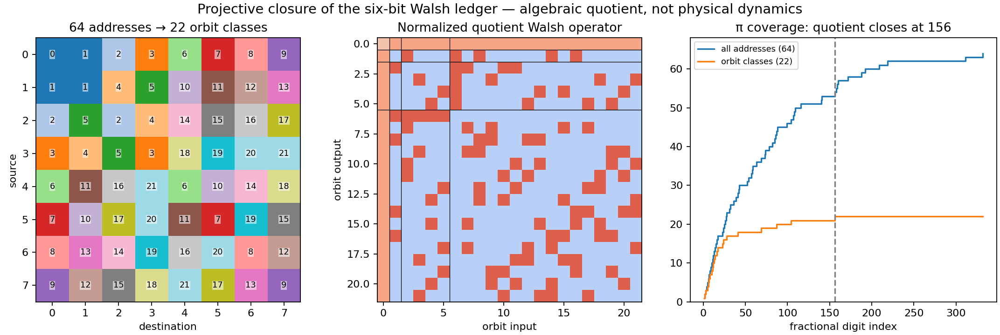
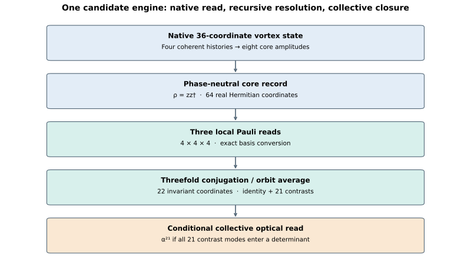

# Projective Walsh closure and G from topology

*GFD Standard Field Model — November 2026*

**Status:** [T] exact finite-field and Walsh identities; [D] consequences conditional on the specified ledger and orbit symmetry; [E] physical identification of orbit projection, attenuation, closure grading and G combination rule. No new physical constants or fitted parameters introduced.

## 1. Upstream and scope

The upstream [G matrix synthesis](https://github.com/fielddynamics/research/blob/main/research/g_from_topology/g_matrix_synthesis.md) assigns the scalar, vector and tensor read blocks dimensions 1, 4, 16, with graded traces 21, 17, 13. The [closure climb](https://github.com/fielddynamics/research/blob/main/research/g_from_topology/g_from_the_closure_climb.md) makes the 17 the mean per distinct newly registered address, not per unit time; the physical combination rule remains proposed. The [null-rotation proof](https://github.com/fielddynamics/research/tree/main/proofs/g-null-rotation) identifies the Sierpinski factors of the Walsh matrices with null rotations in a spinor representation, but the full Walsh read itself has different character. The upstream [coupling algebra](https://github.com/fielddynamics/research/tree/main/research/coupling-algebra) already identifies the 21 projective points over GF(4). The new result here is the exact reduction of the **actual six-bit ordered-pair Walsh operator** to that projective space, including its zero-mode mixing and the original Sierpinski block sizes.

## 2. An order-three cycle on the ordered-pair ledger [T]

Let u,v be three-bit addresses. On the 64-element set define T(u,v)=(v,u XOR v). Then T^2(u,v)=(u XOR v,u) and T^3=1. The only fixed point is (0,0). All other addresses lie in 21 orbits of length three. Seven orbits contain a zero vertex or equal vertices; the other fourteen are the two orientations of each of the seven Fano lines on the nonzero three-bit vectors. This is a transformation of the pair ledger, **not** a spatial rotation of the stellated solid or the modulo-eight pi walk.

Pair source and destination bits by spatial coordinate. With the self-dual GF(4) basis (omega,omega^2), the three paired coordinates form GF(4)^3; T is multiplication by omega. Its nonzero orbits are the one-dimensional subspaces of GF(4)^3, i.e. PG(2,4). Choosing a coordinate flag and normalizing the first nonzero coordinate to field unity gives representatives (0,0,1), (0,1,z), (1,y,z), with z,y in GF(4). Their counts are 1,4,16. The flag is a choice; no physical axis or chamber interpretation is forced.

## 3. Exact projective FWHT [T]

Write H=H8 tensor H8, unnormalized. Let M be the permutation matrix of T and P=(I+M+M^2)/3. H M=M^T H (T is self-adjoint as a binary linear matrix), so HP=PH. P is an orthogonal projector of rank 22. Thus the orbit-constant sector is invariant under the full six-stage Walsh transform. The orthogonal complement has dimension 42.

Use normalized orbit indicators, with e0 for the zero address and 1/sqrt(3) on each nonzero orbit. In this basis the normalized Walsh transform is exactly

$$F=\frac18\begin{pmatrix}1&\sqrt3\,\mathbf1^T\\\sqrt3\,\mathbf1&4A-J\end{pmatrix},$$

where A_{ij}=1 when the projective points have zero GF(4) bilinear dot product and J=11^T is 21 by 21. Each polar line has five points, and any two distinct lines meet at one point. Therefore A^2=4I+J, A1=5·1. F^2=I, with eigenvalues +1 and -1 each eleven times. On the 20 zero-mean projective contrasts the read is A/2, an involution. The zero address and the normalized uniform projective mode span a two-dimensional sector with matrix [[1,sqrt(63)],[sqrt(63),-1]]/8. In particular the entire 21-dimensional projective sector alone is NOT invariant under the FWHT. Its compressed transform has eigenvalue -1/8 on the mean mode. The Walsh DC spectral coefficient is not automatically the same as the physical Field Origin.

The orbit projection loses information for a general table. It is exact as a reduced read only on orbit-constant data; joint XOR translations do not preserve the chosen origin-dependent projection. The native history decoder obtains the eight central amplitudes, not an independent arbitrary 64-entry connection table. The physical mechanism selecting these orbits or constructing that table is unproved.

## 4. The Sierpinski link [T]

The elementary lower triangular factor A2=[[1,0],[1,1]] gives S6=A2^{tensor 6}, with entries 1 exactly when the column bits are a subset of the row bits. H64=S6 diag((-2)^popcount) S6^T. Restrict S6 to the selected 21 flag representatives, ordered by the 1,4,16 strata. Its three diagonal blocks are exactly S0, S2, S4. This is an explicit embedding of the original G block sizes inside the same six-bit factorization, not just the count 64=3*21+1. The restricted matrix has off-diagonal blocks; it is not the direct-sum G operator or a restriction of the unitary Walsh dynamics. Choice of representatives matters.

With projective flag projectors P1,P4,P16, the upstream grading is represented by I_s=P1+s P4+P16. Its trace is 17+4s and det(alpha^{I_s})=alpha^{17+4s}. [T] Given the grading. Applying alpha per orbit, choosing the middle grade and selecting the determinant rather than an ordinary amplitude are [E] physical premises. A normalized FWHT is orthogonal, determinant magnitude one; it cannot create alpha^21 by itself. The 17/13 ratio is not selected by the quotient. G's original conditional normalization remains the same, including the proposed one-loop factor; no new derivation of alpha, G or m_e.

## 5. Pi walk [T/D]

Under the original convention starting at 3 and adding fractional octal digits modulo eight, all 22 orbit classes are first visited at digit 156, whereas all 64 individual addresses first occur at digit 332. This is a different criterion of completion, not a new physical period. The raw pi visit ledger is not orbit-constant. The modular digit decoder (v-u) mod 8 is also not orbit-constant: e.g. orbit (0,1),(1,1),(1,0) has digits 1,0,7. The reduced read cannot in general reproduce the exact pi ledger or its digit decoder after projection. An addressing schedule is not a proof that the Hamiltonian generates pi. These facts rule out equating orbit closure with full field closure without an additional law.

## 6. Next physical proof

Derive an actual three-state cyclic symmetry on the native field-connection records from the eight-vortex dynamics, test if the projective orbit projection commutes with the physical time evolution, and determine whether the 21 independent orbit records are subject to a common electromagnetic attenuation. Derive the 4-block grading from the chamber transformation (not from a choice of flag), and establish the closure mean/start rule. Only then can the exact projective quotient supply a microscopic explanation of the existing G formula. Retain the full 64-address ledger for reconstruction and the zero-mode mixing in any candidate settlement dynamics.

## Verification

`OPENBLAS_NUM_THREADS=1 python verify_projective_walsh.py` (NumPy, mpmath, Matplotlib). 39/39 fresh assertions; [log](projective_walsh_verification_output.txt). The previous 5,378 recorded assertions are preserved but not rerun; 5,417 total recorded assertions, not independent theorems. No remote GitHub changes.

## Three-subread continuation

See [Three sub-reads of one closure engine](THREE_SUBREAD_CLOSURE.md) for the reversible tree, actual native core Pauli ledger, projective invariant contrast count and controlled-rotation obstruction. This continuation does not derive physical attenuation or change the prior model.

