# GFD Standard Field Model (SFM)

*Gravity Field Dynamics · Field Dynamics Research · November 2026*

**One complete stellated octahedron per field. Eight constituent vortices. One Field Origin. Four reciprocal external ports.**

The Standard Field Model (SFM) is the proposed internal research reference architecture joining the Hadamard geometry, Triforce vortex dynamics, overlapping Flower of Life lattice, optical resonator and Distributed Field Processing (DFP). It is a mathematical candidate for the microscopic field, not a replacement for the full covariant SST action or an experimentally validated theory of gravity.

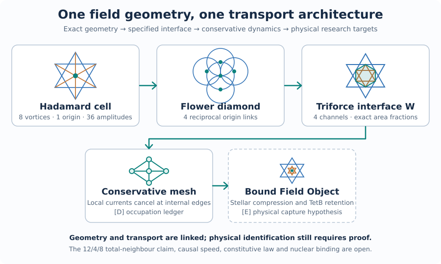

## Start here

**Latest extension:** [Matter vortex and signed charge](MATTER_VORTEX_CHARGE.md) — complete eight-register read, chamber-charge conservation obstruction, conditional inward/outward vortex equilibria and static electric/gravity ledger. The [spectral gravity read](SPECTRAL_GRAVITY_READ.md) remains the microscopic scalar response bridge.

| Resource | Purpose |
|---|---|
| [Unified technical synthesis](UNIFIED_HADAMARD_FIELD_DYNAMICS.md) | The full field architecture and network equations |
| [Optical four-port resonator](OPTICAL_FOUR_PORT_RESONATOR.md) | Latest 12-channel / 4-bright / 8-dark result and its conditions |
| [Detailed illustrated walkthrough](TECHNICAL_WALKTHROUGH.md) | Preserved full earlier README: internal vortex mathematics, historical results and upstream context |
| [Interactive Flower lattice](hadamard_flower_explorer.html) | Rotate the field lattice and examine the projection |
| [Verification record](VERIFICATION.md) · [Visual index](VISUAL_INDEX.md) | Reproduction commands, proof logs and illustrations |

## 1. Standard field specification

| Component | Definition in the candidate model |
|---|---|
| Field unit | One whole stellated octahedron, not one vortex or one tetrahedron |
| Geometry | Hadamard cube with two complementary regular tetrahedra, TetA and TetB |
| Constituent vortices | Eight stellations, each with a three-lateral-tile ring |
| Core | Shared octahedron; collective circulation generated by constituent dynamics |
| Triforce graph | 24 lateral tiles, eight central tiles, one central position; 104 original bonds |
| Directional Field Origin | One position with a scalar and polar triplet; 36 complex amplitudes in the extended field model |
| Direct external ports | Four alternating Hadamard directions; reciprocal active parity on the neighbouring sublattice |
| Optical mode space | Twelve lateral input channels: four symmetric bright modes and eight zero-sum winding modes |
| External embedding | Overlapping-origin diamond lattice; distinct from the original cubic-centre/junction tiling |
| Accounting | Antisymmetric interface flux and conservative regional boundary ledger |
| Structural capacities | 21, 17, 13 from the existing coupling polynomial, not derived from the optical mode counts |

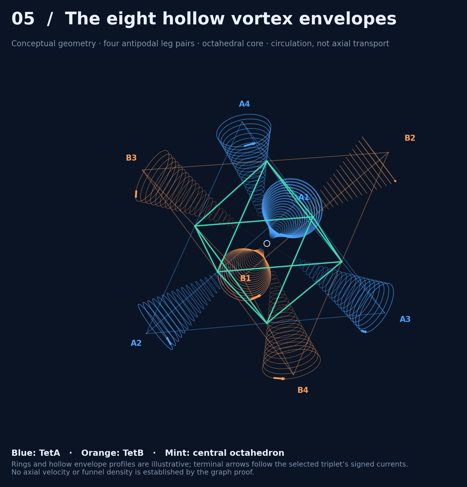

The funnel rendering is conceptual; the finite graph establishes circulation in specific model states, not a physical funnel profile or universal through-flow. The model admits eight-ring solutions with an empty core, generated core circulation and a stationary eight-ring/core configuration. See the [sustained flywheel proof](SUSTAINED_TRIFORCE_FLYWHEEL.md) for the exact assumptions.

## 2. From one field to the lattice

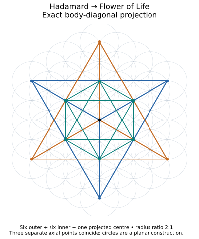

[T] The body-diagonal projection has thirteen distinct planar positions and a 2:1 outer-to-inner radius ratio. Placing complete neighbouring field origins at the four active cube corners and reversing active parity gives a connected diamond graph. The planar circles are a Flower of Life construction, not literal projected spherical boundaries.

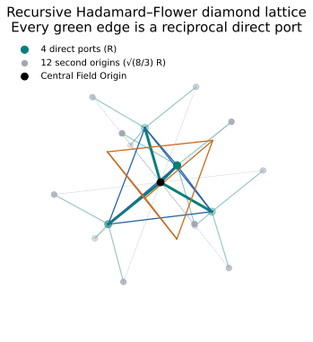

The overlapping-origin model has **4 direct neighbours, 12 second neighbours and 12 further spherical-overlap neighbours** (16 solid-contact neighbours, 28 overlapping spherical envelopes in total). These counts must not be confused with the twelve optical channels. The original 12-total-neighbour / 4-active / 8-inactive spatial hypothesis remains open.

## 3. Optical interface and vortex read

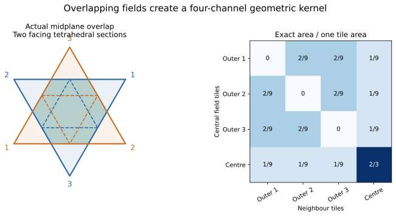

[T] The exact geometric overlap kernel is

$$W=\frac19\begin{pmatrix}0&2&2&1\\2&0&2&1\\2&2&0&1\\1&1&1&6\end{pmatrix}.$$

Its central-mediated rank-one factor is

$$W_c=\frac1{54}(1,1,1,6)^T(1,1,1,6).$$

For a direct bond from field $i$ to field $j$ along corner $s$, the candidate Hamiltonian block is $H_{ji}=-\kappa F_{-s}\mathcal W F_s^T$, with $\mathcal W=W$ (full interface) or $\mathcal W=W_c$ (filtered variant). Reverse blocks are adjoints. The model hopping scale $\kappa$ is dimensionless and not physically calibrated.

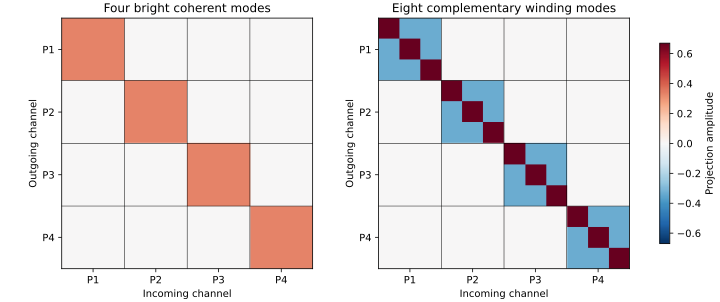

[T/D] Each active port has one symmetric mode and two zero-sum winding modes. The coherent read has rank four and an eight-dimensional dark kernel. The full overlap kernel transmits winding modes; the central-mediated variant suppresses their direct external read. No individual basis channel is inherently dark. Three of the eight initially row-dark modes can reach the isolated directional Field Origin through internal dynamics; five remain origin-dark under the specified unfiltered local Hamiltonian. The physical selection of the central branch is [E], not derived.

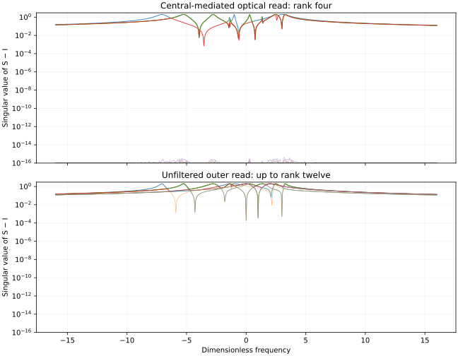

## 4. Distributed Field Processing and bound states

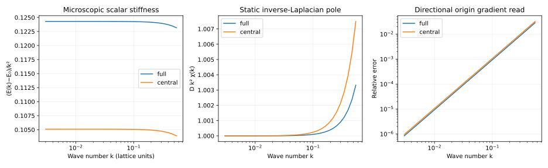

[D] The [spectral extension](SPECTRAL_GRAVITY_READ.md) derives an isotropic band-edge stiffness and polar intensity-gradient read from the same 72-coordinate microscopic Bloch operator. Its static susceptibility has a conditional inverse-Laplacian pole. The real scalar reference is not a circulating solution, and the physical source, normalization and work coupling remain [E].

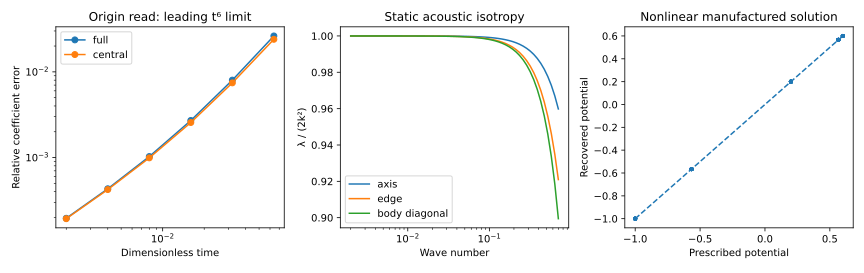

[T/D] The [field-read extension](FIELD_ORIGIN_GRAVITY_READ.md) establishes the neutral origin read $\mathbf P=2\operatorname{Re}(a^*\mathbf b)$ and a source-directed leading-order read in both Flower interface variants. A separate static potential functional on the diamond graph produces a twelve-neighbour Schur stencil and the Newtonian/AQUAL formal continuum operators. Physical identification of the two reads, mass coupling and microscopic stiffness remain [E].

[D] The chosen Hermitian lattice dynamics conserve occupation and energy. For any set of cells $U$,

$$\frac{d}{dt}\sum_{i\in U}N_i=-\sum_{i\in U,\,j\notin U}J_{i\to j}.$$

Internal transfers cancel, leaving the boundary ledger. This is a candidate microscopic accounting mechanism, not a derivation of physical mass registration. Every Field Object in the existing GFD framework closes; overlapping closures retain single-valued ownership, and a larger closure does not reopen smaller internal accounting.

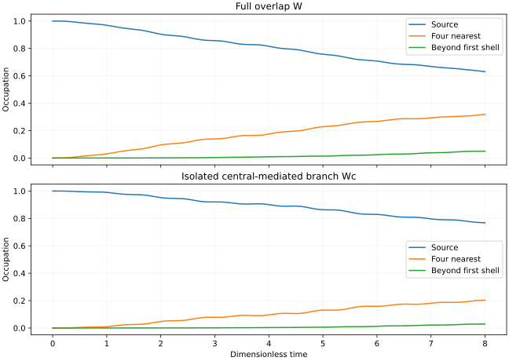

[E] The same geometry is the starting point for the proposed stellar-forge capture mechanism: compression of a complete incoming field into a receiving Field Origin and retained TetB occupation. This remains a nonlinear research target, not a result of the closed linear transport model. The [bound-field research](BOUND_FIELD_CAPTURE.md) connects this hypothesis to Papers VII, XI and XIII.

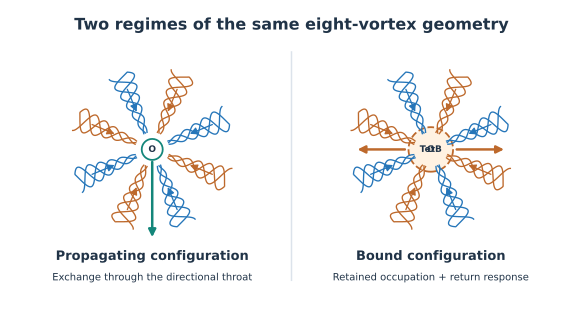

### Matter and electrical response — latest research extension

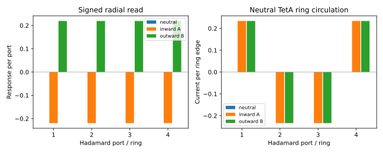

[T] The complete eight-coordinate Walsh read separates the two chamber intensities; their difference $q=n_B-n_A$ is chamber-odd and their total is chamber-even. The existing optical Hamiltonian does **not** conserve the bare tile occupation difference. [D/E] A separately specified conservative reduced energy supports neutral, inward (empty retained TetB) and occupied-TetB outward-read minima and neutral TetA circulation. A dressed transfer witness conserves a total signed charge even with chamber exchange, and a separate constrained diamond graph yields static Gauss settlement. This is not yet a physical electron, charge quantization, actual capture or an electromagnetic field theory. See [the new proof and research gates](MATTER_VORTEX_CHARGE.md).

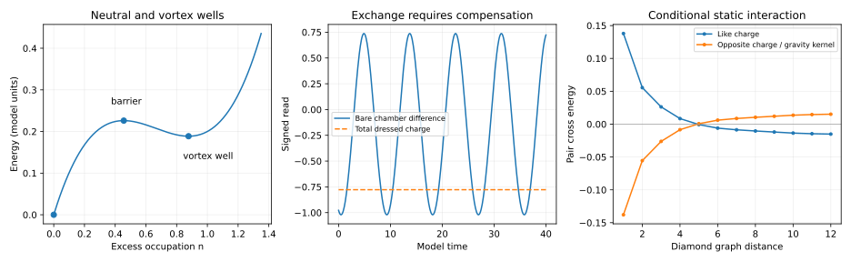

## 5. Status and decisive open questions

| Result | Status |
|---|---|
| Hadamard, Triforce, projection and overlap geometry | [T] Exact mathematical geometry |
| Eight-ring and generated collective-core circulation | [T/D] Specific finite graph solutions with stated coefficients and initial conditions |
| Four reciprocal ports and 4/12/12 neighbour shells | [T] In the chosen overlapping-origin embedding |
| Four bright / eight dark coherent modes | [T/D] Symmetric read and specified optical boundary selection |
| Lossless reciprocal transport and collective ledger | [D] For the chosen Hamiltonian |
| Physical interface selection, literal 12/4/8 neighbours, nonlinear stability and permanent capture | [E] Open |
| Full eight-register parity read; bare chamber charge obstruction | [T/D] Exact algebra and original-H counterexample |
| Reduced three-state vortex/charge model and neutral TetA response | [D] Conditional on chosen energy and response terms |
| Physical electron, elementary charge, capture, Maxwell dynamics and common source coupling | [E] Open |
| Microscopic derivation of gravity laws, physical scales and continuum limit | [E] Open |

**Terminology:** follow the upstream [GFD conventions](https://github.com/fielddynamics/research/blob/main/llms.txt). SST names the full four-term covariant action only. $\mu(x)=x/(1+x)$ is the constitutive law, $x=g_t/a_0$; it acts at drained levels. Bound drainless systems use bare $G$ and Newton/GR at leading order. The proposed microscopic capture model has not derived $x(1-\mu_b)^2=\mu_b$. TetB is neither reverse time nor the deep field. Scale universality means compositional settlement and registration, not geometric self-similarity.

## 6. Complete research index

| Stage / extension | Proof or research specification | Recorded assertions |
|---|---|---:|
| I | [Hadamard null cone foundation](archive/stages-I-VI/TECHNICAL_FOUNDATION.md) | 501 |
| II | [Current registration and nonlinear core harmonics](archive/stages-I-VI/TECHNICAL_FOUNDATION.md) | 483 |
| III | [Extended validation](archive/stages-I-VI/EXTENDED_VALIDATION.md) | 211 |
| IV | [Core hardening](archive/stages-I-VI/CORE_HARDENING.md) | 170 |
| V | [Face/core clarification](archive/stages-I-VI/FACE_CORE_CLARIFICATION.md) | 132 |
| VI | [Triforce flywheel](archive/stages-I-VI/TRIFORCE_FLYWHEEL.md) | 271 |
| VII | [Sustained flywheel](SUSTAINED_TRIFORCE_FLYWHEEL.md) | 809 |
| VIII | [Open directional throat](OPEN_THROAT.md) | 160 |
| IX | [Coupled directional Field Origins](COUPLED_FIELD_ORIGINS.md) | 115 |
| X (exploratory) | [Bound-field capture](BOUND_FIELD_CAPTURE.md) | — |
| Packing | [Whole-field FCC four-port packing](FOUR_PORT_PACKING.md) | 348 |
| Corner-first | [Rigid-sphere contact bound](CORNER_FIRST_PACKING.md) | 43 |
| Flower | [Hadamard–Flower lattice](HADAMARD_FLOWER_LATTICE.md) | 314 |
| Unified | [Unified field dynamics](UNIFIED_HADAMARD_FIELD_DYNAMICS.md) | 316 |
| Optical | [Four-port optical resonator](OPTICAL_FOUR_PORT_RESONATOR.md) | 108 |
| Field read | [Field Origin gravity read](FIELD_ORIGIN_GRAVITY_READ.md) | 130 |
| Spectral read | [Microscopic spectral gravity read](SPECTRAL_GRAVITY_READ.md) | 194 |
| Matter read | [Matter vortex and signed charge](MATTER_VORTEX_CHARGE.md) | 157 |
| | **Total recorded passing assertions** | **4,462** |

The assertions are not independent theorems. Historical Stages I–IX were rerun at Stage IX; subsequent counts refer to the respective extension's own run. Only the new matter-charge verifier was run in this edition; previous assertions remain recorded. No new Lean compilation or browser regression is claimed. The original documents and historical results remain intact.

## 7. Reproduce the results

Install Python dependencies (NumPy, SciPy, SymPy and Matplotlib). From the package root:

```sh
python -m pip install numpy scipy sympy matplotlib
# Historical stages I–IX only:
python run_all_verifiers.py
# Later extensions, individually:
python verify_four_port_packing.py
python verify_corner_first.py
python verify_hadamard_flower.py
OPENBLAS_NUM_THREADS=1 OMP_NUM_THREADS=1 python verify_unified_flower.py
OPENBLAS_NUM_THREADS=1 OMP_NUM_THREADS=1 python verify_optical_ports.py
OPENBLAS_NUM_THREADS=1 OMP_NUM_THREADS=1 python verify_field_read.py
OPENBLAS_NUM_THREADS=1 OMP_NUM_THREADS=1 python verify_spectral_read.py
OPENBLAS_NUM_THREADS=1 OMP_NUM_THREADS=1 python verify_matter_charge.py
```

See [VERIFICATION.md](VERIFICATION.md) for logs, environment notes and scope. Latest [matter-charge log](matter_charge_verification_output.txt) and [response data](matter_charge_rings.csv); historical [optical log](optical_ports_verification_output.txt), [scattering CSV](optical_scattering.csv) and [network CSV](optical_network_dynamics.csv) are included.

## 8. Explorers and supporting material

| Explorer | Function |
|---|---|
| [Flower lattice](hadamard_flower_explorer.html) | Rotate overlapping whole-field geometry |
| [Four-port packing](four_port_packing_explorer.html) | Compare FCC graph selectors |
| [Coupled origins](coupled_origins_explorer.html) | Two-field directional dynamics |
| [Sustained flywheel](sustained_explorer.html) | Exact eight-ring and collective-core trajectories |
| [Geometry explorer](explorer.html) | Hadamard/Walsh and core-current geometry |

Open HTML files locally in a browser. The [Visual index](VISUAL_INDEX.md) catalogs illustrations and regeneration commands. The [historical archive](archive/stages-I-VI/README.md) retains earlier derivations and draft Lean proofs.

Upstream: [GFD research repository](https://github.com/fielddynamics/research), [diamond tetrad lattice](https://github.com/fielddynamics/research/tree/main/research/diamond-tetrad-lattice), [Triforce synthesis](https://github.com/fielddynamics/research/blob/main/research/faces/enterprise_triforce_synthesis.md), [proof index](https://github.com/fielddynamics/research/tree/main/proofs). This package does not modify the upstream repository.
