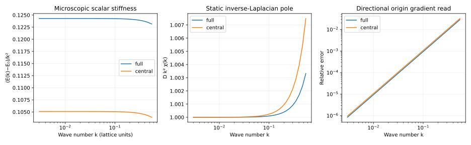

# Spectral gravity read — a microscopic scalar stiffness and polar response

> **Matter/charge extension:** [Eight-register vortex and charge research](MATTER_VORTEX_CHARGE.md) distinguishes retained matter from optical occupation, proves the bare chamber-charge conservation obstruction, and supplies conditional inward/outward response models. Full microscopic capture, charge and physical work coupling remain open.

[T] exact identities; [D] consequences of the specified model; [E] physical identification. This extends [Field Origin gravity read](FIELD_ORIGIN_GRAVITY_READ.md) and the [optical resonator](OPTICAL_FOUR_PORT_RESONATOR.md). No alteration of the full covariant SST action is proposed.

## 1. Two reads, one capacity [T]

For $c=(a,b)$, choose overall phase so $a$ is real and write $b=u+iv$. Then $P=2au$, $C=2u\times v$, $N=|a|^2+|b|^2$. Exactly,

$$P\cdot C=0,\qquad N^2-|P|^2-|C|^2=(a^2+|v|^2-|u|^2)^2+4(u\cdot v)^2.$$

This constrains the **origin** axial read, not every constituent ring current. Both reads can be nonzero and saturate the bound. It does not identify occupation with physical energy, nor the normalized origin read with the constitutive share. In particular, a pure circulating triplet can have no polar read.

### Four optical ports do not individually recover the full intensity read [T]

For positive parity signs $s\in A$, define $I_s=|a+s\cdot b|^2$, $Q=2\operatorname{Re}(b_y^*b_z,b_z^*b_x,b_x^*b_y)$. Then $I_s=N+s\cdot(P+Q)$ and $I_{-s}=N-s\cdot(P-Q)$. The separate parity intensity reads are $P+Q$ and $P-Q$, not both $P$. The exact opposed-pair difference $(I_s-I_{-s})/2=s\cdot P$ removes this quadrupolar alias. Thus four coherent amplitudes suffice to reconstruct $c$, but four raw intensities alone need not suffice for the unambiguous polar read. The entire dual tetrad has a role even when four external links transmit.

## 2. Bloch reduction of the actual microscopic model [D]

Use the existing 36-coordinate local Hamiltonian $H$, the actual tile maps $F_s$, and either full overlap $W$ or filtered central kernel $W_c$. Retain all 72 amplitudes of the two-site primitive cell. With dimensionless displacement $s$ and hopping $\kappa=1$, the Hermitian symbol is

$$M(k)=\begin{pmatrix}H&-\sum_{s\in A}e^{ik\cdot s} F_s W F_{-s}^T\\-\sum_{s\in A}e^{-ik\cdot s}F_{-s}W F_s^T&H\end{pmatrix},$$

with $W$ replaced by $W_c$ for the filtered model. At $k=0$ the numerical eigensystem has a simple lowest eigenvalue $E_0$ and real normalized vector $U$, with equal scalar origin components $\alpha>0$ and zero polar components on both sites. The label $\alpha$ here is a band coordinate, **not the fine-structure constant**. Let $R=(M(0)-E_0)^{+}$ on the orthogonal complement. Write $\partial_jM(0)=iQ_j$ where $Q_j$ is real skew-symmetric. In the local gauge $U^*U(k)>0$, first-order perturbation gives

$$U(k)=U+i\sum_j k_j V_j+O(|k|^2),\qquad V_j=-RQ_jU.$$

The curvature is $D_j=\tfrac12 U^T(\partial_j^2M)U-U^T Q_jV_j$. Td symmetry of a simple invariant scalar band forces the Hessian to be isotropic and the polar derivative to be a scalar multiple of the identity. The computed matrices verify both statements, including vanishing mixed Hessian. Time reversal gives even eigenvalue. In dimensionless lattice coordinates,

$$E(k)=E_0+D|k|^2+O(|k|^4),\quad U(k)_O=(\alpha,i\beta k)+O(|k|^2).$$

| kernel | E0 | gap at k=0 | alpha | beta | D |
|---|---:|---:|---:|---:|---:|
| full | -7.44232057 | 0.69880149 | 0.19673861 | 0.02462432 | 0.12429467 |
| filtered | -7.36307267 | 0.54975131 | 0.20102262 | 0.02253007 | 0.10509418 |

These coefficients are numerical consequences of the existing chosen hopping model. A 7³ wavevector sample found no lower band energy, but is not a global spectral-minimum certificate. The expansion is local near k=0. A lattice scale h restores physical wavenumber factors h and h²; the energy/time scale and physical cell normalization remain unspecified.

## 3. The polar read and static pole now share the same operator [D]

A smooth real scalar envelope $f$ on this isolated band has local origin $a=\alpha f+O(\partial^2 f)$, $b=\beta\nabla f+O(\partial^2 f)$ in lattice units. Thus

$$P=\alpha\beta\nabla(f^2)+\text{higher gradient terms}.$$

Equivalently the candidate gravitational read is a density gradient, not a phase gradient. A single traveling Bloch wave does not have this real gradient read. Its first-order directional amplitude is imaginary and the real scalar–polar product vanishes at leading order. With a real nonzero reference $f_0$ and small real perturbation $\delta f$, $P=2\alpha\beta f_0\nabla\delta f$ at leading order.

The shifted stationary response has scalar susceptibility

$$\chi(k)=U^T[M(k)-E_0 I]^{-1}U\sim\frac1{D|k|^2}.$$

The full matrix inverses at 105 nonzero wavevectors per kernel check this limit and the polar response. A real standing-wave response checks the gradient directly. The inverse Fourier transform of the continuum pole is the three-dimensional $1/(4\pi D r)$ Green function, so a localized positive source in this scalar channel yields an inward intensity-gradient read in the far field when a positive reference is present. Unlike the prior static model, D is calculated from the same microscopic Hamiltonian rather than chosen as a separate graph stiffness. The shift to the band edge is a co-rotating frequency choice; a physical mechanism for a static source in this frame is still needed. A scalar band edge is not by itself a gravitational mode or a Lorentz-covariant propagator. A finite detuning or a restoring gap in the selected response would change the long-range pole. The scalar reference is real and carries no bond currents; coexistence with a genuinely circulating stationary background must be established separately.

## 4. An explicit neutral work-coupling completion [E/D]

An illustrative additional premise is an energy for a real envelope f with boundary $f\to f_0>0$:

$$\mathcal E=\int[K|\nabla f|^2-\eta\rho(f^2-f_0^2)]\,d^3x.$$

Here K is the dimensionful continuum energy coefficient corresponding to D once physical units and state density are specified; eta is a positive mass-source coupling. Neither is assigned a physical value. The source term is phase-neutral in the complex-envelope extension. Variation gives $-K\Delta f=\eta\rho f$. If the same term defines work per unit test mass, $\Phi=-\eta(f^2-f_0^2)$, so $g=-\nabla\Phi=\eta\nabla f^2$. In lattice coordinates the proportionality to P also requires the length conversion. In the weak-source limit $f=f_0+\delta f$,

$$\Delta\Phi=\frac{2\eta^2 f_0^2}{K}\rho+O(\eta^2\rho\,\delta f,|\nabla\delta f|^2),\qquad G_{\rm eff}=\frac{\eta^2 f_0^2}{2\pi K}.$$

This is a conditional work-based response coefficient, **not a second independent gravitational constant**. It must match the inherited GFD tree-level normalization: $\eta^2 f_0^2/(2\pi K)=G^{(0)}_{\rm GFD}=(17/13)\alpha_{\rm EM}^{21}\hbar c/m_e^2$. Neither the equality nor the upstream proposed one-loop correction has yet been derived from this microscopic Hamiltonian. See [G normalization bridge](G_NORMALIZATION_BRIDGE.md). Imposing this match is calibration to the existing theory, not an independent prediction. Universal source/test coupling is assumed. On a bounded domain with fixed boundary the quadratic energy is stable for sufficiently weak sources (e.g. $\eta\|\rho\|_\infty<K\lambda_1$ for first Dirichlet Laplacian eigenvalue $\lambda_1$); strong sources can destabilize this toy model.

For a uniform sphere of radius R and density rho, set $q^2=\eta\rho/K$. Interior regular solution $A\sin(qr)/r$, exterior $f=f_0+B/r$. Continuity yields $B=f_0[\tan(qR)/q-R]$ and $A=f_0/[q\cos(qR)]$. For $qR\ll1$, $B\simeq\eta f_0 M/(4\pi K)$; for $0<qR<\pi/2$, B is positive. Exterior acceleration is inward with magnitude $2\eta B(f_0+B/r)/r^2$. A nonlinear $1/r^3$ correction and source-structure-dependent charge arise. These are features of this optional completion, **not predictions of GFD**. They expose a consistency test: do not assume this quadratic intensity work is the exact gravitational potential beyond linear order. The full equation is $\Delta\Phi=2\eta^2\rho f^2/K-2\eta|\nabla f|^2$. It is not AQUAL and does not derive the existing constitutive law or bound law. In particular the drainless GFD Newton/GR limit must not be silently replaced by this nonlinear toy.

## 5. Research gates

- Derive the physical scalar reference, source coupling and its universal energy normalization from the same stationary or slow manifold as the circulating vortices. Prove stability and causal dynamics, not just a static frequency response.
- Test the two interface choices: they give different dimensionless D and $2\alpha\beta/D$ (0.07795273 vs 0.08619038). Geometry has not fixed a unique universal gravitational strength. Do not equate these ratios with alpha_G, 17/13 or alpha^21.
- Test nonlinear settlement and drained/drainless selection, retaining every object's closure and single-valued ownership. A short-range finite analytic gapped reduction does not automatically give the nonanalytic deep-field AQUAL energy. Preserve the upstream G normalization and derive the matching identity in [G normalization bridge](G_NORMALIZATION_BRIDGE.md); keep the separate $a_0$ and nuclear binding premises explicit.
- Check source-driven real read integrability beyond the linear scalar sector; arbitrary microscopic P is not necessarily curl-free. Test actual force with matter and covariance. No physical 12/4/8 spatial neighbour result is added here.

## Reproduce

`OPENBLAS_NUM_THREADS=1 OMP_NUM_THREADS=1 python verify_spectral_read.py`.
[Log](spectral_read_verification_output.txt) · [coefficients](spectral_read_parameters.csv) · [response data](spectral_read_response.csv). 194 new passing assertions (including 11 uniform-sphere checks), prior 4,111 recorded assertions preserved, not rerun. No Lean or empirical validation, no remote repository write.

## Collective optical closure follow-up

See [G from a collective optical closure](G_CLOSURE_DERIVATION.md) for the conditional electromagnetic-reference normalization, primitive-volume stiffness derivation and the unresolved source-selection and stiffness assignments. This does not introduce another G.

**Continuation:** [Dynamic tetrad settlement](DYNAMIC_TETRAD_SETTLEMENT.md) tests this construction against the unchanged microscopic Hamiltonian, including central-first excitation, filtered observability, static slip and the remaining relativistic constraints.
