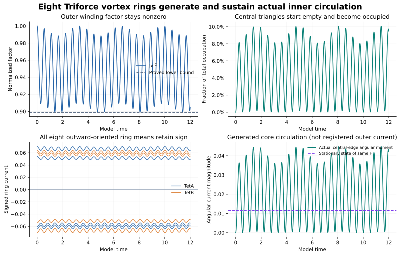

# Generation and sustained circulation of the eight-vortex Triforce flywheel

> **Integration update.** The [unified synthesis](UNIFIED_HADAMARD_FIELD_DYNAMICS.md) connects these local rings to a conservative network of complete cells. The new interface does not change the particular stationary or sustained solutions proved below.

*Field Dynamics Research · Stage VII · [T] exact finite algebra and conditional linear Hamiltonian theorems; [E] physical selection and nonlinear stability open.*

The eight constituent vortices, one per face of the central octahedron, are the eight stellations of the Hadamard null cone. This proof starts from their existing Triforce tiles and derives actual current between the eight central triangles. It does not prescribe a separate core oscillator. The input relative phases determine the collective chirality; it is not spontaneously generated from a real state. SST means only the full four-term covariant action, not the constitutive law.

Sources: [Triforce synthesis](https://github.com/fielddynamics/research/blob/main/research/faces/enterprise_triforce_synthesis.md), [Triforce vortex proof](https://github.com/fielddynamics/research/tree/main/research/diamond-tetrad-lattice/triforce-vortex), [consolidated vortex proof](https://github.com/fielddynamics/research/tree/main/proofs/vortices-of-the-stellated-octahedron), [Hadamard](https://github.com/fielddynamics/research/tree/main/proofs/hadamard-cube-frame), [Walsh eigenmodes](https://github.com/fielddynamics/research/tree/main/proofs/walsh-eigenmodes-of-the-cube), [llms.txt](https://github.com/fielddynamics/research/blob/main/llms.txt), and the preceding [row-column proof](archive/stages-I-VI/TRIFORCE_FLYWHEEL.md).

## 1. [T] Exact bond dictionary and collective phase coordinates

Let `s_i`, i=1,…,4, be the TetA cube corners, so Σs_i=0 and Σs_i s_iᵀ=4I. TetB corners are −s_i with the same indices. X⁺_ij, X⁻_ij (i≠j) denote the outer tiles at apex ±s_i on the original tetrahedron face opposite ±s_j; y⁺_i, y⁻_i are the central triangles at ±s_i/3. The centre is O. Thus the three entries of each row make one stellation, and the three entries of each column are the outer tiles of one original Triforce face.

The actual graph has 104 edges: 24 within the eight outer triangular rings, 12 cross-chamber outer transpose pairs X⁺_ij↔X⁻_ji, 24 outer-to-base edges X±_ij↔y±_i, 24 outer-to-original-face-centre edges X±_ij↔y∓_j, 12 central shared edges y⁺_i↔y⁻_j (i≠j), and 8 O-to-central edges. These include the direct outer cross-chamber edges of the published edge-sharing graph. No graph edges are removed.

Take a real symmetric, chamber-exchange-invariant Hamiltonian on this graph: the six respective edge weights are r,d,b,a,k,o; outer/central/centre site energies are e,e_c,e_0. This is a subclass of the Td-invariant Hamiltonians; no claim of physical equality of chamber parameters is made. In the inversion-even sector set X⁻=X⁺, y⁻=y⁺. Let q∈C⁴ satisfy Σq_i=0, with q_i=s_i·z for a unique z∈C³. Choose ||z||=1. Set ρ=√3/8. Consider

    X±_ij = ρ(u q_i + v q_j),       y±_i = ρ w q_i,       ψ_O=0.

The row and column sums are ρ(3u−v)q_i and ρ(3v−u)q_j. Thus the ansatz is exactly closed under the graph Hamiltonian. q is a collective phase coordinate of the outer tile pattern, not an independent core oscillator. In particular at (u,v,w)=(1/3,1,0), the row sums vanish and the column sums are (8ρ/3)q_j, so q and hence z are read directly from those tiles. The initial eight rings are genuine directed circulating cycles whenever all s·C≠0 (below). They are mixtures of the two local C3 winding modes in general, **not** eight exact single-helicity C3 eigenvectors. Requiring each triple of the four q_i to be equilateral would require four pairwise equidistant distinct points in the complex plane, which is impossible. This distinguishes local circulating cycles from exact single-helicity states. The earlier phase-locked pure E state is dark to the inner sites.

## 2. [T] The full 33-site Hamiltonian reduces exactly

Write x=(u,v,w)ᵀ. Directly summing the six types of edges gives

$$i\dot x=Mx,\quad M=\begin{pmatrix}e+2r&-r+d&b\\d&e-r&a\\3b-a&-b+3a&e_c-k\end{pmatrix}.$$

For example the y equation uses b times the row sum plus a times the opposite column sum, and k times the three opposite central neighbours (whose q sum is −q_i). The centre is dark because Σq_i=0. The matrix is self-adjoint in the positive metric G=[[3,−1,0],[−1,3,0],[0,0,1]]. If B is the 33×9 embedding without ρ, exact rational arithmetic verifies HB=B(M⊗I₃) and BᵀB=8(G⊗I₃). The norm is 8ρ² x†Gx, equal to one for the prescribed initial condition. The three-coordinate reduction therefore reproduces the entire full graph trajectory, not a fitted reduced dynamics.

## 3. [T] An explicit all-bond nonzero witness

Choose dimensionless model weights r=−1, d=−1/2, b=−2, a=−1, k=o=−1, e=e₀=0, e_c=−99/10. These are mathematical witness parameters; they are not derived physical constants or per-galaxy fits. They were chosen to make the stationary branch and detuned transfer analytically tractable. A general row-winding stationary branch with v=1 and u=1/3 requires w=−8d/[3(3b−a)] when 3b≠a and the central site energy can then be selected by the eigenvalue equation. Our choice gives w=−4/15. The reduced matrix becomes

$$M=\begin{pmatrix}-2&1/2&-2\\-1/2&1&-1\\-5&-1&-89/10\end{pmatrix}.$$

Its eigenvalues are λ₀=11/10, λ₋=−11/2−√22, λ₊=−11/2+√22. The full H−λ₀I has exact rank 30, so this is an isolated spatial triplet of the full graph. The stationary vector x*=(1/3,1,−4/15)ᵀ is verified exactly.

Starting at x(0)=(1/3,1,0), the closed form is x(t)=Σ x_ν exp(−iλ_νt), where

| ν | u coefficient | v coefficient | w coefficient |
|---|---:|---:|---:|
| 0 | 25/77 | 75/77 | −20/77 |
| − | 1/231+5√22/462 | 1/77+√22/462 | 10/77+5√22/231 |
| + | 1/231−5√22/462 | 1/77−√22/462 | 10/77−5√22/231 |

All v coefficients are positive, sum to 1, and the dominant one is 75/77. The w coefficients sum to zero and the two positive ones sum to 20/77. Hence for every t,

$$|v(t)|\ge 73/77,\qquad |u(t)-v(t)/3|\le 2\sqrt{22}/99.$$

If w(t)=0, equality in the complex triangle inequality requires both positive-frequency terms to have exactly the same phase as the negative coefficient term. This implies (λ₀−λ₋)t and (λ₀−λ₊)t both integer multiples of 2π. Their ratio `(33/5+√22)/(33/5−√22)` is irrational. Consequently w(t)≠0 at every finite t>0. At t=0, i ẇ=−8/3, so the inner occupation starts as `(8/3)t²+O(t⁴)` (inner norm is 3|w|²/8; real M and real initial coefficients imply even intensity). Recurrence permits w to get arbitrarily close to zero; no uniform positive inner-current lower bound or irreversible attractor is claimed.

## 4. [T] Actual ring currents and actual core currents in the same trajectory

Define C=−i conjugate(z)×z, a real chirality vector determined by the input q. Current convention is J_ij=2 Im(ψ_i H_ji conjugate(ψ_j)), positive i→j. Each ring is oriented outward about its own face normal s. Its mean of three directed edge currents is j_s. The three corresponding corner cross products sum to 4s, and common row shifts cancel in the cyclic current sum. For r=−1,

$$j_s(t)=\frac{|v(t)|^2}{16}\,s\cdot C.$$

This holds for all eight s∈{±1}³, including the inversion-related rings. Thus the ring mean never vanishes or reverses if s·C≠0. More strongly all **24 individual ring bonds** keep their directed cycle sense on an open set of input phases. At u=v/3 the row sum is zero, so each edge has exactly the mean j_s. At other times write m=u−v/3. The correction to the unnormalized Im product on an edge has magnitude at most |v||m||q_i||q_j−q_l|≤√24|v||m| for unit z. Its unshifted magnitude is (2/3)|v|²|s·C|. Therefore it suffices that

$$\min_s |s\cdot C| > \frac{3\sqrt{24}}2\frac{2\sqrt{22}/99}{73/77}\approx 0.734465.$$

This condition is satisfied by open sets of circular input orientations, not just exact coordinate axes. The verifier uses twelve non-axis orientations. All eight rings are physically circulating in this graph sense, from t=0 onward. They do not require that each local wave be a pure C3 eigenstate.

Now read only the 12 **actual** central-to-central bonds, oriented from y⁺_i to y⁻_j, i≠j. No projected outer-ring current is included:

$$I_{ij}=-k\rho^2|w|^2(s_i\times s_j)\cdot C.$$

Σ_{j≠i}I_ij=0 and Σ_{i≠j}I_ij=0 because Σs_i=0. The inner current alone is divergence-free on the central tile adjacency graph (a cube). Also Σ_{i≠j}(s_i×s_j)(s_i×s_j)ᵀ=32I, so it is nonzero iff w and C are nonzero. Its angular current moment is

$$\mathcal L_{\rm inner}=\sum_{i\ne j} I_{ij}(s_i/3\times(-s_j/3))=-\frac{|w|^2}{6}C.$$

The minus sign is the orientation of the core angular read for these weights and inversion parity, not a claim about TetB flow or reverse time. This supplies an actual circulating central current from the outer phases without specifying an axis for the core in the equations. The centre O remains dark, as for the original winding states. At t>0 all eight outer rings and the central cycle coexist, with no exact inner-current zeros in the witness. The result is stronger than a nonzero registered core cycle C1J, which by itself need not correspond to physical current on central bonds.

The exact time means of |v|² and |w|² are 50654/53361 and 6500/53361, respectively, because all cross-frequency terms average to zero. In particular, the mean inner occupation is `(3/8)(6500/53361)` and the mean angular current is nonzero. This is conservative persistence, not a dissipative steady flow or an axial drain.

## 5. [T] A stationary, stable simultaneous eight-ring/core state

In the same H, x*=(1/3,1,−4/15) rotates only by exp(−iλ₀t). Normalize it by multiplying by √(75/77) relative to the ρ above. Every outer row has zero sum. For any unit z with all s·C≠0, all 24 ring bonds have nonzero directed circulation and the inner angular current is nonzero. Inner occupation is exactly 2/77. These are simultaneous stationary cycles of the full graph; the inner amplitudes are not dark. This is an alternative initial state of the same Hamiltonian, **not** a claim that unitary evolution from the empty core converges to this stationary state.

Unrestricted linear orbital stability: if ψ* is the normalized stationary state and ψ(0)=ψ*+δ, then by unitarity

$$\|\psi(t)-e^{-i\lambda_0t}\psi_*\|=\|\delta\|$$

for all time. For normalized states each bond-current deviation is at most 4|H_ij|‖δ‖ (product difference and triangle inequality). A sufficiently small perturbation therefore retains all eight directed rings and a nonzero inner angular moment for all time. This statement holds for perturbations of all 33 complex amplitudes, not merely those in the reduced subspace. Exact rank isolation also implies continuous spectral projection under sufficiently small real Td-preserving graph perturbations; the isolated triplet remains degenerate by symmetry, and a nearby stationary state retains all these strict current inequalities. Ten perturbations of the original graph weights verify the latter numerically. The exact no-return claim for the initially empty core is specific to the witness spectrum; it is not an unconditional perturbation theorem.

## 6. Scope and remaining research

- [T] Geometry: one stellation vortex per face, eight in total; 24 lateral triangles, eight central triangles, one centre. All 104 graph bonds present in the witness.
- [T] The row/column algebra, exact restriction, spectral formula, nonvanishing currents, time means and stationary stability are mathematical results for the stipulated conservative linear model.
- [E] Why the physical Field Origin selects these coefficients, which initial phase configurations are occupied, and a nonlinear stability theorem for its actual nonlinear interaction are open. A real conservative graph cannot attract arbitrary initial states to one stationary vortex or produce chirality from a purely real stationary state. The counterexample in Stage VI shows eight pure phase-locked local vortices need not excite the core. No claim that the geometry alone forces a core current for every phase pattern.
- [E] No derivation of through-flow, TetB drainage, constitutive law, full SST, G or the spacetime continuum. All Field Objects close in GFD; drain status determines the interior law, not whether they register.

## Reproduce

`python verify_sustained_flywheel.py` reruns 984 original checks and performs 809 new assertions, including exact rational identities, exact algebraic eigenprojections, the full graph propagator at 120 time/orientation pairs, all 24 bond signs, actual central currents, full-coordinate perturbations and graph perturbations. The inherited count is not a count of independent mathematical theorems. Earlier stages' logs remain in the folder. `python generate_sustained_figure.py` regenerates the new figure. [Open the standalone closed-form dynamics explorer](sustained_explorer.html). The earlier HTML is preserved and links to the companion. No Lean compilation or GitHub writes performed.
