# The Hadamard Null Cone and Its Collective Vortex Flywheel

*Field Dynamics Research · consolidated illustrated proof · Python verified; Lean pending*

The complete two-stage mathematical argument is preserved below, with static figures placed at the corresponding results. The physical identification of the Hadamard cube with the null cone is the GFD premise; the algebraic identities and the conditional dynamical results are distinguished from that premise.

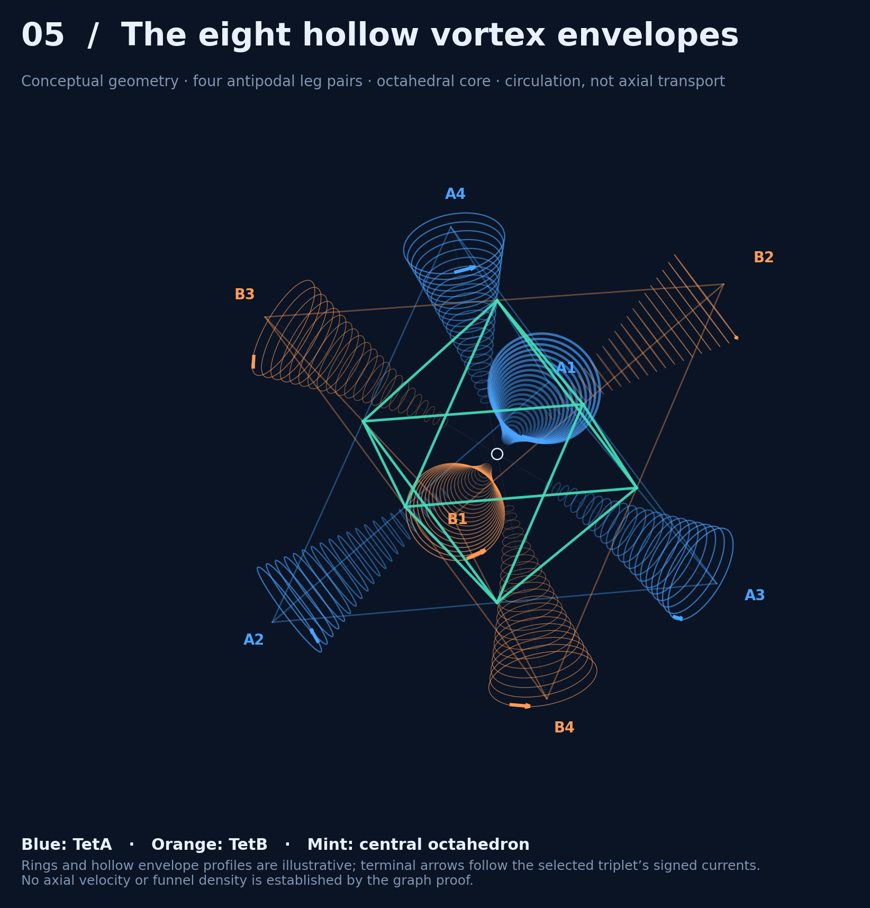

*Conceptual envelope illustration from the earlier vortex visual atlas. The eight stellations form one integrated geometry; the continuous envelope shapes are illustrative, and do not establish axial through-flow.*

## Sustained Triforce flywheel (stage VII) — 809 new checks

**All eight constituent vortex rings remain circulating as the initially empty central triangles develop a conserved circulating current.** This is an exact conditional result on a specified 33-site Hamiltonian with every graph bond present. A closed-form solution retains all 24 directed outer ring bonds for an open set of phases and has nonzero actual inner current for every finite positive time. The same graph also admits stationary eight-ring/core states stable to small unrestricted initial perturbations. The inner current can approach zero by recurrence; physical coefficient selection, nonlinear stability and irreversible settlement remain open. Local circulating rings need not be single-helicity C3 eigenstates.

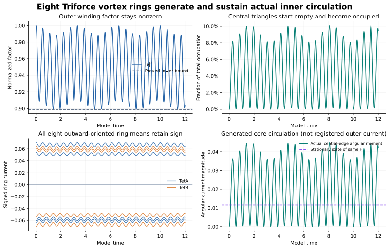

[New proof](SUSTAINED_TRIFORCE_FLYWHEEL.md) · [Interactive exact solution](sustained_explorer.html) · [Python](verify_sustained_flywheel.py) · [Actual log](sustained_verification_output.txt) · [Trajectory](sustained_dynamics.csv). 809 new checks and 984 inherited checks rerun; earlier logs retained (2,577 cumulative distinct assertions across stages, not independent theorems). SST names only the full covariant action.

## Face-first Triforce flywheel (stage VI) — 271 new checks

**Start with eight local three-tile winding states, one per octahedral face.** Each chamber’s twelve outer tiles can be indexed as a 4×4 off-diagonal array: rows are stellation rings and columns are original Triforce faces. The column-sum map on local winding amplitudes has an exact rank-three Gram identity. Across both chambers, the column read can excite the central tiles without imposing a core axis. A phase-locked E-sector state instead has eight pure stationary rings and a parity-cycle registration while the inner tiles stay dark. Both cases are necessary to distinguish registered circulation from actual inner excitation. Full nonlinear stability is open.

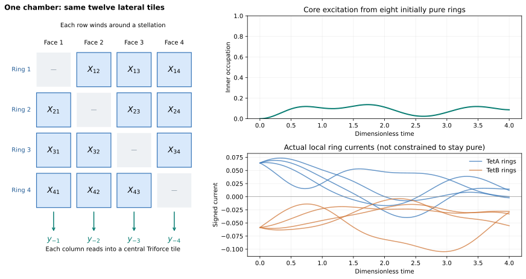

[Full new derivation](TRIFORCE_FLYWHEEL.md) · [Python tests](verify_triforce_flywheel.py) · [log](triforce_verification_output.txt) · [trajectory](triforce_dynamics.csv). The cumulative distinct check count is 1,768; 984 inherited checks were rerun here. The previous explorer is retained unchanged.

## Eight face vortices, one collective core — clarified and tested (stage V)

**The eight stellations are the flywheel, one vortex ring per triangular face of the octahedron.** The six axial orientations are alternative orientations of the central rotational response (three axes, two senses), not the number of vortices. The complete object is the Hadamard null cone. In 36 tested stationary Triforce states (six T₂ branches × six axial orientations), all eight outer ring currents are nonzero simultaneously and the registered core has a nonzero principal axial component. The complementary face-normal energy also has eight isolated circular minima, but those are alternative single-triplet orientations, not eight independent simultaneous minima.

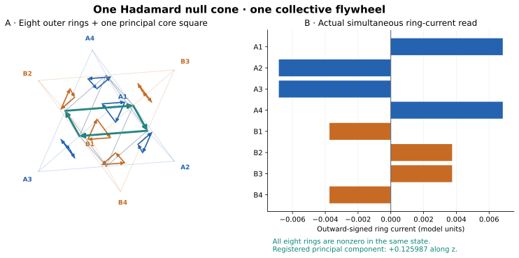

[Clarified mathematical proof](FACE_CORE_CLARIFICATION.md) · [132 new checks](verify_face_core_stability.py) · [actual log](face_core_verification_output.txt). The earlier 1,365-check results are preserved; 984 of those checks were rerun in this extension. The cumulative count is 1,497. Full nonlinear stability of the 33-tile state remains open.

## Core hardening (stage IV) — 1,365 passing checks

[New mathematical proof and dependency audit](CORE_HARDENING.md) · [Python verification](verify_core_hardening.py) · [actual output](core_hardening_output.txt) · [Lean draft status](LEAN_DRAFT.md).

The Hodge–Dirac operator has an exact spectrum; the 24 nonzero modes are **not** the regular torsion representation, but the parity cycle maps to its unique sign sector up to normalization. Uniform spin holonomy has its own gauge-covariant spectrum. A candidate positive quartic energy gives six alternative stable axial core orientations, including a conditional lift to the collective three-triplet flywheel; these are not six outer vortices. See stage V for the complementary face-normal energy and simultaneous eight-ring tests. The earlier registration is uniquely reconstructed from specified Whitney routes and a centre norm principle, not from symmetry and conservation alone. All 170 new checks and the 1,195 inherited checks pass. The physical Hamiltonian, drain and continuum bridges remain open.

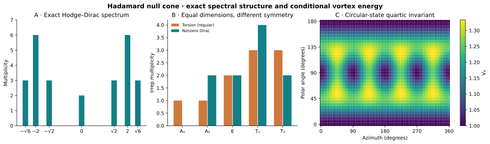

Run `python verify_core_hardening.py` (reruns all stages); regenerate with `python generate_core_figure.py`. The interactive explorer now explicitly distinguishes the eight face rings from the six possible core orientations.

## Extended validation (stage III)

[Read the extended mathematical validation](EXTENDED_VALIDATION.md) · [Python suite](verify_extended_validation.py) · [Actual output: 211 new checks, 984 inherited checks rerun](extended_verification_output.txt).

The extension includes exact current reconstruction, the conserved spatial Gram matrix, a 16-dimensional registration ambiguity, hidden-mode memory, an invariant polynomial basis through degree six for one and two spatial triplets, and explicit tests of the limits of constitutive-law and lattice claims. **1195 checks pass in total.** SST refers only to the full four-term covariant action, per [`llms.txt`](https://github.com/fielddynamics/research/blob/main/llms.txt).

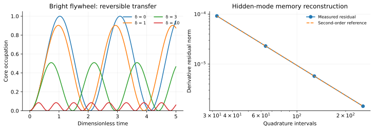

## Explore and reproduce

- [Open the standalone interactive HTML explorer](explorer.html). For interaction, download and open it in a browser or serve it through GitHub Pages / the GFD docs site. GitHub's normal source view does not execute its JavaScript.
- [Initial Python verification](verify_hadamard_null_cone.py) · [501-check log](verification_stage1.txt)
- [Continuation Python verification](verify_current_closure.py) · [combined log: 501 earlier + 483 new checks](verification_output.txt)
- [Static SVG figure generator](generate_figures.py) · [HTML browser checks](browser_verification.txt)

```bash
python -m pip install numpy scipy sympy matplotlib
python verify_current_closure.py
python verify_extended_validation.py
python generate_figures.py
python generate_extended_figure.py
```

The two inherited figures (PNG) were copied from the earlier GFD vortex visual atlas; the five new SVGs can be regenerated with the included script. The HTML is self-contained (no CDN dependencies). Its displayed cycle currents use the same integer incidence formulas as the Python proof. The resonant curves and detuning bounds are distinct calculations. The archive retains 984 passing checks across the two original stages, not 984 independent theorems. The presentation files do not supply a new physical derivation or Lean certificate.

---

## Part I — The Hadamard Null Cone and the Stellated-Octahedral Vortex Flywheel

*Gravity Field Dynamics — proposed companion proof. Python-first verification, November 2026. Status: exact finite geometry and current identities, conditional Hamiltonian results, numerical checks of the detailed Triforce model. Lean formalization deferred.*

### Statement in brief

Take the Hadamard cube as GFD's local null-cone object, with its two parity chambers. The eight stellations are the eight pyramids on the triangular faces of its polar octahedron. In the existing Triforce graph their lateral faces are exactly the 24 outer tiles, three per stellation. The octahedron is not a separate vortex assembly inserted into the null cone. Its face, edge and vertex incidences are determined by that same cube.

The new result is an oriented boundary read from eight faces to twelve core edges. Its Gram operator is exactly the cube Laplacian whose eigenmodes were proved in the Walsh paper. The unsigned vertex read has rank four, whereas the oriented current read has rank seven. Three of the seven core cycle modes are the three square rings of the octahedron. Eliminating the outer amplitudes in the existing 15-site Hamiltonian reproduces the actual conserved core current as an oriented eight-face sum. The detailed 33-tile graph has a corresponding collective chirality read on each isolated spatial triplet, with an additional chamber-difference cycle sector.

This is a theorem about the finite GFD geometry and stated Hamiltonians. It does not prove that physical light cones are discrete, that the field occupies a particular vortex, or that the model supplies the full gravitational action.

### 1. Setting: the two established proofs

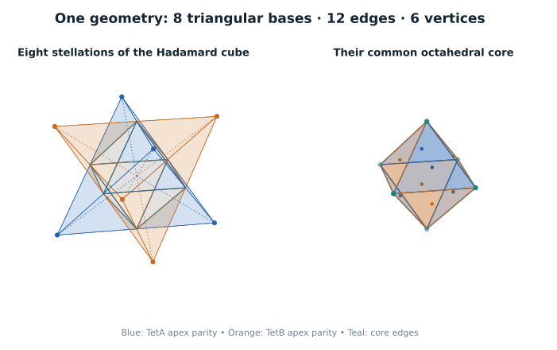

*The eight stellations and their common octahedral core. Colours identify apex parity.*


Let `S = {±1}³`, with parity `p(s)=s_x s_y s_z`. The two parity classes are TetA and TetB, each a regular tetrahedron. For the four TetA columns of M, `M^T M=4I-J`, `M 1=0`, `M M^T=4I`. In the prescribed even/odd ordering the Walsh transform is `H8=H2⊗H4` (Hadamard proof, Theorems 1–3). The angular directions of GFD's null-cone model have future null lifts `ell_s=(1,s/√3)`. For signature (-,+,+,+), `eta(ell_s,ell_t)=-2 d_H(s,t)/3`. This establishes nullness and their Gram relation; the identification of this object with the physical null cone is the framework premise, not an inference that ordinary Lorentzian light cones have only eight rays.

The octahedron `O={r: |r_x|+|r_y|+|r_z|≤1}` is the polar of the cube, with vertices `V={±e_x,±e_y,±e_z}`. Its face indexed by s has vertices `s_i e_i`, outward normal `s/√3`, and apex s of the corresponding stellation. Every pyramid has volume 1/3 in these units. The three lateral triangles are `{s,s_i e_i,s_j e_j}`, i<j. In the formal Triforce graph these are the three outer tiles incident to s. The base is the central tile in the opposite tetrahedron. This explains exactly why the eight outer rings and core are one geometry.

The Walsh eigenmode proof gives `2A1 ⊕ 2T2` on the corners, `4A1 ⊕ E ⊕ 3T2` on the 15 sites. A real tetrahedrally invariant Hamiltonian acts on the three spatial copies as a real symmetric multiplicity matrix tensored with I3. Its rotational states are complex combinations of standing waves. This paper uses those results and supplies a new oriented current read.

### 2. Theorem 1: the oriented core read is the Walsh Laplacian

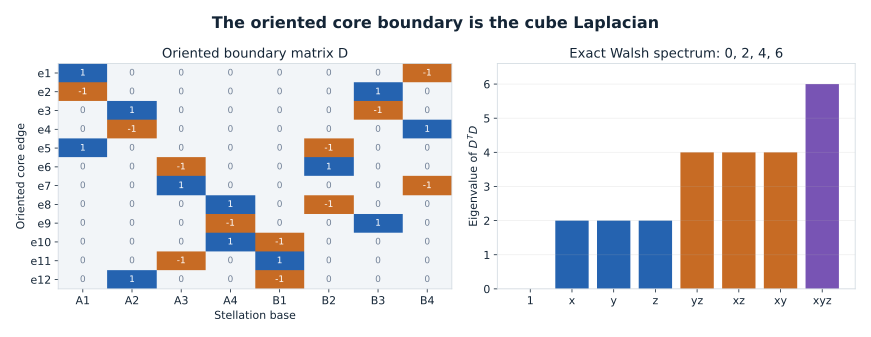

*The exact oriented incidence matrix and its Walsh spectrum.*


Orient every octahedral triangular face outward. Choose an arbitrary orientation u→v for each of the twelve edges. Define:

- B (6×8), unsigned vertex-face incidence: `B[u,s]=1` when u belongs to face s, otherwise 0.
- D (12×8), oriented edge-face incidence: `D[e,s]=(u×v)·s` if both u and v belong to s, otherwise 0. The value is ±1 on incident faces.
- L (6×12), edge-to-vertex boundary: column e has -1 at u and +1 at v.
- A_cube, adjacency of the cube whose vertices are s; two are adjacent if they differ in one sign.

Then

$$ LD=0,\qquad D\mathbf 1=0,\qquad D^TD=3I-A_{\rm cube}. $$

**Proof.** The oriented boundary of each triangle is a closed cycle, so LD=0. Every edge belongs to two outward faces with opposite boundary orientations, so D1=0. Each face has three edges, giving diagonal Gram entry 3. Two different faces share an edge precisely when their sign labels differ in one coordinate; the edge signs are opposite, giving -1. Otherwise they share no edge and the entry is zero. ∎

The eigenmode proof gives `A_cube w_S=(3-2|S|)w_S`, so

$$ D^TD w_S=2|S|w_S. $$

The spectrum is `0,2,2,2,4,4,4,6`. The rank is seven, kernel is the constant face coefficient, and image equals the space of divergence-free edge currents: the connected core graph has 6 vertices and 12 edges, hence its incidence L has rank 5 and `dim ker L=7`. Every conserved core current has exactly one zero-mean face ledger. This is an exact finite analogue of representing divergence-free currents by a circulation potential, not a claim about matter flow through a drain.

In contrast, `B^TB` has Walsh eigenvalues `12,4,4,4,0,0,0,0`. Indeed `B_(i,σ),s=(1+σ s_i)/2`, so `B^TB=(3J+SS^T)/2`, with S here the 8×3 sign matrix. Thus B reads only grades 0 and 1. The oriented current read preserves grades 1,2,3 and is blind only to the constant. The two reads have trivial common kernel. Combined, they reconstruct all eight coefficients, if the same underlying face ledger is the input. That last if matters: physical amplitudes and physical circulation coefficients are different observables, not automatically one ledger.

#### Orientation convention

For a signed coordinate permutation R preserving parity, let P act on face labels and T act on oriented edges (including the sign if an edge orientation reverses). Then `T D = det(R) D P`. A signed circulation about an outward face is a pseudoscalar; the det factor cannot be dropped. The tests check all 24 group elements.

### 3. Theorem 2: the octahedral square rings are collective face circulations

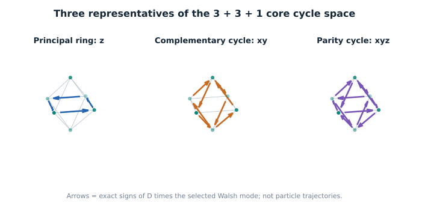

*Representative exact core cycle patterns, calculated as D times Walsh coefficients.*


Let K be the 12×3 matrix with row `K_e=u×v` for edge u→v. Then

$$ DS=2K,\qquad K^TK=4I_3. $$

**Proof.** The two faces adjoining edge u→v have sign vectors s+, s- differing only along the unused axis. The face whose boundary agrees with u→v has s+−s-=2(u×v). Thus row e of DS is 2(u×v). Each column of K is an oriented square ring, with four entries ±1, and the three rings have disjoint edge supports. ∎

In particular, for the indicator of the hemisphere `s_i=+1`, `D 1_(s_i=+1)=K_i`. Four outward-oriented triangular faces give one square ring. Internal shared edges cancel; the outer square remains. For any axial circulation vector C, `D(S C)=2K C`.

This is the exact geometrical flywheel identity. The eight face loops are not eight independent degrees of freedom: a common spatial triplet gives their signed weights. The constant face loop is redundant. Grade 2 gives three further cycles orthogonal to the square rings, and grade 3 gives one more. The 3+3+1 splitting is complete because the Gram eigenvalues are positive on those grades.

### 4. Theorem 3: the 15-site flywheel Hamiltonian produces that current

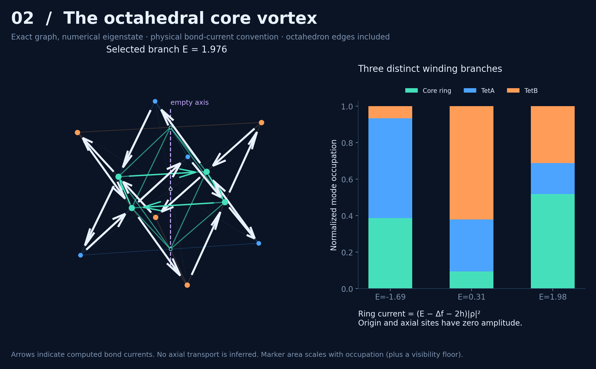

*Prior 15-site eigenstate rendering from the vortex visual atlas; arrows show model bond currents, not a demonstrated physical spacetime flow.*


Use the graph of the formal vortex proof, including its octahedron edges and excluding direct corner-corner bonds. On-site values on core, A and B are Δ_f, ε_A, ε_B; core edge hopping is -h and apex-to-core hopping is -c_A or -c_B. The scalar centre couplings vanish on the spatial triplets. Define isometric spatial embeddings `U=V/√2`, `U_A=S_A/2`, `U_B=S_B/2` (rows of the respective sign matrices). From incidence, `U^T B_A U_A=U^T B_B U_B=√2 I`. Octahedron adjacency annihilates U. The exact spatial restriction is

```
M = [[Δ_f, -√2 c_A, -√2 c_B],
     [-√2 c_A, ε_A, 0],
     [-√2 c_B, 0, ε_B]] ⊗ I3.
```

It is the same collective block as the formal vortex proof up to a phase basis. Its three eigenbranches are spatial triplets. Let E be an eigenvalue different from ε_A,ε_B, and let ψ be a stationary state in this sector. The core-centre amplitude vanishes. The outer apex amplitude is

$$ \psi_s=-\frac{c_s}{E-\epsilon_s}\sum_{u\in s}\psi_u. $$

Eliminating s induces a real hopping `k_s=c_s²/(E-ε_s)` between the three vertices of face s, with an accompanying diagonal shift. Every core edge has one A face and one B face. Its total effective hopping is therefore

$$ k(E)=-h+\frac{c_A^2}{E-\epsilon_A}+\frac{c_B^2}{E-\epsilon_B}. $$

This elimination conserves the incident physical current, not just the eigenvalue. With `J_(i→j)=2 Im(conj(ψ_j) H_ji ψ_i)`, the induced pair currents for face s are `J^s_(u→v)=2 k_s Im(conj(ψ_v) ψ_u)`. Summing over v in that face gives exactly the original bond current J_(u→s), by the apex equation above. Consequently the resulting current on the core is divergence-free. This does not preserve every internal bond as a separate output; it preserves its contributions at the retained vertices.

Write the core state as `ψ_u=u·z/√2`, `C=-i conj(z)×z` (real axial vector). For real u,v,

$$ J_{u\to v}=k(E)\,\mathrm{Im}[(v\cdot z)^*(u\cdot z)]=-\frac{k(E)}2(u\times v)\cdot C. $$

Using Theorem 2 gives the main new current identity:

$$ \boxed{J_{\rm core}=-\frac{k(E)}4 D S C.} $$

The actual reduced physical current is precisely the signed face circulation of the unique zero-mean coefficients `-k(E) S C/4`. These coefficients are an effective current ledger, not the individual bond currents of the 33-tile graph. They are derived from the stated 15-site Hamiltonian, not assigned to match a picture.

For the circular mode with phase -i on successive vertices of the positive square ring and per-vertex amplitude ρ, the oriented current is `2 k(E)|ρ|²`. The secular equation `E-Δ_f=2c_A²/(E-ε_A)+2c_B²/(E-ε_B)` yields `I=(E-Δ_f-2h)|ρ|²`, the physical current formula of the formal vortex proof. The sign reverses under complex conjugation. A real mode has zero current. The statement is restricted to nonresonant energies; the dark branch at ε_A=ε_B is handled separately by its zero core amplitude, not by dividing by zero.

#### Dynamical flywheel corollary

The core equation is `i dot r=Δ_f r+a p+b q` with real `a=-√2 c_A, b=-√2 c_B`. At exact common resonance, the normalized bright outer mode `(a p+b q)/√(a²+b²)` exchanges occupation sinusoidally with the core. The orthogonal dark mode cannot directly excite it and stays dark when the two outer energies are equal. The calculation demonstrates that excitation can move from the stellations to the core; it does not produce energy or select a stationary chirality. Tests check full resonant transfer, darkness and unitary norm conservation.

### 5. Theorem 4: the Triforce current read and the hidden cycle sector

Use the detailed graph of the vortex proof: 33 sites (24 lateral tiles, 8 central tiles and centre), 104 bonds. On each isolated real T2 eigenbranch select an equivariant isometric basis; write its complex state as z in C³. Its three coordinates transform as a polar vector. For each stellation, define j_s as the mean signed physical bond current around its three outer tiles, oriented about the outward axis s. This is a pseudoscalar under improper transformations.

**Proof of the form of j.** The bond current is a quadratic form in z, vanishing on real z and changing sign under conjugation. In a real triplet basis its matrix is imaginary antisymmetric, and every such form is linear in `C=-i conj(z)×z`. The stabilizer of s includes the 120° rotation about s. An axial vector coefficient invariant under this proper rotation must be parallel to s. T_d transports s within each chamber, leaving one coefficient per chamber, with the determinant sign accounted for by the outward current convention. Thus

$$ j_s=\kappa_A(s\cdot C)\quad(s\in A),\qquad j_s=\kappa_B(s\cdot C)\quad(s\in B). $$

The two coefficients depend on the graph, branch, and coupling parameters; no universal ratio is claimed. The tetrahedral balance gives `sum_A j=sum_B j=0`. The four signed currents in one chamber reconstruct C if its κ is nonzero: `C=(4 κ)^{-1} sum_s s j_s` using the unnormalized sign vectors.

Let `κ_+=(κ_A+κ_B)/2`, `κ_-=(κ_A-κ_B)/2`. Applying the same oriented geometric aggregation gives

$$ D j=2\kappa_+ K C+\kappa_- D\,\mathrm{diag}(p) S C. $$

Since pS is exactly the three complementary grade-2 Walsh modes, the second term is orthogonal to the square-ring subspace. The square-ring read `K^T D j/4` is `2κ_+ C`. If the two chamber strengths differ, a second three-dimensional cycle pattern remains. This is a natural target for improving the 15-site reduction.

**Scope.** The formula for the physical Triforce ring currents follows by symmetry on an isolated T2 triplet, and is tested on all six triplets of one generic Hamiltonian. D j is their canonical geometric boundary aggregation, not an asserted equality with a physical 15-site effective current. Such equality requires a dynamical coarse-graining that maps the actual current observables, including hidden sectors. Accidental degeneracy between triplets or superpositions of distinct energies need a larger multiplicity-space current description. The other winding sector W in the formal Triforce proof is not covered by this statement.

### 6. Nonlinear scalar accounting: a bridge to investigate

The eigenmode proof establishes that the linear μ read is blind to T2. The square of a real signed current pattern is not. For `j_s=s·a+p(s)s·b`, the Walsh scalar and chamber-sign coefficients of j² are exactly

$$ c_1(j^2)=|a|^2+|b|^2,\qquad c_{xyz}(j^2)=2a\cdot b. $$

The proof is the orthogonality of the sign columns and cancellation of odd parity averages. The two chamber averages are `|a+b|²` and `|a-b|²`. This gives an invariant quadratic read of common circulation and chamber interference, consistent with the existing separation of linear scalar and spatial sectors. It is not a derivation of μ or a proof that GFD's physical scalar field measures squared currents. The next task is to derive a nonlinear scalar coupling that fixes that measurement and reproduces the existing linear partition `g_s=μ g_t` and the full SST action. A conserved circulation is not itself a net drain.

### 7. Verification and what comes next

Run `python verify_hadamard_null_cone.py` with Python 3, NumPy, SciPy and SymPy. The script constructs the geometries independently, checks exact integer and symbolic identities, and verifies model dynamics using floating-point arithmetic. `verification_output.txt` records 501/501 passing checks, including repeated parameter cases and symmetry elements; these are not 501 independent theorems. For the core identity, the worst residual across 12 parameter sets × 3 eigenbranches was 1.110e-16. For the Triforce chirality identity, across all six branches × 4 random polarizations in one generic model, it was 2.290e-16. Parameters are illustrative model units, not observational fits.

The next Lean package should formalize Theorems 1–2 first (integer incidence matrices, ranks, Walsh diagonalization), then the symbolic algebra of Theorem 3 with explicit nonresonance and Hermitian-current assumptions, and the representation argument in Theorem 4. This package does not contain a Lean proof yet; no repository change or independent rerun of the original proof suites has been performed. No new SPARC fit, derivation of G, causal propagation law, or SST derivation is claimed.

### Source proofs

- [The Stellated Octahedron, the Cube and the Hadamard Matrix](https://github.com/fielddynamics/research/tree/main/proofs/hadamard-cube-frame)
- [The Walsh Eigenmodes of the Cube, and What Field Closure Reads](https://github.com/fielddynamics/research/tree/main/proofs/walsh-eigenmodes-of-the-cube)
- [Vortices of the Stellated Octahedron](https://github.com/fielddynamics/research/tree/main/proofs/vortices-of-the-stellated-octahedron)
- [The Coupling Algebra](https://github.com/fielddynamics/research/tree/main/research/coupling-algebra)
- [Consolidated Vortex Theorem](https://github.com/fielddynamics/research/tree/main/research/diamond-tetrad-lattice/vortex-theorem)


---

## Part II — Conservative Current Registration and Nonlinear Core Harmonics

*Field Dynamics Research — continuation of the Hadamard null-cone vortex flywheel proof. Research draft, Python verified. The earlier proof's 501 checks are rerun; 483 new checks pass. No Lean certification or physical parameter derivation is claimed.*

### Abstract

Take the Hadamard cube as the GFD null-cone object, with the eight stellations constituting its flywheel and their common octahedron its core. The prior proof established the oriented core-face boundary `D`, with `D^T D = 3I - A_cube`, the seven-dimensional core cycle space, and the physical T2 current of the 15-site model. We extend this to the 33-tile Triforce Hamiltonian by constructing an exact rational, tetrahedrally equivariant chain map from fine sites and bonds to core sites and edges. The map commutes with divergence, and the eight oriented outer ring cycles map to one quarter of their triangular base boundaries. The complete mapped current differs from the ring-only expression. The core cycle space carries `2T1 + A2`. No coherent superposition of T2 triplets can generate its A2 component under a real symmetry-invariant linear Hamiltonian and equivariant current read. In contrast, a chiral E doublet gives a pure A2 current; an explicit eigenstate of the original 15-site model realizes it. The pointwise square of the odd core triplet supplies a symmetry-compatible E harmonic. A conservative quadratic interaction converts leg winding into a circulating E harmonic, while axial winding produces a standing E harmonic. Exact resonant solutions and off-resonant bounds distinguish availability of the mechanism from physical selection. The constitutive partition remains an independent scalar read unless nonlinear settlement selects it.

### 1. Starting point and conventions

The source proofs are the [Hadamard cube](https://github.com/fielddynamics/research/tree/main/proofs/hadamard-cube-frame), [Walsh eigenmodes](https://github.com/fielddynamics/research/tree/main/proofs/walsh-eigenmodes-of-the-cube), [vortex theorem](https://github.com/fielddynamics/research/tree/main/proofs/vortices-of-the-stellated-octahedron), and the earlier `verify_hadamard_null_cone.py` (included). The latter is rerun before the new tests. No new claim that the finite physical null cone follows uniquely from conventional Lorentzian geometry is needed: GFD's null-cone identification is the starting physical premise. The following results concern the specified geometries and Hamiltonians.

Write `s=(±1,±1,±1)`, `p(s)=s_x s_y s_z`, and `S` for the eight-by-three sign matrix. The core has vertices `±e_i`, oriented edges `u→v` between orthogonal unit vertices, incidence `L`, and outward-oriented face boundary `D`. Its cube Walsh columns are `1, x,y,z,yz,xz,xy,xyz`. The earlier exact results are `LD=0`, `D1=0`, `D^TD=3I-A_cube`, `rank D=7`, and `DS=2K` with `K_(uv)=u×v`. Physical current in a real symmetric Hamiltonian is `J_(i→j)=2 Im(ψ_i H_ji conj(ψ_j))`, so `d|ψ|²/dt=LJ` with incidence -1 at source and +1 at target. This convention matches the corrected formal vortex proof.

### 2. Theorem: conservative current registration from the Triforce

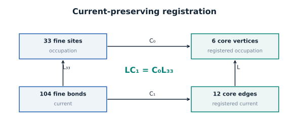

*The exact rational current-registration chain map.*


Construct `C0` (6 × 33) on the 33-tile graph. An outer tile has an apex and two core vertices; map it to equal weights on those two vertices. A central tile maps to equal weights on its three core vertices. The centre maps to uniform weight on all six. Each column sums to one. This is a specified geometric coarse-graining, not a uniqueness theorem.

For two probability columns a,b supported together in a single triangular face, define an edge flow `F(a,b)_(uv)=a_u b_v-a_v b_u`. Summing incidence at each vertex gives `LF(a,b)=b-a`. For adjacent central faces with an antipodal pair in the union, route via the midpoint m of their common edge, using `F(a,m)+F(m,b)`. For a centre-to-central bond use `L^+(b-a)`, the minimum Euclidean norm flow, where `L^+=L^T(LL^T+11^T/6)^(-1)` on zero-sum vectors. These rules exhaust the 104 fine bonds: 84 single-face routes, 12 shared-edge routes, 8 centre routes. They are rational and symmetry equivariant.

The edge map C1 has these flows as columns. Thus, by construction,

    L C1 = C0 L33.

For arbitrary fine evolution obeying continuity, `ρ_core=C0|ψ|²`, `J_core=C1 J_fine` obey `dot ρ_core=L J_core`. For every stationary fine state, the mapped current is divergence free. This is stronger than fitting a coarse eigenvalue: continuity is preserved for coherent superpositions as well. It does not assert that a 6-site Hamiltonian yields that current from its own amplitudes. One can add any divergence-free flow to a routing column without changing continuity, so the chosen routing is a modelling decision. It is local on noncentral bonds and symmetric at the centre.

#### Corollary: the triangular flywheel cycles

Let R be the 104 × 8 matrix of oriented outer ring cycles, one loop per stellation. Each loop lies on the three lateral tile centroids; under C0 these become the three base-edge midpoints. Their three wedge flows sum to exactly `D_s/4`, because the midpoint triangle has one quarter the oriented area and the directed flow is a multiple of the triangle boundary. Direct substitution of the three midpoint distributions proves this without an area argument. Hence

    L33 R = 0,     C1 R = D/4.

The eight fine rings therefore span all seven core cycle directions under this map. A uniform face coefficient is redundant. For arbitrary fine current J, the projection onto the disjoint fine rings has coefficients `j=R^T J/3`; its pushforward is `D j/4`. But the full registered current is `C1 J = D j/4 + C1 (J-Rj)`. The second term matters: other bonds and nonuniform ring-bond currents are not captured by ring means. The full mapped current need not equal the original 15-site Schur current. This distinction is essential.

### 3. Theorem: the complete core current has two axial triplets and a parity singlet

Let `W` be the Walsh matrix (columns). The nonconstant columns of `DW` form an orthogonal cycle basis, with squared norms `16,16,16,32,32,32,48`. They decompose into:

- `DS`: three square-ring cycles (T1, axial).
- `D diag(p) S`: three complementary cycles (T1, axial).
- `Dp`: one parity-dependent alternating face cycle (A2, pseudoscalar).

The reason for the determinant twist is that a reflection reverses outward face orientation. The scalar cube representations A1 and T2 therefore become A2 and T1 in the oriented boundary read. The constant mode is killed by D. These cycles are topological current patterns, not seven independent linear Hamiltonian frequencies. The exact cycle projector is `I-L^+L`.

#### Selection rule for all coherent T2 flywheel states

For a real symmetric Hamiltonian H and complex state ψ, the current operator is bilinear in Re ψ and Im ψ and antisymmetric between them. On `m T2 = U⊗V`, where V is the real polar triplet and U is multiplicity space, the possible time-odd forms are contained in

    Λ²(U⊗V) = (Sym² U ⊗ Λ² V) ⊕ (Λ² U ⊗ Sym² V).

For Td, `Λ²V=T1` and `Sym²V=A1+E+T2`. No A2 appears. Thus a symmetry-equivariant mapped current, after projection to cycles if needed, has exactly zero parity-cycle component for ANY coherent superposition of T2 branches, stationary or otherwise. The two T1 reads can be different for mixed branches; on one isolated triplet both are proportional to `C=-i conj(z)×z`. This is an exact representation statement, not an inference from random sampling.

The linear Hamiltonian on the full T2 multiplicity space is `M⊗I3`. With Z an m×3 matrix of spatial amplitudes, `i dot Z=M Z`. Its shared density `Z†Z` is conserved, even for time-dependent Hermitian M(t). Consequently the sum of local chirality vectors is conserved. The outer flywheel can transfer chirality and occupation into the core, but cannot generate total chirality from nothing in this linear model. The detailed Triforce has m=6, the 15-site model m=3.

#### Validation

Ten generic Td-invariant Triforce Hamiltonians were generated, with six isolated T2 eigenbranches each. The tests include full fine current, coarse current, arbitrary coherent branch superpositions, and both E eigen-doublets per Hamiltonian. The maximum coarse continuity residual was 6.25e-17. The largest forbidden T2 parity residual was 2.82e-17. The complementary cycle is physically nonzero in this routing, with maximum norm 0.04015; the maximum full-current difference from mapped outer ring means is 0.24130 (arbitrary normalized model units). These are counterexamples to a universal ring-only reduction. The full sample of stationary mapped currents spans all seven cycles; this is numerical existence in the tested graphs, not a generic rank theorem for all parameter choices.

### 4. Theorem: the parity cycle is an actual stationary state of the original core Hamiltonian

The previous +/-i axial winding analysis misses the E representation of the six core vertices. Consider a normalized trace-free vector e=(e_x,e_y,e_z) and core amplitudes `ψ_(±i)=e_i/√2`. Apex and centre amplitudes are zero. Every triangular base sums to zero, so it drives no apex. The core centre also receives zero. Each core vertex connects to both signs of the other two axes; the octahedron-edge hopping is -h. Thus the full Hamiltonian gives the exact energy `Δ_f+2h` on this E doublet, independent of the outer resonances. The state is supported on the core, not independently energized by the outer T2 sector in the linear system.

Take ω=exp(2πi/3) and `e=(1,ω,ω²)/√3`. For any oriented edge with axes i,j, physical current is `-h Im(e_i conj(e_j))`. It is +h√3/6 for the cyclic axis pairs x→y, y→z, z→x, and the negative for reversed pairs, regardless of antipodal signs. Also `(Dp)_(uv)=2 ε_ijk`, where k is the unused axis. Therefore

    J_E = (h √3/12) D p.

This is a pure A2 cycle: nonzero for h≠0, locally conserved, with `K^T J_E=0`. Its conjugate reverses all currents. It does not have a net axial angular-momentum read, but is an internally circulating state. It is not a drain. It also explains why the 33-tile E doublets can access the seventh cycle (`Λ²E=A2`); the observed maximum A2 current norm was 0.12261 under the chosen map. The previous T2 result and this E result give distinct, exact dynamical sectors of one null-cone object.

### 5. Theorem: quadratic harmonic conversion distinguishes leg and axial winding

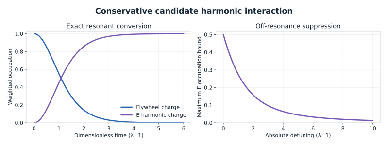

*The exact resonant conversion solution and the independent detuning bound, for leg winding and λ=1.*


The E sector need not be introduced as independent external geometry. On core vertices the odd T2 amplitude is `ψ_(±i)=± z_i/√2`. Its pointwise square is even, with both signs equal to `z_i²/2`. Reading the even core subspace gives `z_i²/√2`. Removing its trace (A1) leaves the E projection

    Q_E(z) = P0 (z⊙z),    P0=I-11^T/3,

up to a fixed normalization factor absorbed into the coupling. This is the actual pointwise multiplication operation in the core geometry. The signed spatial permutation R on z induces its unsigned permutation |R| on E; `Q_E(Rz)=|R|Q_E(z)`. This is exactly the E part of `Sym²T2=A1+E+T2`.

One admissible conservative Hamiltonian in the rotating frame is

    H_int = δ |e|² + λ[e† Q_E(z) + Q_E(z)† e],

with e in the trace-free subspace, δ the detuning from twice the input frequency. The Hamiltonian is invariant under Td and `z→e^{iθ}z, e→e^{2iθ}e`. It gives `i dot z=2λ conj(z)⊙e`, `i dot e=δe+λ Q_E(z)` and conserves `N=|z|²+2|e|²` and H. This is a new candidate nonlinear term, not derived as the unique physical coupling of GFD. The factor of 2 is needed for reciprocal backreaction and charge conservation.

For leg winding `d=(1,ω,ω²)/√3`, `Q_E(d)=conj(d)/√3`. For coordinate-axis winding `d=(1,i,0)/√2`, `Q_E(d)=(1,-1,0)/2`. Both have zero holomorphic scalar trace, but only the first drives a chiral E doublet. For both polarizations let `η=|Q_E(d)|`, `v=Q_E(d)/η`; then `conj(d)⊙v=η d`. The two-dimensional ansatz `z=A(t)d`, `e=-iB(t)v` is exact at resonance δ=0, λ>0, with A(0)=1, B(0)=0:

    dot A=-2λη AB,     dot B=λη A²,
    A=sech(√2 λη t),  B=tanh(√2 λη t)/√2.

This gives coherent conversion of the initial T2 amplitude into E harmonic occupation, with A²+2B²=1. For the leg the E-channel linear bond current is nonzero, pure A2 and opposite to the selected stationary state of §4 (conjugate polarization). For the axial input the E harmonic has a single overall phase multiplying a real vector and therefore zero linear E-channel bond current. The full nonlinear model has inter-harmonic exchange in addition to those linear bond currents; the E-channel current alone is not a measurement of total nonlinear transport. The result is a precise dynamical discrimination between the C3 leg and the axial winding modes. It does not prove that the actual field is at harmonic resonance or that the system irreversibly settles.

For detuning δ and unit initial charge, conservation of H=0 gives `|δ| B ≤ 2|λ|η(1-2B²)` for B=|e| (B=0 trivial). Hence

    B ≤ (sqrt(δ²+32 λ²η²)-|δ|)/(8 |λ|η).

At large detuning conversion is suppressed. The tests include numerical integration at exact resonance and four off-resonant values; the maximum charge residual in the resonant cases is below 7.5e-10. Numerical detuned peak occupations match the analytical bounds closely. Resonance gives reversible Hamiltonian dynamics, not an established dissipative drain or spontaneous creation of energy.

### 6. The scalar settlement bridge: what is and is not established

For an outward signed ring pattern `j_s=s·a+p(s)s·b`, exact Walsh algebra gives `mean(j²)=|a|²+|b|²`, `mean(p j²)=2 a·b`. Thus the normalized quadratic chamber share, if nonzero, is

    μ_quad = |a+b|² / [2(|a|²+|b|²)].

For a single triplet with chamber ring coefficients κA,κB, this reduces to `κA²/(κA²+κB²)`. It equals the constitutive share `g/(g+a0)` iff `κA²/κB²=g/a0` for positive g,a0. This requirement is not supplied by topology. Moreover the eigenmode proof's *linear* chamber share is independently adjustable by adding the two A1 coefficients without changing the spatial read. The new tests explicitly construct examples with the same spatial coefficients and linear μ=0.13,0.5,0.87. A nonlinear scalar selection rule, including the physical choice of amplitude versus intensity, remains necessary. A real time-reversal-even quadratic scalar cannot distinguish conjugate chiralities on its own. Orientation-dependent drive/brake requires an additional orientation-sensitive coupling or reference.

The next research task is the actual A1 receiver alongside the E receiver: derive its source and detuning from the Field Origin's microscopic interaction, prove a stable constitutive equilibrium and a conservative through-flow or boundary registration law. Do not identify the A2 cycle itself with TetB drainage or equate κA²/κB² to g/a0 without independent evidence. G's determinant normalization, a0, causal continuum recovery and physical spin connection remain open.

### 7. Reproducibility and formalization

Run `python verify_current_closure.py` in this directory (NumPy, SciPy, SymPy). It imports and reruns the previous 501-check suite, then runs 483 new checks. `verification_output.txt` is the actual combined summary and new checks. Exact rational chain-map identities and equivariance are separate from numerical eigenstate and nonlinear trajectory tests. The counts include repeated parameter cases, not 984 independent theorems. No remote repository was modified. No Lean proof was requested at this stage; suitable formalization targets are the rational chain identity, ring-map identity, character selection, pure E current identity and quadratic equivariance. The conservative harmonic solution can be formalized separately with analysis assumptions.

